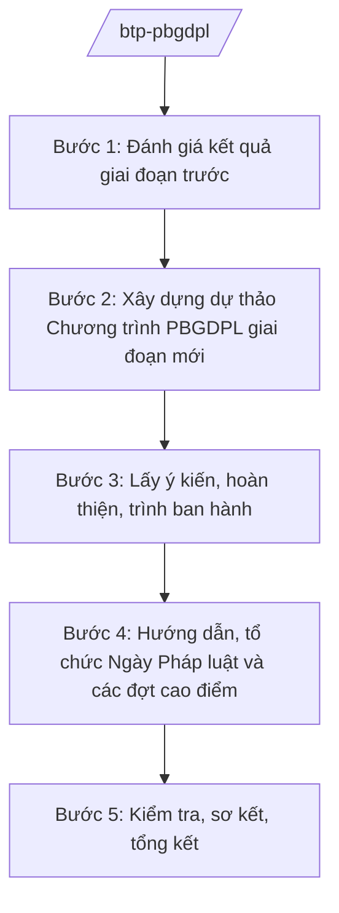

# Skill: PBGDPL toàn quốc

## 2. Khi nào dùng
Khi xây dựng Chương trình PBGDPL giai đoạn hằng năm/5 năm; khi triển khai Ngày Pháp luật Việt Nam (09/11); khi hướng dẫn, kiểm tra công tác PBGDPL của bộ, ngành, địa phương.

## 3. Đầu vào (Input)

| Trường | Mô tả | Bắt buộc |
|--------|-------|----------|
| `giai_doan` | Năm hoặc giai đoạn chương trình | Có |
| `muc_tieu` | Mục tiêu, chỉ tiêu chương trình | Có |
| `doi_tuong_uu_tien` | Nhóm đối tượng ưu tiên (đồng bào DTTS, học sinh, doanh nghiệp...) | Có |
| `kinh_phi` | Nguồn kinh phí thực hiện | Không |
| `bao_cao_dia_phuong` | Báo cáo PBGDPL của các tỉnh/thành | Không |

## 4. Quy trình

**Bước 1. Đánh giá kết quả giai đoạn trước**
- Làm gì: Tổng hợp báo cáo của bộ, ngành, địa phương; đánh giá chỉ tiêu đạt/chưa đạt; xác định bài học.
- Dùng input: `bao_cao_dia_phuong`.
- Vai trò: Chuyên viên Vụ PBGDPL — AI hỗ trợ tổng hợp số liệu 63 tỉnh/thành, vẽ biểu đồ so sánh (2–3 ngày).
- Lưu ý nghiệp vụ: Số liệu do địa phương báo cáo — cần kiểm tra tính hợp lý, kiểm tra ngẫu nhiên đối chiếu.
- → Kết quả bước: Báo cáo đánh giá giai đoạn trước.

**Bước 2. Xây dựng dự thảo Chương trình PBGDPL giai đoạn mới**
- Làm gì: Xác định mục tiêu, nhiệm vụ, giải pháp, phân công trách nhiệm bộ/ngành/địa phương; dự toán kinh phí.
- Dùng input: `giai_doan`, `muc_tieu`, `doi_tuong_uu_tien`, kết quả bước 1.
- Vai trò: Vụ trưởng Vụ PBGDPL chủ trì — AI hỗ trợ soạn khung chương trình, rà soát tính khả thi của chỉ tiêu (3–5 ngày).
- Lưu ý nghiệp vụ: Gắn với chuyển đổi số (PBGDPL trên môi trường điện tử, mạng xã hội); lồng ghép vào các chương trình MTQG.
- → Kết quả bước: Dự thảo Chương trình PBGDPL.

**Bước 3. Lấy ý kiến, hoàn thiện, trình ban hành**
- Làm gì: Lấy ý kiến bộ, ngành, địa phương; hoàn thiện; trình Thủ tướng Chính phủ phê duyệt (đối với chương trình quốc gia).
- Dùng input: Dự thảo chương trình.
- Vai trò: Thứ trưởng phụ trách ký Tờ trình — AI hỗ trợ tổng hợp ý kiến, soạn báo cáo tiếp thu (2–3 ngày).
- Lưu ý nghiệp vụ: Chương trình quốc gia do Thủ tướng phê duyệt; chương trình của Bộ do Bộ trưởng ban hành.
- → Kết quả bước: Quyết định phê duyệt Chương trình PBGDPL.

**Bước 4. Hướng dẫn, tổ chức Ngày Pháp luật và các đợt cao điểm**
- Làm gì: Ban hành văn bản hướng dẫn triển khai; tổ chức Ngày Pháp luật Việt Nam 09/11; các đợt PBGDPL chuyên đề.
- Dùng input: Chương trình đã phê duyệt.
- Vai trò: Chuyên viên Vụ PBGDPL — AI hỗ trợ soạn tài liệu tuyên truyền mẫu, bộ câu hỏi thi tìm hiểu pháp luật (2–3 ngày).
- Lưu ý nghiệp vụ: Nội dung phải thiết thực, gắn với vấn đề người dân quan tâm (đất đai, hôn nhân gia đình, an toàn giao thông...).
- → Kết quả bước: Kế hoạch Ngày Pháp luật + bộ tài liệu tuyên truyền.

**Bước 5. Kiểm tra, sơ kết, tổng kết**
- Làm gì: Kiểm tra việc thực hiện tại bộ, ngành, địa phương; sơ kết hằng năm, tổng kết giai đoạn; đề xuất khen thưởng.
- Dùng input: Báo cáo thực hiện của các đơn vị.
- Vai trò: Đoàn kiểm tra của Bộ — AI hỗ trợ lập đề cương kiểm tra, tổng hợp báo cáo sơ kết/tổng kết (3–5 ngày).
- Lưu ý nghiệp vụ: Đánh giá thực chất, tránh hình thức; nhân rộng mô hình hay.
- → Kết quả bước: Báo cáo sơ kết/tổng kết Chương trình.

## Luồng quy trình (Workflow)

## 5. Đầu ra (Output)
- Báo cáo đánh giá giai đoạn trước
- **Chương trình PBGDPL** (dự thảo + quyết định phê duyệt)
- Văn bản hướng dẫn triển khai; Kế hoạch Ngày Pháp luật Việt Nam
- Bộ tài liệu tuyên truyền mẫu
- Báo cáo sơ kết/tổng kết

### Cấu trúc output chuẩn (thể thức NĐ 30/2020/NĐ-CP)
Quyết định phê duyệt Chương trình PBGDPL gồm:
1. Quốc hiệu "CỘNG HÒA XÃ HỘI CHỦ NGHĨA VIỆT NAM", Tiêu ngữ "Độc lập – Tự do – Hạnh phúc"; số, ký hiệu; tên quyết định; căn cứ pháp lý
2. Điều 1. Phê duyệt Chương trình (kèm theo Chương trình)
3. Điều 2. Tổ chức thực hiện (phân công bộ, ngành, địa phương; kinh phí)
4. Điều 3. Hiệu lực thi hành
5. Nơi nhận (kết thúc "- Lưu: VT, [mã đơn vị]."), chữ ký (ghi rõ chức danh, họ tên người ký; ký hiệu "KT."/"TL." khi ký thay) (Thủ tướng Chính phủ / Bộ trưởng Bộ Tư pháp tùy cấp ban hành)
Phụ lục: Chương trình PBGDPL (mục tiêu, nhiệm vụ, giải pháp, lộ trình, kinh phí)
## 6. Checklist nghiệm thu
- [ ] Mục tiêu, chỉ tiêu cụ thể, đo đếm được
- [ ] Phân công trách nhiệm rõ từng bộ/ngành/địa phương
- [ ] Có nội dung PBGDPL trên môi trường điện tử
- [ ] Kinh phí và nguồn kinh phí rõ ràng
- [ ] Đã lấy ý kiến các bên liên quan
- [ ] Thể thức đúng NĐ 30/2020/NĐ-CP
- [ ] Human gate đầy đủ

## 7. Ví dụ mô phỏng
*Dữ liệu dưới đây là giả lập 100% phục vụ minh họa.*

**Input mẫu:** Chương trình PBGDPL giai đoạn 2026–2030; mục tiêu: 100% xã có tủ sách pháp luật điện tử; đối tượng ưu tiên: đồng bào DTTS, thanh thiếu niên, doanh nghiệp nhỏ.

**Output mẫu (trích Chương trình):**
> **CHƯƠNG TRÌNH PHỔ BIẾN, GIÁO DỤC PHÁP LUẬT GIAI ĐOẠN 2026–2030**
> I. MỤC TIÊU
> 1. 100% đơn vị cấp xã duy trì tủ sách pháp luật (bản giấy hoặc điện tử)...
> II. NHIỆM VỤ VÀ GIẢI PHÁP
> 1. Đẩy mạnh PBGDPL trên môi trường điện tử: xây dựng chuyên mục pháp luật trên Cổng TTĐT Chính phủ và các bộ, ngành...
> *(số liệu minh họa, không phải số liệu thật)*

## 8. Human gate
Chuyên viên Vụ PBGDPL soạn → Vụ trưởng Vụ PBGDPL kiểm tra → Thứ trưởng phụ trách cho ý kiến → **Bộ trưởng Bộ Tư pháp ký** Tờ trình → **Thủ tướng Chính phủ phê duyệt** (chương trình quốc gia).

## 9. Giới hạn
- AI không tự quyết định mục tiêu, chỉ tiêu chính sách; không bịa số liệu đánh giá.
- Không phát hành văn bản; mọi tài liệu tuyên truyền phải qua kiểm duyệt nội dung.
- Nội dung PBGDPL phải chính xác theo văn bản pháp luật hiện hành.

## 10. Căn cứ & lưu ý
- Nghị định 39/2025/NĐ-CP ngày 26/02/2025 của Chính phủ — chức năng, nhiệm vụ, quyền hạn của Bộ Tư pháp (quản lý nhà nước về PBGDPL).
- Nghị quyết 176/2025/QH15 của Quốc hội — cơ cấu tổ chức của Chính phủ.
- Luật Phổ biến, giáo dục pháp luật (tên luật, không ghi số hiệu).
- Nghị định 30/2020/NĐ-CP — thể thức văn bản.
