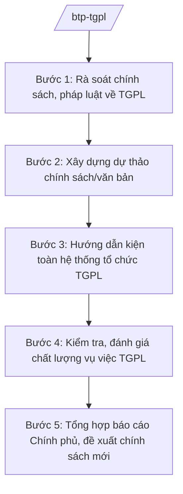

# Skill: Trợ giúp pháp lý (chính sách, hệ thống)

## 2. Khi nào dùng
Khi xây dựng chính sách TGPL; khi kiện toàn hệ thống Trung tâm TGPL nhà nước, chi nhánh, tổ chức tham gia TGPL; khi kiểm tra, đánh giá chất lượng vụ việc TGPL; khi triển khai TGPL trên môi trường điện tử.

## 3. Đầu vào (Input)

| Trường | Mô tả | Bắt buộc |
|--------|-------|----------|
| `noi_dung_chinh_sach` | Chính sách TGPL cần xây dựng/sửa đổi | Có |
| `doi_tuong_tgpl` | Nhóm đối tượng được TGPL (người nghèo, trẻ em, người DTTS...) | Có |
| `he_thong_hien_tai` | Thực trạng hệ thống Trung tâm TGPL các tỉnh | Không |
| `bao_cao_chat_luong` | Báo cáo chất lượng vụ việc TGPL | Không |

## 4. Quy trình

**Bước 1. Rà soát chính sách, pháp luật về TGPL**
- Làm gì: Đánh giá thực trạng thi hành chính sách TGPL; xác định khoảng trống (đối tượng chưa được bao phủ, thủ tục còn rườm rà).
- Dùng input: `noi_dung_chinh_sach`, `bao_cao_chat_luong`.
- Vai trò: Chuyên viên Cục Trợ giúp pháp lý — AI hỗ trợ tổng hợp báo cáo 63 tỉnh/thành, phân tích khoảng trống chính sách (3–5 ngày).
- Lưu ý nghiệp vụ: Đối chiếu với chuẩn mực quốc tế về tiếp cận công lý mà Việt Nam cam kết.
- → Kết quả bước: Báo cáo rà soát chính sách TGPL.

**Bước 2. Xây dựng dự thảo chính sách/văn bản**
- Làm gì: Soạn dự thảo văn bản (thông tư, đề án) về TGPL: mở rộng đối tượng, đơn giản thủ tục, TGPL điện tử.
- Dùng input: Kết quả bước 1; `doi_tuong_tgpl`.
- Vai trò: Cục trưởng Cục Trợ giúp pháp lý chủ trì — AI hỗ trợ soạn dự thảo, kiểm tra kỹ thuật văn bản (3–5 ngày).
- Lưu ý nghiệp vụ: Thủ tục yêu cầu TGPL phải đơn giản, có thể thực hiện trực tuyến; bảo đảm kinh phí chi trả cho người thực hiện TGPL.
- → Kết quả bước: Dự thảo văn bản/đề án TGPL.

**Bước 3. Hướng dẫn kiện toàn hệ thống tổ chức TGPL**
- Làm gì: Hướng dẫn Sở Tư pháp kiện toàn Trung tâm TGPL nhà nước cấp tỉnh, chi nhánh; quản lý tổ chức đăng ký tham gia TGPL (văn phòng luật sư, tổ chức tư vấn).
- Dùng input: `he_thong_hien_tai`.
- Vai trò: Chuyên viên Cục Trợ giúp pháp lý — AI hỗ trợ soạn văn bản hướng dẫn, mẫu báo cáo của địa phương (2–3 ngày).
- Lưu ý nghiệp vụ: Bảo đảm mỗi tỉnh có ít nhất một Trung tâm TGPL hoạt động hiệu quả; phát triển mạng lưới cộng tác viên.
- → Kết quả bước: Văn bản hướng dẫn kiện toàn hệ thống.

**Bước 4. Kiểm tra, đánh giá chất lượng vụ việc TGPL**
- Làm gì: Kiểm tra định kỳ/chuyên đề tại các Trung tâm; đánh giá chất lượng vụ việc (hồ sơ, quy trình, sự hài lòng của người được TGPL).
- Dùng input: `bao_cao_chat_luong`.
- Vai trò: Đoàn kiểm tra của Cục — AI hỗ trợ lập bộ tiêu chí đánh giá, tổng hợp kết quả kiểm tra (3–5 ngày).
- Lưu ý nghiệp vụ: Kiểm tra thực chất hồ sơ vụ việc, phỏng vấn người được TGPL; xử lý vi phạm đạo đức nghề nghiệp.
- → Kết quả bước: Báo cáo kiểm tra, đánh giá chất lượng.

**Bước 5. Tổng hợp báo cáo Chính phủ, đề xuất chính sách mới**
- Làm gì: Tổng hợp báo cáo công tác TGPL toàn quốc hằng năm; đề xuất sửa đổi chính sách.
- Dùng input: Kết quả các bước trên.
- Vai trò: Cục trưởng Cục Trợ giúp pháp lý ký báo cáo — AI hỗ trợ tổng hợp số liệu, soạn báo cáo (2–3 ngày).
- Lưu ý nghiệp vụ: Số liệu vụ việc TGPL phải phân loại theo đối tượng, lĩnh vực, hình thức thực hiện.
- → Kết quả bước: Báo cáo công tác TGPL toàn quốc.

## Luồng quy trình (Workflow)

## 5. Đầu ra (Output)
- Báo cáo rà soát chính sách TGPL
- Dự thảo văn bản/đề án về TGPL
- Văn bản hướng dẫn kiện toàn hệ thống TGPL
- Báo cáo kiểm tra, đánh giá chất lượng vụ việc
- Báo cáo công tác TGPL toàn quốc

### Cấu trúc output chuẩn (thể thức NĐ 30/2020/NĐ-CP)
Báo cáo công tác TGPL toàn quốc gồm:
1. Quốc hiệu "CỘNG HÒA XÃ HỘI CHỦ NGHĨA VIỆT NAM", Tiêu ngữ "Độc lập – Tự do – Hạnh phúc"; tên báo cáo; kính gửi: Chính phủ
2. Tình hình chung (hệ thống tổ chức, đội ngũ)
3. Kết quả thực hiện (số vụ việc theo đối tượng/lĩnh vực/hình thức — số liệu minh họa)
4. Đánh giá chất lượng vụ việc
5. Khó khăn, vướng mắc
6. Kiến nghị, đề xuất
7. Nơi nhận (kết thúc "- Lưu: VT, [mã đơn vị]."), chữ ký (ghi rõ chức danh, họ tên người ký; ký hiệu "KT."/"TL." khi ký thay) (Bộ trưởng Bộ Tư pháp)

> **Checklist thể thức văn bản theo NĐ 30/2020/NĐ-CP** — đối chiếu trước khi trình ký:
> 1. Quốc hiệu và Tiêu ngữ.
> 2. Tên cơ quan, tổ chức ban hành văn bản.
> 3. Số, ký hiệu của văn bản.
> 4. Địa danh và thời gian ban hành văn bản.
> 5. Tên loại và trích yếu nội dung văn bản.
> 6. Nội dung văn bản.
> 7. Chức vụ, họ tên và chữ ký của người có thẩm quyền.
> 8. Dấu, chữ ký số của cơ quan, tổ chức.
> 9. Nơi nhận (kèm Phụ lục nếu có).

## 6. Checklist nghiệm thu
- [ ] Đối tượng TGPL xác định đúng, không bỏ sót nhóm yếu thế
- [ ] Thủ tục đơn giản, có phương án thực hiện trực tuyến
- [ ] Hệ thống tổ chức bao phủ 63 tỉnh/thành
- [ ] Bộ tiêu chí đánh giá chất lượng rõ ràng
- [ ] Số liệu báo cáo có phân loại, có nguồn
- [ ] Thể thức đúng NĐ 30/2020/NĐ-CP
- [ ] Human gate đầy đủ

## 7. Ví dụ mô phỏng
*Dữ liệu dưới đây là giả lập 100% phục vụ minh họa.*

**Input mẫu:** Đề án "Trợ giúp pháp lý trên môi trường điện tử giai đoạn 2026–2030"; đối tượng: người nghèo, người DTTS, trẻ em, nạn nhân bạo lực gia đình.

**Output mẫu (trích Đề án):**
> **ĐỀ ÁN TRỢ GIÚP PHÁP LÝ TRÊN MÔI TRƯỜNG ĐIỆN TỬ GIAI ĐOẠN 2026–2030**
> I. MỤC TIÊU: 100% Trung tâm TGPL nhà nước tiếp nhận yêu cầu TGPL trực tuyến; rút ngắn thời gian thụ lý xuống còn 3 ngày làm việc...
> II. NHIỆM VỤ: 1. Xây dựng Cổng thông tin TGPL quốc gia... 2. Số hóa quy trình cử người thực hiện TGPL...
> *(số liệu minh họa, không phải số liệu thật)*

## 8. Human gate
Chuyên viên Cục Trợ giúp pháp lý soạn → Cục trưởng Cục Trợ giúp pháp lý kiểm tra → Thứ trưởng phụ trách cho ý kiến → **Bộ trưởng Bộ Tư pháp ký** văn bản/báo cáo.

## 9. Giới hạn
- AI không quyết định chính sách TGPL; không tự ý mở rộng/thu hẹp đối tượng.
- Không tiếp cận thông tin cá nhân của người được TGPL ngoài phạm vi tổng hợp số liệu.
- Không bịa số liệu vụ việc, chất lượng.

## 10. Căn cứ & lưu ý
- Nghị định 39/2025/NĐ-CP ngày 26/02/2025 của Chính phủ — chức năng, nhiệm vụ, quyền hạn của Bộ Tư pháp (quản lý nhà nước về trợ giúp pháp lý).
- Nghị quyết 176/2025/QH15 của Quốc hội — cơ cấu tổ chức của Chính phủ.
- Luật Trợ giúp pháp lý (tên luật, không ghi số hiệu).
- Nghị định 30/2020/NĐ-CP — thể thức văn bản.
