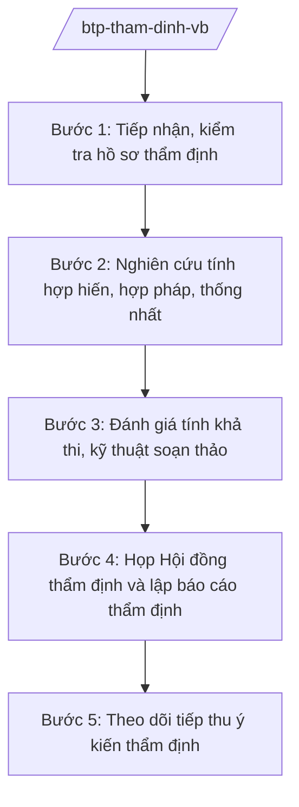

# Skill: Thẩm định dự thảo VBQPPL (cấp bộ)

## 2. Khi nào dùng
Khi bộ, cơ quan ngang bộ gửi dự thảo VBQPPL (nghị định, quyết định của Thủ tướng, thông tư liên tịch có Bộ Tư pháp tham gia...) đề nghị Bộ Tư pháp thẩm định trước khi trình Chính phủ/Thủ tướng ban hành.

## 3. Đầu vào (Input)

| Trường | Mô tả | Bắt buộc |
|--------|-------|----------|
| `du_thao` | Dự thảo VBQPPL cần thẩm định | Có |
| `to_trinh` | Tờ trình của cơ quan chủ trì soạn thảo | Có |
| `bao_cao_tac_dong` | Báo cáo đánh giá tác động (nếu thuộc diện) | Có |
| `tong_hop_y_kien` | Báo cáo tổng hợp, tiếp thu ý kiến | Có |
| `co_so_phap_ly` | Căn cứ pháp lý được viện dẫn trong dự thảo | Có |

## 4. Quy trình

**Bước 1. Tiếp nhận, kiểm tra hồ sơ thẩm định**
- Làm gì: Kiểm tra tính đầy đủ của hồ sơ gửi thẩm định; từ chối bổ sung nếu thiếu thành phần.
- Dùng input: Toàn bộ hồ sơ (`du_thao`, `to_trinh`, `bao_cao_tac_dong`, `tong_hop_y_kien`).
- Vai trò: Chuyên viên Vụ Pháp luật — AI hỗ trợ lập danh mục kiểm tra hồ sơ (checklist), đối chiếu thành phần (0,5 ngày).
- Lưu ý nghiệp vụ: Hồ sơ thiếu → trả lại, không thẩm định "khuyết".
- → Kết quả bước: Biên bản tiếp nhận hoặc văn bản yêu cầu bổ sung.

**Bước 2. Nghiên cứu tính hợp hiến, hợp pháp, thống nhất**
- Làm gì: Đối chiếu từng điều khoản với Hiến pháp, luật, văn bản cấp trên; phát hiện chồng chéo, mâu thuẫn với VBQPPL hiện hành.
- Dùng input: `du_thao`, `co_so_phap_ly`.
- Vai trò: Chuyên viên Vụ Pháp luật — AI hỗ trợ tra cứu, đối chiếu văn bản liên quan, đánh dấu điều khoản có nguy cơ mâu thuẫn (2–3 ngày).
- Lưu ý nghiệp vụ: Thẩm quyền ban hành: văn bản của Chính phủ không được trái luật; thông tư không được quy định vấn đề thuộc thẩm quyền Chính phủ.
- → Kết quả bước: Bảng phân tích tính hợp hiến, hợp pháp theo từng điều.

**Bước 3. Đánh giá tính khả thi, kỹ thuật soạn thảo**
- Làm gì: Đánh giá khả năng thực thi (nguồn lực, thủ tục, thời gian chuyển tiếp); kiểm tra kỹ thuật lập pháp, ngôn ngữ.
- Dùng input: `bao_cao_tac_dong`, `du_thao`.
- Vai trò: Chuyên viên Vụ Pháp luật — AI hỗ trợ rà lỗi kỹ thuật: thuật ngữ không thống nhất, dẫn chiếu sai, thể thức (1–2 ngày).
- Lưu ý nghiệp vụ: Điều khoản chuyển tiếp phải rõ; tránh quy định "xin – cho" tạo cơ chế xin phép không cần thiết.
- → Kết quả bước: Nhận xét về tính khả thi và kỹ thuật.

**Bước 4. Họp Hội đồng thẩm định và lập báo cáo thẩm định**
- Làm gì: Tổ chức họp thẩm định (mời cơ quan chủ trì soạn thảo giải trình); lập Báo cáo thẩm định với kết luận: đủ điều kiện trình / cần chỉnh sửa / chưa đủ điều kiện.
- Dùng input: Kết quả bước 2, 3; ý kiến giải trình của cơ quan chủ trì.
- Vai trò: Vụ trưởng Vụ Pháp luật chủ trì họp — AI hỗ trợ soạn dự thảo báo cáo thẩm định theo mẫu (1–2 ngày).
- Lưu ý nghiệp vụ: Báo cáo thẩm định là căn cứ bắt buộc trong hồ sơ trình Chính phủ; ý kiến thẩm định phải rõ "đồng ý có điều kiện" kèm điều kiện cụ thể.
- → Kết quả bước: Báo cáo thẩm định (Bộ Tư pháp ký).

**Bước 5. Theo dõi tiếp thu ý kiến thẩm định**
- Làm gì: Đôn đốc cơ quan chủ trì tiếp thu; kiểm tra dự thảo sau chỉnh sửa trước khi trình Chính phủ.
- Dùng input: Dự thảo chỉnh sửa; báo cáo giải trình tiếp thu.
- Vai trò: Chuyên viên Vụ Pháp luật — AI hỗ trợ đối chiếu dự thảo mới với các yêu cầu trong báo cáo thẩm định (1 ngày).
- Lưu ý nghiệp vụ: Nếu cơ quan chủ trì không tiếp thu ý kiến quan trọng về tính hợp pháp → báo cáo Lãnh đạo Bộ có ý kiến với Chính phủ.
- → Kết quả bước: Xác nhận hoàn thành tiếp thu / văn bản báo cáo Lãnh đạo Bộ.

## Luồng quy trình (Workflow)

## 5. Đầu ra (Output)
- Biên bản tiếp nhận hồ sơ thẩm định
- **Báo cáo thẩm định** dự thảo VBQPPL
- Văn bản xác nhận tiếp thu ý kiến thẩm định

### Cấu trúc output chuẩn (thể thức NĐ 30/2020/NĐ-CP)
Báo cáo thẩm định gồm:
1. Quốc hiệu "CỘNG HÒA XÃ HỘI CHỦ NGHĨA VIỆT NAM", Tiêu ngữ "Độc lập – Tự do – Hạnh phúc"; tên báo cáo; kính gửi: cơ quan chủ trì soạn thảo
2. Hồ sơ gửi thẩm định (thành phần, thời gian)
3. Ý kiến về sự cần thiết ban hành
4. Ý kiến về tính hợp hiến, hợp pháp, thống nhất của dự thảo
5. Ý kiến về tính khả thi
6. Ý kiến về kỹ thuật soạn thảo, ngôn ngữ
7. Kết luận: đủ điều kiện trình / cần hoàn thiện thêm (nêu cụ thể)
8. Nơi nhận (kết thúc "- Lưu: VT, [mã đơn vị]."), chữ ký (ghi rõ chức danh, họ tên người ký; ký hiệu "KT."/"TL." khi ký thay) (Thứ trưởng Bộ Tư pháp phụ trách)
## 6. Checklist nghiệm thu
- [ ] Hồ sơ gửi thẩm định đầy đủ thành phần
- [ ] Đã đối chiếu tính hợp hiến, hợp pháp từng điều khoản trọng yếu
- [ ] Đã đánh giá tính khả thi và điều khoản chuyển tiếp
- [ ] Đã họp thẩm định có sự tham gia của cơ quan chủ trì
- [ ] Kết luận rõ ràng, có điều kiện cụ thể (nếu có)
- [ ] Thể thức đúng NĐ 30/2020/NĐ-CP
- [ ] Human gate đầy đủ

## 7. Ví dụ mô phỏng
*Dữ liệu dưới đây là giả lập 100% phục vụ minh họa.*

**Input mẫu:** Dự thảo Nghị định quy định chi tiết thi hành Luật Công chứng (sửa đổi) do Bộ Tư pháp chủ trì soạn thảo, gửi Vụ Pháp luật thẩm định nội bộ trước khi trình Chính phủ; kèm Tờ trình, báo cáo đánh giá tác động, báo cáo tổng hợp ý kiến 20 bộ/ngành/địa phương.

**Output mẫu (trích Báo cáo thẩm định):**
> **BÁO CÁO THẨM ĐỊNH**
> Dự thảo Nghị định quy định chi tiết thi hành Luật Công chứng (sửa đổi)
> 4. Về tính hợp pháp: Điều 12 dự thảo quy định mức phí công chứng cụ thể — nội dung này thuộc thẩm quyền của Bộ Tài chính quy định về phí, lệ phí; đề nghị chuyển thành nguyên tắc hoặc phối hợp lấy ý kiến Bộ Tài chính...
> 7. Kết luận: Dự thảo đủ điều kiện trình Chính phủ sau khi tiếp thu các ý kiến tại mục 4, 5, 6 của Báo cáo này.

## 8. Human gate
Chuyên viên Vụ Pháp luật nghiên cứu → Vụ trưởng Vụ Pháp luật chủ trì họp thẩm định → **Thứ trưởng Bộ Tư pháp ký** Báo cáo thẩm định.

## 9. Giới hạn
- AI không thay Hội đồng thẩm định kết luận về tính hợp pháp; chỉ hỗ trợ tra cứu, đối chiếu, soạn dự thảo.
- Không bịa căn cứ pháp lý khi đối chiếu; mọi nhận xét mâu thuẫn phải dẫn đúng điều/khoản văn bản hiện hành.
- Không dùng văn bản đã hết hiệu lực để đối chiếu.

## 10. Căn cứ & lưu ý
- Nghị định 39/2025/NĐ-CP ngày 26/02/2025 của Chính phủ — chức năng, nhiệm vụ, quyền hạn của Bộ Tư pháp (thẩm định dự thảo VBQPPL).
- Nghị định 303/2025/NĐ-CP của Chính phủ — khung chung chức năng bộ, cơ quan ngang bộ.
- Luật Ban hành văn bản quy phạm pháp luật (tên luật, không ghi số hiệu).
- Nghị định 30/2020/NĐ-CP — thể thức văn bản.
