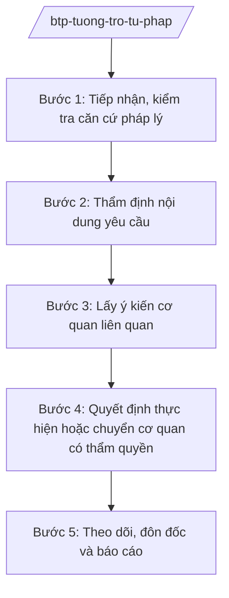

# Skill: Tương trợ tư pháp quốc tế

## 2. Khi nào dùng
Khi tiếp nhận yêu cầu tương trợ tư pháp từ nước ngoài hoặc lập yêu cầu gửi ra nước ngoài: ủy thác tư pháp (tống đạt giấy tờ, thu thập chứng cứ), dẫn độ, chuyển giao người đang chấp hành án phạt tù, công nhận bản án dân sự.

## 3. Đầu vào (Input)

| Trường | Mô tả | Bắt buộc |
|--------|-------|----------|
| `loai_yeu_cau` | Ủy thác tư pháp / dẫn độ / chuyển giao người chấp hành án / công nhận bản án | Có |
| `nuoc_lien_quan` | Quốc gia gửi/nhận yêu cầu | Có |
| `dieu_uoc_ap_dung` | Hiệp định TTTP song phương / đa phương áp dụng | Có |
| `ho_so` | Hồ sơ yêu cầu (bản dịch, tài liệu kèm theo) | Có |
| `y_kien_co_quan_lien_quan` | Ý kiến Bộ Công an, TANDTC, VKSNDTC (tùy loại) | Không |

## 4. Quy trình

**Bước 1. Tiếp nhận, kiểm tra căn cứ pháp lý**
- Làm gì: Kiểm tra hiệp định TTTP giữa Việt Nam và nước liên quan; xác định cơ quan trung ương có thẩm quyền; kiểm tra tính đầy đủ của hồ sơ.
- Dùng input: `loai_yeu_cau`, `nuoc_lien_quan`, `dieu_uoc_ap_dung`, `ho_so`.
- Vai trò: Chuyên viên Cục Tương trợ tư pháp — AI hỗ trợ tra cứu hiệp định song phương, lập danh mục kiểm tra hồ sơ (⏱ 1–2 ngày).
- Lưu ý nghiệp vụ: Nếu chưa có hiệp định → áp dụng nguyên tắc có đi có lại (cần xác nhận của Bộ Ngoại giao).
- → Kết quả bước: Xác nhận thụ lý hoặc yêu cầu bổ sung hồ sơ.

**Bước 2. Thẩm định nội dung yêu cầu**
- Làm gì: Đánh giá yêu cầu có phù hợp pháp luật Việt Nam, không xâm phạm chủ quyền, an ninh quốc gia, trật tự công cộng.
- Dùng input: Hồ sơ yêu cầu.
- Vai trò: Chuyên viên Cục Tương trợ tư pháp — AI hỗ trợ dịch thuật, tóm tắt hồ sơ nước ngoài (⏱ 2–3 ngày).
- Lưu ý nghiệp vụ: Từ chối tương trợ nếu: yêu cầu liên quan tội phạm chính trị/quân sự thuần túy; người bị yêu cầu là công dân Việt Nam (đối với dẫn độ ra nước ngoài — Việt Nam không dẫn độ công dân mình).
- → Kết quả bước: Báo cáo thẩm định yêu cầu TTTP.

**Bước 3. Lấy ý kiến cơ quan liên quan**
- Làm gì: Gửi lấy ý kiến Bộ Công an (dẫn độ, chuyển giao phạm nhân), TANDTC, VKSNDTC (ủy thác tư pháp trong tố tụng).
- Dùng input: Báo cáo thẩm định.
- Vai trò: Cục trưởng Cục Tương trợ tư pháp ký văn bản lấy ý kiến — AI hỗ trợ soạn công văn, tổng hợp ý kiến (⏱ 3–5 ngày).
- Lưu ý nghiệp vụ: Đối với dẫn độ: phải có quyết định của Tòa án về việc dẫn độ.
- → Kết quả bước: Tổng hợp ý kiến cơ quan liên quan.

**Bước 4. Quyết định thực hiện hoặc chuyển cơ quan có thẩm quyền**
- Làm gì: Ban hành quyết định thực hiện ủy thác tư pháp; hoặc chuyển hồ sơ cho TANDTC/VKSNDTC/Bộ Công an thực hiện theo thẩm quyền; hoặc lập yêu cầu TTTP gửi ra nước ngoài.
- Dùng input: Kết quả bước 2, 3.
- Vai trò: Thứ trưởng/Bộ trưởng Bộ Tư pháp ký — AI hỗ trợ soạn quyết định/văn bản yêu cầu theo mẫu hiệp định (⏱ 1–2 ngày).
- Lưu ý nghiệp vụ: Văn bản gửi ra nước ngoài phải dịch sang ngôn ngữ theo hiệp định; tuân thủ thời hạn của hiệp định.
- → Kết quả bước: Quyết định thực hiện / yêu cầu TTTP gửi nước ngoài.

**Bước 5. Theo dõi, đôn đốc và báo cáo**
- Làm gì: Theo dõi tiến độ thực hiện; đôn đốc cơ quan trong nước; trao đổi với phía nước ngoài; tổng hợp báo cáo.
- Dùng input: Kết quả thực hiện các yêu cầu.
- Vai trò: Chuyên viên Cục Tương trợ tư pháp — AI hỗ trợ cập nhật cơ sở dữ liệu TTTP, lập báo cáo định kỳ ⏱ ~liên tục trong quá trình thực hiện (ước tính).
- Lưu ý nghiệp vụ: Bảo mật thông tin vụ việc; chỉ trao đổi qua kênh cơ quan trung ương.
- → Kết quả bước: Báo cáo công tác TTTP.

## Luồng quy trình (Workflow)

## 5. Đầu ra (Output)
- Báo cáo thẩm định yêu cầu tương trợ tư pháp
- Quyết định thực hiện ủy thác tư pháp / Văn bản từ chối có lý do
- Yêu cầu TTTP gửi ra nước ngoài (kèm bản dịch)
- Báo cáo công tác TTTP định kỳ

### Cấu trúc output chuẩn (thể thức NĐ 30/2020/NĐ-CP)
Quyết định thực hiện ủy thác tư pháp gồm:
1. Quốc hiệu "CỘNG HÒA XÃ HỘI CHỦ NGHĨA VIỆT NAM", Tiêu ngữ "Độc lập – Tự do – Hạnh phúc"; số, ký hiệu; tên quyết định
2. Căn cứ (hiệp định TTTP, luật TTTP — nêu tên)
3. Nội dung ủy thác được thực hiện (tống đạt/thu thập chứng cứ...)
4. Cơ quan thực hiện trong nước; thời hạn
5. Hiệu lực; nơi nhận (kết thúc "- Lưu: VT, [mã đơn vị]."); chữ ký (ghi rõ chức danh, họ tên người ký; ký hiệu "KT."/"TL." khi ký thay) (Thứ trưởng/Bộ trưởng Bộ Tư pháp)

> **Checklist thể thức văn bản theo NĐ 30/2020/NĐ-CP** — đối chiếu trước khi trình ký:
> 1. Quốc hiệu và Tiêu ngữ.
> 2. Tên cơ quan, tổ chức ban hành văn bản.
> 3. Số, ký hiệu của văn bản.
> 4. Địa danh và thời gian ban hành văn bản.
> 5. Tên loại và trích yếu nội dung văn bản.
> 6. Nội dung văn bản.
> 7. Chức vụ, họ tên và chữ ký của người có thẩm quyền.
> 8. Dấu, chữ ký số của cơ quan, tổ chức.
> 9. Nơi nhận (kèm Phụ lục nếu có).

## 6. Checklist nghiệm thu
- [ ] Đã xác định đúng hiệp định áp dụng / nguyên tắc có đi có lại
- [ ] Hồ sơ đầy đủ, bản dịch hợp lệ
- [ ] Đã đánh giá không xâm phạm chủ quyền, an ninh quốc gia
- [ ] Đã lấy ý kiến cơ quan liên quan (đúng loại việc)
- [ ] Tuân thủ thời hạn của hiệp định
- [ ] Bảo mật thông tin vụ việc
- [ ] Thể thức đúng NĐ 30/2020/NĐ-CP; human gate đầy đủ

## 7. Ví dụ mô phỏng
*Dữ liệu dưới đây là giả lập 100% phục vụ minh họa.*

**Input mẫu:** Yêu cầu ủy thác tư pháp từ nước ngoài (giả lập: nước BB): tống đạt giấy triệu tập của Tòa án nước BB cho ông Nguyễn Văn AA (giả lập) đang cư trú tại Việt Nam; có Hiệp định TTTP song phương.

**Output mẫu (trích Quyết định):**
> **QUYẾT ĐỊNH Về việc thực hiện ủy thác tư pháp**
> 2. Căn cứ Hiệp định tương trợ tư pháp giữa Việt Nam và nước BB (giả lập)...
> 3. Thực hiện ủy thác: tống đạt giấy triệu tập cho ông Nguyễn Văn AA (giả lập, địa chỉ giả lập)...
> 4. Giao Sở Tư pháp tỉnh A phối hợp Tòa án nhân dân có thẩm quyền thực hiện trong 30 ngày.

## 8. Human gate
Chuyên viên Cục Tương trợ tư pháp thẩm định → Cục trưởng Cục Tương trợ tư pháp kiểm tra → **Thứ trưởng/Bộ trưởng Bộ Tư pháp ký** quyết định; vụ việc phức tạp báo cáo Thủ tướng.

## 9. Giới hạn
- AI không quyết định chấp nhận/từ chối yêu cầu TTTP; không đánh giá an ninh quốc gia.
- Tuyệt đối bảo mật thông tin vụ việc, nhân thân các bên; ví dụ chỉ dùng dữ liệu giả lập.
- Không liên hệ trực tiếp với cơ quan nước ngoài ngoài kênh chính thức.

## 10. Căn cứ & lưu ý
- Nghị định 39/2025/NĐ-CP ngày 26/02/2025 của Chính phủ — chức năng, nhiệm vụ, quyền hạn của Bộ Tư pháp (cơ quan trung ương về tương trợ tư pháp trong lĩnh vực dân sự).
- Luật Tương trợ tư pháp (nêu tên luật, không ghi số hiệu).
- Các hiệp định TTTP song phương/đa phương mà Việt Nam là thành viên (viện dẫn cụ thể theo từng vụ việc thực tế).
- Nghị định 30/2020/NĐ-CP — thể thức văn bản.
