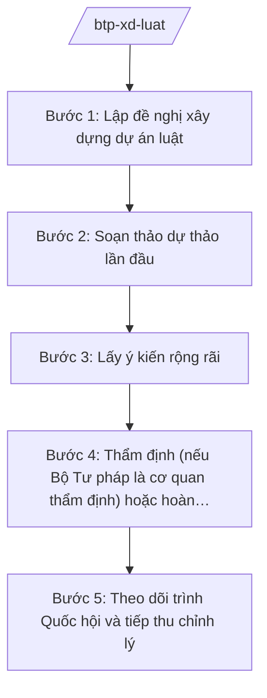

# Skill: Chủ trì soạn thảo, thẩm định luật, pháp lệnh

## 2. Khi nào dùng
Khi Bộ Tư pháp được giao chủ trì soạn thảo dự án luật, pháp lệnh, nghị quyết của Quốc hội/Ủy ban Thường vụ Quốc hội thuộc lĩnh vực tư pháp (hộ tịch, quốc tịch, công chứng, trợ giúp pháp lý, PBGDPL...), hoặc khi thẩm định dự án luật do bộ, ngành khác chủ trì.

## 3. Đầu vào (Input)

| Trường | Mô tả | Bắt buộc |
|--------|-------|----------|
| `ten_du_an` | Tên dự án luật/pháp lệnh | Có |
| `co_quan_chu_tri` | Bộ Tư pháp chủ trì hoặc phối hợp | Có |
| `chuong_trinh_xd` | Thuộc Chương trình xây dựng luật, pháp lệnh của Quốc hội | Có |
| `co_so_chinh_tri` | Nghị quyết, kết luận của Đảng; yêu cầu thực tiễn | Có |
| `du_thao_hien_hanh` | Văn bản hiện hành cần sửa đổi, thay thế (nếu có) | Không |
| `y_kien_bo_nganh` | Ý kiến tham gia của các bộ, ngành, địa phương | Không |

## 4. Quy trình

**Bước 1. Lập đề nghị xây dựng dự án luật**
- Làm gì: Soạn Tờ trình đề nghị xây dựng + Báo cáo đánh giá tác động chính sách (RIA) sơ bộ.
- Dùng input: `ten_du_an`, `co_so_chinh_tri`, `chuong_trinh_xd`.
- Vai trò: Chuyên viên Vụ Pháp luật — AI hỗ trợ rà soát tính tương thích với hệ thống pháp luật hiện hành, tổng hợp kinh nghiệm quốc tế (2–3 ngày).
- Lưu ý nghiệp vụ: Phải chứng minh sự cần thiết ban hành; đánh giá tác động thủ tục hành chính, ngân sách.
- → Kết quả bước: Hồ sơ đề nghị xây dựng dự án luật.

**Bước 2. Soạn thảo dự thảo lần đầu**
- Làm gì: Thành lập Ban soạn thảo/Tổ biên tập; xây dựng dự thảo 1 gồm tờ trình, dự thảo luật, thuyết minh chi tiết.
- Dùng input: Hồ sơ đề nghị đã được chấp thuận; `du_thao_hien_hanh`.
- Vai trò: Vụ trưởng Vụ Pháp luật chủ trì — AI hỗ trợ soạn khung điều khoản, kiểm tra kỹ thuật lập pháp (thuật ngữ, cấu trúc chương/điều) (5–7 ngày).
- Lưu ý nghiệp vụ: Tuân thủ kỹ thuật soạn thảo VBQPPL; mỗi chính sách phải có điều khoản tương ứng.
- → Kết quả bước: Dự thảo 1 kèm thuyết minh.

**Bước 3. Lấy ý kiến rộng rãi**
- Làm gì: Đăng tải lấy ý kiến trên Cổng TTĐT; gửi lấy ý kiến bộ, ngành, địa phương, đối tượng chịu tác động; tổ chức hội thảo.
- Dùng input: Dự thảo 1.
- Vai trò: Chuyên viên Vụ Pháp luật tổng hợp — AI hỗ trợ phân loại ý kiến theo điều khoản, lập bảng tổng hợp tiếp thu/giải trình (3–5 ngày).
- Lưu ý nghiệp vụ: Thời gian lấy ý kiến tối thiểu theo quy định; phải có báo cáo giải trình tiếp thu.
- → Kết quả bước: Báo cáo tổng hợp, tiếp thu ý kiến.

**Bước 4. Thẩm định (nếu Bộ Tư pháp là cơ quan thẩm định) hoặc hoàn thiện trình Chính phủ**
- Làm gì: Tổ chức thẩm định độc lập (Hội đồng thẩm định) hoặc hoàn thiện hồ sơ trình Chính phủ cho ý kiến.
- Dùng input: Dự thảo sau tiếp thu; báo cáo thẩm định (nếu có).
- Vai trò: Thứ trưởng phụ trách ký Tờ trình — AI hỗ trợ kiểm tra lần cuối: thể thức, chính tả, dẫn chiếu điều khoản (1–2 ngày).
- Lưu ý nghiệp vụ: Hồ sơ trình Chính phủ gồm: Tờ trình, dự thảo, báo cáo đánh giá tác động, báo cáo tổng hợp ý kiến, báo cáo thẩm định.
- → Kết quả bước: Hồ sơ dự án luật trình Chính phủ.

**Bước 5. Theo dõi trình Quốc hội và tiếp thu chỉnh lý**
- Làm gì: Phối hợp Ủy ban của Quốc hội thẩm tra; tiếp thu ý kiến đại biểu; chỉnh lý dự thảo qua các kỳ họp.
- Dùng input: Ý kiến thẩm tra, ý kiến đại biểu Quốc hội.
- Vai trò: Bộ trưởng/Lãnh đạo Bộ làm việc với cơ quan của Quốc hội — AI hỗ trợ soạn báo cáo giải trình tiếp thu từng đợt ⏱ ~theo tiến độ kỳ họp (ước tính).
- Lưu ý nghiệp vụ: Mọi chỉnh lý phải bảo đảm tính thống nhất với Hiến pháp và hệ thống pháp luật.
- → Kết quả bước: Dự thảo luật hoàn chỉnh trình Quốc hội thông qua.

## Luồng quy trình (Workflow)

## 5. Đầu ra (Output)
- Hồ sơ đề nghị xây dựng dự án luật
- Dự thảo luật/pháp lệnh + Tờ trình + Thuyết minh chi tiết
- Báo cáo đánh giá tác động chính sách
- Báo cáo tổng hợp, tiếp thu ý kiến
- Báo cáo thẩm định (nếu BTP là cơ quan thẩm định)

### Cấu trúc output chuẩn (thể thức NĐ 30/2020/NĐ-CP)
Tờ trình Chính phủ về dự án luật gồm:
1. Quốc hiệu "CỘNG HÒA XÃ HỘI CHỦ NGHĨA VIỆT NAM", Tiêu ngữ "Độc lập – Tự do – Hạnh phúc"; tên Tờ trình; kính gửi: Chính phủ
2. Sự cần thiết ban hành
3. Quan điểm, mục tiêu xây dựng
4. Quá trình soạn thảo (lấy ý kiến, thẩm định)
5. Bố cục và nội dung cơ bản của dự thảo
6. Những vấn đề còn ý kiến khác nhau
7. Kiến nghị Chính phủ xem xét, cho ý kiến
8. Nơi nhận (kết thúc "- Lưu: VT, [mã đơn vị]."), chữ ký (ghi rõ chức danh, họ tên người ký; ký hiệu "KT."/"TL." khi ký thay) (Bộ trưởng Bộ Tư pháp)
## 6. Checklist nghiệm thu
- [ ] Thuộc Chương trình xây dựng luật, pháp lệnh đã được phê duyệt
- [ ] Có báo cáo đánh giá tác động chính sách
- [ ] Đã lấy ý kiến đúng đối tượng, đủ thời gian; có báo cáo tiếp thu
- [ ] Đã qua thẩm định (nếu thuộc diện thẩm định)
- [ ] Kỹ thuật lập pháp đúng (cấu trúc, thuật ngữ thống nhất)
- [ ] Không trái Hiến pháp, thống nhất với hệ thống pháp luật
- [ ] Thể thức đúng NĐ 30/2020/NĐ-CP
- [ ] Human gate đầy đủ các nấc

## 7. Ví dụ mô phỏng
*Dữ liệu dưới đây là giả lập 100% phục vụ minh họa.*

**Input mẫu:** Dự án Luật Trợ giúp pháp lý (sửa đổi); Bộ Tư pháp chủ trì; thuộc Chương trình xây dựng luật, pháp lệnh năm 2026 của Quốc hội; cơ sở: tổng kết 10 năm thi hành, yêu cầu chuyển đổi số trong TGPL.

**Output mẫu (trích Tờ trình):**
> **TỜ TRÌNH**
> **Về dự án Luật Trợ giúp pháp lý (sửa đổi)**
> Kính gửi: Chính phủ
> 1. Sự cần thiết ban hành: Sau 10 năm thi hành, Luật Trợ giúp pháp lý đã bộc lộ một số bất cập: đối tượng được TGPL chưa bao phủ hết nhóm yếu thế mới phát sinh; thủ tục yêu cầu TGPL còn nặng về giấy tờ, chưa tương thích với dịch vụ công trực tuyến...
> 2. Quan điểm xây dựng: mở rộng diện bao phủ, đơn giản hóa thủ tục, đẩy mạnh TGPL qua môi trường điện tử...
> *(các mục 3–7 theo cấu trúc chuẩn; số liệu minh họa, không phải số liệu thật)*

## 8. Human gate
Chuyên viên Vụ Pháp luật soạn → Vụ trưởng Vụ Pháp luật kiểm tra → Thứ trưởng phụ trách cho ý kiến → **Bộ trưởng Bộ Tư pháp ký** Tờ trình trình Chính phủ → Chính phủ cho ý kiến → trình Quốc hội.

## 9. Giới hạn
- AI không thay Ban soạn thảo quyết định nội dung chính sách; không tự ý "sáng tác" điều khoản trái chủ trương đã duyệt.
- AI không ký, không phát hành văn bản; không bịa số liệu đánh giá tác động.
- Không viện dẫn văn bản đã hết hiệu lực; luật chỉ nêu tên, không ghi số hiệu nếu chưa kiểm chứng.

## 10. Căn cứ & lưu ý
- Nghị định 39/2025/NĐ-CP ngày 26/02/2025 của Chính phủ — chức năng, nhiệm vụ, quyền hạn của Bộ Tư pháp (Bộ là cơ quan giúp Chính phủ trong công tác xây dựng pháp luật).
- Nghị quyết 176/2025/QH15 ngày 18/02/2025 của Quốc hội — cơ cấu tổ chức của Chính phủ (14 Bộ + 3 cơ quan ngang Bộ).
- Nghị định 303/2025/NĐ-CP của Chính phủ — khung chung chức năng bộ, cơ quan ngang bộ.
- Luật Ban hành văn bản quy phạm pháp luật (tên luật, không ghi số hiệu).
- Nghị định 30/2020/NĐ-CP — thể thức văn bản (áp dụng cho mọi output là văn bản hành chính).
