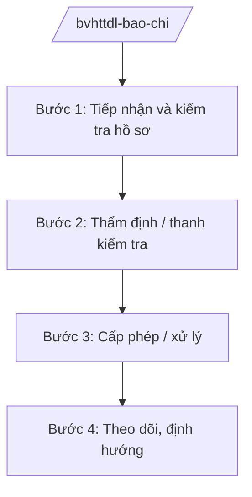

# Skill: Quản lý báo chí, xuất bản (cấp bộ)

## 2. Khi nào dùng

Khi Cục Báo chí / Cục Xuất bản, In và Phát hành — Bộ VHTTDL thực hiện: cấp, thu hồi giấy phép
hoạt động báo chí, xuất bản theo thẩm quyền; thanh tra, kiểm tra hoạt động báo chí, xuất bản;
định hướng thông tin, xử lý vi phạm; quản lý báo chí điện tử, mạng xã hội có yếu tố báo chí.

## 3. Đầu vào (Input)

| Trường | Mô tả | Bắt buộc |
|--------|-------|----------|
| `noi_dung` | Cấp phép mới / cấp lại / thu hồi / thanh kiểm tra / định hướng thông tin | Có |
| `co_quan_bao_chi` | Tên cơ quan báo chí, nhà xuất bản, tổ chức liên quan | Có |
| `ho_so` | Hồ sơ đề nghị cấp phép hoặc tài liệu phục vụ thanh kiểm tra | Có |
| `can_cu_vi_pham` | Hành vi vi phạm cần xử lý (nếu có) | Không |

## 4. Quy trình

**Bước 1. Tiếp nhận và kiểm tra hồ sơ**
- Làm gì: Kiểm tra điều kiện cấp phép (cơ quan chủ quản, nhân sự, tôn chỉ mục đích, phương án tài chính...); hoặc tiếp nhận phản ánh vi phạm để thanh kiểm tra.
- Dùng input: `noi_dung`, `co_quan_bao_chi`, `ho_so`.
- Vai trò: Chuyên viên Cục Báo chí — AI hỗ trợ lập bảng kiểm điều kiện cấp phép theo quy định (1 giờ).
- Lưu ý nghiệp vụ: Điều kiện về người đứng đầu cơ quan báo chí phải được kiểm tra chặt chẽ.
- → Kết quả bước: Hồ sơ đạt / yêu cầu bổ sung; hoặc quyết định thanh kiểm tra.

**Bước 2. Thẩm định / thanh kiểm tra**
- Làm gì: Thẩm định hồ sơ cấp phép; hoặc tổ chức đoàn kiểm tra hoạt động báo chí, xuất bản; lập biên bản.
- Dùng input: `ho_so`, `can_cu_vi_pham`.
- Vai trò: Cục Báo chí/Cục Xuất bản, In và Phát hành — AI hỗ trợ soạn biên bản kiểm tra, đối chiếu hành vi với quy định (2 giờ).
- Lưu ý nghiệp vụ: Kiểm tra đúng nội dung quyết định, không mở rộng tùy tiện; biên bản phải có chữ ký các bên.
- → Kết quả bước: Kết quả thẩm định / biên bản kiểm tra.

**Bước 3. Cấp phép / xử lý**
- Làm gì: Soạn giấy phép hoạt động báo chí/xuất bản trình ký; hoặc soạn quyết định xử phạt vi phạm hành chính.
- Dùng input: Kết quả thẩm định/kiểm tra.
- Vai trò: Cục trưởng — AI hỗ trợ soạn giấy phép/quyết định xử phạt đúng mẫu, đúng thẩm quyền (1 giờ).
- Lưu ý nghiệp vụ: Mức phạt phải đúng khung, đúng thẩm quyền xử phạt; bảo đảm quyền khiếu nại của tổ chức.
- → Kết quả bước: Giấy phép được cấp / quyết định xử phạt được ban hành.

**Bước 4. Theo dõi, định hướng**
- Làm gì: Theo dõi hoạt động sau cấp phép; ban hành văn bản định hướng thông tin định kỳ; tổng hợp báo cáo Lãnh đạo Bộ.
- Dùng input: Báo cáo hoạt động của cơ quan báo chí.
- Vai trò: Cục Báo chí — AI hỗ trợ tổng hợp báo cáo tình hình báo chí (1 giờ).
- Lưu ý nghiệp vụ: Định hướng thông tin phải kịp thời, rõ ràng, đúng chủ trương.
- → Kết quả bước: Văn bản định hướng thông tin; báo cáo định kỳ.

## Luồng quy trình (Workflow)

## 5. Đầu ra (Output)

- Giấy phép hoạt động báo chí / giấy phép xuất bản.
- Quyết định xử phạt vi phạm hành chính (nếu có).
- Văn bản định hướng thông tin báo chí.

### Cấu trúc output chuẩn (thể thức NĐ 30/2020/NĐ-CP)

**Giấy phép hoạt động báo chí** gồm: (1) Quốc hiệu "CỘNG HÒA XÃ HỘI CHỦ NGHĨA VIỆT NAM", Tiêu ngữ "Độc lập – Tự do – Hạnh phúc"; (2) tên cơ quan báo chí, cơ quan chủ quản;
(3) loại hình báo chí, tôn chỉ, mục đích; (4) người đứng đầu; (5) phạm vi, thời hạn;
(6) điều kiện tuân thủ; (7) chữ ký (ghi rõ chức danh, họ tên người ký; ký hiệu "KT; (8) nơi nhận (kết thúc "- Lưu: VT, [mã đơn vị].")."/"TL." khi ký thay) người có thẩm quyền, đóng dấu Bộ.

**Quyết định xử phạt** gồm: (1) Quốc hiệu "CỘNG HÒA XÃ HỘI CHỦ NGHĨA VIỆT NAM", Tiêu ngữ "Độc lập – Tự do – Hạnh phúc"; (2) căn cứ pháp lý; (3) hành vi vi phạm;
(4) hình thức, mức xử phạt; (5) biện pháp khắc phục; (6) quyền khiếu nại; (7) chữ ký.

> **Chuẩn tài liệu đầu ra** (thứ tự ưu tiên):
> 1. Chuẩn riêng của ngành/cơ quan chủ quản — mẫu, biểu mẫu, quy chuẩn tại văn bản quy phạm chuyên ngành (xem mục "Căn cứ & lưu ý").
> 2. Tài liệu không có quy chuẩn riêng — thể thức NĐ 30/2020/NĐ-CP: Quốc hiệu và Tiêu ngữ; tên cơ quan ban hành; số, ký hiệu; địa danh và thời gian; tên loại và trích yếu; nội dung; chức vụ, họ tên, chữ ký người có thẩm quyền; dấu, chữ ký số; nơi nhận (kèm Phụ lục nếu có).

## 6. Checklist nghiệm thu

- [ ] Điều kiện cấp phép được kiểm tra đầy đủ
- [ ] Giấy phép ghi đúng tôn chỉ, mục đích, phạm vi
- [ ] Xử phạt đúng hành vi, đúng khung, đúng thẩm quyền
- [ ] Biên bản kiểm tra có chữ ký các bên
- [ ] Thể thức văn bản đúng NĐ 30/2020/NĐ-CP
- [ ] Không bịa thông tin cơ quan báo chí, hành vi vi phạm

## 7. Ví dụ mô phỏng

*Dữ liệu dưới đây là giả lập 100% phục vụ minh họa.*

**Input mẫu:** noi_dung = "Cấp giấy phép hoạt động tạp chí điện tử"; co_quan_bao_chi = "Tạp chí
Điện tử Văn hóa AA (giả lập)"; ho_so = "Đề án thành lập, quyết định của cơ quan chủ quản,
lý lịch người đứng đầu, phương án tài chính".

**Output mẫu (trích giấy phép):**

> **BỘ VĂN HÓA, THỂ THAO VÀ DU LỊCH**
>
> **GIẤY PHÉP HOẠT ĐỘNG BÁO CHÍ**
>
> 1. Tên cơ quan báo chí: Tạp chí Điện tử Văn hóa AA.
> 2. Cơ quan chủ quản: Hội Văn hóa AA (tên giả lập).
> 3. Loại hình: tạp chí điện tử; tôn chỉ, mục đích: thông tin về văn hóa, nghệ thuật...
> 4. Người đứng đầu: ông Nguyễn Văn AA (tên giả lập).
> 5. Thời hạn giấy phép: 10 năm kể từ ngày cấp...
> 6. Cơ quan báo chí chịu trách nhiệm tuân thủ đúng tôn chỉ, mục đích và quy định pháp luật.

## 8. Human gate

- Cục trưởng Cục Báo chí/Cục Xuất bản, In và Phát hành duyệt hồ sơ, ký giấy phép theo phân cấp.
- Thứ trưởng phụ trách cho ý kiến đối với cấp phép cơ quan báo chí lớn; Bộ trưởng quyết định các trường hợp quan trọng.

## 9. Giới hạn

- AI không quyết định cấp/thu hồi giấy phép thay người có thẩm quyền; không tự ký.
- AI không bịa thông tin cơ quan báo chí, hành vi vi phạm, mức xử phạt.
- AI không viện dẫn văn bản hết hiệu lực.

## 10. Căn cứ & lưu ý

- Nghị quyết 176/2025/QH15 của Quốc hội — cơ cấu tổ chức của Chính phủ.
- Nghị định 43/2025/NĐ-CP ngày 28/02/2025 — chức năng, nhiệm vụ, quyền hạn của Bộ VHTTDL (quản lý nhà nước về báo chí, xuất bản).
- Nghị định 137/2025/NĐ-CP, Nghị định 138/2025/NĐ-CP ngày 12/6/2025 — phân định thẩm quyền, phân quyền, phân cấp lĩnh vực VHTTDL.
- Nghị định 30/2020/NĐ-CP — thể thức văn bản hành chính.
- Lưu ý: tên Luật Báo chí, Luật Xuất bản chỉ nêu tên, không ghi số hiệu.
