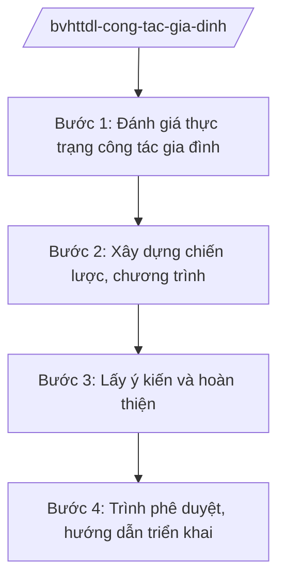

# Skill: Công tác gia đình

## 2. Khi nào dùng

Khi Vụ Gia đình — Bộ VHTTDL thực hiện: xây dựng chiến lược phát triển gia đình Việt Nam;
chỉ đạo công tác phòng, chống bạo lực gia đình; xây dựng gia đình văn hóa; hướng dẫn,
kiểm tra công tác gia đình tại các địa phương.

## 3. Đầu vào (Input)

| Trường | Mô tả | Bắt buộc |
|--------|-------|----------|
| `noi_dung` | Chiến lược / chương trình / kế hoạch công tác gia đình cần xây dựng | Có |
| `muc_tieu` | Mục tiêu cụ thể (giảm bạo lực gia đình, xây dựng gia đình văn hóa...) | Có |
| `so_lieu_hien_trang` | Số liệu về tình hình gia đình, bạo lực gia đình toàn quốc | Có |
| `don_vi_phoi_hop` | Bộ, ngành, đoàn thể, địa phương phối hợp | Không |

## 4. Quy trình

**Bước 1. Đánh giá thực trạng công tác gia đình**
- Làm gì: Tổng hợp số liệu về hôn nhân, gia đình, bạo lực gia đình, gia đình văn hóa toàn quốc; phân tích nguyên nhân.
- Dùng input: `so_lieu_hien_trang`.
- Vai trò: Chuyên viên Vụ Gia đình — AI hỗ trợ tổng hợp số liệu, phân tích xu hướng (2 giờ).
- Lưu ý nghiệp vụ: Số liệu bạo lực gia đình phải từ nguồn chính thức, thận trọng khi công bố số liệu nhạy cảm.
- → Kết quả bước: Báo cáo thực trạng công tác gia đình.

**Bước 2. Xây dựng chiến lược, chương trình**
- Làm gì: Xác định quan điểm, mục tiêu, nhiệm vụ, giải pháp: phòng chống bạo lực gia đình, giáo dục đạo đức lối sống trong gia đình, xây dựng gia đình văn hóa.
- Dùng input: `noi_dung`, `muc_tieu`, `don_vi_phoi_hop`.
- Vai trò: Vụ Gia đình chủ trì — AI hỗ trợ soạn dự thảo chiến lược, rà soát tính khả thi (2–3 giờ).
- Lưu ý nghiệp vụ: Giải pháp phải gắn với vai trò của Hội Liên hiệp Phụ nữ, Đoàn Thanh niên, chính quyền địa phương.
- → Kết quả bước: Dự thảo chiến lược/chương trình công tác gia đình.

**Bước 3. Lấy ý kiến và hoàn thiện**
- Làm gì: Lấy ý kiến bộ, ngành, địa phương, tổ chức xã hội; tổng hợp tiếp thu.
- Dùng input: Dự thảo chiến lược.
- Vai trò: Vụ Gia đình — AI hỗ trợ tổng hợp ý kiến thành bảng tiếp thu (1 giờ).
- Lưu ý nghiệp vụ: Chú trọng ý kiến của các tổ chức đại diện phụ nữ, trẻ em.
- → Kết quả bước: Dự thảo hoàn chỉnh trình phê duyệt.

**Bước 4. Trình phê duyệt, hướng dẫn triển khai**
- Làm gì: Trình Thủ tướng/Chính phủ phê duyệt; hướng dẫn địa phương xây dựng kế hoạch; kiểm tra, sơ kết, tổng kết định kỳ.
- Dùng input: Toàn bộ hồ sơ.
- Vai trò: Vụ trưởng → Thứ trưởng → Bộ trưởng ký trình — AI hỗ trợ soạn văn bản hướng dẫn, khung báo cáo địa phương (1 giờ).
- Lưu ý nghiệp vụ: Có cơ chế hỗ trợ nạn nhân bạo lực gia đình (đường dây nóng, cơ sở trợ giúp) trong kế hoạch triển khai.
- → Kết quả bước: Chiến lược được phê duyệt + văn bản hướng dẫn địa phương.

## Luồng quy trình (Workflow)

## 5. Đầu ra (Output)

- Chiến lược phát triển gia đình Việt Nam (dự thảo trình phê duyệt).
- Văn bản hướng dẫn triển khai công tác gia đình tại địa phương.
- Báo cáo sơ kết, tổng kết.

### Cấu trúc output chuẩn

**Khung thể thức chung (NĐ 30/2020/NĐ-CP):** mọi văn bản trong output đều trình bày đầy đủ: Quốc hiệu "CỘNG HÒA XÃ HỘI CHỦ NGHĨA VIỆT NAM", Tiêu ngữ "Độc lập – Tự do – Hạnh phúc"; tên cơ quan ban hành; số, ký hiệu văn bản; địa danh, ngày tháng năm ban hành; tên loại văn bản; nội dung theo các mục dưới đây; nơi nhận (kết thúc "- Lưu: VT, [mã đơn vị]."); khối chữ ký (chức danh, họ tên người ký; ký hiệu "KT."/"TL." khi ký thay).

**Chiến lược phát triển gia đình** gồm: (1) Quyết định phê duyệt (thể thức NĐ 30/2020);
(2) quan điểm; (3) mục tiêu (giảm tỷ lệ bạo lực gia đình, tăng tỷ lệ gia đình văn hóa...);
(4) nhiệm vụ, giải pháp (truyền thông, giáo dục, hỗ trợ nạn nhân, xây dựng mô hình);
(5) nguồn lực; (6) tổ chức thực hiện.

*Thể thức văn bản tuân thủ NĐ 30/2020/NĐ-CP.*

*Thể thức văn bản tuân thủ NĐ 30/2020/NĐ-CP.*
## 6. Checklist nghiệm thu

- [ ] Số liệu thực trạng từ nguồn chính thức
- [ ] Mục tiêu cụ thể, đo lường được
- [ ] Có giải pháp hỗ trợ nạn nhân bạo lực gia đình
- [ ] Đã lấy ý kiến tổ chức đại diện phụ nữ, trẻ em
- [ ] Thể thức văn bản đúng NĐ 30/2020/NĐ-CP
- [ ] Không bịa số liệu, không viện dẫn văn bản hết hiệu lực

## 7. Ví dụ mô phỏng

*Dữ liệu dưới đây là giả lập 100% phục vụ minh họa.*

**Input mẫu:** noi_dung = "Chương trình phòng, chống bạo lực gia đình giai đoạn 2026–2030";
muc_tieu = "Giảm 20% số vụ bạo lực gia đình được phát hiện (số liệu giả lập)".

**Output mẫu (trích chương trình):**

> **CHƯƠNG TRÌNH**
> **Phòng, chống bạo lực gia đình giai đoạn 2026–2030**
> *(Dự thảo)*
>
> **I. MỤC TIÊU:** Giảm 20% số vụ bạo lực gia đình; 100% nạn nhân được tiếp cận dịch vụ
> hỗ trợ (số liệu giả lập minh họa).
> **II. NHIỆM VỤ, GIẢI PHÁP:**
> 1. Truyền thông nâng cao nhận thức về bình đẳng giới trong gia đình...
> 2. Củng cố đường dây nóng, cơ sở trợ giúp nạn nhân tại các tỉnh, thành phố...
> 3. Đào tạo đội ngũ cán bộ làm công tác gia đình ở cơ sở...
> **III. TỔ CHỨC THỰC HIỆN:** Vụ Gia đình — Bộ VHTTDL chủ trì, phối hợp Hội Liên hiệp
> Phụ nữ Việt Nam, UBND các tỉnh, thành phố...
>
> *Vụ trưởng Vụ Gia đình: ông Hoàng Văn EE (tên giả lập).*

## 8. Human gate

- Vụ trưởng Vụ Gia đình duyệt báo cáo thực trạng và dự thảo.
- Thứ trưởng phụ trách cho ý kiến; Bộ trưởng ký tờ trình Thủ tướng/Chính phủ.

## 9. Giới hạn

- AI không quyết định mục tiêu, chính sách thay Lãnh đạo Bộ; không tự ký trình.
- AI không bịa số liệu về bạo lực gia đình, gia đình văn hóa.
- AI không viện dẫn văn bản hết hiệu lực.

## 10. Căn cứ & lưu ý

- Nghị quyết 176/2025/QH15 của Quốc hội — cơ cấu tổ chức của Chính phủ.
- Nghị định 43/2025/NĐ-CP ngày 28/02/2025 — chức năng, nhiệm vụ, quyền hạn của Bộ VHTTDL (quản lý nhà nước về gia đình).
- Nghị định 137/2025/NĐ-CP, Nghị định 138/2025/NĐ-CP ngày 12/6/2025 — phân định thẩm quyền, phân quyền, phân cấp lĩnh vực VHTTDL.
- Nghị định 30/2020/NĐ-CP — thể thức văn bản hành chính.
- Lưu ý: tên Luật Phòng, chống bạo lực gia đình chỉ nêu tên, không ghi số hiệu.
