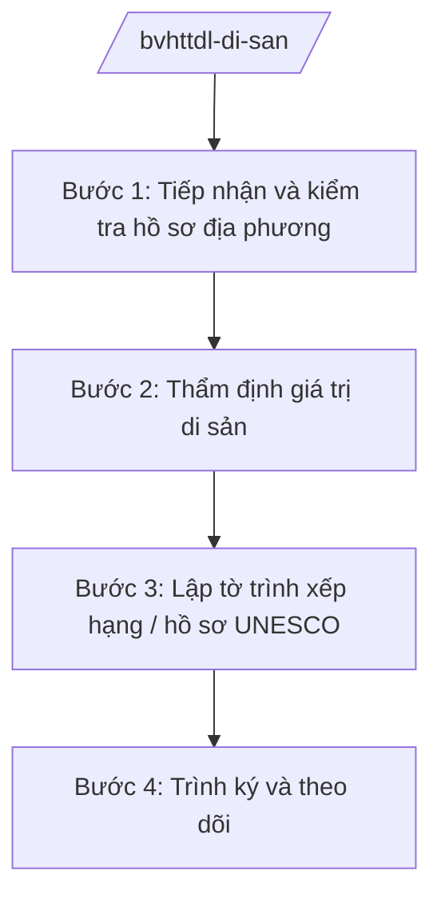

# Skill: Quản lý di sản (xếp hạng quốc gia, UNESCO)

## 2. Khi nào dùng

Khi Cục Di sản văn hóa — Bộ VHTTDL thực hiện: thẩm định hồ sơ xếp hạng di tích quốc gia,
di tích quốc gia đặc biệt trình Thủ tướng; lập hồ sơ di sản đề cử UNESCO công nhận;
kiểm tra, hướng dẫn công tác bảo vệ và phát huy giá trị di sản trên toàn quốc.

## 3. Đầu vào (Input)

| Trường | Mô tả | Bắt buộc |
|--------|-------|----------|
| `ten_di_san` | Tên di tích/danh lam thắng cảnh/di sản | Có |
| `loai_hinh` | Di tích lịch sử/văn hóa/khảo cổ/kiến trúc nghệ thuật; di sản văn hóa phi vật thể | Có |
| `cap_de_nghi` | Di tích quốc gia / Di tích quốc gia đặc biệt / Di sản UNESCO | Có |
| `ho_so_dia_phuong` | Hồ sơ do UBND cấp tỉnh lập, gửi đề nghị | Có |
| `danh_gia_khoa_hoc` | Kết quả thẩm định giá trị của hội đồng khoa học | Không |

## 4. Quy trình

**Bước 1. Tiếp nhận và kiểm tra hồ sơ địa phương**
- Làm gì: Kiểm tra tính đầy đủ, hợp lệ của hồ sơ xếp hạng do tỉnh gửi; đối chiếu tiêu chí theo quy định.
- Dùng input: `ho_so_dia_phuong`, `ten_di_san`, `loai_hinh`, `cap_de_nghi`.
- Vai trò: Chuyên viên Cục Di sản văn hóa — AI hỗ trợ lập bảng kiểm thành phần hồ sơ, đối chiếu checklist tiêu chí (1 giờ).
- Lưu ý nghiệp vụ: Hồ sơ thiếu thì trả lại một lần, nêu rõ nội dung bổ sung; không kéo dài nhiều vòng.
- → Kết quả bước: Biên bản kiểm tra hồ sơ (đạt / yêu cầu bổ sung).

**Bước 2. Thẩm định giá trị di sản**
- Làm gì: Tổ chức hội đồng khoa học thẩm định giá trị lịch sử, văn hóa, khoa học, thẩm mỹ của di sản; khảo sát thực địa khi cần.
- Dùng input: `ho_so_dia_phuong`, `danh_gia_khoa_hoc`.
- Vai trò: Cục trưởng Cục Di sản văn hóa (bà Vũ Thị FF) chủ trì hội đồng — AI hỗ trợ tổng hợp tài liệu khoa học, soạn biên bản thẩm định (2–3 giờ).
- Lưu ý nghiệp vụ: Thành viên hội đồng phải độc lập, không có lợi ích liên quan; biên bản ghi rõ ý kiến đa số/thiểu số.
- → Kết quả bước: Biên bản thẩm định của hội đồng khoa học.

**Bước 3. Lập tờ trình xếp hạng / hồ sơ UNESCO**
- Làm gì: Soạn tờ trình Thủ tướng xếp hạng di tích quốc gia/đặc biệt; hoặc lập hồ sơ đề cử theo mẫu UNESCO (đối với di sản thế giới).
- Dùng input: Kết quả thẩm định, toàn bộ hồ sơ.
- Vai trò: Cục Di sản văn hóa soạn thảo — AI hỗ trợ soạn tờ trình, kiểm tra đầy đủ thành phần hồ sơ UNESCO (2 giờ).
- Lưu ý nghiệp vụ: Hồ sơ UNESCO phải dịch sang tiếng Anh/Pháp, tuân thủ đúng biểu mẫu và thời hạn nộp của UNESCO.
- → Kết quả bước: Tờ trình + hồ sơ xếp hạng/đề cử hoàn chỉnh.

**Bước 4. Trình ký và theo dõi**
- Làm gì: Trình Lãnh đạo Bộ ký văn bản trình Thủ tướng; theo dõi tiến độ xét duyệt; công bố sau khi có quyết định.
- Dùng input: Toàn bộ hồ sơ.
- Vai trò: Cục trưởng → Thứ trưởng (bà Phạm Thị DD) → Bộ trưởng (ông Lê Văn CC) ký trình — AI hỗ trợ theo dõi tiến độ, nhắc hạn (30 phút).
- Lưu ý nghiệp vụ: Sau khi xếp hạng, hướng dẫn địa phương cắm mốc, khoanh vùng bảo vệ và lập quy hoạch bảo quản.
- → Kết quả bước: Quyết định xếp hạng được ban hành; văn bản hướng dẫn địa phương.

## Luồng quy trình (Workflow)

## 5. Đầu ra (Output)

- Tờ trình Thủ tướng về xếp hạng di tích quốc gia/di tích quốc gia đặc biệt.
- Hồ sơ đề cử di sản UNESCO (đúng biểu mẫu).
- Văn bản hướng dẫn địa phương về bảo vệ, phát huy giá trị di sản.

### Cấu trúc output chuẩn (thể thức NĐ 30/2020/NĐ-CP)

**Tờ trình xếp hạng** gồm: (1) Quốc hiệu "CỘNG HÒA XÃ HỘI CHỦ NGHĨA VIỆT NAM", Tiêu ngữ "Độc lập – Tự do – Hạnh phúc" (BỘ VHTTDL); (2) trích yếu; (3) căn cứ pháp lý;
(4) tóm tắt giá trị di sản theo kết luận hội đồng khoa học; (5) nội dung đề nghị xếp hạng;
(6) kiến nghị; (7) nơi nhận (kết thúc "- Lưu: VT, [mã đơn vị]."). Ký tên Bộ trưởng, đóng dấu Bộ.

**Hồ sơ đề cử UNESCO** gồm: (1) phiếu nhận dạng di sản; (2) mô tả; (3) luận chứng giá trị nổi bật
toàn cầu; (4) tình trạng bảo tồn; (5) kế hoạch quản lý; (6) tài liệu, ảnh, bản đồ kèm theo.
## 6. Checklist nghiệm thu

- [ ] Hồ sơ địa phương đầy đủ, hợp lệ trước khi thẩm định
- [ ] Hội đồng khoa học độc lập, biên bản ghi rõ kết luận
- [ ] Tờ trình nêu đúng căn cứ, đúng cấp đề nghị xếp hạng
- [ ] Hồ sơ UNESCO đúng biểu mẫu, đúng hạn nộp
- [ ] Thể thức văn bản đúng NĐ 30/2020/NĐ-CP
- [ ] Có văn bản hướng dẫn địa phương sau xếp hạng
- [ ] Dữ liệu di sản (tên, vị trí, giá trị) khớp hồ sơ gốc, không bịa

## 7. Ví dụ mô phỏng

*Dữ liệu dưới đây là giả lập 100% phục vụ minh họa.*

**Input mẫu:** ten_di_san = "Di tích khảo cổ Gò AA"; loai_hinh = "Di tích khảo cổ";
cap_de_nghi = "Di tích quốc gia"; ho_so_dia_phuong = "Hồ sơ của UBND tỉnh A (quyết định thành lập
hội đồng khoa học cấp tỉnh, biên bản khai quật, ảnh, bản đồ khoanh vùng)".

**Output mẫu (trích Tờ trình):**

> **BỘ VĂN HÓA, THỂ THAO VÀ DU LỊCH**
>
> **TỜ TRÌNH**
> **Về việc xếp hạng di tích quốc gia: Di tích khảo cổ Gò AA, tỉnh A**
>
> Kính gửi: Thủ tướng Chính phủ
>
> 1. Căn cứ pháp lý: Luật Di sản văn hóa; Nghị định 43/2025/NĐ-CP...
> 2. Tóm tắt giá trị: Hội đồng khoa học Bộ kết luận di tích có giá trị tiêu biểu về khảo cổ học,
> niên đại khoảng 2.000 năm, hiện vật phong phú, còn nguyên vẹn tầng văn hóa...
> 3. Đề nghị: xếp hạng di tích quốc gia đối với Di tích khảo cổ Gò AA.
> 4. Kiến nghị: Thủ tướng xem xét, quyết định; giao UBND tỉnh A cắm mốc, khoanh vùng bảo vệ
> và lập quy hoạch bảo quản, tu bổ di tích theo quy định.

## 8. Human gate

- Cục trưởng Cục Di sản văn hóa duyệt hồ sơ trước khi tổ chức thẩm định.
- Hội đồng khoa học kết luận độc lập về giá trị di sản.
- Thứ trưởng phụ trách cho ý kiến; Bộ trưởng ký tờ trình Thủ tướng / ký văn bản gửi UNESCO.

## 9. Giới hạn

- AI không kết luận giá trị khoa học của di sản thay hội đồng; không tự ký trình.
- AI không bịa thông tin khảo cổ, niên đại, giá trị di sản; mọi số liệu phải từ hồ sơ gốc.
- AI không viện dẫn văn bản hết hiệu lực.

## 10. Căn cứ & lưu ý

- Nghị quyết 176/2025/QH15 của Quốc hội — cơ cấu tổ chức của Chính phủ.
- Nghị định 43/2025/NĐ-CP ngày 28/02/2025 của Chính phủ — chức năng, nhiệm vụ, quyền hạn của Bộ VHTTDL (quản lý nhà nước về di sản văn hóa).
- Nghị định 137/2025/NĐ-CP, Nghị định 138/2025/NĐ-CP ngày 12/6/2025 — phân định thẩm quyền, phân quyền, phân cấp lĩnh vực VHTTDL (địa phương lập hồ sơ đề nghị, Bộ thẩm định trình Thủ tướng).
- Nghị định 30/2020/NĐ-CP — thể thức văn bản hành chính.
- Lưu ý: tên Luật Di sản văn hóa chỉ nêu tên, không ghi số hiệu.
