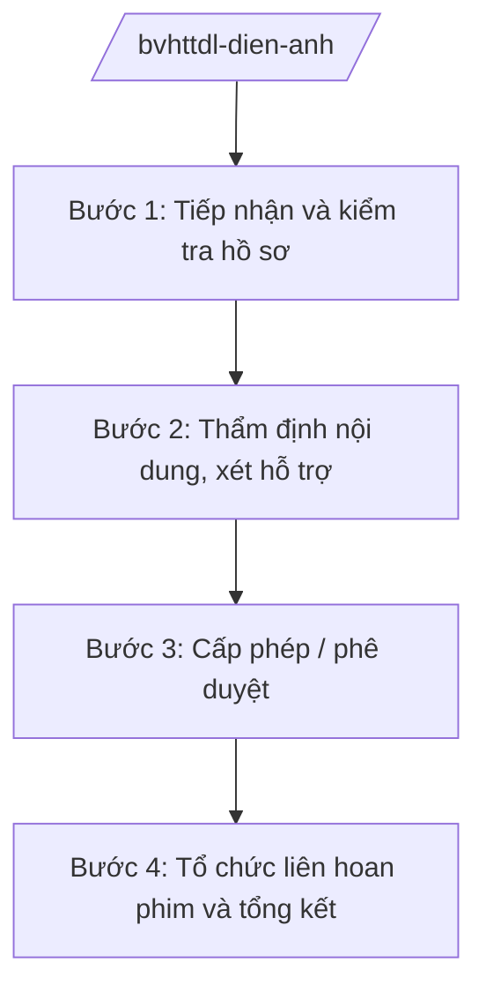

# Skill: Điện ảnh

## 2. Khi nào dùng

Khi Cục Điện ảnh — Bộ VHTTDL thực hiện: quản lý Quỹ hỗ trợ phát triển điện ảnh; tổ chức
Liên hoan phim Việt Nam; cấp giấy phép phân loại, phổ biến phim theo thẩm quyền;
quản lý hoạt động sản xuất, phát hành phim; hướng dẫn chuyên môn cho địa phương.

## 3. Đầu vào (Input)

| Trường | Mô tả | Bắt buộc |
|--------|-------|----------|
| `noi_dung` | Hỗ trợ từ quỹ / tổ chức liên hoan phim / cấp phép phổ biến phim | Có |
| `don_vi_de_nghi` | Hãng phim, tổ chức, cá nhân đề nghị | Có |
| `ho_so` | Kịch bản, hồ sơ dự án phim hoặc hồ sơ đề nghị hỗ trợ | Có |
| `muc_ho_tro` | Mức kinh phí đề nghị hỗ trợ từ quỹ (nếu có) | Không |

## 4. Quy trình

**Bước 1. Tiếp nhận và kiểm tra hồ sơ**
- Làm gì: Kiểm tra hồ sơ đề nghị hỗ trợ từ Quỹ phát triển điện ảnh hoặc hồ sơ phim đề nghị phân loại, cấp phép phổ biến.
- Dùng input: `noi_dung`, `don_vi_de_nghi`, `ho_so`.
- Vai trò: Chuyên viên Cục Điện ảnh — AI hỗ trợ lập bảng kiểm thành phần hồ sơ (1 giờ).
- Lưu ý nghiệp vụ: Kịch bản, phim phải được kiểm tra nội dung theo đúng tiêu chí phân loại.
- → Kết quả bước: Hồ sơ đạt / yêu cầu bổ sung.

**Bước 2. Thẩm định nội dung, xét hỗ trợ**
- Làm gì: Tổ chức hội đồng thẩm định kịch bản/phim; hội đồng xét hỗ trợ từ quỹ theo tiêu chí công khai.
- Dùng input: `ho_so`, `muc_ho_tro`.
- Vai trò: Cục Điện ảnh chủ trì hội đồng — AI hỗ trợ tổng hợp ý kiến hội đồng, lập bảng điểm xét hỗ trợ (1–2 giờ).
- Lưu ý nghiệp vụ: Tiêu chí xét hỗ trợ phải công khai, minh bạch; thành viên hội đồng độc lập.
- → Kết quả bước: Biên bản thẩm định / quyết định hỗ trợ từ quỹ.

**Bước 3. Cấp phép / phê duyệt**
- Làm gì: Cấp giấy phép phân loại phim, quyết định cho phép phổ biến phim; hoặc phê duyệt danh mục dự án được hỗ trợ.
- Dùng input: Kết quả thẩm định.
- Vai trò: Cục trưởng Cục Điện ảnh (bà Vũ Thị FF) — AI hỗ trợ soạn giấy phép/quyết định đúng mẫu (1 giờ).
- Lưu ý nghiệp vụ: Phân loại độ tuổi phải chính xác; phim không đạt thì từ chối bằng văn bản nêu rõ lý do.
- → Kết quả bước: Giấy phép phân loại, phổ biến phim / quyết định hỗ trợ.

**Bước 4. Tổ chức liên hoan phim và tổng kết**
- Làm gì: Tổ chức Liên hoan phim Việt Nam định kỳ: thể lệ, chấm giải, trao giải; tổng kết hoạt động quỹ hằng năm.
- Dùng input: Kế hoạch liên hoan, báo cáo quỹ.
- Vai trò: Cục Điện ảnh — AI hỗ trợ soạn thể lệ, tổng hợp báo cáo (1–2 giờ).
- Lưu ý nghiệp vụ: Ban giám khảo độc lập, uy tín; công tác tổ chức bảo đảm an toàn, trang trọng.
- → Kết quả bước: Liên hoan phim được tổ chức thành công; báo cáo tổng kết quỹ.

## Luồng quy trình (Workflow)

## 5. Đầu ra (Output)

- Giấy phép phân loại phim, quyết định cho phép phổ biến phim.
- Quyết định hỗ trợ từ Quỹ phát triển điện ảnh.
- Đề án tổ chức Liên hoan phim Việt Nam.

### Cấu trúc output chuẩn (thể thức NĐ 30/2020/NĐ-CP)

**Giấy phép phân loại phim** gồm: (1) Quốc hiệu "CỘNG HÒA XÃ HỘI CHỦ NGHĨA VIỆT NAM", Tiêu ngữ "Độc lập – Tự do – Hạnh phúc"; (2) tên phim, hãng sản xuất;
(3) mức phân loại độ tuổi; (4) phạm vi phổ biến; (5) điều kiện tuân thủ; (6) chữ ký (ghi rõ chức danh, họ tên người ký; ký hiệu "KT; (7) nơi nhận (kết thúc "- Lưu: VT, [mã đơn vị].")."/"TL." khi ký thay) Cục trưởng.

**Quyết định hỗ trợ từ quỹ** gồm: (1) Quốc hiệu "CỘNG HÒA XÃ HỘI CHỦ NGHĨA VIỆT NAM", Tiêu ngữ "Độc lập – Tự do – Hạnh phúc"; (2) căn cứ; (3) danh mục dự án
được hỗ trợ và mức hỗ trợ; (4) điều kiện giải ngân, quyết toán; (5) chữ ký.
## 6. Checklist nghiệm thu

- [ ] Hồ sơ phim/kịch bản được kiểm tra đầy đủ
- [ ] Hội đồng thẩm định độc lập, có biên bản
- [ ] Phân loại độ tuổi chính xác
- [ ] Xét hỗ trợ quỹ theo tiêu chí công khai
- [ ] Thể thức văn bản đúng NĐ 30/2020/NĐ-CP
- [ ] Không bịa thông tin phim, mức hỗ trợ

## 7. Ví dụ mô phỏng

*Dữ liệu dưới đây là giả lập 100% phục vụ minh họa.*

**Input mẫu:** noi_dung = "Cấp giấy phép phổ biến phim"; don_vi_de_nghi = "Hãng phim AA (giả lập)";
ho_so = "Phim truyện 'Mùa lúa mới' (tên giả lập), kịch bản, bản phim hoàn chỉnh".

**Output mẫu (trích giấy phép):**

> **BỘ VĂN HÓA, THỂ THAO VÀ DU LỊCH**
> **CỤC ĐIỆN ẢNH**
>
> **GIẤY PHÉP PHÂN LOẠI PHIM**
>
> 1. Tên phim: "Mùa lúa mới".
> 2. Hãng sản xuất: Hãng phim AA.
> 3. Mức phân loại: T13 (phổ biến đến người xem từ đủ 13 tuổi trở lên).
> 4. Phạm vi phổ biến: trong hệ thống rạp chiếu phim toàn quốc.
> 5. Đơn vị phát hành chịu trách nhiệm phổ biến đúng mức phân loại và quy định pháp luật.

## 8. Human gate

- Cục trưởng Cục Điện ảnh duyệt hồ sơ, ký giấy phép phân loại, phổ biến phim.
- Hội đồng xét hỗ trợ quỹ quyết định danh mục dự án; Thứ trưởng phụ trách phê duyệt.
- Bộ trưởng quyết định tổ chức Liên hoan phim Việt Nam.

## 9. Giới hạn

- AI không đánh giá nội dung phim thay hội đồng thẩm định; không tự ký cấp phép.
- AI không bịa thông tin phim, mức phân loại, mức hỗ trợ.
- AI không viện dẫn văn bản hết hiệu lực.

## 10. Căn cứ & lưu ý

- Nghị quyết 176/2025/QH15 của Quốc hội — cơ cấu tổ chức của Chính phủ.
- Nghị định 43/2025/NĐ-CP ngày 28/02/2025 — chức năng, nhiệm vụ, quyền hạn của Bộ VHTTDL (quản lý nhà nước về điện ảnh).
- Nghị định 137/2025/NĐ-CP, Nghị định 138/2025/NĐ-CP ngày 12/6/2025 — phân định thẩm quyền, phân quyền, phân cấp lĩnh vực VHTTDL.
- Nghị định 30/2020/NĐ-CP — thể thức văn bản hành chính.
- Lưu ý: tên Luật Điện ảnh chỉ nêu tên, không ghi số hiệu.
