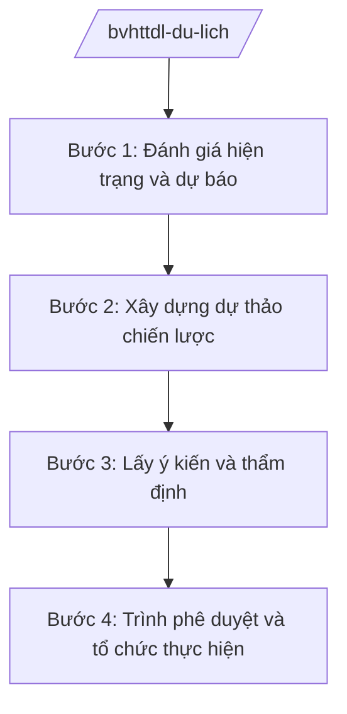

# Skill: Chiến lược phát triển du lịch quốc gia

## 2. Khi nào dùng

Khi Cục Du lịch — Bộ VHTTDL được giao: xây dựng chiến lược, quy hoạch phát triển du lịch;
đánh giá, điều chỉnh chính sách phát triển du lịch quốc gia; hướng dẫn, kiểm tra công tác
quản lý nhà nước về du lịch tại các địa phương.

## 3. Đầu vào (Input)

| Trường | Mô tả | Bắt buộc |
|--------|-------|----------|
| `ten_chien_luoc` | Tên chiến lược/quy hoạch (kỳ, giai đoạn) | Có |
| `muc_tieu` | Mục tiêu tổng quát và cụ thể (khách, doanh thu, việc làm...) | Có |
| `so_lieu_hien_trang` | Số liệu hiện trạng ngành du lịch toàn quốc | Có |
| `dinh_huong_cap_tren` | Chủ trương, định hướng của Đảng, Nhà nước về phát triển du lịch | Có |
| `dia_phuong_tham_gia` | Các tỉnh, thành phố trọng điểm du lịch tham gia lấy ý kiến | Không |

## 4. Quy trình

**Bước 1. Đánh giá hiện trạng và dự báo**
- Làm gì: Tổng hợp số liệu khách du lịch, doanh thu, cơ sở lưu trú, nhân lực toàn quốc; phân tích điểm mạnh, yếu, cơ hội, thách thức; dự báo xu hướng.
- Dùng input: `so_lieu_hien_trang`, `dinh_huong_cap_tren`, `ten_chien_luoc`.
- Vai trò: Chuyên viên Cục Du lịch — AI hỗ trợ tổng hợp số liệu thành bảng, vẽ biểu đồ xu hướng, soạn phân tích SWOT (⏱ 2–3 giờ).
- Lưu ý nghiệp vụ: Số liệu phải từ nguồn thống kê chính thức; ghi rõ năm, nguồn; không dùng số liệu ước đoán không có căn cứ.
- → Kết quả bước: Báo cáo đánh giá hiện trạng + dự báo.

**Bước 2. Xây dựng dự thảo chiến lược**
- Làm gì: Xác định quan điểm, mục tiêu, nhiệm vụ, giải pháp, chương trình hành động; phân kỳ thực hiện; dự kiến nguồn lực.
- Dùng input: `muc_tieu`, báo cáo hiện trạng, `dinh_huong_cap_tren`.
- Vai trò: Tổ biên tập Cục Du lịch (Vụ trưởng chỉ đạo) — AI hỗ trợ soạn khung chiến lược, rà soát tính nhất quán giữa mục tiêu và giải pháp (⏱ 3–4 giờ).
- Lưu ý nghiệp vụ: Mục tiêu phải đo lường được; giải pháp gắn với đầu mối thực hiện và lộ trình cụ thể.
- → Kết quả bước: Dự thảo chiến lược (kèm phụ lục số liệu).

**Bước 3. Lấy ý kiến và thẩm định**
- Làm gì: Lấy ý kiến bộ, ngành, địa phương, hiệp hội du lịch, chuyên gia; tổng hợp tiếp thu; gửi thẩm định theo quy định.
- Dùng input: Dự thảo chiến lược.
- Vai trò: Cục Du lịch — AI hỗ trợ tổng hợp ý kiến thành bảng tiếp thu/giải trình (⏱ 1–2 giờ).
- Lưu ý nghiệp vụ: Đặc biệt lấy ý kiến các địa phương trọng điểm du lịch và cộng đồng doanh nghiệp.
- → Kết quả bước: Dự thảo hoàn chỉnh + bảng tiếp thu ý kiến.

**Bước 4. Trình phê duyệt và tổ chức thực hiện**
- Làm gì: Lập tờ trình Thủ tướng/Chính phủ phê duyệt chiến lược; sau phê duyệt, hướng dẫn địa phương xây dựng kế hoạch triển khai; theo dõi, đánh giá định kỳ.
- Dùng input: Toàn bộ hồ sơ.
- Vai trò: Cục trưởng → Thứ trưởng → Bộ trưởng ký trình — AI hỗ trợ soạn tờ trình, lập khung theo dõi chỉ tiêu (⏱ 1 giờ).
- Lưu ý nghiệp vụ: Chiến lược phải có cơ chế giám sát, đánh giá giữa kỳ và cuối kỳ rõ ràng.
- → Kết quả bước: Chiến lược được phê duyệt + kế hoạch triển khai + khung giám sát.

## Luồng quy trình (Workflow)

## 5. Đầu ra (Output)

- Tờ trình phê duyệt chiến lược/quy hoạch phát triển du lịch.
- Dự thảo chiến lược (quan điểm, mục tiêu, nhiệm vụ, giải pháp, tổ chức thực hiện).
- Khung chỉ tiêu giám sát, đánh giá.

### Cấu trúc output chuẩn

**Khung thể thức chung (NĐ 30/2020/NĐ-CP):** mọi văn bản trong output đều trình bày đầy đủ: Quốc hiệu "CỘNG HÒA XÃ HỘI CHỦ NGHĨA VIỆT NAM", Tiêu ngữ "Độc lập – Tự do – Hạnh phúc"; tên cơ quan ban hành; số, ký hiệu văn bản; địa danh, ngày tháng năm ban hành; tên loại văn bản; nội dung theo các mục dưới đây; nơi nhận (kết thúc "- Lưu: VT, [mã đơn vị]."); khối chữ ký (chức danh, họ tên người ký; ký hiệu "KT."/"TL." khi ký thay).

**Chiến lược** gồm: (1) Quyết định phê duyệt (thể thức NĐ 30/2020); (2) quan điểm phát triển;
(3) mục tiêu tổng quát và mục tiêu cụ thể đến từng mốc; (4) nhiệm vụ, giải pháp theo nhóm
(thể chế, hạ tầng, sản phẩm, xúc tiến, nhân lực, liên kết vùng); (5) chương trình, đề án trọng điểm;
(6) nguồn lực thực hiện; (7) tổ chức thực hiện và cơ chế giám sát, đánh giá.

*Thể thức văn bản tuân thủ NĐ 30/2020/NĐ-CP.*

*Thể thức văn bản tuân thủ NĐ 30/2020/NĐ-CP.*

> **Checklist thể thức văn bản theo NĐ 30/2020/NĐ-CP** — đối chiếu trước khi trình ký:
> 1. Quốc hiệu và Tiêu ngữ.
> 2. Tên cơ quan, tổ chức ban hành văn bản.
> 3. Số, ký hiệu của văn bản.
> 4. Địa danh và thời gian ban hành văn bản.
> 5. Tên loại và trích yếu nội dung văn bản.
> 6. Nội dung văn bản.
> 7. Chức vụ, họ tên và chữ ký của người có thẩm quyền.
> 8. Dấu, chữ ký số của cơ quan, tổ chức.
> 9. Nơi nhận (kèm Phụ lục nếu có).

## 6. Checklist nghiệm thu

- [ ] Số liệu hiện trạng từ nguồn chính thức, ghi rõ nguồn
- [ ] Mục tiêu đo lường được, có mốc thời gian
- [ ] Giải pháp gắn đầu mối thực hiện cụ thể
- [ ] Đã lấy ý kiến địa phương trọng điểm và doanh nghiệp
- [ ] Có cơ chế giám sát, đánh giá giữa kỳ/cuối kỳ
- [ ] Thể thức văn bản đúng NĐ 30/2020/NĐ-CP
- [ ] Không bịa số liệu, không viện dẫn văn bản hết hiệu lực

## 7. Ví dụ mô phỏng

*Dữ liệu dưới đây là giả lập 100% phục vụ minh họa.*

**Input mẫu:** ten_chien_luoc = "Chiến lược phát triển du lịch Việt Nam đến năm 2035, tầm nhìn 2045";
muc_tieu = "Đón 50 triệu lượt khách quốc tế vào năm 2035 (số liệu giả lập)"; so_lieu_hien_trang =
"Năm 2025: 20 triệu lượt khách quốc tế, 120 triệu lượt khách nội địa (số liệu giả lập)".

**Output mẫu (trích dự thảo chiến lược):**

> **CHIẾN LƯỢC PHÁT TRIỂN DU LỊCH VIỆT NAM ĐẾN NĂM 2035, TẦM NHÌN 2045**
> *(Dự thảo trình phê duyệt)*
>
> **I. QUAN ĐIỂM PHÁT TRIỂN**
> 1. Phát triển du lịch trở thành ngành kinh tế mũi nhọn, bền vững, chuyên nghiệp...
> **II. MỤC TIÊU**
> 1. Mục tiêu tổng quát: đưa du lịch Việt Nam thuộc nhóm điểm đến hàng đầu khu vực...
> 2. Mục tiêu cụ thể đến năm 2035: đón 50 triệu lượt khách quốc tế; tổng thu từ du lịch
> đạt 200 nghìn tỷ đồng (số liệu giả lập minh họa)...
> **III. NHIỆM VỤ, GIẢI PHÁP**
> 1. Hoàn thiện thể chế, chính sách... 2. Phát triển kết cấu hạ tầng du lịch...
> 3. Đa dạng hóa sản phẩm du lịch... 4. Đẩy mạnh xúc tiến, quảng bá...
>
> *Đơn vị chủ trì soạn thảo: Cục Du lịch — Bộ VHTTDL (Cục trưởng: bà Vũ Thị FF — tên giả lập).*

## 8. Human gate

- Cục trưởng Cục Du lịch duyệt báo cáo hiện trạng và dự thảo.
- Thứ trưởng phụ trách cho ý kiến trước khi trình Bộ trưởng.
- Bộ trưởng ký tờ trình Thủ tướng/Chính phủ phê duyệt chiến lược.

## 9. Giới hạn

- AI không quyết định mục tiêu, chính sách thay Lãnh đạo Bộ; không tự ký trình.
- AI không bịa số liệu thống kê du lịch; mọi số liệu phải ghi rõ nguồn.
- AI không viện dẫn văn bản hết hiệu lực.

## 10. Căn cứ & lưu ý

- Nghị quyết 176/2025/QH15 của Quốc hội — cơ cấu tổ chức của Chính phủ.
- Nghị định 43/2025/NĐ-CP ngày 28/02/2025 — chức năng, nhiệm vụ, quyền hạn của Bộ VHTTDL (quản lý nhà nước về du lịch).
- Nghị định 137/2025/NĐ-CP, Nghị định 138/2025/NĐ-CP ngày 12/6/2025 — phân định thẩm quyền, phân quyền, phân cấp lĩnh vực VHTTDL.
- Nghị định 30/2020/NĐ-CP — thể thức văn bản hành chính.
- Lưu ý: tên Luật Du lịch chỉ nêu tên, không ghi số hiệu.
