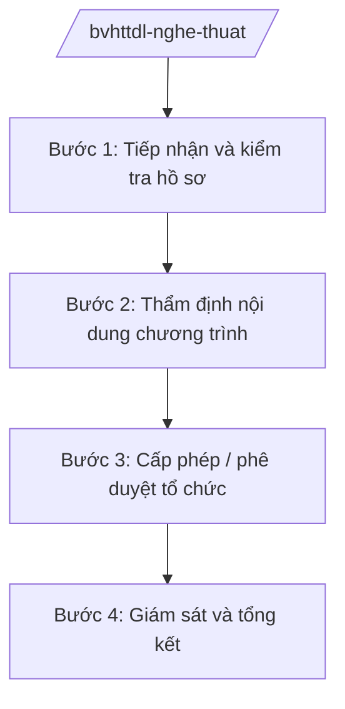

# Skill: Nghệ thuật biểu diễn

## 2. Khi nào dùng

Khi Cục Nghệ thuật biểu diễn — Bộ VHTTDL thực hiện: tổ chức liên hoan, hội diễn nghệ thuật
chuyên nghiệp toàn quốc; cấp phép biểu diễn nghệ thuật theo thẩm quyền Bộ; quản lý hoạt động
của các đơn vị nghệ thuật trực thuộc Bộ; hướng dẫn chuyên môn cho địa phương.

## 3. Đầu vào (Input)

| Trường | Mô tả | Bắt buộc |
|--------|-------|----------|
| `noi_dung` | Liên hoan/hội diễn cần tổ chức hoặc hồ sơ đề nghị cấp phép biểu diễn | Có |
| `don_vi_to_chuc` | Đơn vị nghệ thuật/tổ chức đề nghị | Có |
| `chuong_trinh` | Chương trình, kịch bản, danh sách nghệ sĩ tham gia | Có |
| `thoi_gian_dia_diem` | Thời gian, địa điểm tổ chức/dự kiến biểu diễn | Có |
| `kinh_phi` | Dự toán kinh phí (đối với liên hoan do Bộ tổ chức) | Không |

## 4. Quy trình

**Bước 1. Tiếp nhận và kiểm tra hồ sơ**
- Làm gì: Kiểm tra hồ sơ đề nghị cấp phép biểu diễn hoặc đề án tổ chức liên hoan: tính đầy đủ, hợp lệ của chương trình, kịch bản.
- Dùng input: `noi_dung`, `don_vi_to_chuc`, `chuong_trinh`, `thoi_gian_dia_diem`.
- Vai trò: Chuyên viên Cục Nghệ thuật biểu diễn — AI hỗ trợ lập bảng kiểm hồ sơ, đối chiếu quy định (⏱ 1 giờ).
- Lưu ý nghiệp vụ: Kịch bản có nội dung chưa phù hợp thì yêu cầu chỉnh sửa cụ thể, có văn bản trả lời rõ lý do.
- → Kết quả bước: Hồ sơ đạt yêu cầu / văn bản yêu cầu bổ sung, chỉnh sửa.

**Bước 2. Thẩm định nội dung chương trình**
- Làm gì: Tổ chức hội đồng thẩm định nội dung tư tưởng, nghệ thuật của chương trình, vở diễn.
- Dùng input: `chuong_trinh`.
- Vai trò: Cục Nghệ thuật biểu diễn chủ trì hội đồng — AI hỗ trợ tổng hợp ý kiến hội đồng thành biên bản (⏱ 1–2 giờ).
- Lưu ý nghiệp vụ: Đánh giá khách quan, bảo đảm tính định hướng tư tưởng, không áp đặt cảm tính cá nhân.
- → Kết quả bước: Biên bản thẩm định (đạt / yêu cầu chỉnh sửa).

**Bước 3. Cấp phép / phê duyệt tổ chức**
- Làm gì: Soạn quyết định cấp phép biểu diễn hoặc phê duyệt đề án liên hoan; trình ký.
- Dùng input: Kết quả thẩm định, `kinh_phi`.
- Vai trò: Cục trưởng Cục Nghệ thuật biểu diễn — AI hỗ trợ soạn quyết định đúng mẫu, kiểm tra thể thức (⏱ 1 giờ).
- Lưu ý nghiệp vụ: Giấy phép ghi rõ phạm vi, thời hạn; liên hoan phải có quy chế chấm giải công khai.
- → Kết quả bước: Giấy phép biểu diễn / quyết định phê duyệt liên hoan.

**Bước 4. Giám sát và tổng kết**
- Làm gì: Giám sát việc tuân thủ nội dung đã cấp phép; tổng kết liên hoan, trao giải; xử lý vi phạm nếu có.
- Dùng input: Giấy phép, báo cáo tổ chức.
- Vai trò: Cục Nghệ thuật biểu diễn — AI hỗ trợ tổng hợp báo cáo tổng kết (⏱ 1 giờ).
- Lưu ý nghiệp vụ: Vi phạm nội dung đã cấp phép thì xử lý theo quy định, bảo đảm tính răn đe.
- → Kết quả bước: Báo cáo tổng kết / quyết định xử lý vi phạm (nếu có).

## Luồng quy trình (Workflow)

## 5. Đầu ra (Output)

- Giấy phép biểu diễn nghệ thuật.
- Quyết định phê duyệt đề án liên hoan, hội diễn + quy chế.
- Báo cáo tổng kết.

### Cấu trúc output chuẩn (thể thức NĐ 30/2020/NĐ-CP)

**Giấy phép biểu diễn** gồm: (1) Quốc hiệu "CỘNG HÒA XÃ HỘI CHỦ NGHĨA VIỆT NAM", Tiêu ngữ "Độc lập – Tự do – Hạnh phúc" (BỘ VHTTDL/Cục Nghệ thuật biểu diễn);
(2) tên tổ chức được cấp phép; (3) nội dung chương trình được phép biểu diễn;
(4) thời gian, địa điểm; (5) điều kiện tuân thủ; (6) thời hạn giấy phép; (7) chữ ký (ghi rõ chức danh, họ tên người ký; ký hiệu "KT."/"TL." khi ký thay) Cục trưởng; (8) nơi nhận (kết thúc "- Lưu: VT, [mã đơn vị].").

**Đề án liên hoan** gồm: (1) tên, mục đích, thời gian, địa điểm; (2) đối tượng tham gia;
(3) nội dung, thể lệ, cơ cấu giải thưởng; (4) kinh phí; (5) tổ chức thực hiện.

> **Chuẩn tài liệu đầu ra** (thứ tự ưu tiên):
> 1. Chuẩn riêng của ngành/cơ quan chủ quản — mẫu, biểu mẫu, quy chuẩn tại văn bản quy phạm chuyên ngành (xem mục "Căn cứ & lưu ý").
> 2. Tài liệu không có quy chuẩn riêng — thể thức NĐ 30/2020/NĐ-CP: Quốc hiệu và Tiêu ngữ; tên cơ quan ban hành; số, ký hiệu; địa danh và thời gian; tên loại và trích yếu; nội dung; chức vụ, họ tên, chữ ký người có thẩm quyền; dấu, chữ ký số; nơi nhận (kèm Phụ lục nếu có).

## 6. Checklist nghiệm thu

- [ ] Hồ sơ đầy đủ, hợp lệ trước khi thẩm định
- [ ] Hội đồng thẩm định khách quan, có biên bản
- [ ] Giấy phép ghi rõ phạm vi, thời hạn, điều kiện
- [ ] Quy chế liên hoan công khai, minh bạch
- [ ] Thể thức văn bản đúng NĐ 30/2020/NĐ-CP
- [ ] Không bịa thông tin chương trình, nghệ sĩ

## 7. Ví dụ mô phỏng

*Dữ liệu dưới đây là giả lập 100% phục vụ minh họa.*

**Input mẫu:** noi_dung = "Liên hoan Ca múa nhạc chuyên nghiệp toàn quốc năm 2026";
don_vi_to_chuc = "Cục Nghệ thuật biểu diễn — Bộ VHTTDL"; chuong_trinh = "30 đơn vị nghệ thuật
tham gia (giả lập)"; thoi_gian_dia_diem = "Tháng 9/2026, Nhà hát AA".

**Output mẫu (trích quyết định phê duyệt):**

> **BỘ VĂN HÓA, THỂ THAO VÀ DU LỊCH**
>
> **QUYẾT ĐỊNH**
> **Về việc phê duyệt Đề án tổ chức Liên hoan Ca múa nhạc chuyên nghiệp toàn quốc năm 2026**
>
> **CỤC TRƯỞNG CỤC NGHỆ THUẬT BIỂU DIỄN**
>
> Điều 1. Phê duyệt Đề án tổ chức Liên hoan Ca múa nhạc chuyên nghiệp toàn quốc năm 2026
> với các nội dung chủ yếu: 30 đơn vị nghệ thuật chuyên nghiệp tham gia; thời gian tháng 9/2026
> tại Nhà hát AA; cơ cấu giải thưởng gồm 5 Huy chương Vàng, 10 Huy chương Bạc (giả lập)...
> Điều 2. Kinh phí tổ chức từ nguồn ngân sách nhà nước và xã hội hóa theo quy định...
> Điều 3. Quyết định có hiệu lực kể từ ngày ký...

## 8. Human gate

- Cục trưởng Cục Nghệ thuật biểu diễn duyệt hồ sơ, ký giấy phép biểu diễn.
- Thứ trưởng phụ trách phê duyệt đề án liên hoan toàn quốc; Bộ trưởng quyết định các liên hoan lớn.

## 9. Giới hạn

- AI không đánh giá giá trị nghệ thuật thay hội đồng thẩm định; không tự ký cấp phép.
- AI không bịa thông tin chương trình, nghệ sĩ, giải thưởng.
- AI không viện dẫn văn bản hết hiệu lực.

## 10. Căn cứ & lưu ý

- Nghị quyết 176/2025/QH15 của Quốc hội — cơ cấu tổ chức của Chính phủ.
- Nghị định 43/2025/NĐ-CP ngày 28/02/2025 — chức năng, nhiệm vụ, quyền hạn của Bộ VHTTDL (quản lý nhà nước về nghệ thuật biểu diễn).
- Nghị định 137/2025/NĐ-CP, Nghị định 138/2025/NĐ-CP ngày 12/6/2025 — phân định thẩm quyền, phân quyền, phân cấp lĩnh vực VHTTDL.
- Nghị định 30/2020/NĐ-CP — thể thức văn bản hành chính.
