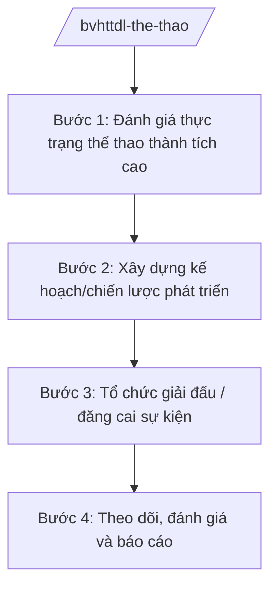

# Skill: Thể thao thành tích cao

## 2. Khi nào dùng

Khi Cục Thể dục thể thao — Bộ VHTTDL thực hiện: xây dựng chiến lược, kế hoạch phát triển
thể thao thành tích cao; quản lý đào tạo vận động viên đội tuyển quốc gia; tổ chức, đăng cai
giải thi đấu quốc gia và quốc tế; quản lý hoạt động thể thao chuyên nghiệp.

## 3. Đầu vào (Input)

| Trường | Mô tả | Bắt buộc |
|--------|-------|----------|
| `noi_dung` | Chiến lược/kế hoạch/đề án hoặc giải đấu cần triển khai | Có |
| `mon_the_thao` | Các môn thể thao trọng điểm | Có |
| `muc_tieu_thanh_tich` | Chỉ tiêu huy chương, thứ hạng tại đấu trường khu vực, châu lục, thế giới | Có |
| `don_vi_phoi_hop` | Liên đoàn, hiệp hội thể thao, địa phương, đơn vị liên quan | Không |
| `kinh_phi_du_kien` | Dự kiến nguồn lực (ngân sách, xã hội hóa) | Không |

## 4. Quy trình

**Bước 1. Đánh giá thực trạng thể thao thành tích cao**
- Làm gì: Tổng hợp thành tích các đội tuyển, hệ thống đào tạo VĐV, cơ sở vật chất, đội ngũ HLV toàn quốc.
- Dùng input: `mon_the_thao`, `muc_tieu_thanh_tich`.
- Vai trò: Chuyên viên Cục Thể dục thể thao — AI hỗ trợ tổng hợp số liệu thành tích, so sánh với khu vực (2 giờ).
- Lưu ý nghiệp vụ: Số liệu thành tích phải chính xác đến từng giải đấu, có đối chiếu với liên đoàn quốc tế.
- → Kết quả bước: Báo cáo thực trạng thể thao thành tích cao.

**Bước 2. Xây dựng kế hoạch/chiến lược phát triển**
- Làm gì: Xác định môn trọng điểm, lộ trình đào tạo VĐV, kế hoạch thi đấu, chế độ chính sách cho VĐV/HLV.
- Dùng input: `noi_dung`, `muc_tieu_thanh_tich`, `kinh_phi_du_kien`.
- Vai trò: Cục Thể dục thể thao chủ trì, phối hợp các liên đoàn — AI hỗ trợ soạn dự thảo kế hoạch, lập bảng tiến độ (2–3 giờ).
- Lưu ý nghiệp vụ: Bảo đảm chế độ dinh dưỡng, y tế, học văn hóa cho VĐV trẻ theo quy định.
- → Kết quả bước: Dự thảo chiến lược/kế hoạch phát triển thể thao thành tích cao.

**Bước 3. Tổ chức giải đấu / đăng cai sự kiện**
- Làm gì: Lập đề án tổ chức giải quốc gia hoặc đăng cai giải quốc tế: điều lệ, địa điểm, kinh phí, an ninh, y tế, truyền thông.
- Dùng input: `noi_dung`, `don_vi_phoi_hop`.
- Vai trò: Cục Thể dục thể thao + địa phương đăng cai — AI hỗ trợ soạn đề án tổ chức, dự toán kinh phí, checklist công tác (2 giờ).
- Lưu ý nghiệp vụ: Tuân thủ điều lệ của liên đoàn thể thao quốc tế; bảo đảm an toàn tuyệt đối cho VĐV, khán giả.
- → Kết quả bước: Đề án tổ chức giải đấu được phê duyệt.

**Bước 4. Theo dõi, đánh giá và báo cáo**
- Làm gì: Giám sát thực hiện kế hoạch, tổng hợp thành tích, đánh giá hiệu quả đầu tư, báo cáo Lãnh đạo Bộ.
- Dùng input: Kết quả thi đấu, báo cáo các đơn vị.
- Vai trò: Cục Thể dục thể thao — AI hỗ trợ tổng hợp báo cáo thành tích theo môn, so sánh với chỉ tiêu (1 giờ).
- Lưu ý nghiệp vụ: Đánh giá khách quan, chỉ rõ môn đạt/không đạt chỉ tiêu và nguyên nhân.
- → Kết quả bước: Báo cáo tổng kết gửi Lãnh đạo Bộ.

## Luồng quy trình (Workflow)

## 5. Đầu ra (Output)

- Chiến lược/kế hoạch phát triển thể thao thành tích cao.
- Đề án tổ chức, đăng cai giải thi đấu.
- Báo cáo thành tích, đánh giá hiệu quả.

### Cấu trúc output chuẩn

**Khung thể thức chung (NĐ 30/2020/NĐ-CP):** mọi văn bản trong output đều trình bày đầy đủ: Quốc hiệu "CỘNG HÒA XÃ HỘI CHỦ NGHĨA VIỆT NAM", Tiêu ngữ "Độc lập – Tự do – Hạnh phúc"; tên cơ quan ban hành; số, ký hiệu văn bản; địa danh, ngày tháng năm ban hành; tên loại văn bản; nội dung theo các mục dưới đây; nơi nhận (kết thúc "- Lưu: VT, [mã đơn vị]."); khối chữ ký (chức danh, họ tên người ký; ký hiệu "KT."/"TL." khi ký thay).

**Kế hoạch phát triển thể thao thành tích cao** gồm: (1) Quyết định phê duyệt (thể thức NĐ 30/2020);
(2) đánh giá thực trạng; (3) mục tiêu (huy chương, thứ hạng theo từng đấu trường);
(4) môn trọng điểm và lộ trình đào tạo; (5) chế độ chính sách VĐV/HLV;
(6) nguồn lực; (7) tổ chức thực hiện.

**Đề án tổ chức giải đấu** gồm: (1) tên, quy mô, thời gian, địa điểm; (2) điều lệ giải;
(3) công tác tổ chức (an ninh, y tế, truyền thông); (4) dự toán kinh phí; (5) phân công thực hiện.

*Thể thức văn bản tuân thủ NĐ 30/2020/NĐ-CP.*

*Thể thức văn bản tuân thủ NĐ 30/2020/NĐ-CP.*

> **Checklist thể thức văn bản theo NĐ 30/2020/NĐ-CP** — đối chiếu trước khi trình ký:
> 1. Quốc hiệu và Tiêu ngữ.
> 2. Tên cơ quan, tổ chức ban hành văn bản.
> 3. Số, ký hiệu của văn bản.
> 4. Địa danh và thời gian ban hành văn bản.
> 5. Tên loại và trích yếu nội dung văn bản.
> 6. Nội dung văn bản.
> 7. Chức vụ, họ tên và chữ ký của người có thẩm quyền.
> 8. Dấu, chữ ký số của cơ quan, tổ chức.
> 9. Nơi nhận (kèm Phụ lục nếu có).

## 6. Checklist nghiệm thu

- [ ] Số liệu thành tích chính xác, có đối chiếu
- [ ] Mục tiêu huy chương/thứ hạng cụ thể theo từng đấu trường
- [ ] Chế độ VĐV/HLV đúng quy định hiện hành
- [ ] Đề án giải đấu có phương án an ninh, y tế
- [ ] Thể thức văn bản đúng NĐ 30/2020/NĐ-CP
- [ ] Không bịa số liệu thành tích, không viện dẫn văn bản hết hiệu lực

## 7. Ví dụ mô phỏng

*Dữ liệu dưới đây là giả lập 100% phục vụ minh họa.*

**Input mẫu:** noi_dung = "Kế hoạch chuẩn bị lực lượng tham dự Đại hội thể thao khu vực năm 2027";
mon_the_thao = "Điền kinh, bơi, cử tạ, taekwondo (giả lập)"; muc_tieu_thanh_tich = "Top 3 toàn đoàn".

**Output mẫu (trích kế hoạch):**

> **KẾ HOẠCH**
> **Chuẩn bị lực lượng tham dự Đại hội thể thao khu vực năm 2027**
>
> **I. MỤC TIÊU:** Phấn đấu đạt top 3 toàn đoàn; các môn trọng điểm điền kinh, bơi, cử tạ,
> taekwondo đóng góp tối thiểu 60% tổng số huy chương vàng (số liệu giả lập minh họa).
> **II. NHIỆM VỤ:**
> 1. Tập trung đầu tư 4 môn trọng điểm: bảo đảm chế độ tập huấn, thi đấu cọ xát quốc tế
> tối thiểu 3 đợt/môn/năm...
> 2. Hoàn thiện đội ngũ HLV: mời chuyên gia nước ngoài cho 2 môn...
> 3. Bảo đảm y tế, dinh dưỡng, học văn hóa cho VĐV trẻ...
> **III. TỔ CHỨC THỰC HIỆN:** Cục Thể dục thể thao chủ trì, phối hợp các liên đoàn quốc gia...
>
> *Cục trưởng Cục Thể dục thể thao: ông Hoàng Văn EE (tên giả lập).*

## 8. Human gate

- Cục trưởng Cục Thể dục thể thao duyệt báo cáo thực trạng và dự thảo kế hoạch.
- Thứ trưởng phụ trách cho ý kiến; Bộ trưởng phê duyệt chiến lược/kế hoạch, quyết định đăng cai giải quốc tế.

## 9. Giới hạn

- AI không quyết định chỉ tiêu thành tích, lựa chọn VĐV thay hội đồng chuyên môn; không tự ký phê duyệt.
- AI không bịa thành tích thi đấu, số liệu VĐV.
- AI không viện dẫn văn bản hết hiệu lực.

## 10. Căn cứ & lưu ý

- Nghị quyết 176/2025/QH15 của Quốc hội — cơ cấu tổ chức của Chính phủ.
- Nghị định 43/2025/NĐ-CP ngày 28/02/2025 — chức năng, nhiệm vụ, quyền hạn của Bộ VHTTDL (quản lý nhà nước về thể dục, thể thao).
- Nghị định 137/2025/NĐ-CP, Nghị định 138/2025/NĐ-CP ngày 12/6/2025 — phân định thẩm quyền, phân quyền, phân cấp lĩnh vực VHTTDL.
- Nghị định 30/2020/NĐ-CP — thể thức văn bản hành chính.
- Lưu ý: tên Luật Thể dục, thể thao chỉ nêu tên, không ghi số hiệu.
