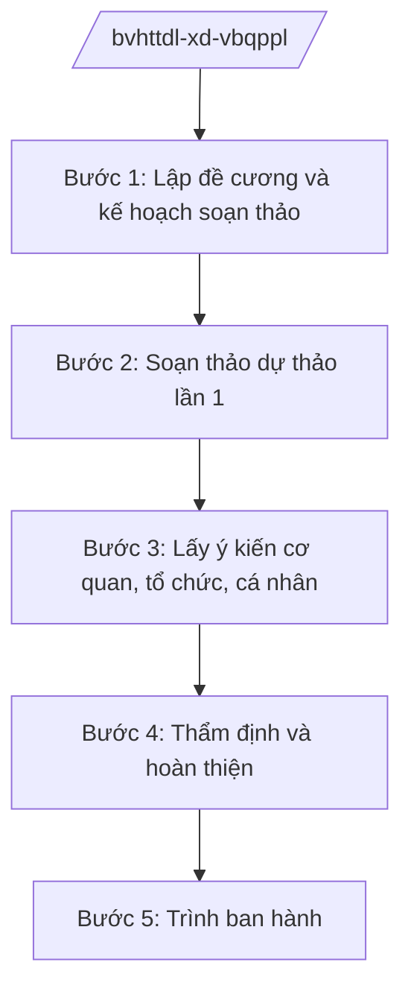

# Skill: Xây dựng VBQPPL lĩnh vực VHTTDL

## 2. Khi nào dùng

Khi Vụ/Cục thuộc Bộ Văn hóa, Thể thao và Du lịch (VHTTDL) được giao chủ trì soạn thảo:
thông tư của Bộ trưởng; hoặc dự thảo luật, pháp lệnh, nghị định, quyết định của Thủ tướng
thuộc lĩnh vực văn hóa, thể thao, du lịch, gia đình để trình cấp có thẩm quyền ban hành.

## 3. Đầu vào (Input)

| Trường | Mô tả | Bắt buộc |
|--------|-------|----------|
| `ten_van_ban` | Tên dự thảo văn bản | Có |
| `loai_van_ban` | Thông tư / Nghị định / Luật / Quyết định của Thủ tướng | Có |
| `don_vi_chu_tri` | Vụ/Cục được giao chủ trì soạn thảo | Có |
| `co_so_chinh_sach` | Chủ trương, yêu cầu quản lý đặt ra việc xây dựng văn bản | Có |
| `pham_vi_dieu_chinh` | Đối tượng, phạm vi điều chỉnh của dự thảo | Có |
| `tien_do` | Mốc thời gian phải trình ban hành | Không |

## 4. Quy trình

**Bước 1. Lập đề cương và kế hoạch soạn thảo**
- Làm gì: Xác định bố cục dự thảo, phân công tổ biên tập, lập tiến độ chi tiết.
- Dùng input: `ten_van_ban`, `loai_van_ban`, `don_vi_chu_tri`, `co_so_chinh_sach`, `tien_do`.
- Vai trò: Vụ trưởng Vụ chủ trì (ông Hoàng Văn EE) — AI hỗ trợ dựng đề cương từ văn bản tương tự và lập bảng tiến độ (30 phút).
- Lưu ý nghiệp vụ: Kiểm tra văn bản không thuộc trường hợp đã có văn bản điều chỉnh đầy đủ; xác định đúng thẩm quyền ban hành (Bộ trưởng / Chính phủ / Quốc hội).
- → Kết quả bước: Đề cương chi tiết + quyết định thành lập tổ biên tập.

**Bước 2. Soạn thảo dự thảo lần 1**
- Làm gì: Viết toàn văn dự thảo theo đề cương; rà soát tính thống nhất với hệ thống pháp luật hiện hành.
- Dùng input: `pham_vi_dieu_chinh`, `co_so_chinh_sach`.
- Vai trò: Tổ biên tập (chuyên viên Vụ) — AI hỗ trợ soạn khung điều khoản, đối chiếu thuật ngữ pháp lý, phát hiện chồng chéo với văn bản hiện hành (2–4 giờ).
- Lưu ý nghiệp vụ: Ngôn ngữ điều khoản phải rõ ràng, khả thi; không quy định vượt thẩm quyền của Bộ.
- → Kết quả bước: Dự thảo lần 1 kèm thuyết minh tóm tắt.

**Bước 3. Lấy ý kiến cơ quan, tổ chức, cá nhân**
- Làm gì: Gửi lấy ý kiến các bộ, ngành, địa phương liên quan; đăng tải lấy ý kiến rộng rãi theo quy định.
- Dùng input: Dự thảo lần 1.
- Vai trò: Vụ chủ trì — AI hỗ trợ tổng hợp ý kiến góp ý thành bảng (ý kiến / cơ quan góp ý / tiếp thu hay không / lý do) (1–2 giờ).
- Lưu ý nghiệp vụ: Bảo đảm thời hạn lấy ý kiến; mọi ý kiến không tiếp thu phải có lý do rõ ràng.
- → Kết quả bước: Bảng tổng hợp, giải trình tiếp thu ý kiến.

**Bước 4. Thẩm định và hoàn thiện**
- Làm gì: Trình Vụ Pháp chế thẩm định nội bộ; đối với dự thảo nghị định/luật thì gửi Bộ Tư pháp thẩm định; tiếp thu, hoàn thiện dự thảo.
- Dùng input: Dự thảo sau tiếp thu, bảng giải trình.
- Vai trò: Vụ Pháp chế, Vụ chủ trì — AI hỗ trợ rà soát kỹ thuật soạn thảo, thể thức (1 giờ).
- Lưu ý nghiệp vụ: Không trình ký khi còn ý kiến thẩm định chưa được giải trình đầy đủ.
- → Kết quả bước: Dự thảo hoàn chỉnh + báo cáo thẩm định + báo cáo giải trình.

**Bước 5. Trình ban hành**
- Làm gì: Lập tờ trình, trình Lãnh đạo Bộ ký ban hành (thông tư) hoặc trình Chính phủ/Quốc hội (nghị định/luật).
- Dùng input: Toàn bộ hồ sơ các bước trên.
- Vai trò: Vụ trưởng → Thứ trưởng (bà Phạm Thị DD) → Bộ trưởng (ông Lê Văn CC) ký — AI hỗ trợ soạn tờ trình và kiểm tra đầy đủ thành phần hồ sơ (1 giờ).
- Lưu ý nghiệp vụ: Hồ sơ trình phải đủ: tờ trình, dự thảo, báo cáo thẩm định, bảng tiếp thu ý kiến, thuyết minh.
- → Kết quả bước: Văn bản được ký ban hành hoặc trình cấp trên.

## Luồng quy trình (Workflow)

## 5. Đầu ra (Output)

- Tờ trình ban hành/trình văn bản.
- Dự thảo văn bản QPPL hoàn chỉnh (đúng thể thức NĐ 30/2020/NĐ-CP).
- Báo cáo thẩm định, bảng tổng hợp tiếp thu ý kiến.

### Cấu trúc output chuẩn

**Tờ trình** gồm: (1) Quốc hiệu "CỘNG HÒA XÃ HỘI CHỦ NGHĨA VIỆT NAM", Tiêu ngữ "Độc lập – Tự do – Hạnh phúc"; (2) tên loại văn bản "TỜ TRÌNH" và trích yếu;
(3) sự cần thiết ban hành; (4) mục đích, quan điểm xây dựng; (5) nội dung cơ bản của dự thảo;
(6) dự kiến tác động; (7) kiến nghị; (8) nơi nhận (kết thúc "- Lưu: VT, [mã đơn vị]."). Ký tên: BỘ TRƯỞNG, đóng dấu Bộ.

**Dự thảo văn bản** gồm: (1) Quốc hiệu "CỘNG HÒA XÃ HỘI CHỦ NGHĨA VIỆT NAM", Tiêu ngữ "Độc lập – Tự do – Hạnh phúc"; (2) căn cứ ban hành; (3) các chương, điều, khoản;
(4) điều khoản thi hành; (5) chữ ký (ghi rõ chức danh, họ tên người ký; ký hiệu "KT."/"TL." khi ký thay) người có thẩm quyền.
## 6. Checklist nghiệm thu

- [ ] Xác định đúng loại văn bản và thẩm quyền ban hành
- [ ] Đề cương được Vụ trưởng phê duyệt trước khi soạn thảo
- [ ] Đã lấy ý kiến đầy đủ cơ quan liên quan, có bảng tiếp thu
- [ ] Có báo cáo thẩm định (nội bộ và/hoặc Bộ Tư pháp)
- [ ] Dự thảo không chồng chéo, mâu thuẫn với văn bản hiện hành
- [ ] Thể thức đúng NĐ 30/2020/NĐ-CP
- [ ] Hồ sơ trình đầy đủ thành phần
- [ ] Có chữ ký của người có thẩm quyền

## 7. Ví dụ mô phỏng

*Dữ liệu dưới đây là giả lập 100% phục vụ minh họa.*

**Input mẫu:** ten_van_ban = "Thông tư quy định tiêu chí xếp hạng cơ sở lưu trú du lịch";
loai_van_ban = "Thông tư"; don_vi_chu_tri = "Cục Du lịch – Bộ VHTTDL";
co_so_chinh_sach = "Yêu cầu nâng cao chất lượng dịch vụ lưu trú, hội nhập tiêu chuẩn khu vực";
pham_vi_dieu_chinh = "Tổ chức, cá nhân kinh doanh dịch vụ lưu trú du lịch trên toàn quốc".

**Output mẫu (trích Tờ trình):**

> **BỘ VĂN HÓA, THỂ THAO VÀ DU LỊCH**
>
> **TỜ TRÌNH**
> **Về việc ban hành Thông tư quy định tiêu chí xếp hạng cơ sở lưu trú du lịch**
>
> Kính gửi: Bộ trưởng Bộ Văn hóa, Thể thao và Du lịch
>
> 1. Sự cần thiết ban hành: hệ thống tiêu chí xếp hạng hiện hành đã lạc hậu, chưa tương
> thích với tiêu chuẩn khu vực, gây khó khăn cho doanh nghiệp và công tác quản lý nhà nước...
> 2. Mục đích, quan điểm: xây dựng bộ tiêu chí minh bạch, khả thi, phù hợp thông lệ quốc tế...
> 3. Nội dung cơ bản của dự thảo: gồm 5 chương, 20 điều, quy định nguyên tắc xếp hạng,
> tiêu chí theo từng hạng, trình tự công nhận, trách nhiệm của tổ chức, cá nhân...
> 4. Dự kiến tác động: nâng chất lượng dịch vụ lưu trú; chi phí tuân thủ của doanh nghiệp
> ở mức hợp lý...
> 5. Kiến nghị: trình Bộ trưởng xem xét, ký ban hành Thông tư.

## 8. Human gate

- Vụ trưởng Vụ chủ trì duyệt đề cương và dự thảo từng lần.
- Vụ Pháp chế thẩm định trước khi trình Lãnh đạo Bộ.
- Thứ trưởng phụ trách cho ý kiến; Bộ trưởng ký ban hành (thông tư) hoặc ký tờ trình Chính phủ/Quốc hội (nghị định/luật).

## 9. Giới hạn

- AI không quyết định nội dung chính sách thay Lãnh đạo Bộ; không tự ký hoặc phát hành văn bản.
- AI không bịa căn cứ pháp lý, số hiệu văn bản; không viện dẫn văn bản đã hết hiệu lực.
- AI không soạn thảo nội dung vượt thẩm quyền ban hành của Bộ.

## 10. Căn cứ & lưu ý

- Nghị quyết 176/2025/QH15 của Quốc hội — cơ cấu tổ chức của Chính phủ (14 Bộ + 3 cơ quan ngang Bộ).
- Nghị định 43/2025/NĐ-CP ngày 28/02/2025 của Chính phủ — chức năng, nhiệm vụ, quyền hạn và cơ cấu tổ chức của Bộ Văn hóa, Thể thao và Du lịch.
- Nghị định 137/2025/NĐ-CP, Nghị định 138/2025/NĐ-CP ngày 12/6/2025 của Chính phủ — phân định thẩm quyền, phân quyền, phân cấp trong lĩnh vực văn hóa, thể thao và du lịch.
- Nghị định 303/2025/NĐ-CP của Chính phủ — khung chung về tổ chức bộ máy.
- Nghị định 30/2020/NĐ-CP của Chính phủ — công tác văn thư (thể thức văn bản hành chính).
- Lưu ý: tên các luật chuyên ngành (Luật Di sản văn hóa, Luật Du lịch, Luật Thể dục thể thao, Luật Điện ảnh...) chỉ nêu tên, không ghi số hiệu trong skill.
