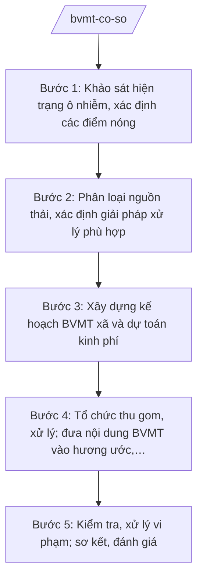

# Skill: Bảo vệ môi trường cơ sở

## 2. Khi nào dùng

- Khi Phòng Kinh tế xã được giao tham mưu công tác bảo vệ môi trường cơ sở (nhiệm vụ lĩnh vực môi trường cấp xã theo Thông tư 19/2025/TT-BNNMT).
- Khi cần khảo sát hiện trạng ô nhiễm, xác định các điểm nóng về rác thải, nước thải, chất thải chăn nuôi trên địa bàn xã.
- Khi cần xây dựng kế hoạch thu gom, vận chuyển, xử lý rác thải sinh hoạt, nước thải nông thôn, chất thải chăn nuôi, thu gom bao bì thuốc bảo vệ thực vật kèm dự toán kinh phí.
- Khi cần đưa nội dung bảo vệ môi trường vào hương ước, thôn quy ước hoặc tổ chức kiểm tra, xử lý vi phạm về môi trường (phối hợp công an xã).

## 3. Đầu vào (Input)

| Trường | Mô tả | Bắt buộc |
|--------|-------|----------|
| `nam_ke_hoach` | Năm áp dụng của kế hoạch (vd: 2026) | Có |
| `hien_trang_moi_truong` | Hiện trạng môi trường xã: tỷ lệ thu gom rác, tình trạng nước thải, chất thải chăn nuôi, điểm tập kết rác | Có |
| `diem_nong_o_nhiem` | Các điểm nóng ô nhiễm: bãi rác tự phát, kênh mương ứ đọng, cơ sở chăn nuôi gây ô nhiễm; vị trí, mức độ | Có |
| `nguon_thai` | Phân loại nguồn thải: hộ gia đình, cơ sở chăn nuôi, cơ sở sản xuất nhỏ, chợ, trường học | Có |
| `hinh_thuc_thu_gom` | Hình thức thu gom hiện có: tổ tự quản, hợp đồng đơn vị dịch vụ; tần suất, phí thu gom | Có |
| `kinh_phi` | Kinh phí dự kiến cho công tác BVMT (ngân sách xã, phí vệ sinh, huy động) | Có |
| `huong_uoc_thon` | Hương ước, quy ước của các thôn hiện hành (để bổ sung nội dung BVMT) | Có |
| `don_vi_dich_vu` | Đơn vị cung ứng dịch vụ thu gom, xử lý rác thải dự kiến hợp đồng (nếu có) | Không |
| `van_ban_chi_dao` | Văn bản chỉ đạo của cấp trên về công tác BVMT trong năm áp dụng (nếu có) | Không |

## 4. Quy trình

**Bước 1. Khảo sát hiện trạng ô nhiễm, xác định các điểm nóng**
- Làm gì: Khảo sát thực tế toàn xã: lượng rác thải sinh hoạt phát sinh, tình trạng thu gom, các bãi rác tự phát, kênh mương ứ đọng rác, nước thải nông thôn, cơ sở chăn nuôi xả thải; chụp ảnh, ghi nhận vị trí điểm nóng; lấy ý kiến người dân, trưởng thôn.
- Dùng input: `hien_trang_moi_truong`, `diem_nong_o_nhiem`, `nguon_thai`.
- Vai trò: Công chức Phòng Kinh tế (ông Nguyễn Văn G) chủ trì khảo sát, phối hợp trưởng các thôn; AI hỗ trợ lập phiếu khảo sát, tổng hợp kết quả thành bảng hiện trạng và bản đồ điểm nóng (~3 ngày).
- Lưu ý nghiệp vụ: Khảo sát thực tế, không ngồi ước đoán; ghi nhận đầy đủ cơ sở chăn nuôi có nguy cơ gây ô nhiễm; ý kiến người dân là căn cứ quan trọng để xác định điểm nóng.
- → Kết quả bước: Báo cáo khảo sát hiện trạng ô nhiễm + danh mục điểm nóng trên địa bàn xã.

**Bước 2. Phân loại nguồn thải, xác định giải pháp xử lý phù hợp**
- Làm gì: Phân loại nguồn thải theo nhóm (hộ gia đình, chăn nuôi, sản xuất nhỏ, chợ, trường học) và theo loại (rác sinh hoạt, nước thải, chất thải chăn nuôi, bao bì thuốc bảo vệ thực vật); xác định giải pháp cho từng nhóm: thu gom tập trung, xử lý tại nguồn (hầm biogas, ủ phân), thu gom bao bì thuốc BVTV về điểm tập kết.
- Dùng input: `nguon_thai`, `hinh_thuc_thu_gom`, báo cáo khảo sát bước 1.
- Vai trò: Công chức Phòng Kinh tế (ông Nguyễn Văn G) phân loại, đề xuất giải pháp; AI hỗ trợ lập bảng phân loại nguồn thải – giải pháp và ước tính khối lượng cần xử lý (~1 ngày).
- Lưu ý nghiệp vụ: Bao bì thuốc bảo vệ thực vật là chất thải nguy hại, phải thu gom riêng, không đổ chung với rác sinh hoạt; chất thải chăn nuôi khuyến khích xử lý tại nguồn (biogas, ủ phân hữu cơ).
- → Kết quả bước: Bảng phân loại nguồn thải và giải pháp xử lý cho từng nhóm.

**Bước 3. Xây dựng kế hoạch BVMT xã và dự toán kinh phí**
- Làm gì: Soạn Kế hoạch bảo vệ môi trường xã năm áp dụng: mục tiêu (tỷ lệ thu gom rác, xóa điểm nóng), nhiệm vụ theo từng nhóm nguồn thải, hình thức tổ chức thu gom (hợp đồng đơn vị dịch vụ hoặc tổ tự quản), tuyên truyền, kiểm tra; lập dự toán kinh phí chi tiết từng hạng mục.
- Dùng input: Kết quả các bước 1–2, `kinh_phi`, `don_vi_dich_vu`, `nam_ke_hoach`, `van_ban_chi_dao`.
- Vai trò: Công chức Phòng Kinh tế (ông Nguyễn Văn G) soạn kế hoạch, dự toán; AI hỗ trợ soạn thảo theo thể thức NĐ 30/2020/NĐ-CP và lập bảng dự toán kinh phí (~2 ngày).
- Lưu ý nghiệp vụ: Dự toán phải phù hợp khả năng ngân sách xã và mức phí vệ sinh thu được; hợp đồng đơn vị dịch vụ phải bảo đảm năng lực thu gom, vận chuyển, xử lý; kế hoạch phải có chỉ tiêu cụ thể, đo đếm được.
- → Kết quả bước: Dự thảo Kế hoạch BVMT xã năm … kèm dự toán kinh phí.

**Bước 4. Tổ chức thu gom, xử lý; đưa nội dung BVMT vào hương ước, thôn quy ước**
- Làm gì: Triển khai kế hoạch sau phê duyệt: ký hợp đồng đơn vị dịch vụ thu gom hoặc củng cố tổ tự quản; đặt thùng rác công cộng, điểm tập kết bao bì thuốc BVTV; tổ chức ra quân vệ sinh, xóa điểm nóng; soạn nội dung BVMT bổ sung vào hương ước, thôn quy ước (quy định về đổ rác đúng nơi, xử lý chất thải chăn nuôi, mức phạt vi phạm theo thỏa thuận cộng đồng) trình thôn thông qua.
- Dùng input: Kế hoạch đã phê duyệt bước 3, `huong_uoc_thon`.
- Vai trò: Công chức Phòng Kinh tế (ông Nguyễn Văn G) phối hợp trưởng các thôn, đơn vị dịch vụ tổ chức; AI hỗ trợ soạn mẫu điều khoản BVMT đưa vào hương ước, thôn quy ước và lịch ra quân vệ sinh (~2 ngày).
- Lưu ý nghiệp vụ: Nội dung đưa vào hương ước, thôn quy ước phải được nhân dân thôn bàn, thống nhất; không đặt ra quy định trái pháp luật; điểm tập kết bao bì thuốc BVTV phải có biển báo, mái che.
- → Kết quả bước: Hợp đồng dịch vụ/tổ tự quản đi vào hoạt động + nội dung BVMT bổ sung vào hương ước, thôn quy ước.

**Bước 5. Kiểm tra, xử lý vi phạm; sơ kết, đánh giá**
- Làm gì: Tổ chức kiểm tra định kỳ và đột xuất: việc thu gom của đơn vị dịch vụ/tổ tự quản, tình trạng điểm nóng, cơ sở chăn nuôi gây ô nhiễm; lập biên bản, xử lý vi phạm theo thẩm quyền (phối hợp công an xã); sơ kết 6 tháng, tổng kết năm, đánh giá chỉ tiêu đạt được.
- Dùng input: Kế hoạch đã phê duyệt, danh mục điểm nóng bước 1.
- Vai trò: Công chức Phòng Kinh tế (ông Nguyễn Văn G) chủ trì kiểm tra, phối hợp công an xã; AI hỗ trợ lập lịch kiểm tra, mẫu biên bản kiểm tra và bảng đánh giá chỉ tiêu (~0,5 ngày/lần kiểm tra).
- Lưu ý nghiệp vụ: Xử lý vi phạm phải đúng thẩm quyền, đúng trình tự; ưu tiên nhắc nhở, vận động trước khi xử phạt đối với hộ gia đình; cơ sở chăn nuôi tái vi phạm phải báo cáo UBND xã xử lý nghiêm.
- → Kết quả bước: Biên bản kiểm tra, xử lý vi phạm + báo cáo sơ kết, tổng kết công tác BVMT.

## Luồng quy trình (Workflow)

## 5. Đầu ra (Output)

**Danh sách sản phẩm:**
1. Kế hoạch bảo vệ môi trường xã năm … kèm dự toán kinh phí (sản phẩm chính).
2. Nội dung bảo vệ môi trường bổ sung vào hương ước, thôn quy ước (tài liệu kèm theo).
3. Hợp đồng dịch vụ thu gom, vận chuyển, xử lý rác thải / quyết định củng cố tổ tự quản (tài liệu kèm theo).
4. Biên bản kiểm tra, xử lý vi phạm về môi trường; báo cáo sơ kết, tổng kết (tài liệu kèm theo).

### Cấu trúc output chuẩn — Kế hoạch bảo vệ môi trường xã

1. Quốc hiệu – tiêu ngữ: "CỘNG HÒA XÃ HỘI CHỦ NGHĨA VIỆT NAM / Độc lập – Tự do – Hạnh phúc". (đúng thể thức NĐ 30/2020/NĐ-CP)
2. Tên cơ quan ban hành: "ỦY BAN NHÂN DÂN XÃ A".
3. Số, ký hiệu văn bản: số/ký hiệu theo quy định (vd: 45/KH-UBND).
4. Địa danh, ngày tháng năm ban hành: "Xã A, ngày … tháng … năm …".
5. Tên loại và trích yếu: "KẾ HOẠCH — Bảo vệ môi trường xã A năm …".
6. Căn cứ: Luật Bảo vệ môi trường (chỉ nêu tên luật); Thông tư số 19/2025/TT-BNNMT ngày 19/6/2025 của Bộ Nông nghiệp và Môi trường; Nghị định số 150/2025/NĐ-CP ngày 12/6/2025 của Chính phủ; văn bản chỉ đạo của cấp trên (nếu có).
7. Nội dung: I. Đánh giá hiện trạng môi trường và các điểm nóng; II. Mục tiêu (tỷ lệ thu gom rác thải sinh hoạt, xóa điểm nóng, thu gom bao bì thuốc BVTV); III. Nhiệm vụ, giải pháp (thu gom – vận chuyển – xử lý rác thải sinh hoạt; nước thải nông thôn; chất thải chăn nuôi; thu gom bao bì thuốc bảo vệ thực vật; tuyên truyền; đưa nội dung BVMT vào hương ước, thôn quy ước); IV. Tổ chức thực hiện (Phòng Kinh tế chủ trì, công an xã phối hợp kiểm tra, xử lý vi phạm; các thôn, tổ tự quản/đơn vị dịch vụ); V. Kinh phí (dự toán chi tiết từng hạng mục).
8. Thẩm quyền – chức vụ – họ tên người ký: Chủ tịch UBND xã — Nguyễn Văn A; ký, đóng dấu UBND xã.
9. Nơi nhận: Thường trực Đảng ủy, HĐND xã; Sở Nông nghiệp và Môi trường tỉnh A; Phòng Kinh tế; công an xã; các thôn; đơn vị dịch vụ (nếu có); lưu VP.

## 6. Checklist nghiệm thu

- [ ] Kế hoạch đủ các phần theo cấu trúc output chuẩn, kèm dự toán kinh phí chi tiết từng hạng mục.
- [ ] Nội dung bao quát đủ 4 nhóm: rác thải sinh hoạt; nước thải nông thôn; chất thải chăn nuôi; bao bì thuốc bảo vệ thực vật (thu gom riêng, không đổ chung rác sinh hoạt).
- [ ] Danh mục điểm nóng đầy đủ vị trí, mức độ; kế hoạch có giải pháp xóa từng điểm nóng với thời hạn cụ thể.
- [ ] Có nội dung bảo vệ môi trường đưa vào hương ước, thôn quy ước, đã được nhân dân thôn thống nhất, không trái pháp luật.
- [ ] Phân công rõ: Phòng Kinh tế chủ trì, công an xã phối hợp kiểm tra, xử lý vi phạm; đơn vị dịch vụ/tổ tự quản chịu trách nhiệm thu gom.
- [ ] Dự toán kinh phí phù hợp khả năng ngân sách xã và nguồn thu phí vệ sinh.
- [ ] Số liệu hiện trạng, điểm nóng khớp đúng Input, không bịa số liệu.
- [ ] Văn bản đúng thể thức NĐ 30/2020/NĐ-CP; đã qua human gate: công chức soạn → Trưởng phòng Kinh tế kiểm tra → Chủ tịch UBND xã ký.

## 7. Ví dụ mô phỏng

*Dữ liệu dưới đây là giả lập 100% phục vụ minh họa.*

### Input mẫu

| Trường | Giá trị giả lập |
|--------|-----------------|
| nam_ke_hoach | 2026 |
| hien_trang_moi_truong | Tỷ lệ thu gom rác thải sinh hoạt đạt 70%; 3 bãi rác tự phát; kênh Thôn 2 ứ đọng rác; 20 hộ chăn nuôi xả thải trực tiếp |
| diem_nong_o_nhiem | Bãi rác tự phát tại Thôn 3 (500 m²), Thôn 5 (300 m²); kênh mương Thôn 2 ứ đọng; 5 cơ sở chăn nuôi lớn gây mùi tại Thôn 4 |
| nguon_thai | 1.000 hộ gia đình; 20 cơ sở chăn nuôi; 1 chợ xã; 3 trường học |
| hinh_thuc_thu_gom | Tổ tự quản 5 thôn, thu gom 2 lần/tuần; phí vệ sinh 10.000 đồng/hộ/tháng |
| kinh_phi | 200 triệu đồng (ngân sách xã 120 triệu, phí vệ sinh 80 triệu) |
| huong_uoc_thon | Hương ước 5 thôn hiện hành (chưa có điều khoản về BVMT) |
| don_vi_dich_vu | Hợp tác xã dịch vụ môi trường thôn (dự kiến) |
| van_ban_chi_dao | Văn bản của UBND tỉnh A về tăng cường quản lý chất thải rắn sinh hoạt năm 2026 |

### Output mẫu — Kế hoạch bảo vệ môi trường xã A năm 2026 (trích)

> CỘNG HÒA XÃ HỘI CHỦ NGHĨA VIỆT NAM
> Độc lập – Tự do – Hạnh phúc
>
> ỦY BAN NHÂN DÂN XÃ A
>
> Số: 45/KH-UBND
>
> Xã A, ngày 10 tháng 01 năm 2026
>
> **KẾ HOẠCH**
> **Bảo vệ môi trường xã A năm 2026**
>
> Căn cứ Luật Bảo vệ môi trường;
> Căn cứ Thông tư số 19/2025/TT-BNNMT ngày 19/6/2025 của Bộ Nông nghiệp và Môi trường hướng dẫn chức năng, nhiệm vụ của cơ quan chuyên môn về nông nghiệp và môi trường thuộc UBND cấp xã;
> Căn cứ Nghị định số 150/2025/NĐ-CP ngày 12/6/2025 của Chính phủ quy định tổ chức các cơ quan chuyên môn thuộc UBND cấp tỉnh, cấp xã;
> Theo đề nghị của Trưởng phòng Kinh tế xã A,
>
> **I. ĐÁNH GIÁ HIỆN TRẠNG**
>
> Tỷ lệ thu gom rác thải sinh hoạt toàn xã đạt 70%. Còn 3 bãi rác tự phát (Thôn 3, Thôn 5); kênh mương Thôn 2 ứ đọng rác; 20 hộ chăn nuôi xả thải trực tiếp ra môi trường.
>
> **II. MỤC TIÊU NĂM 2026**
>
> 1. Nâng tỷ lệ thu gom rác thải sinh hoạt lên 90%.
> 2. Xóa 3 bãi rác tự phát, khơi thông kênh mương Thôn 2 trong quý II/2026.
> 3. 100% bao bì thuốc bảo vệ thực vật được thu gom về điểm tập kết, không đổ chung với rác sinh hoạt.
>
> **III. NHIỆM VỤ, GIẢI PHÁP**
>
> 1. Thu gom, vận chuyển, xử lý rác thải sinh hoạt: củng cố tổ tự quản 5 thôn, thu gom 3 lần/tuần; đặt 50 thùng rác công cộng tại khu dân cư, chợ, trường học.
> 2. Nước thải nông thôn: vận động hộ gia đình xây hố ga, bể tự hoại; khơi thông kênh mương Thôn 2.
> 3. Chất thải chăn nuôi: vận động 20 hộ xây hầm biogas, ủ phân hữu cơ; kiểm tra, yêu cầu 5 cơ sở gây ô nhiễm tại Thôn 4 khắc phục trong quý I/2026.
> 4. Bao bì thuốc bảo vệ thực vật: đặt 10 điểm thu gom có biển báo, mái che tại các thôn; hợp đồng đơn vị xử lý chất thải nguy hại vận chuyển định kỳ.
> 5. Tuyên truyền và đưa nội dung BVMT vào hương ước, thôn quy ước của 5 thôn.
>
> **IV. TỔ CHỨC THỰC HIỆN**
>
> 1. Phòng Kinh tế chủ trì, theo dõi, tổng hợp, báo cáo.
> 2. Công an xã phối hợp kiểm tra, xử lý vi phạm về môi trường.
> 3. Trưởng các thôn tổ chức thực hiện trên địa bàn, đưa nội dung BVMT vào hương ước, thôn quy ước.
>
> **V. KINH PHÍ**
>
> Tổng kinh phí 200 triệu đồng, trong đó ngân sách xã 120 triệu đồng, nguồn thu phí vệ sinh 80 triệu đồng.
>
> **Nơi nhận:**
> - Như mục IV;
> - Sở Nông nghiệp và Môi trường tỉnh A (để báo cáo);
> - Lưu: VP, Phòng Kinh tế.
>
> **CHỦ TỊCH**
>
> *(Ký, đóng dấu)*
> **Nguyễn Văn A**

## 8. Human gate (người kiểm duyệt)

- Công chức Phòng Kinh tế (ông Nguyễn Văn G) khảo sát, soạn kế hoạch, dự toán và nội dung BVMT bổ sung vào hương ước, thôn quy ước.
- Trưởng phòng Kinh tế (bà Hoàng Thị D) kiểm tra nội dung, số liệu, thể thức văn bản trước khi trình.
- Chủ tịch UBND xã (ông Nguyễn Văn A) ký ban hành Kế hoạch.
- Nội dung BVMT đưa vào hương ước, thôn quy ước phải được nhân dân từng thôn bàn, thống nhất thông qua.
- Biên bản xử lý vi phạm về môi trường do người có thẩm quyền ký; trường hợp vượt thẩm quyền báo cáo Chủ tịch UBND xã quyết định.

## 9. Giới hạn (guardrails)

- AI KHÔNG ra quyết định hành chính thay người có thẩm quyền; không tự phê duyệt kế hoạch, không tự quyết định xử lý vi phạm.
- AI KHÔNG tự ký, đóng dấu hoặc phát hành văn bản dưới danh nghĩa UBND xã hay cá nhân lãnh đạo.
- AI KHÔNG bịa số liệu hiện trạng ô nhiễm, điểm nóng, dự toán kinh phí; chỉ dùng số liệu do con người cung cấp trong Input.
- AI KHÔNG bịa số hiệu văn bản, căn cứ pháp lý; khi nhắc Luật Bảo vệ môi trường chỉ nêu tên luật.
- AI KHÔNG dùng văn bản đã hết hiệu lực làm căn cứ; không soạn điều khoản hương ước, thôn quy ước trái pháp luật.

## 10. Căn cứ & lưu ý

- Thông tư số 19/2025/TT-BNNMT ngày 19/6/2025 của Bộ Nông nghiệp và Môi trường: hướng dẫn chức năng, nhiệm vụ của cơ quan chuyên môn về nông nghiệp và môi trường thuộc UBND cấp xã (bao gồm lĩnh vực môi trường).
- Luật Bảo vệ môi trường (chỉ nêu tên luật).
- Nghị định số 150/2025/NĐ-CP ngày 12/6/2025 của Chính phủ (hiệu lực 16/6/2025): tổ chức cơ quan chuyên môn thuộc UBND cấp xã (Phòng Kinh tế); sửa đổi bởi Nghị định số 370/2025/NĐ-CP ngày 31/12/2025 (hiệu lực 01/01/2026).
- Nghị định số 30/2020/NĐ-CP của Chính phủ: thể thức văn bản hành chính.
- Lưu ý: bao bì thuốc bảo vệ thực vật phải thu gom, xử lý riêng; nội dung BVMT đưa vào hương ước, thôn quy ước phải được nhân dân thống nhất; kiểm tra, xử lý vi phạm phối hợp chặt chẽ với công an xã.
