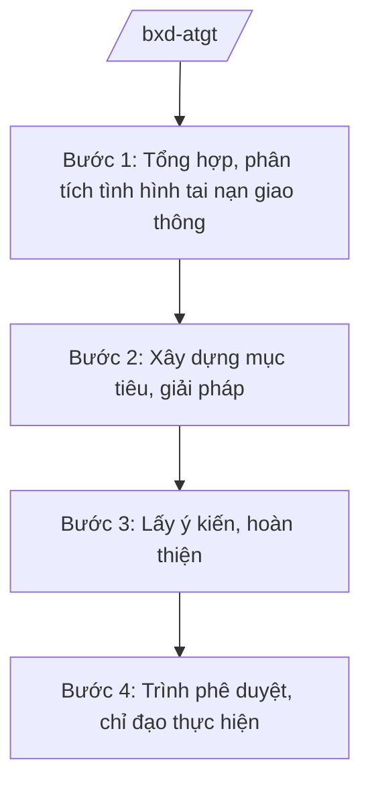

# Skill: An toàn giao thông (cấp bộ)

## 2. Khi nào dùng

Khi Bộ Xây dựng (cơ quan thường trực Ủy ban An toàn giao thông Quốc gia) xây dựng chiến lược,
chương trình, kế hoạch quốc gia về bảo đảm trật tự, an toàn giao thông; tổng hợp, đánh giá
tình hình tai nạn giao thông toàn quốc; chỉ đạo, hướng dẫn địa phương.

## 3. Đầu vào (Input)

| Trường | Mô tả | Bắt buộc |
|--------|-------|----------|
| `nhiem_vu` | Nhiệm vụ: chiến lược / chương trình / đánh giá / chỉ đạo | Có |
| `so_lieu_tngt` | Số liệu tai nạn giao thông (nguồn chính thức) | Có |
| `giai_doan` | Giai đoạn thực hiện | Có |
| `muc_tieu_giam` | Mục tiêu giảm tai nạn (số vụ, số người chết, bị thương) | Không |

## 4. Quy trình

**Bước 1. Tổng hợp, phân tích tình hình tai nạn giao thông**

- Làm gì: Thu thập số liệu tai nạn giao thông toàn quốc từ cơ quan chức năng; phân tích
  nguyên nhân, địa bàn, thời điểm, loại phương tiện.
- Dùng input: `so_lieu_tngt`, `giai_doan`.
- Vai trò: Văn phòng Ủy ban ATGT Quốc gia (đặt tại Bộ Xây dựng) chủ trì; AI hỗ trợ tổng hợp ⏱ ~3–5 ngày làm việc (ước tính).
  số liệu, lập biểu đồ, bảng phân tích (2–3 giờ).
- Lưu ý nghiệp vụ: Chỉ dùng số liệu từ nguồn chính thức (Cục CSGT, địa phương); ghi rõ nguồn,
  kỳ báo cáo.
- → Kết quả bước: Báo cáo phân tích tình hình tai nạn giao thông.

**Bước 2. Xây dựng mục tiêu, giải pháp**

- Làm gì: Đề xuất mục tiêu giảm tai nạn; nhóm giải pháp (hạ tầng, phương tiện, người tham gia
  giao thông, quản lý nhà nước, ứng dụng công nghệ).
- Dùng input: `muc_tieu_giam`, báo cáo phân tích.
- Vai trò: Chuyên viên xây dựng dự thảo; AI hỗ trợ dự thảo nội dung, đối chiếu giải pháp ⏱ ~3–5 ngày làm việc (ước tính).
  các giai đoạn trước (2–3 giờ).
- Lưu ý nghiệp vụ: Mục tiêu phải cụ thể, đo lường được; giải pháp có đầu mối, thời hạn.
- → Kết quả bước: Dự thảo chiến lược/chương trình/kế hoạch ATGT.

**Bước 3. Lấy ý kiến, hoàn thiện**

- Làm gì: Lấy ý kiến các bộ/ngành thành viên Ủy ban ATGT Quốc gia, địa phương; tiếp thu, giải trình.
- Dùng input: Dự thảo.
- Vai trò: Văn phòng Ủy ban ATGT Quốc gia tổng hợp; AI hỗ trợ bảng tiếp thu ý kiến (2 giờ).
- Lưu ý nghiệp vụ: Phối hợp chặt với Bộ Công an (lực lượng CSGT), Bộ Giáo dục và Đào tạo
  (giáo dục ATGT trong trường học).
- → Kết quả bước: Dự thảo hoàn chỉnh.

**Bước 4. Trình phê duyệt, chỉ đạo thực hiện**

- Làm gì: Trình Thủ tướng (Chủ tịch Ủy ban ATGT Quốc gia) phê duyệt; ban hành văn bản chỉ đạo
  các đợt cao điểm; theo dõi, sơ kết, tổng kết.
- Dùng input: Toàn bộ hồ sơ.
- Vai trò: Bộ trưởng Bộ Xây dựng (Phó Chủ tịch thường trực Ủy ban) ký trình; AI hỗ trợ ⏱ ~1–2 ngày làm việc (ước tính).
  checklist hồ sơ, dự thảo công điện chỉ đạo (1–2 giờ).
- Lưu ý nghiệp vụ: Các đợt cao điểm (Tết, lễ) có công điện chỉ đạo riêng, ban hành kịp thời.
- → Kết quả bước: Văn bản phê duyệt/chỉ đạo + kế hoạch theo dõi.

## Luồng quy trình (Workflow)

## 5. Đầu ra (Output)

- Chiến lược/chương trình/kế hoạch quốc gia về ATGT (đúng thể thức NĐ 30/2020/NĐ-CP).
- Báo cáo phân tích tình hình tai nạn giao thông.
- Công điện, văn bản chỉ đạo các đợt cao điểm.

### Cấu trúc output chuẩn (quyết định phê duyệt chương trình ATGT)

1. Quốc hiệu "CỘNG HÒA XÃ HỘI CHỦ NGHĨA VIỆT NAM", Tiêu ngữ "Độc lập – Tự do – Hạnh phúc"; số, ký hiệu: …/QĐ-TTg.
2. Căn cứ pháp lý (pháp luật về trật tự, ATGT đường bộ; NĐ 33/2025/NĐ-CP...).
3. Điều 1: Phê duyệt chương trình (mục tiêu, nhóm giải pháp, phân kỳ, kinh phí).
4. Điều 2: Tổ chức thực hiện (Ủy ban ATGT Quốc gia; trách nhiệm bộ/ngành, địa phương).
5. Điều 3: Hiệu lực; chế độ báo cáo, sơ kết, tổng kết.
6. Nơi nhận (kết thúc "- Lưu: VT, [mã đơn vị]."); chữ ký (ghi rõ chức danh, họ tên người ký; ký hiệu "KT."/"TL." khi ký thay) người có thẩm quyền.
## 6. Checklist nghiệm thu

- [ ] Số liệu tai nạn từ nguồn chính thức, ghi rõ nguồn và kỳ báo cáo.
- [ ] Mục tiêu cụ thể, đo lường được theo từng năm/giai đoạn.
- [ ] Giải pháp có đầu mối chủ trì, thời hạn rõ ràng.
- [ ] Đã lấy ý kiến các thành viên Ủy ban ATGT Quốc gia.
- [ ] Đúng thẩm quyền phê duyệt; đúng thể thức NĐ 30/2020/NĐ-CP.
- [ ] Có cơ chế theo dõi, sơ kết, tổng kết.
- [ ] Đã qua human gate đầy đủ.

## 7. Ví dụ mô phỏng

*Dữ liệu dưới đây là giả lập 100% phục vụ minh họa.*

**Input mẫu:** `nhiem_vu` = chương trình quốc gia; `giai_doan` = 2026–2030; `so_lieu_tngt` = số liệu
giả lập: giảm 5%/năm số người chết vì tai nạn giao thông; `muc_tieu_giam` = giảm 25% số người
chết vào năm 2030 so với 2025 (số liệu giả lập).

**Output mẫu (trích cấu trúc chuẩn):**

> **THỦ TƯỚNG CHÍNH PHỦ**
> **CỘNG HÒA XÃ HỘI CHỦ NGHĨA VIỆT NAM**
> **Độc lập – Tự do – Hạnh phúc**
>
> Số: 1234/QĐ-TTg *(số hiệu giả lập)*
>
> **QUYẾT ĐỊNH**
> **Phê duyệt Chương trình quốc gia bảo đảm trật tự, an toàn giao thông giai đoạn 2026–2030**
>
> *Căn cứ pháp luật về trật tự, an toàn giao thông đường bộ;*
> *Căn cứ Nghị định số 33/2025/NĐ-CP ngày 25/02/2025 của Chính phủ... (được sửa đổi, bổ sung);*
> *Theo đề nghị của Bộ trưởng Bộ Xây dựng,*
>
> **Điều 1.** Phê duyệt Chương trình... với mục tiêu giảm 25% số người chết vì tai nạn giao thông
> vào năm 2030 *(số liệu giả lập)*...
> **Điều 2.** Ủy ban An toàn giao thông Quốc gia chỉ đạo, điều hành...

## 8. Human gate

1. Chánh Văn phòng Ủy ban ATGT Quốc gia: duyệt nội dung chuyên môn.
2. Bộ trưởng Bộ Xây dựng (Phó Chủ tịch thường trực Ủy ban): duyệt trước khi trình.
3. Thủ tướng Chính phủ (Chủ tịch Ủy ban ATGT Quốc gia): phê duyệt.

## 9. Giới hạn

- AI không quyết định mục tiêu, giải pháp ATGT thay cơ quan có thẩm quyền.
- AI không bịa số liệu tai nạn giao thông; chỉ dùng số liệu từ nguồn chính thức.
- AI không tự ký, ban hành văn bản.
- AI không viện dẫn văn bản hết hiệu lực.

## 10. Căn cứ & lưu ý

- Nghị định số 33/2025/NĐ-CP ngày 25/02/2025 của Chính phủ quy định chức năng, nhiệm vụ,
  quyền hạn và cơ cấu tổ chức của Bộ Xây dựng (được sửa đổi, bổ sung).
- Pháp luật về trật tự, an toàn giao thông (đường bộ, đường sắt, đường thủy nội địa...).
- Nghị định số 30/2020/NĐ-CP về công tác văn thư (thể thức văn bản).
- Lưu ý: Bộ Xây dựng là cơ quan thường trực Ủy ban An toàn giao thông Quốc gia.
