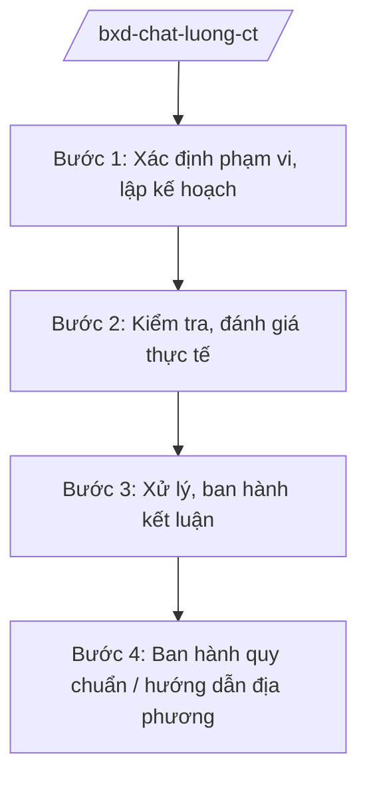

# Skill: Quản lý chất lượng công trình (cấp bộ)

## 2. Khi nào dùng

Khi Bộ Xây dựng thực hiện quản lý nhà nước về chất lượng công trình xây dựng ở tầm vĩ mô:
ban hành quy chuẩn kỹ thuật quốc gia; kiểm tra công trình trọng điểm quốc gia; xử lý sự cố
công trình nghiêm trọng; hướng dẫn địa phương về quản lý chất lượng.

## 3. Đầu vào (Input)

| Trường | Mô tả | Bắt buộc |
|--------|-------|----------|
| `nhiem_vu` | Nhiệm vụ: ban hành quy chuẩn / kiểm tra công trình / xử lý sự cố / hướng dẫn | Có |
| `doi_tuong_ct` | Công trình hoặc nhóm công trình liên quan | Có |
| `ho_so_ky_thuat` | Hồ sơ thiết kế, nghiệm thu, báo cáo sự cố (nếu có) | Không |
| `don_vi_phoi_hop` | Cơ quan, địa phương, chủ đầu tư phối hợp | Không |

## 4. Quy trình

**Bước 1. Xác định phạm vi, lập kế hoạch**

- Làm gì: Xác định công trình/nhóm công trình thuộc diện kiểm tra hoặc nội dung quy chuẩn cần ban hành; lập kế hoạch.
- Dùng input: `nhiem_vu`, `doi_tuong_ct`.
- Vai trò: Cục Giám định nhà nước về chất lượng công trình xây dựng chủ trì; AI hỗ trợ lập ⏱ ~2–3 ngày làm việc (ước tính).
  kế hoạch kiểm tra, danh mục hồ sơ cần thu thập (1–2 giờ).
- Lưu ý nghiệp vụ: Ưu tiên công trình trọng điểm quốc gia, công trình có dấu hiệu mất an toàn.
- → Kết quả bước: Kế hoạch kiểm tra / đề cương xây dựng quy chuẩn.

**Bước 2. Kiểm tra, đánh giá thực tế**

- Làm gì: Tổ chức đoàn kiểm tra hiện trường; đánh giá hồ sơ quản lý chất lượng của chủ đầu tư,
  nhà thầu; lấy mẫu thí nghiệm khi cần.
- Dùng input: `ho_so_ky_thuat`, `don_vi_phoi_hop`.
- Vai trò: Đoàn kiểm tra của Cục thực hiện; AI hỗ trợ tổng hợp biên bản kiểm tra, lập bảng ⏱ ~3–5 ngày làm việc (ước tính).
  tồn tại – kiến nghị (2–3 giờ).
- Lưu ý nghiệp vụ: Kết luận kiểm tra phải dựa trên hồ sơ, số liệu thực tế; không suy đoán.
- → Kết quả bước: Biên bản kiểm tra + báo cáo đánh giá chất lượng.

**Bước 3. Xử lý, ban hành kết luận**

- Làm gì: Ban hành thông báo kết luận kiểm tra; yêu cầu khắc phục; xử lý vi phạm theo thẩm quyền;
  đối với sự cố nghiêm trọng, tổ chức giám định nguyên nhân.
- Dùng input: Báo cáo đánh giá chất lượng.
- Vai trò: Cục trưởng ký thông báo kết luận; AI hỗ trợ dự thảo thông báo, văn bản yêu cầu ⏱ ~2–3 ngày làm việc (ước tính).
  khắc phục (1–2 giờ).
- Lưu ý nghiệp vụ: Yêu cầu khắc phục phải có thời hạn cụ thể; theo dõi đến khi hoàn thành.
- → Kết quả bước: Thông báo kết luận kiểm tra; quyết định xử lý (nếu có).

**Bước 4. Ban hành quy chuẩn / hướng dẫn địa phương**

- Làm gì: (Nếu nhiệm vụ là ban hành quy chuẩn) tổ chức soạn thảo QCVN, lấy ý kiến, thẩm định,
  trình ban hành; (nếu hướng dẫn) ban hành văn bản hướng dẫn địa phương.
- Dùng input: Kết quả các bước trên.
- Vai trò: Vụ Khoa học công nghệ và môi trường (Bộ Xây dựng) phối hợp; AI hỗ trợ dự thảo ⏱ ~5–7 ngày làm việc (ước tính).
  quy chuẩn, văn bản hướng dẫn (2–4 giờ).
- Lưu ý nghiệp vụ: Quy chuẩn kỹ thuật quốc gia phải qua thẩm định theo quy định pháp luật
  về tiêu chuẩn, quy chuẩn kỹ thuật.
- → Kết quả bước: Quy chuẩn/văn bản hướng dẫn được ban hành.

## Luồng quy trình (Workflow)

## 5. Đầu ra (Output)

- Kế hoạch kiểm tra; biên bản kiểm tra; thông báo kết luận kiểm tra.
- Quy chuẩn kỹ thuật quốc gia / văn bản hướng dẫn (đúng thể thức NĐ 30/2020/NĐ-CP).

### Cấu trúc output chuẩn (thông báo kết luận kiểm tra)

1. Quốc hiệu "CỘNG HÒA XÃ HỘI CHỦ NGHĨA VIỆT NAM", Tiêu ngữ "Độc lập – Tự do – Hạnh phúc"; số, ký hiệu: …/TB-BXD.
2. Căn cứ (quyết định kiểm tra; NĐ 33/2025/NĐ-CP...).
3. Nội dung: đoàn kiểm tra, thời gian, đối tượng; kết quả kiểm tra (đạt/tồn tại);
   yêu cầu khắc phục (nội dung, thời hạn, trách nhiệm).
4. Tổ chức thực hiện; theo dõi.
5. Nơi nhận (kết thúc "- Lưu: VT, [mã đơn vị]."); chữ ký (ghi rõ chức danh, họ tên người ký; ký hiệu "KT."/"TL." khi ký thay) người có thẩm quyền.
## 6. Checklist nghiệm thu

- [ ] Đúng thẩm quyền kiểm tra của Bộ (công trình trọng điểm, sự cố nghiêm trọng...).
- [ ] Kết luận dựa trên hồ sơ, số liệu thực tế, không suy đoán.
- [ ] Yêu cầu khắc phục cụ thể, có thời hạn, có đầu mối chịu trách nhiệm.
- [ ] Quy chuẩn (nếu có) đúng trình tự thẩm định, ban hành.
- [ ] Đúng thể thức NĐ 30/2020/NĐ-CP.
- [ ] Đã qua human gate đầy đủ.

## 7. Ví dụ mô phỏng

*Dữ liệu dưới đây là giả lập 100% phục vụ minh họa.*

**Input mẫu:** `nhiem_vu` = kiểm tra công trình; `doi_tuong_ct` = cầu vượt giả lập trên địa bàn
tỉnh A (công trình cấp II, vốn đầu tư công); `don_vi_phoi_hop` = Sở Xây dựng tỉnh A, chủ đầu tư.

**Output mẫu (trích cấu trúc chuẩn):**

> **BỘ XÂY DỰNG**
> **CỤC GIÁM ĐỊNH NHÀ NƯỚC VỀ CHẤT LƯỢNG CÔNG TRÌNH XÂY DỰNG**
> **CỘNG HÒA XÃ HỘI CHỦ NGHĨA VIỆT NAM**
> **Độc lập – Tự do – Hạnh phúc**
>
> Số: 1234/TB-BXD *(số hiệu giả lập)*
>
> **THÔNG BÁO**
> **Kết luận kiểm tra chất lượng công trình cầu vượt [tên giả lập], tỉnh A**
>
> *Căn cứ Quyết định kiểm tra số ...; căn cứ Nghị định số 33/2025/NĐ-CP...*
>
> Đoàn kiểm tra của Cục đã tiến hành kiểm tra từ ngày ... đến ngày ... *(thời gian giả lập)*.
> **Kết quả:** 1. Về hồ sơ quản lý chất lượng: ... 2. Tồn tại: ... 
> **Yêu cầu:** Chủ đầu tư khắc phục các tồn tại trước ngày ...; báo cáo kết quả về Cục...

## 8. Human gate

1. Cục trưởng Cục Giám định nhà nước về chất lượng công trình xây dựng: duyệt kế hoạch,
   ký thông báo kết luận.
2. Thứ trưởng phụ trách: duyệt đối với công trình trọng điểm, sự cố nghiêm trọng.
3. Bộ trưởng: ban hành quy chuẩn kỹ thuật quốc gia.

## 9. Giới hạn

- AI không kết luận về chất lượng, an toàn công trình thay đoàn kiểm tra và cơ quan có thẩm quyền.
- AI không bịa số liệu kỹ thuật, kết quả thí nghiệm.
- AI không tự ký, ban hành văn bản.
- AI không viện dẫn văn bản hết hiệu lực.

## 10. Căn cứ & lưu ý

- Nghị định số 33/2025/NĐ-CP ngày 25/02/2025 của Chính phủ quy định chức năng, nhiệm vụ,
  quyền hạn và cơ cấu tổ chức của Bộ Xây dựng (được sửa đổi, bổ sung).
- Pháp luật về xây dựng (quản lý chất lượng công trình; phân cấp quản lý).
- Pháp luật về tiêu chuẩn, quy chuẩn kỹ thuật (đối với ban hành QCVN).
- Nghị định số 30/2020/NĐ-CP về công tác văn thư (thể thức văn bản).
