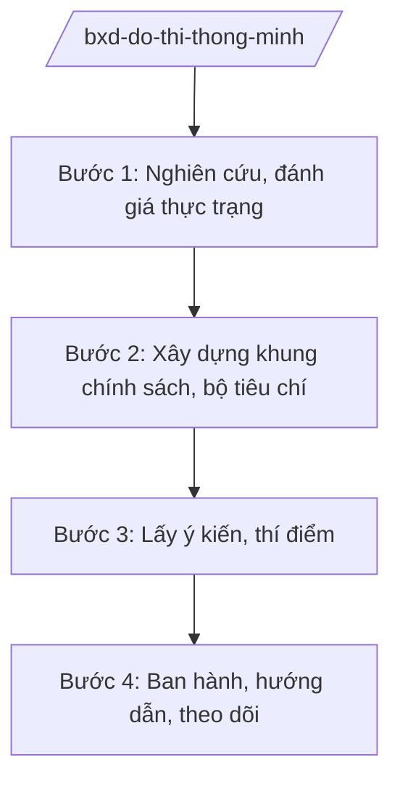

# Skill: Phát triển đô thị thông minh

## 2. Khi nào dùng

Khi Bộ Xây dựng xây dựng đề án, khung chính sách phát triển đô thị thông minh ở tầm quốc gia;
hướng dẫn địa phương triển khai; đánh giá, công nhận đô thị thông minh; tổng hợp mô hình điểm.

## 3. Đầu vào (Input)

| Trường | Mô tả | Bắt buộc |
|--------|-------|----------|
| `nhiem_vu` | Nhiệm vụ: đề án / khung chính sách / hướng dẫn / đánh giá | Có |
| `pham_vi` | Phạm vi: toàn quốc / nhóm đô thị / đô thị điểm | Có |
| `linh_vuc_uu_tien` | Lĩnh vực ưu tiên: giao thông, năng lượng, môi trường, quản trị... | Có |
| `mo_hinh_tham_khao` | Mô hình trong nước/quốc tế tham khảo | Không |

## 4. Quy trình

**Bước 1. Nghiên cứu, đánh giá thực trạng**

- Làm gì: Rà soát hiện trạng ứng dụng công nghệ trong quản lý đô thị tại các địa phương;
  nghiên cứu mô hình đô thị thông minh trong nước và quốc tế.
- Dùng input: `pham_vi`, `mo_hinh_tham_khao`.
- Vai trò: Vụ Quy hoạch – Kiến trúc / Cục Phát triển đô thị (Bộ Xây dựng) chủ trì; AI hỗ trợ tổng hợp tài liệu, lập bảng so sánh mô hình ⏱ ~3–5 ngày làm việc (ước tính).
- Lưu ý nghiệp vụ: Đánh giá theo bộ tiêu chí thống nhất; không áp đặt một mô hình cho mọi đô thị.
- → Kết quả bước: Báo cáo đánh giá thực trạng.

**Bước 2. Xây dựng khung chính sách, bộ tiêu chí**

- Làm gì: Xây dựng khung phát triển đô thị thông minh; bộ tiêu chí đánh giá, công nhận;
  cơ chế chính sách khuyến khích.
- Dùng input: `linh_vuc_uu_tien`, báo cáo thực trạng.
- Vai trò: Chuyên viên soạn thảo; AI hỗ trợ dự thảo khung chính sách, bộ tiêu chí (⏱ 2–3 giờ).
- Lưu ý nghiệp vụ: Phối hợp Bộ Khoa học và Công nghệ (chuyển đổi số), Bộ Công an (dữ liệu, an ninh mạng);
  bảo đảm an toàn thông tin trong tiêu chí.
- → Kết quả bước: Dự thảo khung chính sách + bộ tiêu chí.

**Bước 3. Lấy ý kiến, thí điểm**

- Làm gì: Lấy ý kiến bộ/ngành, địa phương, chuyên gia; lựa chọn đô thị thí điểm; tổng kết mô hình điểm.
- Dùng input: Dự thảo khung chính sách.
- Vai trò: Đơn vị chủ trì tổng hợp; AI hỗ trợ bảng tiếp thu ý kiến, báo cáo tổng kết thí điểm (⏱ 2 giờ).
- Lưu ý nghiệp vụ: Thí điểm có thời hạn, có đánh giá độc lập trước khi nhân rộng.
- → Kết quả bước: Khung chính sách hoàn chỉnh + báo cáo tổng kết thí điểm.

**Bước 4. Ban hành, hướng dẫn, theo dõi**

- Làm gì: Trình Thủ tướng phê duyệt đề án / Bộ trưởng ban hành văn bản hướng dẫn; tập huấn
  địa phương; định kỳ đánh giá, xếp hạng đô thị thông minh.
- Dùng input: Toàn bộ hồ sơ.
- Vai trò: Vụ trưởng/Cục trưởng kiểm tra; Thứ trưởng duyệt; AI hỗ trợ dự thảo văn bản hướng dẫn, kế hoạch tập huấn ⏱ ~3–5 ngày làm việc (ước tính).
- Lưu ý nghiệp vụ: Công khai bộ tiêu chí, kết quả đánh giá.
- → Kết quả bước: Văn bản ban hành + kế hoạch triển khai, đánh giá định kỳ.

## Luồng quy trình (Workflow)

## 5. Đầu ra (Output)

- Đề án/khung chính sách phát triển đô thị thông minh (đúng thể thức NĐ 30/2020/NĐ-CP).
- Bộ tiêu chí đánh giá, công nhận đô thị thông minh.
- Văn bản hướng dẫn địa phương.

### Cấu trúc output chuẩn (quyết định phê duyệt đề án)

1. Quốc hiệu "CỘNG HÒA XÃ HỘI CHỦ NGHĨA VIỆT NAM", Tiêu ngữ "Độc lập – Tự do – Hạnh phúc"; số, ký hiệu: …/QĐ-TTg.
2. Căn cứ pháp lý (NĐ 33/2025/NĐ-CP...).
3. Điều 1: Phê duyệt đề án (mục tiêu, nội dung, lộ trình, kinh phí).
4. Điều 2: Tổ chức thực hiện (Bộ Xây dựng chủ trì; phối hợp bộ/ngành, địa phương).
5. Điều 3: Hiệu lực; chế độ báo cáo, đánh giá.
6. Nơi nhận (kết thúc "- Lưu: VT, [mã đơn vị]."); chữ ký (ghi rõ chức danh, họ tên người ký; ký hiệu "KT."/"TL." khi ký thay) người có thẩm quyền.

> **Checklist thể thức văn bản theo NĐ 30/2020/NĐ-CP** — đối chiếu trước khi trình ký:
> 1. Quốc hiệu và Tiêu ngữ.
> 2. Tên cơ quan, tổ chức ban hành văn bản.
> 3. Số, ký hiệu của văn bản.
> 4. Địa danh và thời gian ban hành văn bản.
> 5. Tên loại và trích yếu nội dung văn bản.
> 6. Nội dung văn bản.
> 7. Chức vụ, họ tên và chữ ký của người có thẩm quyền.
> 8. Dấu, chữ ký số của cơ quan, tổ chức.
> 9. Nơi nhận (kèm Phụ lục nếu có).

## 6. Checklist nghiệm thu

- [ ] Khung chính sách phù hợp điều kiện thực tế các đô thị Việt Nam.
- [ ] Bộ tiêu chí cụ thể, đo lường được, công khai.
- [ ] Có thí điểm, tổng kết trước khi nhân rộng.
- [ ] Phối hợp liên ngành (KHCN, Công an về dữ liệu, an ninh mạng).
- [ ] Đúng thẩm quyền phê duyệt; đúng thể thức NĐ 30/2020/NĐ-CP.
- [ ] Có cơ chế đánh giá, xếp hạng định kỳ.
- [ ] Đã qua human gate đầy đủ.

## 7. Ví dụ mô phỏng

*Dữ liệu dưới đây là giả lập 100% phục vụ minh họa.*

**Input mẫu:** `nhiem_vu` = đề án; `pham_vi` = toàn quốc, giai đoạn 2026–2030; `linh_vuc_uu_tien` =
giao thông thông minh, quản trị đô thị số; `mo_hinh_tham_khao` = 3 đô thị thí điểm giả lập.

**Output mẫu (trích cấu trúc chuẩn):**

> **THỦ TƯỚNG CHÍNH PHỦ**
> **CỘNG HÒA XÃ HỘI CHỦ NGHĨA VIỆT NAM**
> **Độc lập – Tự do – Hạnh phúc**
>
> Số: 1234/QĐ-TTg *(số hiệu giả lập)*
>
> **QUYẾT ĐỊNH**
> **Phê duyệt Đề án phát triển đô thị thông minh Việt Nam giai đoạn 2026–2030**
>
> *Căn cứ Nghị định số 33/2025/NĐ-CP ngày 25/02/2025 của Chính phủ... (được sửa đổi, bổ sung);*
> *Theo đề nghị của Bộ trưởng Bộ Xây dựng,*
>
> **Điều 1.** Phê duyệt Đề án... với mục tiêu đến năm 2030 có 10 đô thị đạt tiêu chí
> đô thị thông minh *(số liệu giả lập)*...

## 8. Human gate

1. Vụ trưởng/Cục trưởng đơn vị chủ trì: duyệt nội dung chuyên môn.
2. Thứ trưởng phụ trách: duyệt trước khi trình.
3. Bộ trưởng Bộ Xây dựng: ký tờ trình / ban hành văn bản hướng dẫn.
4. Thủ tướng Chính phủ: phê duyệt đề án quốc gia.

## 9. Giới hạn

- AI không quyết định mô hình, tiêu chí, lộ trình thay cơ quan có thẩm quyền.
- AI không bịa số liệu đánh giá đô thị.
- AI không tự ký, ban hành văn bản.
- AI không viện dẫn văn bản hết hiệu lực.

## 10. Căn cứ & lưu ý

- Nghị định số 33/2025/NĐ-CP ngày 25/02/2025 của Chính phủ quy định chức năng, nhiệm vụ,
  quyền hạn và cơ cấu tổ chức của Bộ Xây dựng (được sửa đổi, bổ sung).
- Nghị quyết số 176/2025/QH15 về cơ cấu tổ chức của Chính phủ.
- Nghị định số 30/2020/NĐ-CP về công tác văn thư (thể thức văn bản).
- Lưu ý phối hợp: chuyển đổi số (Bộ KH&CN), an toàn thông tin và dữ liệu (Bộ Công an).
