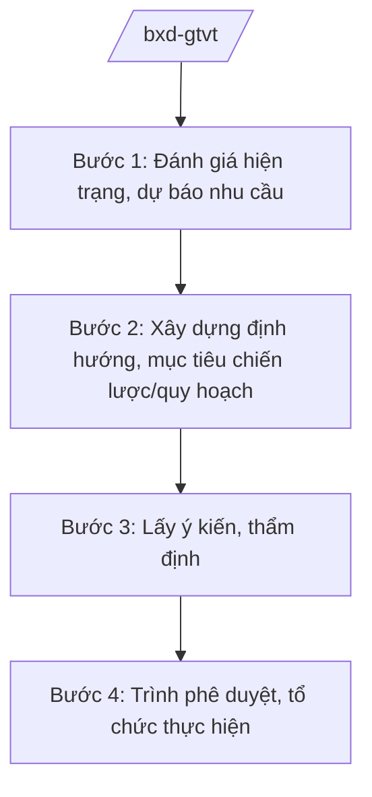

# Skill: Chiến lược, quy hoạch mạng lưới GTVT quốc gia

## 2. Khi nào dùng

Khi Bộ Xây dựng thực hiện quản lý nhà nước về giao thông vận tải ở tầm chiến lược: xây dựng
chiến lược phát triển GTVT; quy hoạch mạng lưới giao thông quốc gia (đường bộ, đường sắt,
đường thủy, hàng hải, hàng không); chính sách phát triển kết cấu hạ tầng giao thông.

## 3. Đầu vào (Input)

| Trường | Mô tả | Bắt buộc |
|--------|-------|----------|
| `nhiem_vu` | Nhiệm vụ: chiến lược / quy hoạch mạng lưới / chính sách | Có |
| `linh_vuc_vt` | Lĩnh vực vận tải: đường bộ / đường sắt / đường thủy / hàng hải / hàng không / đa phương thức | Có |
| `dinh_huong` | Định hướng phát triển, mục tiêu | Có |
| `so_lieu_hien_trang` | Số liệu hiện trạng mạng lưới, nhu cầu vận tải | Có |

## 4. Quy trình

**Bước 1. Đánh giá hiện trạng, dự báo nhu cầu**

- Làm gì: Tổng hợp hiện trạng kết cấu hạ tầng, nhu cầu vận tải; dự báo đến kỳ quy hoạch.
- Dùng input: `linh_vuc_vt`, `so_lieu_hien_trang`.
- Vai trò: Vụ Kế hoạch – Tài chính / cục chuyên ngành (Bộ Xây dựng) chủ trì; AI hỗ trợ tổng hợp ⏱ ~5–7 ngày làm việc (ước tính).
  số liệu, lập bảng phân tích hiện trạng (3–4 giờ).
- Lưu ý nghiệp vụ: Số liệu từ nguồn chính thức (thống kê, báo cáo địa phương, đơn vị quản lý);
  dự báo có cơ sở khoa học.
- → Kết quả bước: Báo cáo đánh giá hiện trạng và dự báo nhu cầu.

**Bước 2. Xây dựng định hướng, mục tiêu chiến lược/quy hoạch**

- Làm gì: Đề xuất quan điểm, mục tiêu, định hướng phát triển mạng lưới; danh mục dự án ưu tiên.
- Dùng input: `dinh_huong`, báo cáo hiện trạng.
- Vai trò: Chuyên viên vụ/cục soạn thảo; AI hỗ trợ dự thảo nội dung, so sánh phương án (2–3 giờ).
- Lưu ý nghiệp vụ: Phù hợp quy hoạch tổng thể quốc gia, quy hoạch vùng; gắn với mục tiêu phát triển
  kinh tế – xã hội.
- → Kết quả bước: Dự thảo chiến lược/quy hoạch.

**Bước 3. Lấy ý kiến, thẩm định**

- Làm gì: Lấy ý kiến bộ/ngành, địa phương; tổ chức thẩm định theo quy định pháp luật về quy hoạch.
- Dùng input: Dự thảo chiến lược/quy hoạch.
- Vai trò: Đơn vị chủ trì tổng hợp; AI hỗ trợ phân loại ý kiến, lập báo cáo tiếp thu (2–3 giờ).
- Lưu ý nghiệp vụ: Quy hoạch mạng lưới GTVT quốc gia thuộc thẩm quyền phê duyệt của Thủ tướng.
- → Kết quả bước: Dự thảo hoàn chỉnh + báo cáo thẩm định/tiếp thu.

**Bước 4. Trình phê duyệt, tổ chức thực hiện**

- Làm gì: Trình Thủ tướng phê duyệt quy hoạch/chiến lược; ban hành kế hoạch thực hiện;
  hướng dẫn địa phương; theo dõi, sơ kết.
- Dùng input: Toàn bộ hồ sơ.
- Vai trò: Vụ trưởng kiểm tra; Thứ trưởng duyệt; AI hỗ trợ checklist hồ sơ trình (1–2 giờ).
- Lưu ý nghiệp vụ: Công bố công khai sau phê duyệt; định kỳ rà soát, điều chỉnh.
- → Kết quả bước: Quyết định phê duyệt + kế hoạch tổ chức thực hiện.

## Luồng quy trình (Workflow)

## 5. Đầu ra (Output)

- Chiến lược/quy hoạch mạng lưới GTVT (đúng thể thức NĐ 30/2020/NĐ-CP).
- Báo cáo hiện trạng, dự báo; báo cáo thẩm định, tiếp thu ý kiến.
- Kế hoạch tổ chức thực hiện.

### Cấu trúc output chuẩn (quyết định phê duyệt quy hoạch mạng lưới)

1. Quốc hiệu "CỘNG HÒA XÃ HỘI CHỦ NGHĨA VIỆT NAM", Tiêu ngữ "Độc lập – Tự do – Hạnh phúc"; số, ký hiệu: …/QĐ-TTg.
2. Căn cứ pháp lý (pháp luật về quy hoạch; NĐ 33/2025/NĐ-CP...).
3. Điều 1: Phê duyệt quy hoạch (tên, phạm vi, mục tiêu, định hướng mạng lưới, danh mục ưu tiên).
4. Điều 2: Tổ chức thực hiện (Bộ Xây dựng chủ trì; trách nhiệm bộ/ngành, địa phương).
5. Điều 3: Hiệu lực; chế độ báo cáo, rà soát, điều chỉnh.
6. Nơi nhận (kết thúc "- Lưu: VT, [mã đơn vị]."); chữ ký (ghi rõ chức danh, họ tên người ký; ký hiệu "KT."/"TL." khi ký thay) người có thẩm quyền.

> **Checklist thể thức văn bản theo NĐ 30/2020/NĐ-CP** — đối chiếu trước khi trình ký:
> 1. Quốc hiệu và Tiêu ngữ.
> 2. Tên cơ quan, tổ chức ban hành văn bản.
> 3. Số, ký hiệu của văn bản.
> 4. Địa danh và thời gian ban hành văn bản.
> 5. Tên loại và trích yếu nội dung văn bản.
> 6. Nội dung văn bản.
> 7. Chức vụ, họ tên và chữ ký của người có thẩm quyền.
> 8. Dấu, chữ ký số của cơ quan, tổ chức.
> 9. Nơi nhận (kèm Phụ lục nếu có).

## 6. Checklist nghiệm thu

- [ ] Số liệu hiện trạng, dự báo có nguồn chính thức, có cơ sở.
- [ ] Phù hợp quy hoạch tổng thể quốc gia và quy hoạch có liên quan.
- [ ] Mục tiêu, định hướng cụ thể; danh mục dự án ưu tiên rõ ràng.
- [ ] Đã lấy ý kiến, thẩm định đúng trình tự.
- [ ] Đúng thẩm quyền phê duyệt; đúng thể thức NĐ 30/2020/NĐ-CP.
- [ ] Có cơ chế theo dõi, rà soát, điều chỉnh.
- [ ] Đã qua human gate đầy đủ.

## 7. Ví dụ mô phỏng

*Dữ liệu dưới đây là giả lập 100% phục vụ minh họa.*

**Input mẫu:** `nhiem_vu` = quy hoạch mạng lưới; `linh_vuc_vt` = đường bộ; `dinh_huong` = phát triển
mạng lưới đường bộ cao tốc đồng bộ, hiện đại đến năm 2040; `so_lieu_hien_trang` = số liệu giả lập
về chiều dài đường bộ, lưu lượng vận tải toàn quốc.

**Output mẫu (trích cấu trúc chuẩn):**

> **THỦ TƯỚNG CHÍNH PHỦ**
> **CỘNG HÒA XÃ HỘI CHỦ NGHĨA VIỆT NAM**
> **Độc lập – Tự do – Hạnh phúc**
>
> Số: 1234/QĐ-TTg *(số hiệu giả lập)*
>
> **QUYẾT ĐỊNH**
> **Phê duyệt Quy hoạch mạng lưới đường bộ quốc gia đến năm 2040**
>
> *Căn cứ pháp luật về quy hoạch;*
> *Căn cứ Nghị định số 33/2025/NĐ-CP ngày 25/02/2025 của Chính phủ quy định chức năng,
> nhiệm vụ, quyền hạn và cơ cấu tổ chức của Bộ Xây dựng (được sửa đổi, bổ sung);*
> *Theo đề nghị của Bộ trưởng Bộ Xây dựng,*
>
> **Điều 1.** Phê duyệt Quy hoạch mạng lưới đường bộ quốc gia đến năm 2040...
> **Điều 2.** Bộ Xây dựng chủ trì, phối hợp các bộ, địa phương tổ chức thực hiện...

## 8. Human gate

1. Vụ trưởng/Cục trưởng đơn vị chủ trì: duyệt nội dung chuyên môn.
2. Thứ trưởng phụ trách GTVT: duyệt trước khi trình.
3. Bộ trưởng Bộ Xây dựng: ký tờ trình Chính phủ.
4. Thủ tướng Chính phủ: phê duyệt quy hoạch, chiến lược quốc gia.

## 9. Giới hạn

- AI không quyết định định hướng, mục tiêu, danh mục dự án thay cơ quan có thẩm quyền.
- AI không bịa số liệu hiện trạng, dự báo.
- AI không tự ký, ban hành văn bản.
- AI không viện dẫn văn bản hết hiệu lực.

## 10. Căn cứ & lưu ý

- Nghị định số 33/2025/NĐ-CP ngày 25/02/2025 của Chính phủ quy định chức năng, nhiệm vụ,
  quyền hạn và cơ cấu tổ chức của Bộ Xây dựng (được sửa đổi, bổ sung).
- Nghị quyết số 176/2025/QH15 về cơ cấu tổ chức của Chính phủ.
- Pháp luật về quy hoạch (quy hoạch mạng lưới GTVT quốc gia).
- Nghị định số 30/2020/NĐ-CP về công tác văn thư (thể thức văn bản).
