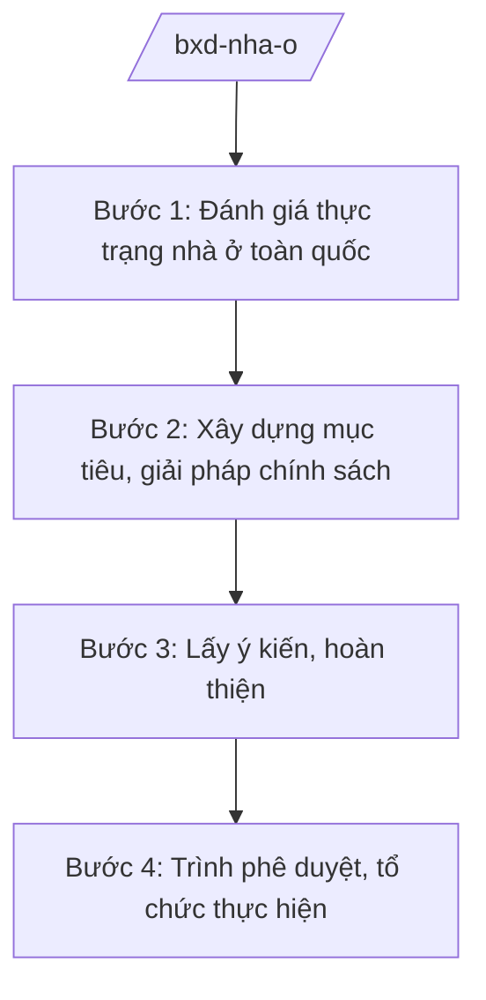

# Skill: Chính sách nhà ở, nhà ở xã hội

## 2. Khi nào dùng

Khi Bộ Xây dựng xây dựng chiến lược, chương trình, chính sách phát triển nhà ở mang tầm quốc gia:
nhà ở xã hội, nhà ở cho công nhân, cải tạo chung cư cũ, chính sách tín dụng ưu đãi về nhà ở.

## 3. Đầu vào (Input)

| Trường | Mô tả | Bắt buộc |
|--------|-------|----------|
| `chuong_trinh` | Tên chiến lược/chương trình/đề án nhà ở | Có |
| `doi_tuong` | Đối tượng thụ hưởng (người thu nhập thấp, công nhân, cán bộ...) | Có |
| `muc_tieu` | Mục tiêu (số lượng căn, diện tích sàn, thời hạn) | Có |
| `nguon_luc` | Nguồn lực dự kiến (ngân sách, tín dụng, đất đai) | Có |
| `dia_ban_uu_tien` | Địa bàn, khu vực ưu tiên triển khai | Không |

## 4. Quy trình

**Bước 1. Đánh giá thực trạng nhà ở toàn quốc**

- Làm gì: Tổng hợp số liệu nhà ở từ địa phương; đánh giá cung – cầu, nhất là nhà ở xã hội.
- Dùng input: `doi_tuong`, `dia_ban_uu_tien`.
- Vai trò: Cục Quản lý nhà và thị trường bất động sản (Bộ Xây dựng) chủ trì; AI hỗ trợ tổng hợp ⏱ ~5–7 ngày làm việc (ước tính).
  số liệu báo cáo địa phương, lập bảng phân tích (3–4 giờ).
- Lưu ý nghiệp vụ: Số liệu phải có nguồn rõ ràng từ báo cáo chính thức của địa phương; không dùng số liệu ước đoán làm căn cứ quyết định.
- → Kết quả bước: Báo cáo đánh giá thực trạng nhà ở.

**Bước 2. Xây dựng mục tiêu, giải pháp chính sách**

- Làm gì: Đề xuất mục tiêu cụ thể, cơ chế chính sách (đất đai, tín dụng, thuế), phân kỳ thực hiện.
- Dùng input: `muc_tieu`, `nguon_luc`, `chuong_trinh`.
- Vai trò: Chuyên viên cục chủ trì soạn thảo; AI hỗ trợ dự thảo nội dung chính sách, so sánh ⏱ ~5–7 ngày làm việc (ước tính).
  chính sách các giai đoạn (2–3 giờ).
- Lưu ý nghiệp vụ: Chính sách nhà ở xã hội phải gắn với đối tượng theo quy định pháp luật về nhà ở;
  cơ chế tín dụng phối hợp chặt với Ngân hàng Nhà nước.
- → Kết quả bước: Dự thảo chiến lược/chương trình/đề án.

**Bước 3. Lấy ý kiến, hoàn thiện**

- Làm gì: Lấy ý kiến bộ/ngành, địa phương, hiệp hội, doanh nghiệp; tiếp thu, giải trình.
- Dùng input: Dự thảo chiến lược/chương trình.
- Vai trò: Cục chủ trì tổng hợp; AI hỗ trợ phân loại ý kiến, lập bảng tiếp thu (2 giờ).
- Lưu ý nghiệp vụ: Lấy ý kiến các địa phương trọng điểm phát triển nhà ở xã hội.
- → Kết quả bước: Dự thảo hoàn chỉnh + báo cáo tiếp thu ý kiến.

**Bước 4. Trình phê duyệt, tổ chức thực hiện**

- Làm gì: Trình Thủ tướng/Chính phủ phê duyệt (chiến lược, chương trình quốc gia) hoặc ban hành
  văn bản hướng dẫn theo thẩm quyền; giao chỉ tiêu, theo dõi địa phương thực hiện.
- Dùng input: Toàn bộ hồ sơ.
- Vai trò: Cục trưởng kiểm tra; Thứ trưởng duyệt; AI hỗ trợ checklist hồ sơ trình, dự thảo ⏱ ~2–3 ngày làm việc (ước tính).
  văn bản giao chỉ tiêu (1–2 giờ).
- Lưu ý nghiệp vụ: Theo dõi, đôn đốc địa phương; sơ kết, tổng kết định kỳ.
- → Kết quả bước: Văn bản phê duyệt + kế hoạch tổ chức thực hiện.

## Luồng quy trình (Workflow)

## 5. Đầu ra (Output)

- Chiến lược/chương trình/đề án phát triển nhà ở (đúng thể thức NĐ 30/2020/NĐ-CP).
- Báo cáo đánh giá thực trạng; báo cáo tiếp thu ý kiến.
- Văn bản giao chỉ tiêu, hướng dẫn địa phương.

### Cấu trúc output chuẩn (quyết định phê duyệt chương trình)

1. Quốc hiệu "CỘNG HÒA XÃ HỘI CHỦ NGHĨA VIỆT NAM", Tiêu ngữ "Độc lập – Tự do – Hạnh phúc"; số, ký hiệu văn bản.
2. Căn cứ pháp lý (pháp luật về nhà ở; NĐ 33/2025/NĐ-CP...).
3. Điều 1: Phê duyệt chương trình (tên, mục tiêu, đối tượng, giải pháp chính, phân kỳ).
4. Điều 2: Nguồn lực thực hiện; trách nhiệm các bộ, địa phương.
5. Điều 3: Hiệu lực; tổ chức thực hiện; chế độ báo cáo, sơ kết, tổng kết.
6. Nơi nhận (kết thúc "- Lưu: VT, [mã đơn vị]."); chữ ký (ghi rõ chức danh, họ tên người ký; ký hiệu "KT."/"TL." khi ký thay) người có thẩm quyền.
## 6. Checklist nghiệm thu

- [ ] Số liệu thực trạng có nguồn chính thức, không bịa đặt.
- [ ] Đối tượng thụ hưởng đúng quy định pháp luật về nhà ở.
- [ ] Mục tiêu cụ thể, đo lường được, có phân kỳ.
- [ ] Cơ chế đất đai, tín dụng, tài chính khả thi, có phối hợp liên ngành.
- [ ] Đã lấy ý kiến bộ/ngành, địa phương liên quan.
- [ ] Đúng thẩm quyền phê duyệt; đúng thể thức NĐ 30/2020/NĐ-CP.
- [ ] Có cơ chế theo dõi, sơ kết, tổng kết.
- [ ] Đã qua human gate đầy đủ.

## 7. Ví dụ mô phỏng

*Dữ liệu dưới đây là giả lập 100% phục vụ minh họa.*

**Input mẫu:** `chuong_trinh` = "Chương trình phát triển nhà ở xã hội giai đoạn 2026–2030";
`doi_tuong` = người thu nhập thấp, công nhân khu công nghiệp; `muc_tieu` = 100.000 căn
(số liệu giả lập); `nguon_luc` = ngân sách + gói tín dụng ưu đãi giả lập 50.000 tỷ đồng.

**Output mẫu (trích cấu trúc chuẩn):**

> **THỦ TƯỚNG CHÍNH PHỦ**
> **CỘNG HÒA XÃ HỘI CHỦ NGHĨA VIỆT NAM**
> **Độc lập – Tự do – Hạnh phúc**
>
> Số: 1234/QĐ-TTg *(số hiệu giả lập)*
>
> **QUYẾT ĐỊNH**
> **Phê duyệt Chương trình phát triển nhà ở xã hội giai đoạn 2026–2030**
>
> *Căn cứ pháp luật về nhà ở;*
> *Căn cứ Nghị định số 33/2025/NĐ-CP ngày 25/02/2025 của Chính phủ quy định chức năng,
> nhiệm vụ, quyền hạn và cơ cấu tổ chức của Bộ Xây dựng (được sửa đổi, bổ sung);*
> *Theo đề nghị của Bộ trưởng Bộ Xây dựng,*
>
> **Điều 1.** Phê duyệt Chương trình phát triển nhà ở xã hội giai đoạn 2026–2030 với mục tiêu
> hoàn thành 100.000 căn *(số liệu giả lập)*...
>
> **Điều 2.** Bộ Xây dựng chủ trì, phối hợp các bộ, địa phương tổ chức thực hiện; định kỳ
> báo cáo Thủ tướng Chính phủ...

## 8. Human gate

1. Cục trưởng Cục Quản lý nhà và thị trường bất động sản: duyệt nội dung chuyên môn.
2. Thứ trưởng phụ trách: duyệt trước khi trình.
3. Bộ trưởng Bộ Xây dựng: ký tờ trình Chính phủ.
4. Thủ tướng/Chính phủ: phê duyệt chiến lược, chương trình quốc gia.

## 9. Giới hạn

- AI không quyết định mục tiêu, cơ chế chính sách thay cơ quan có thẩm quyền.
- AI không bịa số liệu nhà ở, chỉ tiêu, nguồn lực.
- AI không tự ký, ban hành văn bản.
- AI không viện dẫn văn bản hết hiệu lực.

## 10. Căn cứ & lưu ý

- Nghị định số 33/2025/NĐ-CP ngày 25/02/2025 của Chính phủ quy định chức năng, nhiệm vụ,
  quyền hạn và cơ cấu tổ chức của Bộ Xây dựng (được sửa đổi, bổ sung).
- Nghị quyết số 176/2025/QH15 về cơ cấu tổ chức của Chính phủ.
- Pháp luật về nhà ở (chính sách nhà ở xã hội, đối tượng, điều kiện thụ hưởng).
- Nghị định số 30/2020/NĐ-CP về công tác văn thư (thể thức văn bản).
