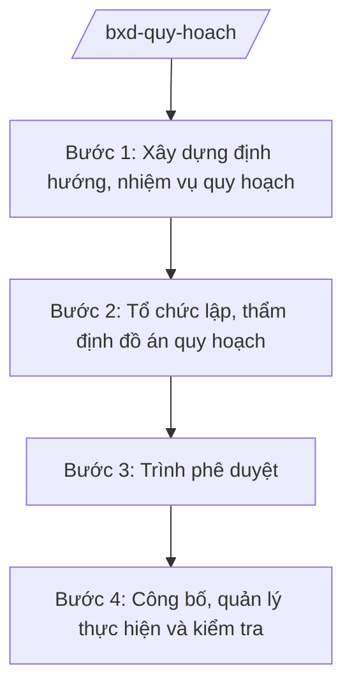

# Skill: Quy hoạch xây dựng, đô thị, nông thôn (cấp bộ)

## 2. Khi nào dùng

Khi Bộ Xây dựng thực hiện nhiệm vụ quản lý nhà nước về quy hoạch xây dựng, quy hoạch đô thị
và nông thôn ở cấp vĩ mô: xây dựng định hướng, thẩm định và trình Thủ tướng phê duyệt các
quy hoạch thuộc thẩm quyền; hướng dẫn, kiểm tra việc lập quy hoạch của địa phương.

## 3. Đầu vào (Input)

| Trường | Mô tả | Bắt buộc |
|--------|-------|----------|
| `loai_quy_hoach` | Loại quy hoạch: vùng / đô thị / nông thôn / khu chức năng | Có |
| `pham_vi` | Phạm vi lập quy hoạch (địa bàn, ranh giới) | Có |
| `co_quan_lap` | Cơ quan tổ chức lập quy hoạch | Có |
| `muc_tieu` | Mục tiêu, định hướng phát triển | Có |
| `ho_so_quy_hoach` | Hồ sơ đồ án quy hoạch trình thẩm định | Có |

## 4. Quy trình

**Bước 1. Xây dựng định hướng, nhiệm vụ quy hoạch**

- Làm gì: Xây dựng định hướng phát triển không gian; phê duyệt nhiệm vụ quy hoạch làm cơ sở lập đồ án.
- Dùng input: `loai_quy_hoach`, `pham_vi`, `muc_tieu`.
- Vai trò: Vụ Quy hoạch – Kiến trúc (Bộ Xây dựng) chủ trì; AI hỗ trợ tổng hợp định hướng, dự thảo nhiệm vụ quy hoạch (2–3 giờ).
- Lưu ý nghiệp vụ: Nhiệm vụ quy hoạch phải phù hợp quy hoạch cấp quốc gia, quy hoạch vùng đã phê duyệt.
- → Kết quả bước: Nhiệm vụ quy hoạch được phê duyệt.

**Bước 2. Tổ chức lập, thẩm định đồ án quy hoạch**

- Làm gì: Tổ chức lập đồ án; thành lập hội đồng thẩm định; tổ chức thẩm định theo quy định.
- Dùng input: `ho_so_quy_hoach`, `co_quan_lap`.
- Vai trò: Vụ Quy hoạch – Kiến trúc chủ trì thẩm định; AI hỗ trợ tổng hợp ý kiến hội đồng, lập biên bản thẩm định (3–4 giờ).
- Lưu ý nghiệp vụ: Đồ án phải có đánh giá môi trường chiến lược (nếu thuộc đối tượng); lấy ý kiến cộng đồng dân cư.
- → Kết quả bước: Báo cáo thẩm định đồ án quy hoạch.

**Bước 3. Trình phê duyệt**

- Làm gì: Hoàn thiện hồ sơ trình Thủ tướng Chính phủ phê duyệt (đối với quy hoạch thuộc thẩm quyền Thủ tướng) hoặc Bộ trưởng phê duyệt theo phân cấp.
- Dùng input: Đồ án sau thẩm định + báo cáo thẩm định.
- Vai trò: Vụ trưởng Vụ Quy hoạch – Kiến trúc kiểm tra; Thứ trưởng duyệt; AI hỗ trợ checklist hồ sơ trình (1 giờ).
- Lưu ý nghiệp vụ: Phân định rõ thẩm quyền phê duyệt: Thủ tướng / Bộ trưởng / UBND cấp tỉnh theo quy định pháp luật về quy hoạch đô thị và nông thôn.
- → Kết quả bước: Quyết định phê duyệt quy hoạch.

**Bước 4. Công bố, quản lý thực hiện và kiểm tra**

- Làm gì: Công bố quy hoạch; hướng dẫn địa phương triển khai; kiểm tra việc thực hiện; rà soát, điều chỉnh khi cần.
- Dùng input: Quyết định phê duyệt.
- Vai trò: Vụ Quy hoạch – Kiến trúc theo dõi; AI hỗ trợ lập kế hoạch kiểm tra, tổng hợp báo cáo thực hiện (2 giờ).
- Lưu ý nghiệp vụ: Quy hoạch phải được công bố công khai; việc điều chỉnh tuân đúng trình tự như lập mới.
- → Kết quả bước: Quy hoạch được công bố; báo cáo tình hình thực hiện.

## Luồng quy trình (Workflow)

## 5. Đầu ra (Output)

- Nhiệm vụ quy hoạch; báo cáo thẩm định đồ án.
- Quyết định phê duyệt quy hoạch đúng thể thức NĐ 30/2020/NĐ-CP.
- Kế hoạch công bố, kiểm tra thực hiện.

### Cấu trúc output chuẩn (quyết định phê duyệt quy hoạch)

1. Quốc hiệu "CỘNG HÒA XÃ HỘI CHỦ NGHĨA VIỆT NAM", Tiêu ngữ "Độc lập – Tự do – Hạnh phúc"; số, ký hiệu: …/QĐ-TTg hoặc …/QĐ-BXD.
2. Căn cứ pháp lý (pháp luật về quy hoạch đô thị và nông thôn; NĐ 33/2025/NĐ-CP...).
3. Điều 1: Phê duyệt quy hoạch (tên, phạm vi, mục tiêu, định hướng chính).
4. Điều 2: Tổ chức thực hiện (trách nhiệm Bộ, địa phương, cơ quan liên quan).
5. Điều 3: Hiệu lực; trách nhiệm thi hành.
6. Nơi nhận (kết thúc "- Lưu: VT, [mã đơn vị]."); chữ ký (ghi rõ chức danh, họ tên người ký; ký hiệu "KT."/"TL." khi ký thay) người có thẩm quyền.
## 6. Checklist nghiệm thu

- [ ] Đúng thẩm quyền lập/thẩm định/phê duyệt theo loại quy hoạch.
- [ ] Phù hợp quy hoạch cấp trên đã phê duyệt.
- [ ] Có đánh giá môi trường chiến lược (nếu thuộc đối tượng).
- [ ] Đã lấy ý kiến cộng đồng, cơ quan liên quan.
- [ ] Hồ sơ thẩm định đầy đủ, hội đồng thẩm định đúng thành phần.
- [ ] Quyết định phê duyệt đúng thể thức NĐ 30/2020/NĐ-CP.
- [ ] Quy hoạch được công bố công khai.
- [ ] Đã qua human gate đầy đủ.

## 7. Ví dụ mô phỏng

*Dữ liệu dưới đây là giả lập 100% phục vụ minh họa.*

**Input mẫu:** `loai_quy_hoach` = quy hoạch chung đô thị; `pham_vi` = Đô thị loại II giả lập
(trên địa bàn tỉnh A); `co_quan_lap` = UBND tỉnh A phối hợp đơn vị tư vấn; `muc_tieu` = phát triển
đô thị xanh, thông minh đến năm 2040.

**Output mẫu (trích cấu trúc chuẩn):**

> **THỦ TƯỚNG CHÍNH PHỦ**
> **CỘNG HÒA XÃ HỘI CHỦ NGHĨA VIỆT NAM**
> **Độc lập – Tự do – Hạnh phúc**
>
> Số: 1234/QĐ-TTg *(số hiệu giả lập)*
>
> **QUYẾT ĐỊNH**
> **Phê duyệt Quy hoạch chung đô thị [tên giả lập], tỉnh A đến năm 2040**
>
> *Căn cứ pháp luật về quy hoạch đô thị và nông thôn;*
> *Căn cứ Nghị định số 33/2025/NĐ-CP ngày 25/02/2025 của Chính phủ quy định chức năng,
> nhiệm vụ, quyền hạn và cơ cấu tổ chức của Bộ Xây dựng (được sửa đổi, bổ sung);*
> *Theo đề nghị của Bộ trưởng Bộ Xây dựng,*
>
> **Điều 1.** Phê duyệt Quy hoạch chung đô thị [tên giả lập], tỉnh A đến năm 2040 với các
> nội dung chủ yếu sau: 1. Phạm vi... 2. Mục tiêu... 3. Định hướng phát triển không gian...
>
> **Điều 2.** Tổ chức thực hiện: Bộ Xây dựng hướng dẫn, kiểm tra; UBND tỉnh A tổ chức thực hiện...
>
> **Điều 3.** Quyết định này có hiệu lực từ ngày ký...

## 8. Human gate

1. Vụ trưởng Vụ Quy hoạch – Kiến trúc: duyệt nhiệm vụ quy hoạch, kết quả thẩm định.
2. Hội đồng thẩm định: thông qua báo cáo thẩm định.
3. Thứ trưởng phụ trách: duyệt hồ sơ trình.
4. Thủ tướng Chính phủ phê duyệt (quy hoạch thuộc thẩm quyền) hoặc Bộ trưởng Bộ Xây dựng
   phê duyệt theo phân cấp.

## 9. Giới hạn

- AI không quyết định nội dung quy hoạch thay cơ quan có thẩm quyền.
- AI không tự ký, ban hành quyết định phê duyệt.
- AI không bịa số liệu quy hoạch, ranh giới, chỉ tiêu; mọi số liệu từ hồ sơ đồ án.
- AI không viện dẫn văn bản hết hiệu lực.

## 10. Căn cứ & lưu ý

- Nghị định số 33/2025/NĐ-CP ngày 25/02/2025 của Chính phủ quy định chức năng, nhiệm vụ,
  quyền hạn và cơ cấu tổ chức của Bộ Xây dựng (được sửa đổi, bổ sung).
- Nghị quyết số 176/2025/QH15 về cơ cấu tổ chức của Chính phủ.
- Pháp luật về quy hoạch đô thị và nông thôn (trình tự lập, thẩm định, phê duyệt).
- Nghị định số 30/2020/NĐ-CP về công tác văn thư (thể thức văn bản).
