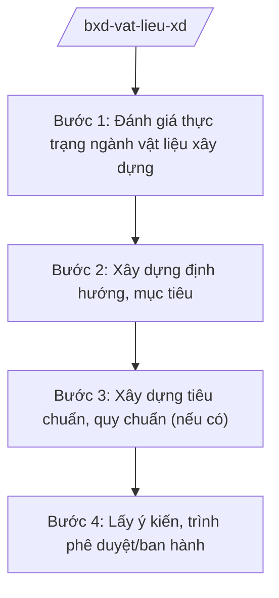

# Skill: Vật liệu xây dựng (chiến lược, tiêu chuẩn)

## 2. Khi nào dùng

Khi Bộ Xây dựng xây dựng chiến lược, quy hoạch phát triển vật liệu xây dựng; ban hành tiêu chuẩn,
quy chuẩn kỹ thuật về vật liệu; quản lý chất lượng vật liệu; thúc đẩy vật liệu xanh, tiết kiệm
tài nguyên.

## 3. Đầu vào (Input)

| Trường | Mô tả | Bắt buộc |
|--------|-------|----------|
| `nhiem_vu` | Nhiệm vụ: chiến lược / quy hoạch / tiêu chuẩn / quản lý chất lượng | Có |
| `nhom_vat_lieu` | Nhóm vật liệu: xi măng / gạch ngói / kính / thép / vật liệu xanh... | Có |
| `so_lieu_san_xuat` | Số liệu sản xuất, tiêu thụ (nguồn chính thức) | Không |
| `muc_tieu` | Mục tiêu phát triển, lộ trình | Có |

## 4. Quy trình

**Bước 1. Đánh giá thực trạng ngành vật liệu xây dựng**

- Làm gì: Tổng hợp số liệu sản xuất, tiêu thụ, công nghệ, môi trường của ngành vật liệu xây dựng.
- Dùng input: `nhom_vat_lieu`, `so_lieu_san_xuat`.
- Vai trò: Vụ Vật liệu xây dựng (Bộ Xây dựng) chủ trì; AI hỗ trợ tổng hợp số liệu, lập bảng phân tích ⏱ ~3–5 ngày làm việc (ước tính).
- Lưu ý nghiệp vụ: Số liệu từ báo cáo địa phương, hiệp hội, tổng cục thống kê; ghi rõ nguồn.
- → Kết quả bước: Báo cáo đánh giá thực trạng.

**Bước 2. Xây dựng định hướng, mục tiêu**

- Làm gì: Đề xuất định hướng phát triển (công nghệ, quy mô, vật liệu xanh); mục tiêu, lộ trình,
  giải pháp chính sách.
- Dùng input: `muc_tieu`, báo cáo thực trạng.
- Vai trò: Chuyên viên vụ soạn thảo; AI hỗ trợ dự thảo, đối chiếu định hướng các giai đoạn (⏱ 2 giờ).
- Lưu ý nghiệp vụ: Gắn với mục tiêu phát thải, kinh tế tuần hoàn; phù hợp quy hoạch khoáng sản
  làm vật liệu xây dựng (phối hợp Bộ Nông nghiệp và Môi trường).
- → Kết quả bước: Dự thảo chiến lược/quy hoạch/đề án.

**Bước 3. Xây dựng tiêu chuẩn, quy chuẩn (nếu có)**

- Làm gì: Tổ chức soạn thảo TCVN/QCVN về vật liệu xây dựng; lấy ý kiến; thẩm định.
- Dùng input: Yêu cầu kỹ thuật của nhóm vật liệu.
- Vai trò: Vụ Vật liệu xây dựng phối hợp Vụ Khoa học công nghệ và môi trường; AI hỗ trợ dự thảo tiêu chuẩn, rà soát kỹ thuật ⏱ ~5–7 ngày làm việc (ước tính).
- Lưu ý nghiệp vụ: Trình tự xây dựng TCVN/QCVN theo quy định pháp luật về tiêu chuẩn, quy chuẩn
  kỹ thuật; phối hợp Bộ Khoa học và Công nghệ (cơ quan quản lý nhà nước về tiêu chuẩn).
- → Kết quả bước: Dự thảo TCVN/QCVN.

**Bước 4. Lấy ý kiến, trình phê duyệt/ban hành**

- Làm gì: Lấy ý kiến bộ/ngành, địa phương, doanh nghiệp, hiệp hội; hoàn thiện; trình Thủ tướng
  phê duyệt chiến lược/quy hoạch hoặc Bộ trưởng ban hành quy chuẩn, văn bản hướng dẫn.
- Dùng input: Toàn bộ hồ sơ.
- Vai trò: Vụ trưởng kiểm tra; Thứ trưởng duyệt; AI hỗ trợ bảng tiếp thu ý kiến, checklist hồ sơ ⏱ ~2–3 ngày làm việc (ước tính).
- Lưu ý nghiệp vụ: Công bố công khai sau ban hành; theo dõi thực hiện.
- → Kết quả bước: Văn bản được phê duyệt/ban hành.

## Luồng quy trình (Workflow)

## 5. Đầu ra (Output)

- Chiến lược/quy hoạch phát triển vật liệu xây dựng (đúng thể thức NĐ 30/2020/NĐ-CP).
- TCVN/QCVN về vật liệu xây dựng; văn bản hướng dẫn.
- Báo cáo đánh giá thực trạng.

### Cấu trúc output chuẩn (quyết định phê duyệt chiến lược)

1. Quốc hiệu "CỘNG HÒA XÃ HỘI CHỦ NGHĨA VIỆT NAM", Tiêu ngữ "Độc lập – Tự do – Hạnh phúc"; số, ký hiệu: …/QĐ-TTg.
2. Căn cứ pháp lý (NĐ 33/2025/NĐ-CP...).
3. Điều 1: Phê duyệt chiến lược (quan điểm, mục tiêu, định hướng, giải pháp, phân kỳ).
4. Điều 2: Tổ chức thực hiện (Bộ Xây dựng chủ trì; trách nhiệm liên quan).
5. Điều 3: Hiệu lực; chế độ báo cáo.
6. Nơi nhận (kết thúc "- Lưu: VT, [mã đơn vị]."); chữ ký (ghi rõ chức danh, họ tên người ký; ký hiệu "KT."/"TL." khi ký thay) người có thẩm quyền.

> **Checklist thể thức văn bản theo NĐ 30/2020/NĐ-CP** — đối chiếu trước khi trình ký:
> 1. Quốc hiệu và Tiêu ngữ.
> 2. Tên cơ quan, tổ chức ban hành văn bản.
> 3. Số, ký hiệu của văn bản.
> 4. Địa danh và thời gian ban hành văn bản.
> 5. Tên loại và trích yếu nội dung văn bản.
> 6. Nội dung văn bản.
> 7. Chức vụ, họ tên và chữ ký của người có thẩm quyền.
> 8. Dấu, chữ ký số của cơ quan, tổ chức.
> 9. Nơi nhận (kèm Phụ lục nếu có).

## 6. Checklist nghiệm thu

- [ ] Số liệu thực trạng có nguồn chính thức.
- [ ] Định hướng gắn với vật liệu xanh, kinh tế tuần hoàn, mục tiêu phát thải.
- [ ] Mục tiêu, lộ trình cụ thể, khả thi.
- [ ] Tiêu chuẩn/quy chuẩn (nếu có) đúng trình tự thẩm định.
- [ ] Đã lấy ý kiến các bên liên quan.
- [ ] Đúng thẩm quyền phê duyệt; đúng thể thức NĐ 30/2020/NĐ-CP.
- [ ] Đã qua human gate đầy đủ.

## 7. Ví dụ mô phỏng

*Dữ liệu dưới đây là giả lập 100% phục vụ minh họa.*

**Input mẫu:** `nhiem_vu` = chiến lược; `nhom_vat_lieu` = vật liệu xây không nung, vật liệu xanh;
`muc_tieu` = đến 2030, vật liệu xanh chiếm 30% tổng sản lượng vật liệu xây (số liệu giả lập).

**Output mẫu (trích cấu trúc chuẩn):**

> **THỦ TƯỚNG CHÍNH PHỦ**
> **CỘNG HÒA XÃ HỘI CHỦ NGHĨA VIỆT NAM**
> **Độc lập – Tự do – Hạnh phúc**
>
> Số: 1234/QĐ-TTg *(số hiệu giả lập)*
>
> **QUYẾT ĐỊNH**
> **Phê duyệt Chiến lược phát triển vật liệu xây dựng xanh đến năm 2030**
>
> *Căn cứ Nghị định số 33/2025/NĐ-CP ngày 25/02/2025 của Chính phủ... (được sửa đổi, bổ sung);*
> *Theo đề nghị của Bộ trưởng Bộ Xây dựng,*
>
> **Điều 1.** Phê duyệt Chiến lược... với mục tiêu đến năm 2030, vật liệu xanh chiếm 30%
> tổng sản lượng *(số liệu giả lập)*...

## 8. Human gate

1. Vụ trưởng Vụ Vật liệu xây dựng: duyệt nội dung chuyên môn.
2. Thứ trưởng phụ trách: duyệt trước khi trình.
3. Bộ trưởng Bộ Xây dựng: ký tờ trình / ban hành quy chuẩn, văn bản hướng dẫn.
4. Thủ tướng Chính phủ: phê duyệt chiến lược, quy hoạch.

## 9. Giới hạn

- AI không quyết định định hướng, mục tiêu, chỉ tiêu thay cơ quan có thẩm quyền.
- AI không bịa số liệu sản xuất, tiêu thụ vật liệu.
- AI không tự ký, ban hành văn bản.
- AI không viện dẫn văn bản hết hiệu lực.

## 10. Căn cứ & lưu ý

- Nghị định số 33/2025/NĐ-CP ngày 25/02/2025 của Chính phủ quy định chức năng, nhiệm vụ,
  quyền hạn và cơ cấu tổ chức của Bộ Xây dựng (được sửa đổi, bổ sung).
- Pháp luật về tiêu chuẩn, quy chuẩn kỹ thuật (đối với ban hành TCVN/QCVN).
- Nghị định số 30/2020/NĐ-CP về công tác văn thư (thể thức văn bản).
