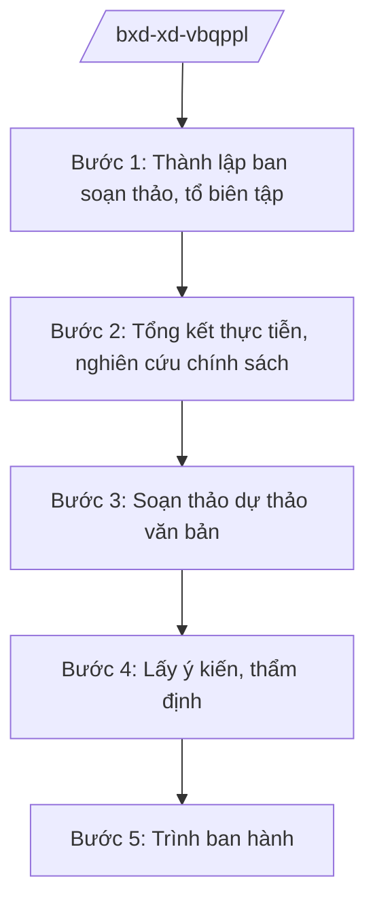

# Skill: Xây dựng VBQPPL lĩnh vực xây dựng

## 2. Khi nào dùng

Khi Bộ Xây dựng được giao chủ trì soạn thảo luật, pháp lệnh, nghị quyết, nghị định, quyết định
của Thủ tướng hoặc ban hành thông tư của Bộ trưởng trong lĩnh vực xây dựng, quy hoạch, nhà ở,
giao thông vận tải.

## 3. Đầu vào (Input)

| Trường | Mô tả | Bắt buộc |
|--------|-------|----------|
| `loai_van_ban` | Loại văn bản: luật / nghị định / thông tư / quyết định TTg | Có |
| `ten_du_thao` | Tên gọi dự thảo văn bản | Có |
| `can_cu_chu_truong` | Văn bản giao nhiệm vụ (chương trình xây dựng pháp luật, chỉ đạo của Chính phủ/TTg) | Có |
| `don_vi_chu_tri` | Vụ/cục được giao chủ trì soạn thảo | Có |
| `noi_dung_chinh_sach` | Các chính sách, nội dung chính cần thể chế hóa | Có |
| `danh_gia_tac_dong` | Báo cáo đánh giá tác động chính sách (nếu có) | Không |

## 4. Quy trình

**Bước 1. Thành lập ban soạn thảo, tổ biên tập**

- Làm gì: Trình Bộ trưởng quyết định thành lập ban soạn thảo/tổ biên tập; phân công vụ chủ trì, vụ phối hợp.
- Dùng input: `loai_van_ban`, `don_vi_chu_tri`, `can_cu_chu_truong`.
- Vai trò: Vụ trưởng Vụ Pháp chế (Bộ Xây dựng) tham mưu; AI hỗ trợ dự thảo quyết định thành lập, danh sách thành viên (⏱ 30 phút).
- Lưu ý nghiệp vụ: Thành phần ban soạn thảo phải có đại diện cơ quan liên quan theo quy định về ban hành VBQPPL.
- → Kết quả bước: Quyết định thành lập ban soạn thảo/tổ biên tập.

**Bước 2. Tổng kết thực tiễn, nghiên cứu chính sách**

- Làm gì: Tổng kết thi hành văn bản hiện hành; nghiên cứu kinh nghiệm; xây dựng nội dung chính sách.
- Dùng input: `noi_dung_chinh_sach`, `danh_gia_tac_dong`.
- Vai trò: Chuyên viên vụ chủ trì thực hiện; AI hỗ trợ tổng hợp tài liệu, lập bảng so sánh quy định hiện hành (⏱ 2–4 giờ).
- Lưu ý nghiệp vụ: Đánh giá tác động chính sách bắt buộc đối với dự thảo luật, nghị định quy định TTHC.
- → Kết quả bước: Báo cáo tổng kết + nội dung chính sách dự kiến đưa vào dự thảo.

**Bước 3. Soạn thảo dự thảo văn bản**

- Làm gì: Viết dự thảo điều khoản theo đúng kỹ thuật soạn thảo VBQPPL; kèm tờ trình, bản thuyết minh.
- Dùng input: `ten_du_thao`, `noi_dung_chinh_sach`.
- Vai trò: Tổ biên tập soạn thảo; AI hỗ trợ dự thảo điều khoản, rà soát kỹ thuật trình bày (⏱ 1–2 ngày).
- Lưu ý nghiệp vụ: Ngôn ngữ chuẩn mực, thống nhất thuật ngữ chuyên ngành xây dựng/GTVT; không trái Hiến pháp, luật.
- → Kết quả bước: Dự thảo văn bản + tờ trình + bản thuyết minh chi tiết.

**Bước 4. Lấy ý kiến, thẩm định**

- Làm gì: Đăng lấy ý kiến trên Cổng TTĐT; gửi lấy ý kiến bộ/ngành, địa phương, đối tượng chịu tác động; gửi Bộ Tư pháp thẩm định (đối với dự thảo luật, nghị định).
- Dùng input: Toàn bộ hồ sơ dự thảo.
- Vai trò: Vụ chủ trì tổng hợp ý kiến; AI hỗ trợ phân loại ý kiến, lập bảng tiếp thu/giải trình (⏱ 2–3 giờ).
- Lưu ý nghiệp vụ: Thời gian lấy ý kiến tối thiểu theo quy định; ý kiến thẩm định của Bộ Tư pháp phải được tiếp thu đầy đủ hoặc giải trình.
- → Kết quả bước: Báo cáo tiếp thu, giải trình ý kiến; dự thảo hoàn chỉnh.

**Bước 5. Trình ban hành**

- Làm gì: Hoàn thiện hồ sơ trình: tờ trình Bộ trưởng → Chính phủ (đối với luật, nghị định) hoặc Bộ trưởng ký ban hành (đối với thông tư).
- Dùng input: Toàn bộ hồ sơ sau thẩm định.
- Vai trò: Vụ trưởng Vụ Pháp chế kiểm tra hồ sơ; Thứ trưởng phụ trách duyệt; AI hỗ trợ checklist hồ sơ trình (⏱ 1 giờ).
- Lưu ý nghiệp vụ: Hồ sơ trình Chính phủ phải đầy đủ thành phần theo quy định; thông tư do Bộ trưởng ký sau khi có ý kiến thẩm định.
- → Kết quả bước: Văn bản được ban hành + hồ sơ lưu trữ đầy đủ.

## Luồng quy trình (Workflow)

## 5. Đầu ra (Output)

- Dự thảo văn bản QPPL hoàn chỉnh đúng thể thức NĐ 30/2020/NĐ-CP.
- Tờ trình, bản thuyết minh chi tiết, báo cáo đánh giá tác động (nếu có).
- Báo cáo tiếp thu, giải trình ý kiến.

### Cấu trúc output chuẩn (dự thảo văn bản QPPL)

1. Quốc hiệu "CỘNG HÒA XÃ HỘI CHỦ NGHĨA VIỆT NAM", Tiêu ngữ "Độc lập – Tự do – Hạnh phúc"
2. Tên loại và trích yếu nội dung văn bản.
3. Căn cứ ban hành (Hiến pháp, luật, nghị định có liên quan).
4. Phần, chương, mục, điều, khoản, điểm (đánh số thứ tự đúng kỹ thuật).
5. Điều khoản thi hành; hiệu lực; trách nhiệm thi hành.
6. Nơi nhận (kết thúc "- Lưu: VT, [mã đơn vị]."); chữ ký (ghi rõ chức danh, họ tên người ký; ký hiệu "KT."/"TL." khi ký thay) người có thẩm quyền.
## 6. Checklist nghiệm thu

- [ ] Đúng loại văn bản theo thẩm quyền (luật/nghị định/thông tư).
- [ ] Đủ thành phần hồ sơ: dự thảo, tờ trình, thuyết minh, đánh giá tác động.
- [ ] Đã lấy ý kiến đúng đối tượng, đủ thời gian; có báo cáo tiếp thu/giải trình.
- [ ] Đã qua thẩm định (Bộ Tư pháp đối với luật/nghị định; Vụ Pháp chế đối với thông tư).
- [ ] Kỹ thuật soạn thảo đúng: không mâu thuẫn nội tại, thuật ngữ thống nhất.
- [ ] Không trái Hiến pháp, luật và văn bản cấp trên.
- [ ] Đúng thể thức NĐ 30/2020/NĐ-CP.
- [ ] Đã qua human gate đầy đủ.

## 7. Ví dụ mô phỏng

*Dữ liệu dưới đây là giả lập 100% phục vụ minh họa.*

**Input mẫu:** `loai_van_ban` = thông tư; `ten_du_thao` = "Thông tư quy định quản lý chất lượng công trình
xây dựng sử dụng vốn đầu tư công"; `don_vi_chu_tri` = Vụ Quản lý hoạt động xây dựng – Bộ Xây dựng;
`can_cu_chu_truong` = Chương trình xây dựng văn bản QPPL năm 2026 của Bộ Xây dựng (Quyết định
số 1234/QĐ-BXD — số hiệu giả lập).

**Output mẫu (trích cấu trúc chuẩn):**

> **BỘ XÂY DỰNG**
> **CỘNG HÒA XÃ HỘI CHỦ NGHĨA VIỆT NAM**
> **Độc lập – Tự do – Hạnh phúc**
>
> Số: 12/2026/TT-BXD *(số hiệu giả lập)*
>
> **THÔNG TƯ**
> **Quy định quản lý chất lượng công trình xây dựng sử dụng vốn đầu tư công**
>
> *Căn cứ Luật Xây dựng;*
> *Căn cứ Nghị định số 33/2025/NĐ-CP ngày 25/02/2025 của Chính phủ quy định chức năng,
> nhiệm vụ, quyền hạn và cơ cấu tổ chức của Bộ Xây dựng (được sửa đổi, bổ sung);*
> *Theo đề nghị của Vụ trưởng Vụ Quản lý hoạt động xây dựng;*
> *Bộ trưởng Bộ Xây dựng ban hành Thông tư quy định quản lý chất lượng công trình xây dựng
> sử dụng vốn đầu tư công.*
>
> **Chương I. QUY ĐỊNH CHUNG**
> **Điều 1. Phạm vi điều chỉnh** ...
> *(các chương, điều tiếp theo theo đúng kỹ thuật soạn thảo)*

## 8. Human gate

1. Vụ trưởng Vụ Pháp chế: kiểm tra tính hợp hiến, hợp pháp, thống nhất của dự thảo.
2. Thứ trưởng phụ trách lĩnh vực: duyệt trước khi trình.
3. Bộ trưởng Bộ Xây dựng: ký ban hành thông tư / ký tờ trình Chính phủ (đối với luật, nghị định).
4. Bộ Tư pháp thẩm định (đối với dự thảo luật, nghị định) — ý kiến thẩm định là bắt buộc.

## 9. Giới hạn

- AI không quyết định nội dung chính sách thay cơ quan có thẩm quyền; chỉ hỗ trợ soạn thảo, tổng hợp.
- AI không tự ký, không tự phát hành văn bản.
- AI không bịa số liệu, căn cứ pháp lý, số hiệu văn bản; không viện dẫn văn bản đã hết hiệu lực.
- Nội dung chính sách do ban soạn thảo và cấp có thẩm quyền quyết định.

## 10. Căn cứ & lưu ý

- Nghị định số 33/2025/NĐ-CP ngày 25/02/2025 của Chính phủ quy định chức năng, nhiệm vụ,
  quyền hạn và cơ cấu tổ chức của Bộ Xây dựng (được sửa đổi, bổ sung).
- Nghị quyết số 176/2025/QH15 về cơ cấu tổ chức của Chính phủ.
- Nghị định số 303/2025/NĐ-CP — khung chung chức năng bộ, cơ quan ngang bộ.
- Quy định của pháp luật về ban hành văn bản quy phạm pháp luật (trình tự, thủ tục soạn thảo,
  lấy ý kiến, thẩm định).
- Nghị định số 30/2020/NĐ-CP về công tác văn thư (thể thức văn bản).
- Lưu ý: kiểm tra hiệu lực của NĐ 33/2025/NĐ-CP tại thời điểm soạn thảo (văn bản đã được sửa đổi,
  bổ sung sau khi ban hành).
