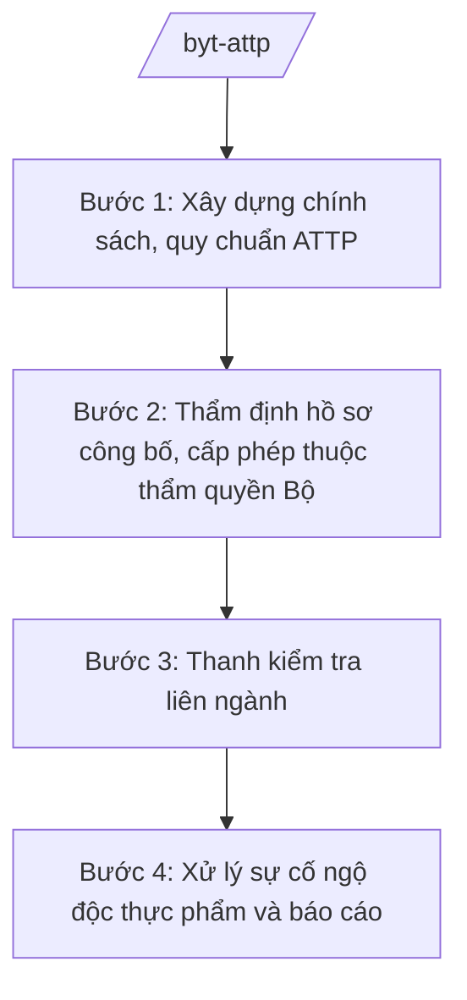

# Skill: An toàn thực phẩm (cấp bộ)

## 2. Khi nào dùng

Khi xây dựng chính sách ATTP, cấp giấy chứng nhận thuộc thẩm quyền Bộ Y tế (cơ sở sản xuất thực phẩm
chức năng, phụ gia thực phẩm...), tổ chức thanh kiểm tra liên ngành, xử lý sự cố ngộ độc thực phẩm
quy mô lớn. Không dùng cho ATTP cơ sở/tỉnh (skill `attp-co-so`, `attp-tinh`, `attp-cong-thuong-tinh`).

## 3. Đầu vào (Input)

| Trường | Mô tả | Bắt buộc |
|--------|-------|----------|
| `ho_so_cong_bo` | Hồ sơ công bố sản phẩm / đề nghị cấp giấy chứng nhận cơ sở đủ điều kiện ATTP | Có |
| `loai_san_pham` | Thực phẩm chức năng / phụ gia / thực phẩm tăng cường vi chất... | Có |
| `ke_hoach_thanh_tra` | Kế hoạch thanh kiểm tra ATTP năm (liên ngành) | Có |
| `bao_cao_ngo_doc` | Báo cáo vụ ngộ độc thực phẩm (số ca, địa bàn, nguyên nhân nghi ngờ) | Không |
| `bao_cao_dia_phuong` | Báo cáo công tác ATTP của địa phương | Không |

## 4. Quy trình

**Bước 1. Xây dựng chính sách, quy chuẩn ATTP**

- Làm gì: Rà soát quy định hiện hành; xây dựng quy chuẩn kỹ thuật quốc gia về ATTP; đề xuất chính sách mới.
- Dùng input: `bao_cao_dia_phuong`, `bao_cao_ngo_doc`.
- Vai trò: Chuyên viên Cục An toàn thực phẩm soạn thảo (AI hỗ trợ tra cứu quy chuẩn quốc tế Codex, đối chiếu quy định hiện hành ⏱ 3 giờ (ước tính)); Cục trưởng (bà Vũ Thị FF) duyệt trình.
- Lưu ý nghiệp vụ: Quy chuẩn phải có căn cứ khoa học, phù hợp thông lệ quốc tế, khả thi với doanh nghiệp.
- → Kết quả bước: Dự thảo quy chuẩn/chính sách ATTP.

**Bước 2. Thẩm định hồ sơ công bố, cấp phép thuộc thẩm quyền Bộ**

- Làm gì: Tiếp nhận hồ sơ công bố sản phẩm, hồ sơ đề nghị cấp giấy chứng nhận cơ sở đủ điều kiện ATTP thuộc thẩm quyền Bộ; thẩm định; cấp giấy tiếp nhận công bố/giấy chứng nhận hoặc từ chối có lý do.
- Dùng input: `ho_so_cong_bo`, `loai_san_pham`.
- Vai trò: Chuyên viên Cục An toàn thực phẩm thẩm định (AI hỗ trợ kiểm tra tính đầy đủ hồ sơ, tra cứu cảnh báo thành phần cấm ⏱ 2 giờ (ước tính)); Cục trưởng ký cấp.
- Lưu ý nghiệp vụ: Không cấp phép cho sản phẩm chứa chất cấm, công bố sai sự thật; thời hạn giải quyết đúng quy định.
- → Kết quả bước: Giấy tiếp nhận công bố / giấy chứng nhận đủ điều kiện ATTP.

**Bước 3. Thanh kiểm tra liên ngành**

- Làm gì: Xây dựng kế hoạch thanh kiểm tra liên ngành (Y tế – Công Thương – Nông nghiệp); tổ chức đoàn kiểm tra; xử lý vi phạm.
- Dùng input: `ke_hoach_thanh_tra`.
- Vai trò: Cục An toàn thực phẩm chủ trì đoàn liên ngành (AI hỗ trợ lập danh sách cơ sở nguy cơ cao từ dữ liệu vi phạm các năm ⏱ 3 giờ (ước tính)); Thứ trưởng phụ trách (bà Phạm Thị DD) phê duyệt kế hoạch.
- Lưu ý nghiệp vụ: Tập trung cơ sở nguy cơ cao, dịp cao điểm (Tết, lễ hội); xử lý nghiêm, công khai vi phạm.
- → Kết quả bước: Kế hoạch thanh tra + kết luận kiểm tra, quyết định xử phạt.

**Bước 4. Xử lý sự cố ngộ độc thực phẩm và báo cáo**

- Làm gì: Tiếp nhận báo cáo vụ ngộ độc; cử đoàn công tác hỗ trợ địa phương điều tra nguyên nhân; chỉ đạo thu hồi, tiêu hủy thực phẩm không an toàn; báo cáo Chính phủ.
- Dùng input: `bao_cao_ngo_doc`.
- Vai trò: Cục An toàn thực phẩm điều phối ứng phó (AI hỗ trợ tổng hợp diễn biến các vụ ngộ độc toàn quốc, lập bản đồ nguy cơ ⏱ 2 giờ (ước tính)); Bộ trưởng (ông Lê Văn CC) báo cáo Thủ tướng với vụ nghiêm trọng.
- Lưu ý nghiệp vụ: Phản ứng trong 24 giờ với vụ ngộ độc đông người; thông tin công khai, chính xác, tránh hoang mang.
- → Kết quả bước: Báo cáo điều tra nguyên nhân + chỉ đạo khắc phục + báo cáo Chính phủ (nếu nghiêm trọng).

## Luồng quy trình (Workflow)

## 5. Đầu ra (Output)

- Quy chuẩn kỹ thuật quốc gia / chính sách ATTP
- Giấy tiếp nhận công bố sản phẩm, giấy chứng nhận cơ sở đủ điều kiện ATTP
- Kế hoạch thanh kiểm tra liên ngành + kết luận kiểm tra
- Báo cáo xử lý sự cố ngộ độc thực phẩm

### Cấu trúc output chuẩn (Giấy tiếp nhận đăng ký bản công bố sản phẩm)

1. Quốc hiệu "CỘNG HÒA XÃ HỘI CHỦ NGHĨA VIỆT NAM", Tiêu ngữ "Độc lập – Tự do – Hạnh phúc"; tên Bộ/Cục; số giấy, ký hiệu; địa danh, ngày tháng
2. Tên giấy
3. Tên sản phẩm, tên tổ chức/cá nhân công bố (giả lập)
4. Nội dung công bố (thành phần, chỉ tiêu chất lượng)
5. Hiệu lực của giấy
6. Chữ ký (ghi rõ chức danh, họ tên người ký; ký hiệu "KT."/"TL." khi ký thay) Cục trưởng, dấu (theo NĐ 30/2020/NĐ-CP)
7. Nơi nhận (kết thúc "- Lưu: VT, [mã đơn vị].").

> **Chuẩn tài liệu đầu ra** (thứ tự ưu tiên):
> 1. Chuẩn riêng của ngành/cơ quan chủ quản — mẫu, biểu mẫu, quy chuẩn tại văn bản quy phạm chuyên ngành (xem mục "Căn cứ & lưu ý").
> 2. Tài liệu không có quy chuẩn riêng — thể thức NĐ 30/2020/NĐ-CP: Quốc hiệu và Tiêu ngữ; tên cơ quan ban hành; số, ký hiệu; địa danh và thời gian; tên loại và trích yếu; nội dung; chức vụ, họ tên, chữ ký người có thẩm quyền; dấu, chữ ký số; nơi nhận (kèm Phụ lục nếu có).

## 6. Checklist nghiệm thu

- [ ] Quy chuẩn có căn cứ khoa học, phù hợp thông lệ quốc tế
- [ ] Hồ sơ công bố/cấp phép được thẩm định đầy đủ; từ chối có lý do rõ ràng
- [ ] Kế hoạch thanh tra tập trung đúng cơ sở nguy cơ cao, cao điểm
- [ ] Xử lý sự cố ngộ độc kịp thời (trong 24 giờ với vụ đông người)
- [ ] Công khai vi phạm, không bao che
- [ ] Thể thức đúng NĐ 30/2020/NĐ-CP; đã qua human gate

## 7. Ví dụ mô phỏng

*Dữ liệu dưới đây là giả lập 100% phục vụ minh họa.*

**Input mẫu:**

| Trường | Giá trị |
|--------|---------|
| ho_so_cong_bo | Hồ sơ công bố thực phẩm chức năng hỗ trợ tiêu hóa của Công ty AA (giả lập) |
| loai_san_pham | Thực phẩm chức năng |
| bao_cao_ngo_doc | 50 ca ngộ độc tại 1 lễ hội ở tỉnh A, nghi do bánh kẹo không rõ nguồn gốc |

**Output mẫu (trích chỉ đạo xử lý sự cố):**

> **BỘ Y TẾ**
> Số: 1234/BYT-ATTP
>
> **CÔNG ĐIỆN**
> **Về việc điều tra, xử lý vụ ngộ độc thực phẩm tại tỉnh A**
>
> ...Cục An toàn thực phẩm cử đoàn công tác phối hợp Sở Y tế tỉnh A điều tra nguyên nhân trong 24 giờ; tạm đình chỉ lưu thông lô bánh kẹo nghi ngờ; báo cáo Bộ trước 17h00...

## 8. Human gate

- Cục trưởng Cục An toàn thực phẩm (bà Vũ Thị FF): ký cấp giấy, ký văn bản hướng dẫn
- Thứ trưởng phụ trách (bà Phạm Thị DD): phê duyệt kế hoạch thanh kiểm tra liên ngành
- Bộ trưởng (ông Lê Văn CC): ban hành quy chuẩn, báo cáo Thủ tướng vụ ngộ độc nghiêm trọng

## 9. Giới hạn

- AI không cấp giấy chứng nhận, không kết luận nguyên nhân ngộ độc thay cơ quan chuyên môn
- Không bịa kết quả kiểm nghiệm, số ca ngộ độc, thành phần sản phẩm
- Không công bố thông tin gây hoang mang khi chưa có kết luận điều tra
- Không viện dẫn văn bản hết hiệu lực

## 10. Căn cứ & lưu ý

- Nghị định 42/2025/NĐ-CP ngày 27/02/2025 của Chính phủ — chức năng, nhiệm vụ, quyền hạn và cơ cấu tổ chức của Bộ Y tế
- Nghị quyết 176/2025/QH15 — cơ cấu tổ chức của Chính phủ
- Nghị định 303/2025/NĐ-CP — khung chung về chức năng, nhiệm vụ của bộ, cơ quan ngang bộ
- Nghị định 30/2020/NĐ-CP — công tác văn thư (thể thức văn bản)
- Lưu ý: phân định thẩm quyền ATTP giữa Bộ Y tế – Bộ Công Thương – Bộ Nông nghiệp và Môi trường theo phân công của Chính phủ; phân định với ATTP tuyến tỉnh/xã
