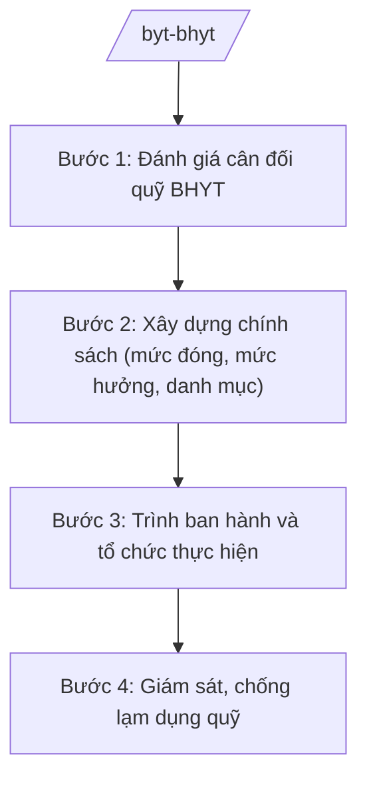

# Skill: Bảo hiểm y tế (chính sách, quỹ)

## 2. Khi nào dùng

Khi xây dựng, sửa đổi chính sách BHYT (mức đóng, mức hưởng, danh mục thuốc/dịch vụ được thanh toán),
đánh giá cân đối quỹ BHYT, phối hợp tổ chức thực hiện BHYT toàn dân. Không dùng cho phối hợp thực
hiện BHYT tuyến tỉnh (skill `phoi-hop-bhyt`).

## 3. Đầu vào (Input)

| Trường | Mô tả | Bắt buộc |
|--------|-------|----------|
| `so_lieu_quy` | Số liệu thu, chi quỹ BHYT toàn quốc (thu theo nhóm đối tượng, chi theo tuyến) | Có |
| `ty_le_bao_phu` | Tỷ lệ dân số tham gia BHYT | Có |
| `danh_muc_thanh_toan` | Danh mục thuốc, vật tư, dịch vụ kỹ thuật đề nghị bổ sung/loại khỏi thanh toán BHYT | Có |
| `de_xuat_dieu_chinh` | Đề xuất điều chỉnh mức đóng/mức hưởng/phạm vi | Có |
| `bao_cao_giam_dinh` | Báo cáo giám định, thanh tra chi BHYT (trục lợi, lạm dụng) | Không |

## 4. Quy trình

**Bước 1. Đánh giá cân đối quỹ BHYT**

- Làm gì: Tổng hợp thu/chi quỹ toàn quốc; phân tích khả năng cân đối ngắn/dài hạn; dự báo tác động của điều chỉnh chính sách đến quỹ.
- Dùng input: `so_lieu_quy`, `ty_le_bao_phu`.
- Vai trò: Chuyên viên Vụ Bảo hiểm y tế phân tích (AI hỗ trợ mô hình dự báo thu/chi quỹ theo kịch bản điều chỉnh — 4 giờ); Vụ trưởng (ông Hoàng Văn EE) duyệt báo cáo.
- Lưu ý nghiệp vụ: Số liệu từ Bảo hiểm Xã hội Việt Nam; dự báo phải tính đến già hóa dân số, chi phí y tế tăng.
- → Kết quả bước: Báo cáo cân đối quỹ BHYT + các kịch bản điều chỉnh.

**Bước 2. Xây dựng chính sách (mức đóng, mức hưởng, danh mục)**

- Làm gì: Soạn thảo điều chỉnh mức đóng, mức hưởng, phạm vi quyền lợi; rà soát, cập nhật danh mục thuốc/dịch vụ thanh toán (bổ sung thuốc mới, loại thuốc kém hiệu quả); lấy ý kiến.
- Dùng input: `danh_muc_thanh_toan`, `de_xuat_dieu_chinh`, báo cáo cân đối quỹ.
- Vai trò: Vụ Bảo hiểm y tế chủ trì, phối hợp Bảo hiểm Xã hội Việt Nam (AI hỗ trợ tổng hợp ý kiến, đánh giá tác động ngân sách — 4 giờ); Thứ trưởng phụ trách (bà Phạm Thị DD) cho ý kiến.
- Lưu ý nghiệp vụ: Bảo đảm quyền lợi người tham gia, cân đối quỹ bền vững; danh mục dựa trên bằng chứng hiệu quả, chi phí-hiệu quả.
- → Kết quả bước: Dự thảo văn bản chính sách BHYT.

**Bước 3. Trình ban hành và tổ chức thực hiện**

- Làm gì: Hoàn thiện hồ sơ trình Chính phủ (nghị định) hoặc Bộ trưởng ban hành (thông tư); ban hành văn bản hướng dẫn; phối hợp Bảo hiểm Xã hội Việt Nam tổ chức thực hiện.
- Dùng input: Dự thảo chính sách, báo cáo đánh giá tác động.
- Vai trò: Vụ trưởng Vụ Bảo hiểm y tế hoàn thiện hồ sơ (AI hỗ trợ kiểm tra tính đầy đủ hồ sơ trình — 2 giờ); Bộ trưởng (ông Lê Văn CC) ký trình Chính phủ/ký ban hành.
- Lưu ý nghiệp vụ: Phối hợp chặt với Bảo hiểm Xã hội Việt Nam (cơ quan tổ chức thực hiện); truyền thông chính sách đến người dân.
- → Kết quả bước: Văn bản chính sách BHYT được ban hành + kế hoạch tổ chức thực hiện.

**Bước 4. Giám sát, chống lạm dụng quỹ**

- Làm gì: Theo dõi chi BHYT bất thường; phối hợp thanh tra, giám định; xử lý trục lợi, lạm dụng quỹ; báo cáo định kỳ.
- Dùng input: `bao_cao_giam_dinh`, số liệu chi theo cơ sở KCB.
- Vai trò: Vụ Bảo hiểm y tế phối hợp Thanh tra Bộ (AI hỗ trợ phát hiện mẫu chi bất thường từ dữ liệu giám định — 3 giờ).
- Lưu ý nghiệp vụ: Xử lý nghiêm trục lợi quỹ; bảo vệ quyền lợi người bệnh chính đáng, không gây khó dễ trong thanh toán.
- → Kết quả bước: Báo cáo giám sát quỹ + quyết định xử lý vi phạm.

## Luồng quy trình (Workflow)

## 5. Đầu ra (Output)

- Báo cáo cân đối quỹ BHYT (kèm kịch bản)
- Dự thảo nghị định/thông tư về BHYT
- Danh mục thuốc, dịch vụ thanh toán BHYT (cập nhật)
- Báo cáo giám sát, chống lạm dụng quỹ

### Cấu trúc output chuẩn (Báo cáo cân đối quỹ BHYT)

1. Quốc hiệu "CỘNG HÒA XÃ HỘI CHỦ NGHĨA VIỆT NAM", Tiêu ngữ "Độc lập – Tự do – Hạnh phúc"; tên Bộ/Vụ; số, ký hiệu; địa danh, ngày tháng
2. Tên báo cáo, kỳ báo cáo
3. Tình hình thu quỹ (theo nhóm đối tượng)
4. Tình hình chi quỹ (theo tuyến, theo nhóm dịch vụ)
5. Đánh giá cân đối, dự báo các kịch bản
6. Kiến nghị điều chỉnh chính sách
7. Chữ ký (ghi rõ chức danh, họ tên người ký; ký hiệu "KT."/"TL." khi ký thay) người có thẩm quyền (theo NĐ 30/2020/NĐ-CP)
8. Nơi nhận (kết thúc "- Lưu: VT, [mã đơn vị].").

> **Checklist thể thức văn bản theo NĐ 30/2020/NĐ-CP** — đối chiếu trước khi trình ký:
> 1. Quốc hiệu và Tiêu ngữ.
> 2. Tên cơ quan, tổ chức ban hành văn bản.
> 3. Số, ký hiệu của văn bản.
> 4. Địa danh và thời gian ban hành văn bản.
> 5. Tên loại và trích yếu nội dung văn bản.
> 6. Nội dung văn bản.
> 7. Chức vụ, họ tên và chữ ký của người có thẩm quyền.
> 8. Dấu, chữ ký số của cơ quan, tổ chức.
> 9. Nơi nhận (kèm Phụ lục nếu có).

## 6. Checklist nghiệm thu

- [ ] Số liệu quỹ từ nguồn chính thức (BHXH Việt Nam), có dự báo dài hạn
- [ ] Điều chỉnh chính sách bảo đảm cân đối quỹ bền vững và quyền lợi người tham gia
- [ ] Danh mục thanh toán dựa trên bằng chứng hiệu quả
- [ ] Có cơ chế phát hiện, xử lý lạm dụng, trục lợi quỹ
- [ ] Phối hợp BHXH Việt Nam trong tổ chức thực hiện
- [ ] Thể thức đúng NĐ 30/2020/NĐ-CP; đã qua human gate

## 7. Ví dụ mô phỏng

*Dữ liệu dưới đây là giả lập 100% phục vụ minh họa.*

**Input mẫu:**

| Trường | Giá trị |
|--------|---------|
| so_lieu_quy | Thu 100.000 tỷ đồng, chi 95.000 tỷ đồng; kết dư 5.000 tỷ đồng |
| ty_le_bao_phu | 94% dân số tham gia BHYT |
| danh_muc_thanh_toan | Đề nghị bổ sung 10 thuốc điều trị ung thư mới vào danh mục |
| de_xuat_dieu_chinh | Giữ nguyên mức đóng; mở rộng phạm vi chi trả thuốc ung thư |

**Output mẫu (trích Báo cáo):**

> **BỘ Y TẾ**
> **VỤ BẢO HIỂM Y TẾ**
> Số: 1234/BC-BHYT
>
> **BÁO CÁO**
> **Cân đối quỹ bảo hiểm y tế năm 2025 và đề xuất chính sách năm 2026**
>
> 1. Thu quỹ đạt 100.000 tỷ đồng (tăng 8%), chi 95.000 tỷ đồng...
> 2. Quỹ kết dư 5.000 tỷ đồng, bảo đảm cân đối...
> 3. Đề xuất: bổ sung 10 thuốc điều trị ung thư vào danh mục thanh toán từ 2026, tác động tăng chi khoảng 2.000 tỷ đồng, quỹ vẫn cân đối...

## 8. Human gate

- Vụ trưởng Vụ Bảo hiểm y tế (ông Hoàng Văn EE): duyệt báo cáo cân đối quỹ, ký tờ trình
- Thứ trưởng phụ trách (bà Phạm Thị DD): cho ý kiến dự thảo chính sách
- Bộ trưởng (ông Lê Văn CC): ký trình Chính phủ (nghị định) / ký ban hành (thông tư)

## 9. Giới hạn

- AI không tự quyết định điều chỉnh mức đóng/mức hưởng, không phê duyệt danh mục thanh toán
- Không bịa số liệu thu/chi quỹ, tỷ lệ bao phủ BHYT
- Không thay cơ quan giám định kết luận lạm dụng, trục lợi cụ thể
- Bảo mật dữ liệu cá nhân người tham gia BHYT
- Không viện dẫn văn bản hết hiệu lực

## 10. Căn cứ & lưu ý

- Nghị định 42/2025/NĐ-CP ngày 27/02/2025 của Chính phủ — chức năng, nhiệm vụ, quyền hạn và cơ cấu tổ chức của Bộ Y tế
- Nghị quyết 176/2025/QH15 — cơ cấu tổ chức của Chính phủ
- Nghị định 303/2025/NĐ-CP — khung chung về chức năng, nhiệm vụ của bộ, cơ quan ngang bộ
- Nghị định 30/2020/NĐ-CP — công tác văn thư (thể thức văn bản)
- Lưu ý: Bộ Y tế xây dựng chính sách BHYT; Bảo hiểm Xã hội Việt Nam là cơ quan tổ chức thực hiện; phân định với phối hợp BHYT tuyến tỉnh (Sở Y tế)
