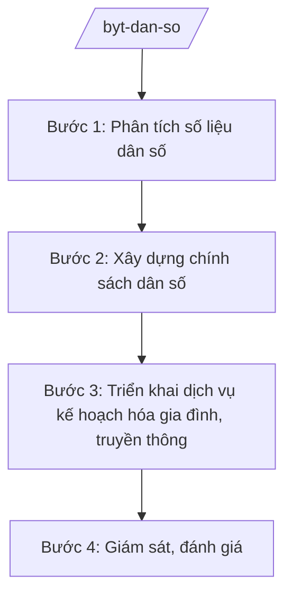

# Skill: Dân số (chính sách, mức sinh)

## 2. Khi nào dùng

Khi xây dựng chính sách dân số (điều chỉnh mức sinh, chăm sóc sức khỏe sinh sản, dân số và phát
triển), phân tích số liệu dân số toàn quốc, triển khai chương trình kế hoạch hóa gia đình.
Không dùng cho công tác dân số tuyến tỉnh/xã (skill `dan-so-sks-tinh`).

## 3. Đầu vào (Input)

| Trường | Mô tả | Bắt buộc |
|--------|-------|----------|
| `so_lieu_dan_so` | Số liệu tổng điều tra dân số, điều tra biến động dân số (quy mô, cơ cấu, mức sinh theo vùng) | Có |
| `muc_tieu_chinh_sach` | Mục tiêu điều chỉnh mức sinh (vd: duy trì mức sinh thay thế) | Có |
| `de_xuat_chinh_sach` | Đề xuất chính sách (hỗ trợ sinh con, dịch vụ KHHGĐ...) | Có |
| `bao_cao_dia_phuong` | Báo cáo thực hiện công tác dân số của địa phương | Không |

## 4. Quy trình

**Bước 1. Phân tích số liệu dân số**

- Làm gì: Tổng hợp số liệu tổng tỷ suất sinh, tỷ số giới tính khi sinh, cơ cấu dân số theo vùng; dự báo xu hướng; xác định vùng mức sinh thấp/cần can thiệp.
- Dùng input: `so_lieu_dan_so`.
- Vai trò: Chuyên viên Cục Dân số phân tích (AI hỗ trợ vẽ biểu đồ xu hướng mức sinh theo vùng, dự báo dân số ⏱ 3 giờ (ước tính)); Cục trưởng duyệt báo cáo phân tích.
- Lưu ý nghiệp vụ: Số liệu từ Tổng cục Thống kê và hệ thống báo cáo ngành; phân tích chênh lệch vùng miền, không đánh đồng bình quân cả nước.
- → Kết quả bước: Báo cáo phân tích tình hình dân số, mức sinh.

**Bước 2. Xây dựng chính sách dân số**

- Làm gì: Soạn thảo chính sách điều chỉnh mức sinh phù hợp từng vùng (khuyến khích sinh ở vùng mức sinh thấp, kiểm soát mất cân bằng giới tính khi sinh); lấy ý kiến; trình cấp có thẩm quyền.
- Dùng input: `muc_tieu_chinh_sach`, `de_xuat_chinh_sach`, báo cáo phân tích.
- Vai trò: Cục Dân số chủ trì soạn thảo (AI hỗ trợ tổng hợp kinh nghiệm chính sách dân số, rà soát tính khả thi ⏱ 4 giờ (ước tính)); Thứ trưởng phụ trách cho ý kiến; Bộ trưởng (ông Lê Văn CC) trình Chính phủ.
- Lưu ý nghiệp vụ: Chính sách phải tôn trọng quyền con người, phù hợp văn hóa từng vùng; không áp đặt chỉ tiêu hành chính cứng nhắc.
- → Kết quả bước: Dự thảo chính sách dân số trình Chính phủ.

**Bước 3. Triển khai dịch vụ kế hoạch hóa gia đình, truyền thông**

- Làm gì: Ban hành hướng dẫn chuyên môn; bảo đảm cung ứng phương tiện tránh thai; tổ chức truyền thông thay đổi hành vi.
- Dùng input: Chính sách đã ban hành, `bao_cao_dia_phuong`.
- Vai trò: Cục Dân số chỉ đạo triển khai (AI hỗ trợ soạn tài liệu truyền thông, kế hoạch cung ứng phương tiện theo nhu cầu địa phương ⏱ 3 giờ (ước tính)).
- Lưu ý nghiệp vụ: Dịch vụ phải an toàn, tự nguyện, bảo mật thông tin cá nhân.
- → Kết quả bước: Văn bản hướng dẫn + kế hoạch cung ứng, truyền thông.

**Bước 4. Giám sát, đánh giá**

- Làm gì: Theo dõi chỉ số mức sinh, tỷ số giới tính khi sinh; đánh giá hiệu quả chính sách; điều chỉnh.
- Dùng input: `bao_cao_dia_phuong`, số liệu giám sát.
- Vai trò: Cục Dân số tổng hợp (AI hỗ trợ đối chiếu chỉ tiêu/kết quả theo tỉnh, phát hiện địa bàn lệch mục tiêu ⏱ 2 giờ (ước tính)).
- Lưu ý nghiệp vụ: Đánh giá định kỳ, công khai kết quả; điều chỉnh chính sách kịp thời khi xu hướng đảo chiều.
- → Kết quả bước: Báo cáo giám sát, đánh giá công tác dân số.

## Luồng quy trình (Workflow)

## 5. Đầu ra (Output)

- Báo cáo phân tích tình hình dân số, mức sinh
- Dự thảo chính sách dân số trình Chính phủ
- Văn bản hướng dẫn chuyên môn về KHHGĐ, chăm sóc SKSS
- Báo cáo giám sát, đánh giá công tác dân số

### Cấu trúc output chuẩn (Báo cáo phân tích tình hình dân số)

1. Quốc hiệu "CỘNG HÒA XÃ HỘI CHỦ NGHĨA VIỆT NAM", Tiêu ngữ "Độc lập – Tự do – Hạnh phúc"; tên Bộ/Cục; số, ký hiệu; địa danh, ngày tháng
2. Tên báo cáo, thời kỳ báo cáo
3. Tình hình chung (quy mô, cơ cấu dân số)
4. Phân tích mức sinh theo vùng (đồng bằng, trung du, miền núi, đô thị)
5. Tỷ số giới tính khi sinh, xu hướng
6. Đánh giá tác động của chính sách hiện hành
7. Khuyến nghị chính sách
8. Chữ ký (ghi rõ chức danh, họ tên người ký; ký hiệu "KT."/"TL." khi ký thay) người có thẩm quyền (theo NĐ 30/2020/NĐ-CP)
9. Nơi nhận (kết thúc "- Lưu: VT, [mã đơn vị].").

> **Checklist thể thức văn bản theo NĐ 30/2020/NĐ-CP** — đối chiếu trước khi trình ký:
> 1. Quốc hiệu và Tiêu ngữ.
> 2. Tên cơ quan, tổ chức ban hành văn bản.
> 3. Số, ký hiệu của văn bản.
> 4. Địa danh và thời gian ban hành văn bản.
> 5. Tên loại và trích yếu nội dung văn bản.
> 6. Nội dung văn bản.
> 7. Chức vụ, họ tên và chữ ký của người có thẩm quyền.
> 8. Dấu, chữ ký số của cơ quan, tổ chức.
> 9. Nơi nhận (kèm Phụ lục nếu có).

## 6. Checklist nghiệm thu

- [ ] Số liệu từ nguồn chính thức, phân tích theo vùng không đánh đồng bình quân
- [ ] Chính sách tôn trọng quyền con người, phù hợp văn hóa vùng miền
- [ ] Có cơ chế giám sát mức sinh, tỷ số giới tính khi sinh
- [ ] Dịch vụ KHHGĐ an toàn, tự nguyện, bảo mật
- [ ] Thể thức đúng NĐ 30/2020/NĐ-CP; đã qua human gate

## 7. Ví dụ mô phỏng

*Dữ liệu dưới đây là giả lập 100% phục vụ minh họa.*

**Input mẫu:**

| Trường | Giá trị |
|--------|---------|
| so_lieu_dan_so | Tổng tỷ suất sinh toàn quốc 1,9 con/phụ nữ; 20 tỉnh mức sinh dưới 1,8; tỷ số giới tính khi sinh 112 bé trai/100 bé gái |
| muc_tieu_chinh_sach | Duy trì mức sinh thay thế (2,1 con), giảm mất cân bằng giới tính khi sinh |
| de_xuat_chinh_sach | Hỗ trợ cặp vợ chồng sinh đủ 2 con ở vùng mức sinh thấp; tăng cường truyền thông |

**Output mẫu (trích Báo cáo):**

> **BỘ Y TẾ**
> **CỤC DÂN SỐ**
> Số: 1234/BC-DS
>
> **BÁO CÁO**
> **Tình hình dân số và mức sinh năm 2025, khuyến nghị chính sách**
>
> 1. Tổng tỷ suất sinh toàn quốc đạt 1,9 con/phụ nữ, thấp hơn mức sinh thay thế...
> 2. 20 tỉnh có mức sinh dưới 1,8, tập trung vùng đô thị...
> 3. Khuyến nghị: ban hành chính sách hỗ trợ cặp vợ chồng sinh đủ 2 con tại vùng mức sinh thấp...

## 8. Human gate

- Cục trưởng Cục Dân số (bà Vũ Thị FF): duyệt báo cáo phân tích, ký văn bản hướng dẫn
- Thứ trưởng phụ trách (bà Phạm Thị DD): cho ý kiến dự thảo chính sách
- Bộ trưởng (ông Lê Văn CC): trình Chính phủ ban hành chính sách dân số

## 9. Giới hạn

- AI không tự ban hành chính sách dân số
- Không bịa số liệu dân số, mức sinh, tỷ số giới tính khi sinh
- Không đề xuất chính sách vi phạm quyền con người, áp đặt hành chính
- Bảo mật thông tin cá nhân trong dữ liệu dân số
- Không viện dẫn văn bản hết hiệu lực

## 10. Căn cứ & lưu ý

- Nghị định 42/2025/NĐ-CP ngày 27/02/2025 của Chính phủ — chức năng, nhiệm vụ, quyền hạn và cơ cấu tổ chức của Bộ Y tế
- Nghị quyết 176/2025/QH15 — cơ cấu tổ chức của Chính phủ
- Nghị định 303/2025/NĐ-CP — khung chung về chức năng, nhiệm vụ của bộ, cơ quan ngang bộ
- Nghị định 30/2020/NĐ-CP — công tác văn thư (thể thức văn bản)
- Lưu ý: phân định với công tác dân số tuyến tỉnh/xã (Sở Y tế, Trạm Y tế) — Bộ làm chính sách, phân tích số liệu toàn quốc, hướng dẫn chuyên môn
