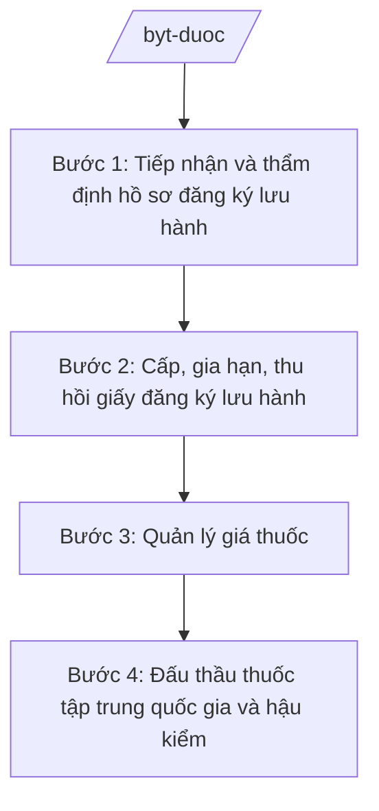

# Skill: Quản lý dược (đăng ký lưu hành, giá thuốc)

## 2. Khi nào dùng

Khi xử lý hồ sơ đăng ký lưu hành thuốc, quản lý giá thuốc (kê khai, công bố), tổ chức đấu thầu
thuốc tập trung cấp quốc gia, hậu kiểm chất lượng thuốc lưu hành. Không dùng cho cấp phép bán lẻ
thuốc tuyến tỉnh (skill `quan-ly-duoc-tinh`).

## 3. Đầu vào (Input)

| Trường | Mô tả | Bắt buộc |
|--------|-------|----------|
| `ho_so_dang_ky` | Hồ sơ đăng ký lưu hành thuốc (hồ sơ kỹ thuật, lâm sàng, GMP) | Có |
| `loai_thuoc` | Thuốc tân dược / vắc xin / sinh phẩm / thuốc cổ truyền | Có |
| `ho_so_gia` | Hồ sơ kê khai giá thuốc của cơ sở sản xuất/nhập khẩu | Không |
| `danh_muc_dau_thau` | Danh mục thuốc đấu thầu tập trung quốc gia | Không |
| `bao_cao_hau_kiem` | Kết quả kiểm nghiệm, hậu kiểm chất lượng thuốc | Không |

## 4. Quy trình

**Bước 1. Tiếp nhận và thẩm định hồ sơ đăng ký lưu hành**

- Làm gì: Kiểm tra tính đầy đủ, hợp lệ của hồ sơ; thẩm định chất lượng, an toàn, hiệu quả (hội đồng thẩm định); yêu cầu bổ sung nếu thiếu.
- Dùng input: `ho_so_dang_ky`, `loai_thuoc`.
- Vai trò: Chuyên viên Cục Quản lý Dược thẩm định hồ sơ (AI hỗ trợ đối chiếu checklist thành phần hồ sơ, tra cứu tiền lệ cấp phép ⏱ 4 giờ (ước tính)); Hội đồng thẩm định họp đánh giá.
- Lưu ý nghiệp vụ: Từ chối thẳng hồ sơ giả mạo, số liệu lâm sàng không trung thực; bảo mật thông tin độc quyền của doanh nghiệp.
- → Kết quả bước: Biên bản thẩm định + thông báo bổ sung hồ sơ (nếu có).

**Bước 2. Cấp, gia hạn, thu hồi giấy đăng ký lưu hành**

- Làm gì: Trình cấp giấy đăng ký lưu hành cho hồ sơ đạt; gia hạn khi hết hiệu lực; đình chỉ, thu hồi khi phát hiện vi phạm chất lượng, an toàn.
- Dùng input: Biên bản thẩm định đạt.
- Vai trò: Cục trưởng Cục Quản lý Dược (bà Vũ Thị FF) ký cấp giấy (AI hỗ trợ quản trị cơ sở dữ liệu giấy phép, cảnh báo hết hiệu lực ⏱ 1 giờ (ước tính)).
- Lưu ý nghiệp vụ: Công khai danh mục thuốc được cấp phép trên Cổng TTĐT; thu hồi kịp thời thuốc không đạt chất lượng.
- → Kết quả bước: Giấy đăng ký lưu hành / quyết định thu hồi.

**Bước 3. Quản lý giá thuốc**

- Làm gì: Tiếp nhận kê khai giá; công bố giá thuốc; kiểm tra yếu tố hình thành giá; xử lý vi phạm về giá.
- Dùng input: `ho_so_gia`.
- Vai trò: Cục Quản lý Dược chủ trì, phối hợp cơ quan quản lý giá (AI hỗ trợ so sánh giá kê khai với giá tham chiếu, phát hiện bất thường ⏱ 3 giờ (ước tính)); Thứ trưởng phụ trách (bà Phạm Thị DD) chỉ đạo xử lý vi phạm.
- Lưu ý nghiệp vụ: Bảo đảm công khai, minh bạch giá; chống độc quyền, thao túng giá thuốc.
- → Kết quả bước: Công bố giá thuốc + quyết định xử lý vi phạm (nếu có).

**Bước 4. Đấu thầu thuốc tập trung quốc gia và hậu kiểm**

- Làm gì: Xây dựng danh mục đấu thầu tập trung; tổ chức lựa chọn nhà thầu; giám sát thực hiện hợp đồng; hậu kiểm chất lượng thuốc lưu hành (lấy mẫu kiểm nghiệm).
- Dùng input: `danh_muc_dau_thau`, `bao_cao_hau_kiem`.
- Vai trò: Cục Quản lý Dược tổ chức đấu thầu (AI hỗ trợ tổng hợp nhu cầu các bệnh viện, phân tích giá trúng thầu ⏱ 4 giờ (ước tính)); Bộ trưởng (ông Lê Văn CC) phê duyệt kế hoạch đấu thầu tập trung.
- Lưu ý nghiệp vụ: Đấu thầu công khai, cạnh tranh, tiết kiệm; hậu kiểm độc lập, xử lý nghiêm thuốc giả, thuốc kém chất lượng.
- → Kết quả bước: Kết quả đấu thầu + báo cáo hậu kiểm chất lượng.

## Luồng quy trình (Workflow)

## 5. Đầu ra (Output)

- Giấy đăng ký lưu hành thuốc (cấp mới, gia hạn) / quyết định thu hồi
- Công bố giá thuốc
- Kế hoạch và kết quả đấu thầu thuốc tập trung quốc gia
- Báo cáo hậu kiểm chất lượng thuốc

### Cấu trúc output chuẩn (Giấy đăng ký lưu hành thuốc)

1. Quốc hiệu "CỘNG HÒA XÃ HỘI CHỦ NGHĨA VIỆT NAM", Tiêu ngữ "Độc lập – Tự do – Hạnh phúc"; tên Bộ; số giấy, ký hiệu
2. Tên giấy: Giấy đăng ký lưu hành thuốc
3. Tên thuốc, hoạt chất, hàm lượng, dạng bào chế
4. Cơ sở sản xuất, cơ sở đăng ký
5. Số đăng ký, ngày cấp, hiệu lực
6. Điều kiện lưu hành (nếu có)
7. Chữ ký (ghi rõ chức danh, họ tên người ký; ký hiệu "KT."/"TL." khi ký thay) Cục trưởng Cục Quản lý Dược, dấu (theo NĐ 30/2020/NĐ-CP)
8. Nơi nhận (kết thúc "- Lưu: VT, [mã đơn vị].").

> **Checklist thể thức văn bản theo NĐ 30/2020/NĐ-CP** — đối chiếu trước khi trình ký:
> 1. Quốc hiệu và Tiêu ngữ.
> 2. Tên cơ quan, tổ chức ban hành văn bản.
> 3. Số, ký hiệu của văn bản.
> 4. Địa danh và thời gian ban hành văn bản.
> 5. Tên loại và trích yếu nội dung văn bản.
> 6. Nội dung văn bản.
> 7. Chức vụ, họ tên và chữ ký của người có thẩm quyền.
> 8. Dấu, chữ ký số của cơ quan, tổ chức.
> 9. Nơi nhận (kèm Phụ lục nếu có).

## 6. Checklist nghiệm thu

- [ ] Hồ sơ đăng ký đầy đủ, hợp lệ; đã qua hội đồng thẩm định
- [ ] Không cấp phép cho hồ sơ giả mạo, số liệu không trung thực
- [ ] Giá thuốc được kê khai, công bố minh bạch; xử lý vi phạm về giá
- [ ] Đấu thầu tập trung công khai, cạnh tranh
- [ ] Có hậu kiểm độc lập chất lượng thuốc lưu hành
- [ ] Công khai danh mục thuốc được cấp/thu hồi
- [ ] Thể thức đúng NĐ 30/2020/NĐ-CP; đã qua human gate

## 7. Ví dụ mô phỏng

*Dữ liệu dưới đây là giả lập 100% phục vụ minh họa.*

**Input mẫu:**

| Trường | Giá trị |
|--------|---------|
| ho_so_dang_ky | Hồ sơ đăng ký thuốc điều trị tăng huyết áp, hoạt chất A, hàm lượng 5mg, viên nén |
| loai_thuoc | Thuốc tân dược sản xuất trong nước (đạt GMP) |
| ho_so_gia | Kê khai giá bán buôn 5.000 đồng/viên |

**Output mẫu (trích Giấy đăng ký lưu hành):**

> **BỘ Y TẾ**
> **CỤC QUẢN LÝ DƯỢC**
>
> **GIẤY ĐĂNG KÝ LƯU HÀNH THUỐC**
> Số: 1234/ĐK-BYT
>
> Tên thuốc: ... Hoạt chất: A 5mg, dạng viên nén
> Cơ sở sản xuất: Công ty Dược phẩm AA (giả lập)
> Số đăng ký: VN-12345-26; Hiệu lực: 5 năm kể từ ngày cấp
>
> **CỤC TRƯỞNG**
> *(Chữ ký)*
> **Vũ Thị FF**

## 8. Human gate

- Hội đồng thẩm định: đánh giá hồ sơ đăng ký lưu hành (biên bản)
- Cục trưởng Cục Quản lý Dược (bà Vũ Thị FF): ký cấp/giãn hạn/thu hồi giấy đăng ký
- Thứ trưởng phụ trách (bà Phạm Thị DD): chỉ đạo xử lý vi phạm về giá, chất lượng
- Bộ trưởng (ông Lê Văn CC): phê duyệt kế hoạch đấu thầu tập trung quốc gia

## 9. Giới hạn

- AI không thay hội đồng thẩm định đánh giá chất lượng, an toàn, hiệu quả của thuốc
- Không cấp phép, không công bố giá thay người có thẩm quyền
- Không bịa số liệu kiểm nghiệm, giá thuốc, kết quả đấu thầu
- Bảo mật thông tin độc quyền trong hồ sơ đăng ký của doanh nghiệp
- Không viện dẫn văn bản hết hiệu lực

## 10. Căn cứ & lưu ý

- Nghị định 42/2025/NĐ-CP ngày 27/02/2025 của Chính phủ — chức năng, nhiệm vụ, quyền hạn và cơ cấu tổ chức của Bộ Y tế
- Nghị quyết 176/2025/QH15 — cơ cấu tổ chức của Chính phủ
- Nghị định 303/2025/NĐ-CP — khung chung về chức năng, nhiệm vụ của bộ, cơ quan ngang bộ
- Nghị định 30/2020/NĐ-CP — công tác văn thư (thể thức văn bản)
- Lưu ý: phân định với quản lý dược tuyến tỉnh (cấp phép bán lẻ, kiểm tra GPP — Sở Y tế); Bộ quản lý đăng ký lưu hành, giá, đấu thầu tập trung và hậu kiểm toàn quốc
