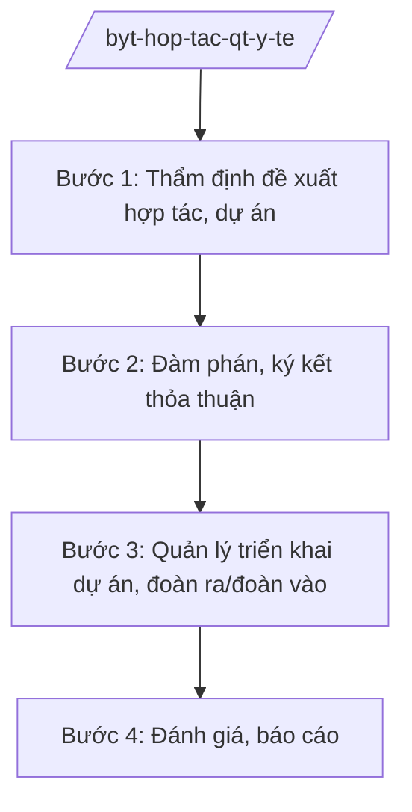

# Skill: Hợp tác quốc tế về y tế

## 2. Khi nào dùng

Khi đề xuất, thẩm định dự án ODA/viện trợ y tế, đàm phán ký kết thỏa thuận hợp tác quốc tế về y tế,
quản lý đoàn ra/đoàn vào, tổ chức hội nghị quốc tế lĩnh vực y tế. Phối hợp Bộ Ngoại giao về đối ngoại.

## 3. Đầu vào (Input)

| Trường | Mô tả | Bắt buộc |
|--------|-------|----------|
| `de_xuat_hop_tac` | Đề xuất hợp tác (đối tác, lĩnh vực, hình thức: ODA, viện trợ, trao đổi chuyên gia) | Có |
| `du_thao_thoa_thuan` | Dự thảo thỏa thuận/biên bản ghi nhớ hợp tác | Không |
| `ke_hoach_doan` | Kế hoạch đoàn ra/đoàn vào, hội nghị quốc tế | Không |
| `bao_cao_du_an` | Báo cáo tiến độ dự án đang triển khai | Không |

## 4. Quy trình

**Bước 1. Thẩm định đề xuất hợp tác, dự án**

- Làm gì: Đánh giá tính phù hợp với chiến lược phát triển ngành y tế, hiệu quả dự án, năng lực đối tác; thẩm định hồ sơ dự án ODA/viện trợ.
- Dùng input: `de_xuat_hop_tac`.
- Vai trò: Chuyên viên Vụ Hợp tác quốc tế thẩm định (AI hỗ trợ tra cứu tiền lệ dự án tương tự, lập bảng tiêu chí đánh giá ⏱ 3 giờ (ước tính)); Vụ trưởng (ông Hoàng Văn EE) duyệt.
- Lưu ý nghiệp vụ: Ưu tiên dự án phù hợp nhu cầu thực tế (y tế cơ sở, phòng chống dịch); không nhận viện trợ kèm điều kiện trái chủ trương.
- → Kết quả bước: Báo cáo thẩm định đề xuất hợp tác/dự án.

**Bước 2. Đàm phán, ký kết thỏa thuận**

- Làm gì: Đàm phán nội dung thỏa thuận với đối tác; phối hợp Bộ Ngoại giao về thủ tục đối ngoại; trình ký kết theo thẩm quyền.
- Dùng input: `du_thao_thoa_thuan`, báo cáo thẩm định.
- Vai trò: Vụ Hợp tác quốc tế chủ trì đàm phán (AI hỗ trợ rà soát điều khoản thỏa thuận, đối chiếu mẫu ⏱ 2 giờ (ước tính)); Thứ trưởng/Bộ trưởng ký theo phân cấp; Bộ Ngoại giao phối hợp về lễ tân, thủ tục.
- Lưu ý nghiệp vụ: Thỏa thuận quốc tế phải tuân thủ quy định về ký kết điều ước quốc tế, thỏa thuận quốc tế.
- → Kết quả bước: Thỏa thuận hợp tác được ký kết.

**Bước 3. Quản lý triển khai dự án, đoàn ra/đoàn vào**

- Làm gì: Theo dõi tiến độ, giải ngân dự án; quản lý chương trình đoàn ra/đoàn vào; tổ chức hội nghị quốc tế tại Việt Nam.
- Dùng input: `ke_hoach_doan`, `bao_cao_du_an`.
- Vai trò: Vụ Hợp tác quốc tế điều phối (AI hỗ trợ tổng hợp tiến độ, giải ngân các dự án ⏱ 3 giờ (ước tính)); Thứ trưởng phụ trách (bà Phạm Thị DD) phê duyệt kế hoạch đoàn.
- Lưu ý nghiệp vụ: Đoàn ra/đoàn vào đúng mục đích, tiết kiệm; hội nghị quốc tế bảo đảm an ninh, lễ tân.
- → Kết quả bước: Báo cáo tiến độ dự án + chương trình đoàn đã thực hiện.

**Bước 4. Đánh giá, báo cáo**

- Làm gì: Đánh giá kết quả, hiệu quả hợp tác; báo cáo Bộ Ngoại giao, Chính phủ về công tác đối ngoại ngành y tế.
- Dùng input: `bao_cao_du_an`, kết quả đoàn/hội nghị.
- Vai trò: Vụ Hợp tác quốc tế tổng hợp (AI hỗ trợ lập báo cáo tổng hợp năm ⏱ 2 giờ (ước tính)).
- Lưu ý nghiệp vụ: Báo cáo đầy đủ kết quả và hiệu quả hợp tác; là cơ sở xây dựng kế hoạch năm sau.
- → Kết quả bước: Báo cáo công tác hợp tác quốc tế về y tế.

## Luồng quy trình (Workflow)

## 5. Đầu ra (Output)

- Báo cáo thẩm định đề xuất hợp tác/dự án
- Thỏa thuận/biên bản ghi nhớ hợp tác quốc tế
- Quyết định phê duyệt dự án ODA/viện trợ
- Kế hoạch đoàn ra/đoàn vào, hội nghị quốc tế
- Báo cáo công tác hợp tác quốc tế về y tế

### Cấu trúc output chuẩn (Báo cáo thẩm định đề xuất hợp tác)

1. Quốc hiệu "CỘNG HÒA XÃ HỘI CHỦ NGHĨA VIỆT NAM", Tiêu ngữ "Độc lập – Tự do – Hạnh phúc"; tên Bộ/Vụ; số, ký hiệu; địa danh, ngày tháng
2. Tên báo cáo
3. Thông tin đối tác, lĩnh vực, hình thức hợp tác
4. Đánh giá tính phù hợp với chiến lược ngành, nhu cầu thực tế
5. Đánh giá hiệu quả, rủi ro, điều kiện ràng buộc
6. Kiến nghị (chấp thuận/từ chối/điều chỉnh)
7. Chữ ký (ghi rõ chức danh, họ tên người ký; ký hiệu "KT."/"TL." khi ký thay) người có thẩm quyền (theo NĐ 30/2020/NĐ-CP)
8. Nơi nhận (kết thúc "- Lưu: VT, [mã đơn vị].").

> **Checklist thể thức văn bản theo NĐ 30/2020/NĐ-CP** — đối chiếu trước khi trình ký:
> 1. Quốc hiệu và Tiêu ngữ.
> 2. Tên cơ quan, tổ chức ban hành văn bản.
> 3. Số, ký hiệu của văn bản.
> 4. Địa danh và thời gian ban hành văn bản.
> 5. Tên loại và trích yếu nội dung văn bản.
> 6. Nội dung văn bản.
> 7. Chức vụ, họ tên và chữ ký của người có thẩm quyền.
> 8. Dấu, chữ ký số của cơ quan, tổ chức.
> 9. Nơi nhận (kèm Phụ lục nếu có).

## 6. Checklist nghiệm thu

- [ ] Đề xuất hợp tác phù hợp chiến lược ngành, nhu cầu thực tế
- [ ] Không nhận viện trợ kèm điều kiện trái chủ trương
- [ ] Thỏa thuận đúng thủ tục đối ngoại, phối hợp Bộ Ngoại giao
- [ ] Đoàn ra/đoàn vào đúng mục đích, tiết kiệm
- [ ] Theo dõi tiến độ, giải ngân dự án đầy đủ
- [ ] Thể thức đúng NĐ 30/2020/NĐ-CP; đã qua human gate

## 7. Ví dụ mô phỏng

*Dữ liệu dưới đây là giả lập 100% phục vụ minh họa.*

**Input mẫu:**

| Trường | Giá trị |
|--------|---------|
| de_xuat_hop_tac | Dự án viện trợ không hoàn lại nâng cấp 10 trạm y tế xã A... của Tổ chức Y tế AA (giả lập), trị giá 5 triệu USD |
| du_thao_thoa_thuan | Biên bản ghi nhớ hợp tác y tế giữa Bộ Y tế và Tổ chức Y tế AA |

**Output mẫu (trích Báo cáo thẩm định):**

> **BỘ Y TẾ**
> **VỤ HỢP TÁC QUỐC TẾ**
> Số: 1234/BC-HTQT
>
> **BÁO CÁO**
> **Thẩm định đề xuất dự án viện trợ nâng cấp trạm y tế của Tổ chức Y tế AA**
>
> 1. Dự án phù hợp chiến lược phát triển y tế cơ sở, đáp ứng nhu cầu 10 xã vùng khó khăn...
> 2. Không có điều kiện ràng buộc trái chủ trương...
> 3. Kiến nghị: chấp thuận, trình Bộ trưởng phê duyệt chủ trương...

## 8. Human gate

- Vụ trưởng Vụ Hợp tác quốc tế (ông Hoàng Văn EE): duyệt báo cáo thẩm định
- Thứ trưởng phụ trách (bà Phạm Thị DD): phê duyệt kế hoạch đoàn, chủ trương dự án
- Bộ trưởng (ông Lê Văn CC): ký thỏa thuận hợp tác, phê duyệt dự án ODA/viện trợ

## 9. Giới hạn

- AI không tự ký kết thỏa thuận quốc tế, không phê duyệt dự án
- Không bịa thông tin đối tác, giá trị viện trợ, điều khoản thỏa thuận
- Không đàm phán thay đoàn đàm phán chính thức
- Tuân thủ quy định về đối ngoại, bảo mật thông tin
- Không viện dẫn văn bản hết hiệu lực

## 10. Căn cứ & lưu ý

- Nghị định 42/2025/NĐ-CP ngày 27/02/2025 của Chính phủ — chức năng, nhiệm vụ, quyền hạn và cơ cấu tổ chức của Bộ Y tế
- Nghị quyết 176/2025/QH15 — cơ cấu tổ chức của Chính phủ
- Nghị định 303/2025/NĐ-CP — khung chung về chức năng, nhiệm vụ của bộ, cơ quan ngang bộ
- Nghị định 30/2020/NĐ-CP — công tác văn thư (thể thức văn bản)
- Lưu ý: phối hợp Bộ Ngoại giao (NĐ 28/2025/NĐ-CP) về thủ tục đối ngoại; tuân thủ quy định về ký kết điều ước quốc tế, thỏa thuận quốc tế
