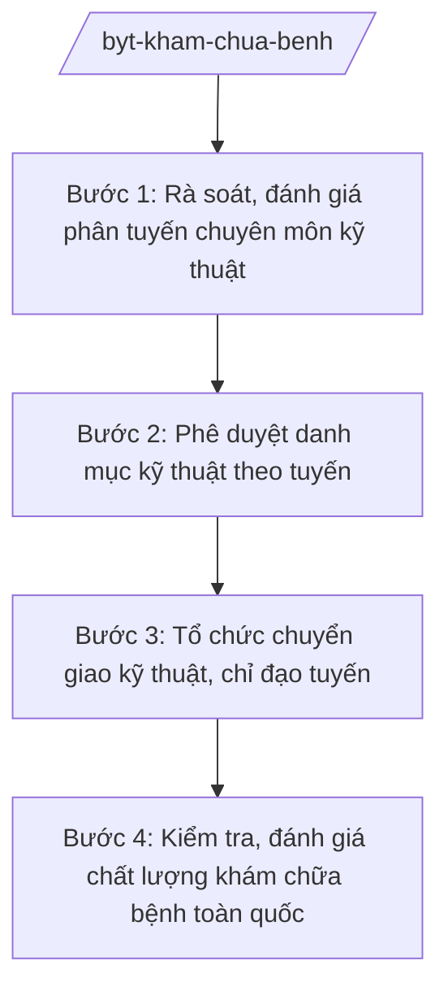

# Skill: Khám chữa bệnh (phân tuyến, chuyển giao kỹ thuật)

## 2. Khi nào dùng

Khi xây dựng chính sách phân tuyến chuyên môn kỹ thuật, phê duyệt danh mục kỹ thuật được phép
thực hiện theo tuyến, tổ chức chuyển giao kỹ thuật từ tuyến trên xuống tuyến dưới (đề án bệnh viện
vệ tinh, chỉ đạo tuyến). Không dùng cho quản lý bệnh viện tuyến tỉnh (skill `quan-ly-benh-vien-tinh`).

## 3. Đầu vào (Input)

| Trường | Mô tả | Bắt buộc |
|--------|-------|----------|
| `danh_muc_ky_thuat` | Danh mục kỹ thuật đề nghị phê duyệt/phân tuyến | Có |
| `phan_tuyen_hien_hanh` | Phân tuyến chuyên môn kỹ thuật đang áp dụng | Có |
| `de_an_chuyen_giao` | Đề án chuyển giao kỹ thuật (bệnh viện tuyến trên → tuyến dưới) | Không |
| `so_lieu_qua_tai` | Số liệu quá tải bệnh viện tuyến trên, công suất sử dụng giường bệnh | Không |
| `y_kien_chuyen_gia` | Ý kiến hội đồng chuyên môn, các bệnh viện đầu ngành | Không |

## 4. Quy trình

**Bước 1. Rà soát, đánh giá phân tuyến chuyên môn kỹ thuật**

- Làm gì: Tổng hợp số liệu quá tải, năng lực tuyến dưới; đánh giá tính phù hợp của phân tuyến hiện hành; xác định kỹ thuật cần điều chuyển tuyến.
- Dùng input: `phan_tuyen_hien_hanh`, `so_lieu_qua_tai`.
- Vai trò: Chuyên viên Cục Quản lý Khám, chữa bệnh phân tích (AI hỗ trợ tổng hợp số liệu quá tải các bệnh viện tuyến trung ương, lập bảng so sánh năng lực theo tuyến ⏱ 3 giờ (ước tính)); Cục trưởng (bà Vũ Thị FF) chủ trì họp hội đồng chuyên môn.
- Lưu ý nghiệp vụ: Phân tuyến phải căn cứ năng lực thực tế (nhân lực, trang thiết bị), không hạ tuyến ồ ạt gây mất an toàn người bệnh.
- → Kết quả bước: Báo cáo đánh giá phân tuyến + danh mục kỹ thuật đề xuất điều chỉnh.

**Bước 2. Phê duyệt danh mục kỹ thuật theo tuyến**

- Làm gì: Thẩm định hồ sơ năng lực của cơ sở đề nghị; phê duyệt danh mục kỹ thuật được phép thực hiện theo từng tuyến/hạng bệnh viện.
- Dùng input: `danh_muc_ky_thuat`, `y_kien_chuyen_gia`.
- Vai trò: Hội đồng chuyên môn thẩm định (AI hỗ trợ đối chiếu danh mục kỹ thuật với tiêu chí phân tuyến ⏱ 2 giờ (ước tính)); Bộ trưởng (ông Lê Văn CC) ký quyết định phê duyệt.
- Lưu ý nghiệp vụ: Kỹ thuật mới, kỹ thuật cao phải có quy trình thẩm định chặt chẽ, có đào tạo chuyển giao trước khi triển khai đại trà.
- → Kết quả bước: Quyết định phê duyệt danh mục kỹ thuật theo tuyến.

**Bước 3. Tổ chức chuyển giao kỹ thuật, chỉ đạo tuyến**

- Làm gì: Phê duyệt đề án chuyển giao kỹ thuật; điều phối bệnh viện tuyến trên hỗ trợ tuyến dưới (đào tạo, cầm tay chỉ việc, hội chẩn từ xa); theo dõi kết quả.
- Dùng input: `de_an_chuyen_giao`.
- Vai trò: Cục Quản lý Khám, chữa bệnh điều phối (AI hỗ trợ lập kế hoạch chuyển giao, theo dõi tiến độ các gói kỹ thuật ⏱ 3 giờ (ước tính)); Thứ trưởng phụ trách (bà Phạm Thị DD) phê duyệt đề án.
- Lưu ý nghiệp vụ: Chuyển giao phải đi kèm đánh giá độc lập tay nghề trước khi tuyến dưới tự thực hiện.
- → Kết quả bước: Đề án chuyển giao được phê duyệt + báo cáo kết quả chuyển giao.

**Bước 4. Kiểm tra, đánh giá chất lượng khám chữa bệnh toàn quốc**

- Làm gì: Xây dựng bộ tiêu chí chất lượng bệnh viện; tổ chức kiểm tra, đánh giá; công khai kết quả; xử lý vi phạm.
- Dùng input: Kết quả tự đánh giá của bệnh viện, báo cáo thanh kiểm tra.
- Vai trò: Cục Quản lý Khám, chữa bệnh chủ trì kiểm tra (AI hỗ trợ tổng hợp điểm chất lượng, xếp hạng bệnh viện ⏱ 4 giờ (ước tính)).
- Lưu ý nghiệp vụ: Đánh giá khách quan, không vì thành tích; kết quả là căn cứ phân bổ, khen thưởng, xử lý.
- → Kết quả bước: Báo cáo đánh giá chất lượng bệnh viện toàn quốc.

## Luồng quy trình (Workflow)

## 5. Đầu ra (Output)

- Quyết định phê duyệt danh mục kỹ thuật theo tuyến
- Quyết định phê duyệt đề án chuyển giao kỹ thuật
- Bộ tiêu chí đánh giá chất lượng bệnh viện
- Báo cáo đánh giá chất lượng khám chữa bệnh toàn quốc

### Cấu trúc output chuẩn (Quyết định phê duyệt danh mục kỹ thuật)

1. Quốc hiệu "CỘNG HÒA XÃ HỘI CHỦ NGHĨA VIỆT NAM", Tiêu ngữ "Độc lập – Tự do – Hạnh phúc"; tên Bộ; số, ký hiệu; địa danh, ngày tháng
2. Tên quyết định
3. Căn cứ pháp lý (NĐ 42/2025/NĐ-CP; văn bản chuyên ngành về khám chữa bệnh)
4. Xét đề nghị của Cục trưởng Cục Quản lý Khám, chữa bệnh
5. Điều 1: Phê duyệt danh mục kỹ thuật (kèm phụ lục: tên kỹ thuật, tuyến được phép thực hiện)
6. Điều 2: Trách nhiệm của cơ sở khám chữa bệnh, Sở Y tế
7. Điều 3: Hiệu lực, trách nhiệm thi hành
8. Chữ ký (ghi rõ chức danh, họ tên người ký; ký hiệu "KT."/"TL." khi ký thay) Bộ trưởng, dấu (theo NĐ 30/2020/NĐ-CP)
9. Nơi nhận (kết thúc "- Lưu: VT, [mã đơn vị].").

> **Checklist thể thức văn bản theo NĐ 30/2020/NĐ-CP** — đối chiếu trước khi trình ký:
> 1. Quốc hiệu và Tiêu ngữ.
> 2. Tên cơ quan, tổ chức ban hành văn bản.
> 3. Số, ký hiệu của văn bản.
> 4. Địa danh và thời gian ban hành văn bản.
> 5. Tên loại và trích yếu nội dung văn bản.
> 6. Nội dung văn bản.
> 7. Chức vụ, họ tên và chữ ký của người có thẩm quyền.
> 8. Dấu, chữ ký số của cơ quan, tổ chức.
> 9. Nơi nhận (kèm Phụ lục nếu có).

## 6. Checklist nghiệm thu

- [ ] Danh mục kỹ thuật bám sát năng lực thực tế từng tuyến
- [ ] Đã qua thẩm định hội đồng chuyên môn, có biên bản
- [ ] Đề án chuyển giao có đánh giá độc lập tay nghề
- [ ] Không phê duyệt kỹ thuật vượt năng lực gây mất an toàn người bệnh
- [ ] Thể thức đúng NĐ 30/2020/NĐ-CP
- [ ] Số liệu quá tải, công suất giường bệnh có nguồn chính thức
- [ ] Đã qua human gate trước khi ban hành

## 7. Ví dụ mô phỏng

*Dữ liệu dưới đây là giả lập 100% phục vụ minh họa.*

**Input mẫu:**

| Trường | Giá trị |
|--------|---------|
| danh_muc_ky_thuat | 50 kỹ thuật can thiệp tim mạch đề nghị phân tuyến |
| phan_tuyen_hien_hanh | 30 kỹ thuật tuyến trung ương, 20 kỹ thuật tuyến tỉnh |
| so_lieu_qua_tai | Công suất sử dụng giường bệnh tuyến trung ương 120% |
| y_kien_chuyen_gia | Hội đồng tim mạch thống nhất chuyển 10 kỹ thuật xuống tuyến tỉnh đủ năng lực |

**Output mẫu (trích Quyết định):**

> **BỘ Y TẾ**
> Số: 1234/QĐ-BYT
>
> **QUYẾT ĐỊNH**
> **Phê duyệt danh mục kỹ thuật can thiệp tim mạch được phép thực hiện theo tuyến**
>
> **BỘ TRƯỞNG BỘ Y TẾ**
>
> Căn cứ Nghị định số 42/2025/NĐ-CP ngày 27/02/2025 của Chính phủ quy định chức năng, nhiệm vụ, quyền hạn và cơ cấu tổ chức của Bộ Y tế;
> Xét đề nghị của Cục trưởng Cục Quản lý Khám, chữa bệnh,
>
> **QUYẾT ĐỊNH:**
>
> Điều 1. Phê duyệt danh mục 50 kỹ thuật can thiệp tim mạch theo phụ lục kèm theo, trong đó 20 kỹ thuật tuyến trung ương, 30 kỹ thuật tuyến tỉnh (10 kỹ thuật chuyển giao có điều kiện đào tạo, đánh giá độc lập)...

## 8. Human gate

- Cục trưởng Cục Quản lý Khám, chữa bệnh (bà Vũ Thị FF): chủ trì thẩm định, ký tờ trình
- Hội đồng chuyên môn: thẩm định danh mục kỹ thuật (biên bản họp)
- Thứ trưởng phụ trách (bà Phạm Thị DD): phê duyệt đề án chuyển giao kỹ thuật
- Bộ trưởng (ông Lê Văn CC): ký quyết định phê duyệt danh mục kỹ thuật

## 9. Giới hạn

- AI không thay hội đồng chuyên môn thẩm định năng lực kỹ thuật y khoa
- Không phê duyệt kỹ thuật vượt năng lực cơ sở; không bịa số liệu quá tải, công suất giường bệnh
- Không đưa ra chỉ định, khuyến cáo điều trị cụ thể cho người bệnh
- Không viện dẫn văn bản hết hiệu lực

## 10. Căn cứ & lưu ý

- Nghị định 42/2025/NĐ-CP ngày 27/02/2025 của Chính phủ — chức năng, nhiệm vụ, quyền hạn và cơ cấu tổ chức của Bộ Y tế
- Nghị quyết 176/2025/QH15 — cơ cấu tổ chức của Chính phủ
- Nghị định 303/2025/NĐ-CP — khung chung về chức năng, nhiệm vụ của bộ, cơ quan ngang bộ
- Nghị định 30/2020/NĐ-CP — công tác văn thư (thể thức văn bản)
- Lưu ý: phân định với quản lý bệnh viện tuyến tỉnh (Sở Y tế) — Bộ làm chính sách phân tuyến, phê duyệt danh mục, chỉ đạo tuyến toàn quốc
