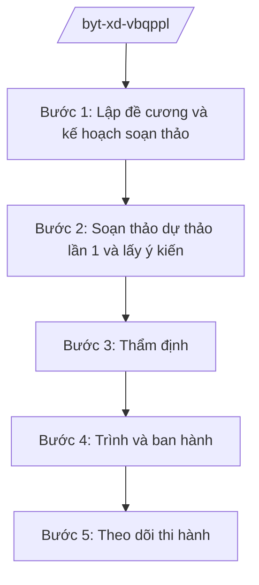

# Skill: Xây dựng VBQPPL lĩnh vực y tế

## 2. Khi nào dùng

Khi Bộ Y tế được giao chủ trì soạn thảo văn bản QPPL: dự án luật/pháp lệnh trình Quốc hội/UBTVQH,
dự thảo nghị định trình Chính phủ, dự thảo thông tư của Bộ trưởng Bộ Y tế. Không dùng cho văn bản
hành chính thông thường (dùng skill `soan-cong-van`, `soan-quyet-dinh-hc` ở Tầng 1).

## 3. Đầu vào (Input)

| Trường | Mô tả | Bắt buộc |
|--------|-------|----------|
| `loai_van_ban` | Luật / pháp lệnh / nghị định / thông tư | Có |
| `ten_van_ban` | Tên dự thảo văn bản | Có |
| `can_cu_chu_truong` | Văn bản giao nhiệm vụ (chỉ đạo của Chính phủ/Thủ tướng, chương trình xây dựng luật, pháp lệnh) | Có |
| `co_quan_chu_tri` | Vụ/Cục chủ trì soạn thảo (vd: Vụ Pháp chế phối hợp Cục Y tế dự phòng) | Có |
| `de_cuong` | Đề cương chi tiết dự thảo | Có |
| `y_kien_phoi_hop` | Ý kiến của bộ/ngành, địa phương, đối tượng chịu tác động | Không |
| `bao_cao_danh_gia_tac_dong` | Báo cáo đánh giá tác động chính sách (nếu có) | Không |

## 4. Quy trình

**Bước 1. Lập đề cương và kế hoạch soạn thảo**

- Làm gì: Vụ/Cục chủ trì lập đề cương chi tiết, xác định phạm vi điều chỉnh, bố cục dự thảo, tiến độ.
- Dùng input: `loai_van_ban`, `ten_van_ban`, `can_cu_chu_truong`, `co_quan_chu_tri`.
- Vai trò: Chuyên viên Vụ chủ trì soạn đề cương (AI hỗ trợ tra cứu văn bản liên quan, đối chiếu quy định hiện hành ⏱ 2 giờ (ước tính)); Vụ trưởng Vụ chủ trì (ông Hoàng Văn EE) duyệt đề cương.
- Lưu ý nghiệp vụ: Đề cương phải bám sát chủ trương được giao, không mở rộng phạm vi tùy tiện.
- → Kết quả bước: Đề cương chi tiết + kế hoạch soạn thảo được duyệt.

**Bước 2. Soạn thảo dự thảo lần 1 và lấy ý kiến**

- Làm gì: Soạn dự thảo; gửi lấy ý kiến các vụ/cục trong Bộ, bộ/ngành liên quan, UBND tỉnh/thành phố, đối tượng chịu tác động; đăng tải lấy ý kiến trên Cổng TTĐT theo quy định.
- Dùng input: `de_cuong`, `y_kien_phoi_hop`.
- Vai trò: Tổ soạn thảo (chuyên viên các vụ/cục) thực hiện (AI hỗ trợ tổng hợp ý kiến trùng lặp, lập bảng tổng hợp tiếp thu/giải trình ⏱ 4 giờ (ước tính)); Vụ trưởng Vụ chủ trì ký văn bản lấy ý kiến.
- Lưu ý nghiệp vụ: Thời gian lấy ý kiến tuân thủ quy định của Luật Ban hành VBQPPL; mọi ý kiến phải được tổng hợp, tiếp thu hoặc giải trình.
- → Kết quả bước: Dự thảo lần 2 kèm bảng tổng hợp ý kiến và giải trình tiếp thu.

**Bước 3. Thẩm định**

- Làm gì: Vụ Pháp chế — Bộ Y tế thẩm định dự thảo thông tư; Bộ Tư pháp thẩm định dự thảo luật, nghị định. Hoàn thiện hồ sơ theo ý kiến thẩm định.
- Dùng input: Dự thảo lần 2, bảng tổng hợp ý kiến.
- Vai trò: Vụ Pháp chế thẩm định (AI hỗ trợ rà soát tính thống nhất với hệ thống pháp luật, phát hiện chồng chéo ⏱ 3 giờ (ước tính)); Thứ trưởng phụ trách (bà Phạm Thị DD) cho ý kiến chỉ đạo hoàn thiện.
- Lưu ý nghiệp vụ: Không trình cấp có thẩm quyền khi chưa có báo cáo thẩm định; nội dung phải bảo đảm tính hợp hiến, hợp pháp, thống nhất, khả thi.
- → Kết quả bước: Báo cáo thẩm định + dự thảo hoàn thiện.

**Bước 4. Trình và ban hành**

- Làm gì: Hoàn thiện hồ sơ trình: tờ trình, dự thảo, báo cáo tổng hợp ý kiến, báo cáo thẩm định, báo cáo đánh giá tác động. Bộ trưởng ký trình Chính phủ/Thủ tướng (đối với luật, nghị định) hoặc ký ban hành (đối với thông tư).
- Dùng input: Toàn bộ hồ sơ các bước trước.
- Vai trò: Vụ trưởng Vụ chủ trì hoàn thiện hồ sơ (AI hỗ trợ kiểm tra tính đầy đủ thành phần hồ sơ theo quy định ⏱ 1 giờ (ước tính)); Bộ trưởng (ông Lê Văn CC) ký trình/ký ban hành.
- Lưu ý nghiệp vụ: Thể thức văn bản đúng NĐ 30/2020/NĐ-CP; số hiệu, ngày ban hành thống nhất.
- → Kết quả bước: Văn bản QPPL được ban hành + hồ sơ lưu trữ đầy đủ.

**Bước 5. Theo dõi thi hành**

- Làm gì: Gửi văn bản đến cơ quan, tổ chức, địa phương; theo dõi, đôn đốc thi hành; tổng hợp vướng mắc để sửa đổi, bổ sung.
- Dùng input: Văn bản đã ban hành.
- Vai trò: Vụ/Cục chủ trì theo dõi (AI hỗ trợ tổng hợp báo cáo vướng mắc từ địa phương ⏱ 2 giờ (ước tính)).
- Lưu ý nghiệp vụ: Kịp thời đề xuất sửa đổi khi phát hiện bất cập trong thi hành.
- → Kết quả bước: Báo cáo theo dõi thi hành văn bản.

## Luồng quy trình (Workflow)

## 5. Đầu ra (Output)

- Dự thảo văn bản QPPL (đúng thể thức NĐ 30/2020/NĐ-CP)
- Tờ trình
- Bảng tổng hợp ý kiến và giải trình tiếp thu
- Báo cáo thẩm định
- Báo cáo đánh giá tác động chính sách (nếu có)

### Cấu trúc output chuẩn (Tờ trình dự thảo văn bản)

1. Quốc hiệu "CỘNG HÒA XÃ HỘI CHỦ NGHĨA VIỆT NAM", Tiêu ngữ "Độc lập – Tự do – Hạnh phúc"; tên cơ quan trình (Bộ Y tế); số, ký hiệu; địa danh, ngày tháng
2. Tên tờ trình (trình về việc gì)
3. Kính gửi (cơ quan có thẩm quyền ban hành)
4. Sự cần thiết ban hành văn bản
5. Mục đích, quan điểm xây dựng văn bản
6. Quá trình xây dựng dự thảo (lấy ý kiến, thẩm định)
7. Bố cục và nội dung cơ bản của dự thảo
8. Dự kiến nguồn lực, điều kiện bảo đảm thi hành
9. Kiến nghị cơ quan có thẩm quyền xem xét, quyết định
10. Chữ ký (ghi rõ chức danh, họ tên người ký; ký hiệu "KT."/"TL." khi ký thay) người có thẩm quyền, dấu (theo NĐ 30/2020/NĐ-CP)
11. Nơi nhận (kết thúc "- Lưu: VT, [mã đơn vị].").
## 6. Checklist nghiệm thu

- [ ] Đúng loại văn bản và đúng thẩm quyền ban hành
- [ ] Đã lấy ý kiến đầy đủ đối tượng theo quy định, có bảng tổng hợp tiếp thu/giải trình
- [ ] Đã có báo cáo thẩm định của cơ quan có thẩm quyền
- [ ] Nội dung hợp hiến, hợp pháp, thống nhất, khả thi; không chồng chéo văn bản hiện hành
- [ ] Thể thức đúng NĐ 30/2020/NĐ-CP
- [ ] Hồ sơ trình đầy đủ thành phần theo quy định
- [ ] Không bịa số liệu, căn cứ pháp lý; không viện dẫn văn bản hết hiệu lực
- [ ] Đã qua human gate trước khi trình/ban hành

## 7. Ví dụ mô phỏng

*Dữ liệu dưới đây là giả lập 100% phục vụ minh họa.*

**Input mẫu:**

| Trường | Giá trị |
|--------|---------|
| loai_van_ban | Thông tư |
| ten_van_ban | Thông tư quy định danh mục kỹ thuật khám bệnh, chữa bệnh được phép thực hiện theo tuyến |
| can_cu_chu_truong | Chương trình xây dựng văn bản QPPL năm 2026 của Bộ Y tế |
| co_quan_chu_tri | Cục Quản lý Khám, chữa bệnh chủ trì, Vụ Pháp chế phối hợp |
| de_cuong | 4 chương, 20 điều: nguyên tắc phân tuyến; danh mục kỹ thuật tuyến trung ương/tỉnh/huyện; chuyển giao kỹ thuật; điều khoản thi hành |
| y_kien_phoi_hop | Ý kiến của 20 Sở Y tế tỉnh A.., 5 bệnh viện tuyến trung ương |

**Output mẫu (trích Tờ trình):**

> **BỘ Y TẾ**
> Số: 1234/TTr-BYT
>
> **TỜ TRÌNH**
> **Về việc ban hành Thông tư quy định danh mục kỹ thuật khám bệnh, chữa bệnh**
> **được phép thực hiện theo tuyến**
>
> Kính gửi: Bộ trưởng Bộ Y tế
>
> 1. Sự cần thiết ban hành: thực hiện phân tuyến chuyên môn kỹ thuật, giảm quá tải tuyến trên...
> 2. Mục đích, quan điểm xây dựng: ...
> 3. Quá trình xây dựng: đã lấy ý kiến 20 Sở Y tế, 5 bệnh viện; đăng Cổng TTĐT 60 ngày; Vụ Pháp chế thẩm định ngày...
> 4. Bố cục và nội dung cơ bản: 4 chương, 20 điều...
> 5. Kiến nghị Bộ trưởng xem xét, ký ban hành.
>
> **KT. BỘ TRƯỞNG**
> **THỨ TRƯỞNG**
> *(Chữ ký)*
> **Phạm Thị DD**

## 8. Human gate

- Vụ trưởng Vụ chủ trì (ông Hoàng Văn EE): duyệt đề cương, ký văn bản lấy ý kiến
- Vụ trưởng Vụ Pháp chế: ký báo cáo thẩm định (đối với thông tư)
- Thứ trưởng phụ trách (bà Phạm Thị DD): cho ý kiến chỉ đạo hoàn thiện dự thảo
- Bộ trưởng (ông Lê Văn CC): ký trình Chính phủ (luật, nghị định) / ký ban hành (thông tư)

## 9. Giới hạn

- AI không thay Vụ Pháp chế/Bộ Tư pháp thực hiện thẩm định; chỉ hỗ trợ rà soát, tổng hợp
- AI không tự ký trình, ký ban hành văn bản
- Không bịa số hiệu văn bản, số liệu dịch tễ, ý kiến góp ý
- Không viện dẫn văn bản đã hết hiệu lực
- Không soạn thảo nội dung vượt quá phạm vi chủ trương được giao

## 10. Căn cứ & lưu ý

- Nghị định 42/2025/NĐ-CP ngày 27/02/2025 của Chính phủ — chức năng, nhiệm vụ, quyền hạn và cơ cấu tổ chức của Bộ Y tế
- Nghị quyết 176/2025/QH15 — cơ cấu tổ chức của Chính phủ (14 Bộ + 3 cơ quan ngang Bộ)
- Nghị định 303/2025/NĐ-CP — khung chung về chức năng, nhiệm vụ của bộ, cơ quan ngang bộ
- Nghị định 30/2020/NĐ-CP — công tác văn thư (thể thức văn bản)
- Luật Ban hành văn bản quy phạm pháp luật (chỉ dẫn tên luật, không ghi số hiệu)
- Lưu ý: thẩm định dự thảo luật, nghị định do Bộ Tư pháp thực hiện; Vụ Pháp chế Bộ Y tế thẩm định dự thảo thông tư của Bộ trưởng
