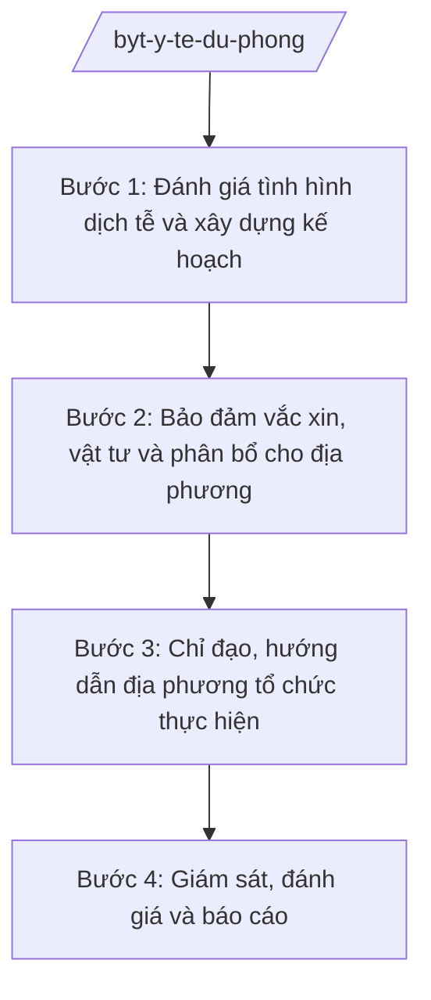

# Skill: Y tế dự phòng (chương trình quốc gia)

## 2. Khi nào dùng

Khi xây dựng kế hoạch, tổ chức thực hiện, giám sát chương trình quốc gia về y tế dự phòng
(phòng chống dịch bệnh, tiêm chủng mở rộng, dinh dưỡng, sức khỏe môi trường) ở cấp Bộ.
Không dùng cho y tế dự phòng tuyến xã/tỉnh (đã có skill `y-te-du-phong-coso`, `phong-chong-dich-tinh`).

## 3. Đầu vào (Input)

| Trường | Mô tả | Bắt buộc |
|--------|-------|----------|
| `so_lieu_dich_te` | Số liệu giám sát dịch tễ toàn quốc (mắc, tử vong theo bệnh, địa bàn) | Có |
| `chuong_trinh` | Tên chương trình quốc gia (vd: tiêm chủng mở rộng, phòng chống HIV/AIDS) | Có |
| `doi_tuong` | Đối tượng thụ hưởng (trẻ em dưới 1 tuổi, phụ nữ có thai...) | Có |
| `danh_muc_vac_xin` | Danh mục vắc xin, sinh phẩm sử dụng | Có |
| `ke_hoach_nam` | Kế hoạch năm (chỉ tiêu bao phủ, kinh phí, tiến độ) | Có |
| `bao_cao_dia_phuong` | Báo cáo thực hiện của các tỉnh/thành phố | Không |

## 4. Quy trình

**Bước 1. Đánh giá tình hình dịch tễ và xây dựng kế hoạch**

- Làm gì: Tổng hợp, phân tích số liệu giám sát dịch tễ toàn quốc; xác định chỉ tiêu (tỷ lệ tiêm chủng đầy đủ, tỷ lệ mắc mục tiêu giảm); lập kế hoạch chương trình năm.
- Dùng input: `so_lieu_dich_te`, `chuong_trinh`, `doi_tuong`, `ke_hoach_nam`.
- Vai trò: Chuyên viên Cục Y tế dự phòng phân tích số liệu (AI hỗ trợ vẽ biểu đồ xu hướng dịch tễ, phát hiện địa bàn nguy cơ — 3 giờ); Cục trưởng Cục Y tế dự phòng (bà Vũ Thị FF) duyệt kế hoạch.
- Lưu ý nghiệp vụ: Số liệu phải lấy từ hệ thống giám sát chính thức; chỉ tiêu phải khả thi, đo lường được.
- → Kết quả bước: Kế hoạch chương trình quốc gia năm được phê duyệt.

**Bước 2. Bảo đảm vắc xin, vật tư và phân bổ cho địa phương**

- Làm gì: Tổng hợp nhu cầu vắc xin, sinh phẩm, vật tư của địa phương; tổ chức mua sắm tập trung hoặc phân bổ; hướng dẫn bảo quản dây chuyền lạnh.
- Dùng input: `danh_muc_vac_xin`, `bao_cao_dia_phuong`.
- Vai trò: Cục Y tế dự phòng chủ trì, phối hợp Vụ Kế hoạch – Tài chính (AI hỗ trợ lập bảng phân bổ theo dân số mục tiêu từng tỉnh — 2 giờ); Thứ trưởng phụ trách (bà Phạm Thị DD) phê duyệt phân bổ.
- Lưu ý nghiệp vụ: Ưu tiên vùng sâu, vùng xa, vùng đồng bào DTTS; bảo đảm dây chuyền lạnh.
- → Kết quả bước: Quyết định phân bổ vắc xin, vật tư + hướng dẫn bảo quản.

**Bước 3. Chỉ đạo, hướng dẫn địa phương tổ chức thực hiện**

- Làm gì: Ban hành văn bản hướng dẫn chuyên môn; tập huấn; kiểm tra, hỗ trợ kỹ thuật các tỉnh thực hiện.
- Dùng input: Kế hoạch đã phê duyệt, văn bản hướng dẫn chuyên môn.
- Vai trò: Cục Y tế dự phòng ban hành hướng dẫn (AI hỗ trợ soạn tài liệu tập huấn, câu hỏi thường gặp — 3 giờ).
- Lưu ý nghiệp vụ: Hướng dẫn phải thống nhất toàn quốc, phù hợp tuyến xã/phường trực tiếp triển khai.
- → Kết quả bước: Văn bản hướng dẫn + các lớp tập huấn đã tổ chức.

**Bước 4. Giám sát, đánh giá và báo cáo**

- Làm gì: Giám sát tỷ lệ bao phủ, tai biến sau tiêm chủng, diễn biến dịch; đánh giá giữa kỳ/cuối kỳ; báo cáo Chính phủ, Thủ tướng.
- Dùng input: `bao_cao_dia_phuong`, số liệu giám sát.
- Vai trò: Cục Y tế dự phòng tổng hợp (AI hỗ trợ đối chiếu số liệu các tỉnh, phát hiện số liệu bất thường — 4 giờ); Bộ trưởng (ông Lê Văn CC) ký báo cáo trình Chính phủ.
- Lưu ý nghiệp vụ: Xử lý kịp thời sự cố (tai biến nặng sau tiêm chủng, dịch bùng phát); không giấu, không làm tròn số liệu.
- → Kết quả bước: Báo cáo giám sát, đánh giá chương trình + báo cáo trình Chính phủ.

## Luồng quy trình (Workflow)

## 5. Đầu ra (Output)

- Kế hoạch chương trình quốc gia về y tế dự phòng năm
- Quyết định phân bổ vắc xin, sinh phẩm, vật tư
- Văn bản hướng dẫn chuyên môn
- Báo cáo giám sát, đánh giá giữa kỳ/cuối kỳ
- Báo cáo trình Chính phủ, Thủ tướng

### Cấu trúc output chuẩn (Kế hoạch chương trình quốc gia)

1. Quốc hiệu "CỘNG HÒA XÃ HỘI CHỦ NGHĨA VIỆT NAM", Tiêu ngữ "Độc lập – Tự do – Hạnh phúc"; tên Bộ; số, ký hiệu; địa danh, ngày tháng
2. Tên kế hoạch
3. Căn cứ pháp lý, căn cứ thực tiễn (tình hình dịch tễ)
4. Mục tiêu chung, mục tiêu cụ thể (chỉ tiêu định lượng)
5. Đối tượng, phạm vi, thời gian thực hiện
6. Nội dung, hoạt động (tiêm chủng, truyền thông, giám sát...)
7. Kinh phí và nguồn kinh phí
8. Phân công trách nhiệm (Bộ, địa phương, đơn vị liên quan)
9. Chế độ báo cáo, giám sát, đánh giá
10. Chữ ký (ghi rõ chức danh, họ tên người ký; ký hiệu "KT."/"TL." khi ký thay) người có thẩm quyền (theo NĐ 30/2020/NĐ-CP)
11. Nơi nhận (kết thúc "- Lưu: VT, [mã đơn vị].").

> **Checklist thể thức văn bản theo NĐ 30/2020/NĐ-CP** — đối chiếu trước khi trình ký:
> 1. Quốc hiệu và Tiêu ngữ.
> 2. Tên cơ quan, tổ chức ban hành văn bản.
> 3. Số, ký hiệu của văn bản.
> 4. Địa danh và thời gian ban hành văn bản.
> 5. Tên loại và trích yếu nội dung văn bản.
> 6. Nội dung văn bản.
> 7. Chức vụ, họ tên và chữ ký của người có thẩm quyền.
> 8. Dấu, chữ ký số của cơ quan, tổ chức.
> 9. Nơi nhận (kèm Phụ lục nếu có).

## 6. Checklist nghiệm thu

- [ ] Kế hoạch bám sát số liệu dịch tễ thực tế, chỉ tiêu định lượng rõ ràng
- [ ] Phân bổ vắc xin/vật tư công bằng, ưu tiên vùng khó khăn
- [ ] Văn bản hướng dẫn thống nhất, dễ áp dụng ở tuyến cơ sở
- [ ] Có cơ chế giám sát tai biến sau tiêm chủng và xử lý sự cố
- [ ] Số liệu báo cáo khớp giữa các nguồn, không làm tròn tùy tiện
- [ ] Đúng thể thức NĐ 30/2020/NĐ-CP
- [ ] Đã qua human gate trước khi ban hành/trình

## 7. Ví dụ mô phỏng

*Dữ liệu dưới đây là giả lập 100% phục vụ minh họa.*

**Input mẫu:**

| Trường | Giá trị |
|--------|---------|
| so_lieu_dich_te | Năm 2025: 1.000 ca sởi toàn quốc, tập trung 10 tỉnh; tỷ lệ tiêm đủ liều sởi 92% |
| chuong_trinh | Chương trình tiêm chủng mở rộng quốc gia |
| doi_tuong | Trẻ em dưới 1 tuổi (1.500.000 trẻ), phụ nữ có thai |
| danh_muc_vac_xin | BCG, viêm gan B, 5 trong 1, sởi, bại liệt... |
| ke_hoach_nam | Năm 2026: 95% trẻ được tiêm đủ liều; 0 ca tử vong do bệnh có vắc xin phòng được |

**Output mẫu (trích Kế hoạch):**

> **BỘ Y TẾ**
> Số: 1234/QĐ-BYT
>
> **QUYẾT ĐỊNH**
> **Ban hành Kế hoạch triển khai Chương trình tiêm chủng mở rộng quốc gia năm 2026**
>
> **BỘ TRƯỞNG BỘ Y TẾ**
>
> Căn cứ Nghị định số 42/2025/NĐ-CP ngày 27/02/2025 của Chính phủ quy định chức năng, nhiệm vụ, quyền hạn và cơ cấu tổ chức của Bộ Y tế;
> ...
> **QUYẾT ĐỊNH:**
>
> Điều 1. Ban hành kèm theo Quyết định này Kế hoạch triển khai Chương trình tiêm chủng mở rộng quốc gia năm 2026.
> Điều 2. Mục tiêu: 95% trẻ em dưới 1 tuổi được tiêm chủng đầy đủ 8 loại vắc xin...
> Điều 3. Cục Y tế dự phòng chủ trì, phối hợp các đơn vị, địa phương tổ chức thực hiện...

## 8. Human gate

- Cục trưởng Cục Y tế dự phòng (bà Vũ Thị FF): duyệt kế hoạch, ký văn bản hướng dẫn chuyên môn
- Vụ trưởng Vụ Kế hoạch – Tài chính: thẩm định kinh phí
- Thứ trưởng phụ trách (bà Phạm Thị DD): phê duyệt phân bổ vắc xin, vật tư
- Bộ trưởng (ông Lê Văn CC): ký quyết định ban hành kế hoạch, ký báo cáo trình Chính phủ

## 9. Giới hạn

- AI không tự phê duyệt kế hoạch, phân bổ vắc xin/vật tư
- Không bịa số liệu dịch tễ, tỷ lệ tiêm chủng, số ca mắc/tử vong
- Không đưa ra khuyến cáo chuyên môn y tế thay cơ quan chuyên môn
- Không viện dẫn văn bản hết hiệu lực

## 10. Căn cứ & lưu ý

- Nghị định 42/2025/NĐ-CP ngày 27/02/2025 của Chính phủ — chức năng, nhiệm vụ, quyền hạn và cơ cấu tổ chức của Bộ Y tế
- Nghị quyết 176/2025/QH15 — cơ cấu tổ chức của Chính phủ
- Nghị định 303/2025/NĐ-CP — khung chung về chức năng, nhiệm vụ của bộ, cơ quan ngang bộ
- Nghị định 30/2020/NĐ-CP — công tác văn thư (thể thức văn bản)
- Lưu ý: phân định rõ với y tế dự phòng tuyến tỉnh/xã (Sở Y tế, UBND xã) — Bộ làm chương trình quốc gia, chỉ đạo, hướng dẫn, giám sát toàn quốc
