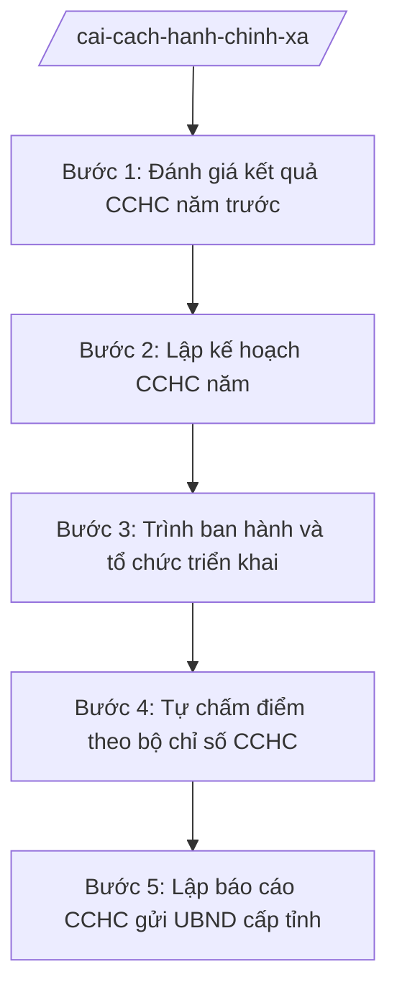

# Skill: Kế hoạch & báo cáo CCHC cấp xã

## 2. Khi nào dùng
- Xây dựng kế hoạch cải cách hành chính năm của xã (đầu năm).
- Đánh giá, tự chấm điểm kết quả CCHC năm để báo cáo cấp trên (cuối năm).
- Sở Nội vụ tỉnh A yêu cầu báo cáo chuyên đề về một nội dung CCHC (cải cách TTHC, chính quyền số...).
- Rà soát, điều chỉnh kế hoạch CCHC giữa năm khi có chỉ đạo mới của cấp trên.

## 3. Đầu vào (Input)
| Trường | Mô tả | Bắt buộc |
|--------|-------|----------|
| `nam_ke_hoach` | Năm lập kế hoạch / báo cáo CCHC | Có |
| `ket_qua_nam_truoc` | Kết quả thực hiện CCHC năm trước, điểm tự chấm năm trước | Có |
| `nhiem_vu_trong_tam` | Nhiệm vụ CCHC trọng tâm năm mới (cải cách TTHC, tổ chức bộ máy, chế độ công vụ, tài chính công, chính quyền số) | Có |
| `so_lieu_mot_cua` | Số liệu giải quyết TTHC tại bộ phận một cửa (tiếp nhận, đúng hạn, trễ hạn) | Không |
| `chi_dao_cap_tren` | Văn bản chỉ đạo, kế hoạch CCHC của tỉnh, của cấp trên | Không |
| `can_bo_phu_trach` | Công chức Văn phòng phụ trách CCHC | Có |

## 4. Quy trình

**Bước 1. Đánh giá kết quả CCHC năm trước**
- Làm gì: Tổng hợp kết quả thực hiện kế hoạch CCHC năm trước theo 5 nội dung: cải cách TTHC, tổ chức bộ máy, chế độ công vụ, tài chính công, xây dựng chính quyền số; nêu tồn tại, nguyên nhân.
- Dùng input: `ket_qua_nam_truoc`, `so_lieu_mot_cua`, `nam_ke_hoach`.
- Vai trò: Công chức Văn phòng phụ trách CCHC tổng hợp; AI hỗ trợ đối chiếu số liệu, lập bảng đánh giá theo 5 nội dung ⏱ 1 ngày (ước tính) làm việc
- Lưu ý nghiệp vụ: Đánh giá phải gắn với số liệu (tỷ lệ hồ sơ đúng hạn, số TTHC rút gọn...); nêu rõ tồn tại thuộc trách nhiệm của xã, không đổ lỗi chung chung.
- → Kết quả bước: Bản đánh giá kết quả CCHC năm trước (điểm mạnh, tồn tại, nguyên nhân).

**Bước 2. Lập kế hoạch CCHC năm**
- Làm gì: Xây dựng kế hoạch CCHC năm mới: mục tiêu, nhiệm vụ theo 5 nội dung, phân công đơn vị thực hiện, thời gian hoàn thành, kinh phí.
- Dùng input: `nhiem_vu_trong_tam`, `chi_dao_cap_tren`, kết quả đánh giá ở Bước 1.
- Vai trò: Chánh Văn phòng HĐND và UBND chủ trì soạn; AI hỗ trợ soạn kế hoạch theo khung 5 nội dung, lập bảng phân công ⏱ 2 ngày (ước tính) làm việc
- Lưu ý nghiệp vụ: Kế hoạch phải bám chỉ đạo của tỉnh, khắc phục tồn tại năm trước; nhiệm vụ cụ thể, có chỉ tiêu đo được, có đầu mối chịu trách nhiệm.
- → Kết quả bước: Dự thảo kế hoạch CCHC năm của UBND xã.

**Bước 3. Trình ban hành và tổ chức triển khai**
- Làm gì: Trình Chủ tịch UBND xã ký ban hành kế hoạch; phổ biến đến các đơn vị, thôn; theo dõi tiến độ thực hiện hằng quý.
- Dùng input: Dự thảo kế hoạch CCHC, `can_bo_phu_trach`.
- Vai trò: Chủ tịch UBND xã ký ban hành; công chức phụ trách theo dõi; AI hỗ trợ lập bảng theo dõi tiến độ quý ⏱ 0,5 ngày (ước tính) làm việc
- Lưu ý nghiệp vụ: Kế hoạch CCHC là văn bản hành chính của UBND xã, đúng thể thức NĐ 30/2020/NĐ-CP; theo dõi quý để kịp điều chỉnh.
- → Kết quả bước: Kế hoạch CCHC năm đã ban hành + bảng theo dõi tiến độ.

**Bước 4. Tự chấm điểm theo bộ chỉ số CCHC**
- Làm gì: Cuối năm, tự chấm điểm kết quả CCHC của xã theo bộ chỉ số do cấp trên ban hành; thu thập minh chứng cho từng tiêu chí.
- Dùng input: `so_lieu_mot_cua`, bảng theo dõi tiến độ, bộ chỉ số CCHC của tỉnh.
- Vai trò: Công chức phụ trách CCHC chấm điểm; Chánh Văn phòng kiểm tra; AI hỗ trợ tính điểm, kiểm tra tính đầy đủ của minh chứng ⏱ 2 ngày (ước tính) làm việc
- Lưu ý nghiệp vụ: Chấm điểm phải trung thực, có minh chứng kèm theo từng tiêu chí; không tự nâng điểm; điểm tự chấm là cơ sở để cấp trên thẩm định.
- → Kết quả bước: Bảng tự chấm điểm CCHC năm kèm hồ sơ minh chứng.

**Bước 5. Lập báo cáo CCHC gửi UBND cấp tỉnh**
- Làm gì: Soạn báo cáo kết quả CCHC năm (kết quả theo 5 nội dung, tự chấm điểm, tồn tại, phương hướng); trình ký; gửi UBND tỉnh A (qua Sở Nội vụ tỉnh A) đúng thời hạn.
- Dùng input: Bảng tự chấm điểm, kết quả triển khai, `nam_ke_hoach`.
- Vai trò: Chánh Văn phòng HĐND và UBND kiểm tra; Chủ tịch UBND xã ký; AI hỗ trợ soạn báo cáo đúng đề cương ⏱ 1 ngày (ước tính) làm việc
- Lưu ý nghiệp vụ: Báo cáo gửi đúng thời hạn tỉnh quy định; số liệu báo cáo phải khớp bảng tự chấm điểm; lưu hồ sơ đầy đủ.
- → Kết quả bước: Báo cáo CCHC năm của UBND xã đã ký, đã gửi cấp tỉnh.

## Luồng quy trình (Workflow)

## 5. Đầu ra (Output)
- Kế hoạch cải cách hành chính năm của UBND xã.
- Bảng tự chấm điểm CCHC theo bộ chỉ số (kèm minh chứng).
- Báo cáo kết quả CCHC năm gửi UBND tỉnh A (qua Sở Nội vụ).

### Cấu trúc output chuẩn
Khung kế hoạch CCHC của UBND xã (theo NĐ 30/2020/NĐ-CP):
1. Quốc hiệu – tiêu ngữ: "CỘNG HÒA XÃ HỘI CHỦ NGHĨA VIỆT NAM / Độc lập – Tự do – Hạnh phúc".
2. Số, ký hiệu văn bản: số .../KH-UBND.
3. Địa danh và ngày, tháng, năm: "Xã A, ngày ... tháng ... năm ...".
4. Tên loại và trích yếu: "KẾ HOẠCH / Cải cách hành chính năm ... của xã A".
5. Nội dung bắt buộc: I. Mục đích, yêu cầu; II. Đánh giá khái quát kết quả năm trước; III. Nhiệm vụ trọng tâm năm (1. Cải cách thủ tục hành chính; 2. Cải cách tổ chức bộ máy; 3. Cải cách chế độ công vụ; 4. Cải cách tài chính công; 5. Xây dựng chính quyền số); IV. Tổ chức thực hiện (phân công, kinh phí, chế độ báo cáo).
6. Nơi nhận: Sở Nội vụ tỉnh A; Thường trực HĐND xã; các đơn vị, thôn; lưu VP.
7. Chữ ký: "TM. ỦY BAN NHÂN DÂN / CHỦ TỊCH" + họ tên Nguyễn Văn A, đóng dấu.

## 6. Checklist nghiệm thu
- [ ] Kế hoạch đủ 5 nội dung CCHC: TTHC, tổ chức bộ máy, chế độ công vụ, tài chính công, chính quyền số.
- [ ] Mỗi nhiệm vụ có chỉ tiêu đo được, đơn vị chủ trì, thời gian hoàn thành.
- [ ] Kế hoạch bám chỉ đạo của tỉnh và khắc phục tồn tại năm trước.
- [ ] Bảng tự chấm điểm có minh chứng kèm theo từng tiêu chí, điểm số trung thực.
- [ ] Số liệu báo cáo khớp với bảng tự chấm điểm và số liệu bộ phận một cửa.
- [ ] Văn bản đúng thể thức NĐ 30/2020/NĐ-CP; báo cáo gửi cấp tỉnh đúng thời hạn.
- [ ] Không bịa số liệu, không trích dẫn văn bản hết hiệu lực.
- [ ] Đã qua human gate: công chức soạn → Chánh Văn phòng kiểm tra → Chủ tịch UBND xã ký.

## 7. Ví dụ mô phỏng
*Dữ liệu dưới đây là giả lập 100% phục vụ minh họa.*

### Input mẫu
- nam_ke_hoach: 2027
- ket_qua_nam_truoc: Năm 2026 đạt 85/100 điểm tự chấm; tồn tại: tỷ lệ hồ sơ một cửa đúng hạn 92%
- nhiem_vu_trong_tam: Nâng tỷ lệ hồ sơ đúng hạn lên 98%; số hóa 100% hồ sơ hộ tịch
- so_lieu_mot_cua: Tiếp nhận 1.000 hồ sơ, đúng hạn 920 hồ sơ (92%)
- chi_dao_cap_tren: Kế hoạch CCHC năm 2027 của UBND tỉnh A
- can_bo_phu_trach: Ông Nguyễn Văn G

### Output mẫu
**KẾ HOẠCH** số 123/KH-UBND
Cải cách hành chính năm 2027 của xã A

CỘNG HÒA XÃ HỘI CHỦ NGHĨA VIỆT NAM
Độc lập – Tự do – Hạnh phúc

Xã A, ngày 09 tháng 10 năm 2026

I. MỤC ĐÍCH, YÊU CẦU
Nâng cao chất lượng phục vụ người dân, doanh nghiệp; khắc phục tồn tại năm 2026 (tỷ lệ hồ sơ một cửa đúng hạn mới đạt 92%).

II. NHIỆM VỤ TRỌNG TÂM NĂM 2027
1. Cải cách thủ tục hành chính: nâng tỷ lệ hồ sơ giải quyết đúng hạn tại bộ phận một cửa lên 98%.
2. Cải cách tổ chức bộ máy: rà soát, sắp xếp đầu mối công việc của Văn phòng HĐND và UBND xã.
3. Cải cách chế độ công vụ: 100% cán bộ, công chức hoàn thành bồi dưỡng theo kế hoạch.
4. Cải cách tài chính công: thực hiện tự chủ theo quy định.
5. Xây dựng chính quyền số: số hóa 100% hồ sơ hộ tịch; tăng tỷ lệ hồ sơ trực tuyến.

III. TỔ CHỨC THỰC HIỆN
Văn phòng HĐND và UBND xã chủ trì, theo dõi; các đơn vị, thôn thực hiện; báo cáo tiến độ hằng quý về UBND xã.

Nơi nhận:
- Sở Nội vụ tỉnh A;
- Thường trực HĐND xã A;
- Các đơn vị, thôn;
- Lưu: VP.

TM. ỦY BAN NHÂN DÂN
CHỦ TỊCH
Nguyễn Văn A

## 8. Human gate
Công chức phụ trách CCHC soạn kế hoạch, bảng tự chấm điểm, báo cáo → Chánh Văn phòng HĐND và UBND kiểm tra số liệu, nội dung → Chủ tịch UBND xã ký ban hành trước khi gửi cấp tỉnh. Điểm tự chấm do con người quyết định trên cơ sở minh chứng; AI chỉ hỗ trợ tính toán, soạn thảo.

## 9. Giới hạn
AI tuyệt đối KHÔNG: ra quyết định hành chính thay người có thẩm quyền; tự ký/phát hành văn bản; bịa số liệu, căn cứ pháp lý, trích dẫn; dùng văn bản hết hiệu lực; tư vấn vượt thẩm quyền cấp xã. Đặc biệt: không tự nâng điểm tự chấm, không bịa minh chứng cho tiêu chí chưa thực hiện.

## 10. Căn cứ & lưu ý
- TT 06/2026/TT-BNV (29/4/2026; hiệu lực 15/6/2026).
- TT 10/2025/TT-BNV (19/6/2025; sửa đổi bởi TT 06/2026/TT-BNV).
- NĐ 30/2020/NĐ-CP (thể thức văn bản hành chính).
- Luật Tổ chức chính quyền địa phương 72/2025/QH15.
- Lưu ý: khi TT 06/2026/TT-BNV và TT 10/2025/TT-BNV có nội dung khác nhau, áp dụng quy định mới hơn (TT 06/2026/TT-BNV); báo cáo CCHC của xã gửi UBND cấp tỉnh qua Sở Nội vụ.
