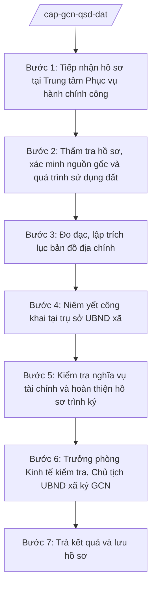

# Skill: Cấp Giấy chứng nhận QSD đất lần đầu

## 2. Khi nào dùng

- Hộ gia đình, cá nhân trên địa bàn xã nộp hồ sơ đề nghị cấp Giấy chứng nhận quyền sử dụng đất lần đầu;
- Cần thẩm tra tính pháp lý của hồ sơ, xác minh nguồn gốc và quá trình sử dụng đất;
- Cần thực hiện niêm yết công khai hồ sơ tại trụ sở UBND xã trước khi trình ký;
- Cần soạn Tờ trình và hồ sơ trình Chủ tịch UBND xã ký Giấy chứng nhận, vào sổ cấp GCN.

## 3. Đầu vào (Input)

| Trường | Mô tả | Bắt buộc |
|--------|-------|----------|
| `ho_ten_nguoi_de_nghi` | Họ tên hộ gia đình, cá nhân đề nghị cấp GCN | Có |
| `giay_to_nhan_than` | CMND/CCCD, sổ hộ khẩu/xác nhận cư trú của người đề nghị | Có |
| `giay_to_ve_dat` | Giấy tờ về quyền sử dụng đất (nếu có): giấy tờ mua bán, tặng cho, thừa kế, quyết định giao đất cũ... | Không |
| `vi_tri_thua_dat` | Vị trí thửa đất: thôn/tổ dân phố, tờ bản đồ, số thửa (nếu có) | Có |
| `dien_tich_de_nghi` | Diện tích đề nghị cấp GCN (m²) | Có |
| `muc_dich_su_dung` | Mục đích sử dụng đất đề nghị (đất ở, đất nông nghiệp...) | Có |
| `bien_lai_nghia_vu_tai_chinh` | Biên lai/chứng từ đã hoàn thành nghĩa vụ tài chính (nếu đã nộp) | Không |
| `ket_qua_niemyet` | Kết quả niêm yết công khai tại trụ sở UBND xã (có/không có khiếu nại) | Có (ở bước trình ký) |

## 4. Quy trình

**Bước 1. Tiếp nhận hồ sơ tại Trung tâm Phục vụ hành chính công**
- Làm gì: Tiếp nhận hồ sơ đề nghị cấp GCN lần đầu tại Trung tâm Phục vụ hành chính công xã (cơ chế một cửa); kiểm tra tính đầy đủ, hợp lệ của thành phần hồ sơ; viết giấy hẹn trả kết quả cho người dân.
- Dùng input: `ho_ten_nguoi_de_nghi`, `giay_to_nhan_than`, `giay_to_ve_dat`, `vi_tri_thua_dat`, `dien_tich_de_nghi`, `muc_dich_su_dung`.
- Vai trò: Công chức Trung tâm PVHCC tiếp nhận, AI hỗ trợ kiểm tra danh mục hồ sơ theo checklist, in giấy hẹn; ⏱ ~0,5 ngày làm việc (ước tính).
- Lưu ý nghiệp vụ: Thực hiện theo cơ chế một cửa (không để người dân phải đi lại nhiều lần); hồ sơ thiếu phải hướng dẫn bổ sung một lần bằng văn bản.
- → Kết quả bước: Hồ sơ đã tiếp nhận + giấy hẹn trả kết quả.

**Bước 2. Thẩm tra hồ sơ, xác minh nguồn gốc và quá trình sử dụng đất**
- Làm gì: Công chức địa chính kiểm tra hồ sơ địa chính, xác minh nguồn gốc đất, quá trình sử dụng đất của hộ gia đình, cá nhân; kiểm tra tình trạng tranh chấp, lấn chiếm; đối chiếu với quy hoạch sử dụng đất.
- Dùng input: `giay_to_ve_dat`, `vi_tri_thua_dat`, hồ sơ địa chính của xã.
- Vai trò: Công chức địa chính xã thực hiện xác minh, AI hỗ trợ tổng hợp thông tin hồ sơ địa chính thành phiếu xác minh, đối chiếu các mốc thời gian sử dụng đất; ⏱ ~5–7 ngày làm việc (ước tính).
- Lưu ý nghiệp vụ: Đất đang có tranh chấp thì dừng giải quyết, hướng dẫn hòa giải; đất không phù hợp quy hoạch thì không đủ điều kiện cấp GCN.
- → Kết quả bước: Phiếu xác minh nguồn gốc, quá trình sử dụng đất và hiện trạng thửa đất.

**Bước 3. Đo đạc, lập trích lục bản đồ địa chính**
- Làm gì: Tổ chức đo đạc hiện trạng thửa đất (hoặc sử dụng số liệu đo đạc hiện có còn giá trị); lập trích lục bản đồ địa chính thửa đất, xác định ranh giới, diện tích, tọa độ các đỉnh thửa.
- Dùng input: `vi_tri_thua_dat`, `dien_tich_de_nghi`, kết quả đo đạc.
- Vai trò: Công chức địa chính/đơn vị đo đạc thực hiện, AI hỗ trợ lập biểu trích lục, kiểm tra diện tích đo đạc so với diện tích đề nghị; ⏱ ~3–5 ngày làm việc (ước tính).
- Lưu ý nghiệp vụ: Ranh giới thửa đất phải được các hộ giáp ranh ký xác nhận; diện tích cấp GCN theo kết quả đo đạc thực tế, đúng quy định về hạn mức.
- → Kết quả bước: Trích lục bản đồ địa chính thửa đất (có xác nhận giáp ranh).

**Bước 4. Niêm yết công khai tại trụ sở UBND xã**
- Làm gì: Niêm yết công khai hồ sơ đề nghị cấp GCN (thông tin người đề nghị, thửa đất, diện tích, mục đích sử dụng) tại trụ sở UBND xã và tại thôn/tổ dân phố nơi có đất theo thời hạn quy định; tiếp nhận, xử lý ý kiến phản ánh, khiếu nại (nếu có).
- Dùng input: Hồ sơ đề nghị cấp GCN, kết quả Bước 2–3.
- Vai trò: Công chức địa chính phối hợp trưởng thôn/tổ dân phố thực hiện niêm yết, AI hỗ trợ soạn thông báo niêm yết và biên bản kết thúc niêm yết; ⏱ ~theo thời hạn niêm yết quy định (ước tính).
- Lưu ý nghiệp vụ: Phải lập biên bản niêm yết và biên bản kết thúc niêm yết; nếu có khiếu nại, tranh chấp phát sinh thì dừng trình ký để xử lý.
- → Kết quả bước: Biên bản niêm yết công khai + kết quả xử lý ý kiến phản ánh (`ket_qua_niemyet`).

**Bước 5. Kiểm tra nghĩa vụ tài chính và hoàn thiện hồ sơ trình ký**
- Làm gì: Xác định nghĩa vụ tài chính của người sử dụng đất (tiền sử dụng đất, lệ phí trước bạ, phí thẩm định...); thông báo để người dân hoàn thành nghĩa vụ tài chính; tập hợp đầy đủ hồ sơ, soạn Tờ trình của Phòng Kinh tế trình Chủ tịch UBND xã.
- Dùng input: `bien_lai_nghia_vu_tai_chinh`, kết quả Bước 2–4.
- Vai trò: Công chức địa chính/tài chính xã thực hiện, AI hỗ trợ soạn Tờ trình, kiểm tra tính đầy đủ thành phần hồ sơ trình ký; ⏱ ~2–3 ngày làm việc (ước tính).
- Lưu ý nghiệp vụ: Chỉ trình ký khi người dân đã hoàn thành nghĩa vụ tài chính (trừ trường hợp được ghi nợ theo quy định); hồ sơ trình ký phải đầy đủ, đúng trình tự.
- → Kết quả bước: Tờ trình + bộ hồ sơ trình Chủ tịch UBND xã ký GCN.

**Bước 6. Trưởng phòng Kinh tế kiểm tra, Chủ tịch UBND xã ký GCN**
- Làm gì: Trưởng phòng Kinh tế kiểm tra lần cuối tính hợp pháp, đầy đủ của hồ sơ; Chủ tịch UBND xã xem xét, ký Giấy chứng nhận quyền sử dụng đất; thực hiện vào sổ cấp Giấy chứng nhận.
- Dùng input: Toàn bộ hồ sơ trình ký ở Bước 5.
- Vai trò: Trưởng phòng Kinh tế kiểm tra, Chủ tịch UBND xã ký; AI hỗ trợ rà soát lỗi thể thức trên dự thảo GCN; ⏱ ~1–2 ngày làm việc (ước tính).
- Lưu ý nghiệp vụ: Thẩm quyền ký GCN lần đầu cho hộ gia đình, cá nhân thuộc Chủ tịch UBND xã; AI tuyệt đối không thay người ký. Trường hợp không đủ điều kiện cấp thì phải có văn bản từ chối nêu rõ lý do, trả lời người dân.
- → Kết quả bước: Giấy chứng nhận QSD đất đã ký + vào sổ cấp GCN.

**Bước 7. Trả kết quả và lưu hồ sơ**
- Làm gì: Trao Giấy chứng nhận cho người dân tại Trung tâm PVHCC theo giấy hẹn; lưu toàn bộ hồ sơ cấp GCN (bản lưu) vào hồ sơ địa chính của xã phục vụ quản lý, tra cứu.
- Dùng input: GCN đã ký, giấy hẹn trả kết quả.
- Vai trò: Công chức Trung tâm PVHCC trả kết quả, công chức địa chính lưu hồ sơ; AI hỗ trợ cập nhật sổ theo dõi cấp GCN; ⏱ ~0,5 ngày làm việc (ước tính).
- Lưu ý nghiệp vụ: Người nhận GCN ký nhận vào sổ giao nhận; hồ sơ bản lưu phải đầy đủ để phục vụ kiểm tra, giải quyết khiếu nại về sau.
- → Kết quả bước: GCN đã trao cho người dân; hồ sơ cấp GCN lưu trữ đầy đủ.

## Luồng quy trình (Workflow)

## 5. Đầu ra (Output)

- Tờ trình của Phòng Kinh tế trình Chủ tịch UBND xã về việc cấp GCN QSD đất;
- Giấy chứng nhận quyền sử dụng đất lần đầu (do Chủ tịch UBND xã ký);
- Sổ cấp Giấy chứng nhận (bản cập nhật sau khi cấp);
- Văn bản từ chối cấp GCN nêu rõ lý do (nếu không đủ điều kiện);
- Bộ hồ sơ cấp GCN bản lưu (đơn đề nghị, giấy tờ về đất, phiếu xác minh, trích lục bản đồ, biên bản niêm yết, chứng từ nghĩa vụ tài chính).

### Cấu trúc output chuẩn (Tờ trình trình ký GCN)

1. Quốc hiệu "CỘNG HÒA XÃ HỘI CHỦ NGHĨA VIỆT NAM" – Tiêu ngữ "Độc lập – Tự do – Hạnh phúc"; (đúng thể thức NĐ 30/2020/NĐ-CP)
2. Tên cơ quan tham mưu: PHÒNG KINH TẾ XÃ A; số, ký hiệu văn bản; địa danh và ngày, tháng, năm;
3. Tên loại và trích yếu: TỜ TRÌNH — Về việc đề nghị cấp Giấy chứng nhận quyền sử dụng đất lần đầu cho hộ ông/bà...;
4. Phần "Kính gửi": Chủ tịch UBND xã A;
5. Căn cứ (Luật Đất đai; văn bản quy định chi tiết về cấp GCN...);
6. Nội dung: thông tin người đề nghị, thửa đất (vị trí, diện tích, mục đích); kết quả thẩm tra, xác minh; kết quả niêm yết công khai; tình hình thực hiện nghĩa vụ tài chính; đề nghị Chủ tịch xem xét, ký cấp GCN;
7. Nơi nhận;
8. Thẩm quyền, chức vụ, họ tên người ký: TM. PHÒNG KINH TẾ — TRƯỞNG PHÒNG — (chữ ký, họ tên), dấu của cơ quan (nếu có).

## 6. Checklist nghiệm thu

- [ ] Hồ sơ tiếp nhận đầy đủ thành phần, có giấy hẹn trả kết quả theo cơ chế một cửa;
- [ ] Đã xác minh nguồn gốc, quá trình sử dụng đất; đất không có tranh chấp, phù hợp quy hoạch;
- [ ] Có trích lục bản đồ địa chính, ranh giới được hộ giáp ranh ký xác nhận;
- [ ] Đã niêm yết công khai đúng thời hạn, có biên bản niêm yết và biên bản kết thúc niêm yết;
- [ ] Người đề nghị đã hoàn thành nghĩa vụ tài chính (hoặc có căn cứ ghi nợ hợp pháp);
- [ ] Tờ trình nêu đầy đủ căn cứ, kết quả thẩm tra, đề nghị rõ ràng;
- [ ] GCN do Chủ tịch UBND xã ký; đã vào sổ cấp GCN;
- [ ] Trường hợp từ chối: có văn bản trả lời nêu rõ lý do;
- [ ] Số liệu thửa đất (diện tích, vị trí, mục đích) thống nhất trong toàn bộ hồ sơ;
- [ ] Hồ sơ bản lưu đầy đủ, sắp xếp theo trình tự để tra cứu.

## 7. Ví dụ mô phỏng

*Dữ liệu dưới đây là giả lập 100% phục vụ minh họa.*

### Input mẫu

| Trường | Giá trị giả lập |
|--------|-----------------|
| ho_ten_nguoi_de_nghi | Ông Nguyễn Văn Dân |
| giay_to_nhan_than | CCCD (bản sao), xác nhận cư trú tại thôn 1, xã A |
| giay_to_ve_dat | Giấy mua bán đất viết tay năm 2005 (bản sao) |
| vi_tri_thua_dat | Thôn 1, xã A; tờ bản đồ số 10, thửa số 200 |
| dien_tich_de_nghi | 500 m² |
| muc_dich_su_dung | Đất ở: 200 m²; đất trồng cây hằng năm: 300 m² |
| bien_lai_nghia_vu_tai_chinh | Đã nộp đủ tiền sử dụng đất, lệ phí trước bạ (biên lai số 123) |
| ket_qua_niemyet | Niêm yết 15 ngày tại trụ sở UBND xã A và nhà văn hóa thôn 1: không có khiếu nại |

### Output mẫu (Tờ trình — trích)

> **CỘNG HÒA XÃ HỘI CHỦ NGHĨA VIỆT NAM**
> **Độc lập – Tự do – Hạnh phúc**
>
> **PHÒNG KINH TẾ XÃ A**
> Số: 45/TTr-KT
> Xã A, ngày 10 tháng 3 năm 2027
>
> **TỜ TRÌNH**
> **Về việc đề nghị cấp Giấy chứng nhận quyền sử dụng đất lần đầu cho hộ ông Nguyễn Văn Dân**
>
> Kính gửi: Chủ tịch UBND xã A.
>
> Căn cứ Luật Đất đai;
> Căn cứ hồ sơ đề nghị cấp Giấy chứng nhận quyền sử dụng đất của hộ ông Nguyễn Văn Dân;
> Phòng Kinh tế báo cáo và đề nghị như sau:
>
> 1. Thông tin thửa đất: thôn 1, xã A; tờ bản đồ số 10, thửa số 200; diện tích 500 m² (đất ở 200 m², đất trồng cây hằng năm 300 m²).
> 2. Kết quả thẩm tra: đất sử dụng ổn định từ năm 2005, không tranh chấp, phù hợp quy hoạch sử dụng đất xã A.
> 3. Niêm yết công khai 15 ngày: không có khiếu nại, phản ánh.
> 4. Nghĩa vụ tài chính: đã hoàn thành (biên lai số 123).
>
> Phòng Kinh tế kính đề nghị Chủ tịch UBND xã xem xét, ký cấp Giấy chứng nhận quyền sử dụng đất cho hộ ông Nguyễn Văn Dân./.
>
> ***Nơi nhận:*** ...
>
> **TM. PHÒNG KINH TẾ**
> **TRƯỞNG PHÒNG**
> *(ký)*
> **Hoàng Thị D**

## 8. Human gate

1. Công chức Trung tâm PVHCC tiếp nhận hồ sơ, viết giấy hẹn (Bước 1);
2. Công chức địa chính xã thẩm tra, xác minh, đo đạc, niêm yết, hoàn thiện hồ sơ trình ký (Bước 2–5);
3. Trưởng phòng Kinh tế kiểm tra lần cuối tính hợp pháp, đầy đủ của hồ sơ (Bước 6);
4. Chủ tịch UBND xã xem xét, ký Giấy chứng nhận (hoặc ký văn bản từ chối nêu rõ lý do) (Bước 6) — thẩm quyền ký thuộc Chủ tịch UBND xã.

## 9. Giới hạn

- AI KHÔNG ra quyết định cấp hoặc từ chối cấp GCN thay người có thẩm quyền;
- AI KHÔNG tự ký GCN, không tự phát hành bất kỳ văn bản nào;
- AI KHÔNG bịa thông tin thửa đất, nguồn gốc sử dụng đất, kết quả niêm yết;
- AI KHÔNG bịa căn cứ pháp lý, không trích dẫn văn bản đã hết hiệu lực;
- AI KHÔNG "làm thay" việc xác minh thực địa, lấy ý kiến giáp ranh, niêm yết công khai — đây là việc của công chức và người dân thực hiện trực tiếp.

## 10. Căn cứ & lưu ý

- Nghị định 151/2025/NĐ-CP về phân định thẩm quyền chính quyền địa phương 2 cấp, phân quyền, phân cấp trong lĩnh vực đất đai (Chủ tịch UBND xã cấp GCN QSD đất lần đầu, giao đất/cho thuê đất/chuyển mục đích sử dụng đất cho cá nhân, hộ gia đình);
- Nghị định 118/2025/NĐ-CP về cơ chế một cửa, một cửa liên thông trong giải quyết thủ tục hành chính;
- Luật Đất đai (chỉ nêu tên luật, không kèm số hiệu);
- Nghị định 30/2020/NĐ-CP về công tác văn thư (chỉ dùng cho thể thức văn bản);
- Lưu ý: chỉ cấp GCN khi đất không có tranh chấp, phù hợp quy hoạch sử dụng đất và người đề nghị đã hoàn thành nghĩa vụ tài chính; trường hợp không đủ điều kiện phải có văn bản từ chối nêu rõ lý do.
