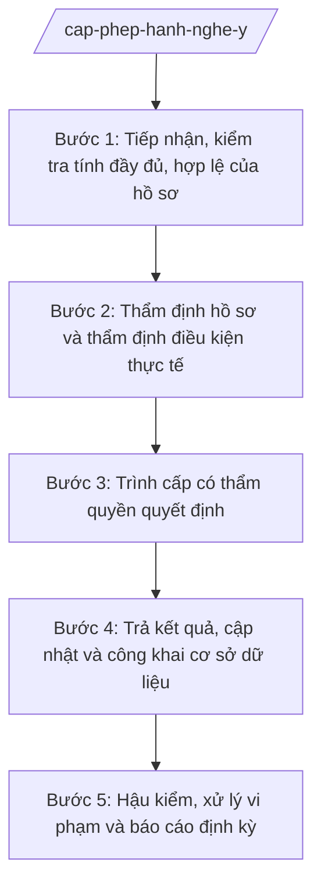

# Skill: Cấp phép hành nghề y, giấy phép hoạt động CSYT

## 2. Khi nào dùng

- Khi tiếp nhận hồ sơ đề nghị cấp mới giấy phép hành nghề khám bệnh, chữa bệnh cho cá nhân (bác sĩ, y sĩ, điều dưỡng, hộ sinh, kỹ thuật viên...).
- Khi tiếp nhận hồ sơ đề nghị cấp, điều chỉnh, cấp lại giấy phép hoạt động đối với cơ sở khám bệnh, chữa bệnh (bệnh viện, phòng khám, cơ sở dịch vụ y tế).
- Khi cần tổ chức thẩm định hồ sơ và thẩm định điều kiện thực tế tại cơ sở KCB trước khi cấp phép.
- Khi phát hiện vi phạm và cần tham mưu thu hồi, đình chỉ giấy phép hành nghề/giấy phép hoạt động theo quy định.
- Khi cần cập nhật, công khai cơ sở dữ liệu người hành nghề và cơ sở KCB được cấp phép trên địa bàn tỉnh.

## 3. Đầu vào (Input)

| Trường | Mô tả | Bắt buộc |
|--------|-------|----------|
| `ho_so_de_nghi` | Hồ sơ đề nghị cấp/điều chỉnh/cấp lại/thu hồi giấy phép: đơn đề nghị, văn bằng, chứng chỉ, giấy tờ pháp lý của cơ sở | Có |
| `loai_giay_phep` | Loại giấy phép: hành nghề cá nhân / hoạt động cơ sở KCB | Có |
| `loai_thu_tuc` | Cấp mới / điều chỉnh / cấp lại / thu hồi / đình chỉ | Có |
| `thong_tin_chu_the` | Thông tin cá nhân đề nghị hành nghề (họ tên, văn bằng, phạm vi hành nghề) hoặc tổ chức (tên cơ sở, địa chỉ, loại hình, quy mô) | Có |
| `ket_qua_tham_dinh_truoc` | Kết quả thẩm định/thanh kiểm tra trước đây của cùng chủ thể (nếu có) | Không |
| `phan_anh_vi_pham` | Thông tin phản ánh, kiến nghị về vi phạm hành nghề (nếu là thủ tục thu hồi/đình chỉ) | Không |

## 4. Quy trình

**Bước 1. Tiếp nhận, kiểm tra tính đầy đủ, hợp lệ của hồ sơ**
- Làm gì: Tiếp nhận hồ sơ tại bộ phận một cửa của Sở Y tế (trực tiếp hoặc trực tuyến); kiểm tra thành phần hồ sơ, tính hợp lệ của giấy tờ (văn bằng, chứng chỉ hành nghề, giấy tờ pháp lý của cơ sở); lập phiếu tiếp nhận, hẹn trả kết quả; yêu cầu bổ sung nếu hồ sơ thiếu.
- Dùng input: `ho_so_de_nghi`, `loai_giay_phep`, `loai_thu_tuc`, `thong_tin_chu_the`.
- Vai trò: Chuyên viên Phòng Nghiệp vụ Y (hoặc bộ phận một cửa Sở) tiếp nhận, kiểm tra; AI hỗ trợ lập danh mục kiểm tra thành phần hồ sơ (checklist), soạn phiếu tiếp nhận ⏱ ~0,5 ngày (ước tính).
- Lưu ý nghiệp vụ: Kiểm tra đúng thành phần hồ sơ theo quy định, không yêu cầu thêm giấy tờ ngoài quy định; ghi rõ lý do khi yêu cầu bổ sung; bảo đảm thời hạn giải quyết thủ tục hành chính.
- → Kết quả bước: Phiếu tiếp nhận hồ sơ + danh mục hồ sơ đã kiểm tra (đủ điều kiện chuyển thẩm định / yêu cầu bổ sung).

**Bước 2. Thẩm định hồ sơ và thẩm định điều kiện thực tế**
- Làm gì: Thẩm định nội dung hồ sơ: văn bằng, phạm vi hành nghề đề nghị, điều kiện cơ sở vật chất, trang thiết bị, nhân sự của cơ sở KCB; tổ chức đoàn thẩm định thực tế tại cơ sở (đối với giấy phép hoạt động cơ sở KHB); lập biên bản thẩm định, kết luận đủ/không đủ điều kiện.
- Dùng input: Hồ sơ đã tiếp nhận bước 1, `ket_qua_tham_dinh_truoc`.
- Vai trò: Chuyên viên Phòng Nghiệp vụ Y chủ trì thẩm định; đoàn thẩm định do Trưởng phòng Nghiệp vụ Y (ông Bùi Văn X) hoặc Phó Giám đốc Sở (ông Đỗ Văn U) làm Trưởng đoàn, có chuyên gia chuyên môn; AI hỗ trợ soạn biên bản thẩm định, bảng đối chiếu điều kiện ⏱ ~2–3 ngày (ước tính).
- Lưu ý nghiệp vụ: Thẩm định đúng điều kiện theo quy định, khách quan, không gây khó dễ; biên bản thẩm định phải có chữ ký các bên; nội dung không đạt phải ghi rõ, hướng dẫn khắc phục.
- → Kết quả bước: Biên bản thẩm định + kết luận đủ/không đủ điều kiện cấp phép.

**Bước 3. Trình cấp có thẩm quyền quyết định**
- Làm gì: Trên cơ sở kết luận thẩm định, soạn tờ trình + dự thảo quyết định (cấp mới/điều chỉnh/cấp lại giấy phép; hoặc quyết định thu hồi/đình chỉ khi có vi phạm); trình lãnh đạo Sở xem xét, ký quyết định theo thẩm quyền.
- Dùng input: Biên bản thẩm định bước 2, `phan_anh_vi_pham` (nếu thu hồi).
- Vai trò: Chuyên viên Phòng Nghiệp vụ Y soạn tờ trình, dự thảo quyết định; Trưởng phòng Nghiệp vụ Y (ông Bùi Văn X) kiểm tra; Phó Giám đốc Sở (ông Đỗ Văn U) xem xét; Giám đốc Sở (ông Hoàng Văn S) ký quyết định cấp/thu hồi giấy phép; AI hỗ trợ soạn thảo theo thể thức NĐ 30/2020/NĐ-CP ⏱ ~1 ngày (ước tính).
- Lưu ý nghiệp vụ: Quyết định phải nêu rõ căn cứ, nội dung cấp phép (phạm vi hành nghề, thời hạn), lý do thu hồi/đình chỉ (nếu có); trường hợp từ chối cấp phép phải trả lời bằng văn bản, nêu rõ lý do.
- → Kết quả bước: Quyết định cấp/điều chỉnh/cấp lại/thu hồi/đình chỉ giấy phép (đã ký).

**Bước 4. Trả kết quả, cập nhật và công khai cơ sở dữ liệu**
- Làm gì: Trả giấy phép cho cá nhân/tổ chức theo phiếu hẹn; cập nhật thông tin vào cơ sở dữ liệu người hành nghề, cơ sở KCB của tỉnh; công khai danh sách cấp mới/thu hồi trên Cổng thông tin điện tử của Sở; lưu hồ sơ theo quy định.
- Dùng input: Quyết định bước 3, `thong_tin_chu_the`.
- Vai trò: Chuyên viên Phòng Nghiệp vụ Y cập nhật cơ sở dữ liệu, phối hợp Văn phòng Sở công khai thông tin; AI hỗ trợ lập danh sách cập nhật, soạn thông báo công khai ⏱ ~0,5 ngày (ước tính).
- Lưu ý nghiệp vụ: Cập nhật kịp thời, chính xác; thông tin công khai đúng quy định, không tiết lộ thông tin cá nhân ngoài phạm vi cho phép; hồ sơ lưu trữ đầy đủ để phục vụ hậu kiểm.
- → Kết quả bước: Giấy phép đã trả + cơ sở dữ liệu được cập nhật + thông báo công khai.

**Bước 5. Hậu kiểm, xử lý vi phạm và báo cáo định kỳ**
- Làm gì: Tổ chức hậu kiểm việc tuân thủ điều kiện hành nghề/hoạt động sau cấp phép; tiếp nhận, xác minh phản ánh vi phạm; tham mưu xử lý (nhắc nhở, đình chỉ, thu hồi) theo thẩm quyền; tổng hợp báo cáo công tác cấp phép gửi Bộ Y tế và UBND tỉnh định kỳ.
- Dùng input: Cơ sở dữ liệu bước 4, `phan_anh_vi_pham`, `ket_qua_tham_dinh_truoc`.
- Vai trò: Chuyên viên Phòng Nghiệp vụ Y hậu kiểm, tổng hợp báo cáo; Trưởng phòng Nghiệp vụ Y (ông Bùi Văn X) kiểm tra; Giám đốc Sở (ông Hoàng Văn S) ký báo cáo; AI hỗ trợ lập kế hoạch hậu kiểm, tổng hợp báo cáo ⏱ ~1 ngày (ước tính).
- Lưu ý nghiệp vụ: Hậu kiểm có trọng tâm (cơ sở có dấu hiệu vi phạm, phản ánh của người dân); xử lý vi phạm đúng trình tự, đúng thẩm quyền; báo cáo định kỳ đầy đủ số lượng cấp mới/điều chỉnh/thu hồi.
- → Kết quả bước: Báo cáo công tác cấp phép hành nghề y (kỳ …) + hồ sơ xử lý vi phạm (nếu có).

## Luồng quy trình (Workflow)

## 5. Đầu ra (Output)

**Danh sách sản phẩm:**
1. Quyết định cấp/điều chỉnh/cấp lại giấy phép hành nghề hoặc giấy phép hoạt động cơ sở KCB (sản phẩm chính 1).
2. Quyết định thu hồi/đình chỉ giấy phép (khi có vi phạm) (sản phẩm chính 2).
3. Biên bản thẩm định điều kiện cấp phép.
4. Báo cáo công tác cấp phép hành nghề y (kỳ …).
5. Danh sách người hành nghề/cơ sở KCB được cấp phép, điều chỉnh, thu hồi (phụ lục, phục vụ công khai).

**Cấu trúc output chuẩn — Quyết định cấp giấy phép:**
- Thể thức: tuân thủ Nghị định 30/2020/NĐ-CP về công tác văn thư.

1. Quốc hiệu "CỘNG HÒA XÃ HỘI CHỦ NGHĨA VIỆT NAM", Tiêu ngữ "Độc lập – Tự do – Hạnh phúc".
2. Số, ký hiệu văn bản: số/ký hiệu theo quy định (vd: 1234/QĐ-SYT).
3. Địa danh, ngày tháng năm ban hành: "Tỉnh A, ngày … tháng … năm …".
4. Tên loại và trích yếu: "QUYẾT ĐỊNH — Về việc cấp giấy phép hành nghề khám bệnh, chữa bệnh / giấy phép hoạt động cơ sở khám bệnh, chữa bệnh".
5. Căn cứ: TT 20/2025/TT-BYT; TT 18/2025/TT-BYT; quy định của pháp luật về khám bệnh, chữa bệnh; hồ sơ đề nghị; biên bản thẩm định.
6. Nội dung quyết định (các Điều): Điều 1. Cấp giấy phép cho … (họ tên/tên cơ sở, phạm vi, thời hạn); Điều 2. Trách nhiệm của người được cấp phép; Điều 3. Hiệu lực và tổ chức thực hiện.
7. Nơi nhận: người/tổ chức được cấp phép, các đơn vị liên quan, lưu VP Sở.
8. Chữ ký: Giám đốc Sở Y tế ký, đóng dấu.

**Cấu trúc output chuẩn — Báo cáo công tác cấp phép:**

1. Quốc hiệu "CỘNG HÒA XÃ HỘI CHỦ NGHĨA VIỆT NAM", Tiêu ngữ "Độc lập – Tự do – Hạnh phúc".
2. Số, ký hiệu văn bản: số/ký hiệu theo quy định (vd: 1234/BC-SYT).
3. Địa danh, ngày tháng năm ban hành.
4. Tên loại và trích yếu: "BÁO CÁO — Công tác cấp phép hành nghề y và giấy phép hoạt động cơ sở KCB tỉnh A (kỳ …)".
5. Căn cứ: TT 20/2025/TT-BYT; TT 18/2025/TT-BYT.
6. Nội dung: I. Kết quả tiếp nhận, giải quyết hồ sơ (bảng: cấp mới/điều chỉnh/cấp lại/từ chối); II. Thẩm định thực tế; III. Hậu kiểm và xử lý vi phạm (thu hồi/đình chỉ); IV. Khó khăn, vướng mắc; V. Kiến nghị.
7. Nơi nhận: Bộ Y tế, UBND tỉnh, lưu VP Sở.
8. Chữ ký: Giám đốc Sở Y tế ký, đóng dấu.

> **Chuẩn tài liệu đầu ra** (thứ tự ưu tiên):
> 1. Chuẩn riêng của ngành/cơ quan chủ quản — mẫu, biểu mẫu, quy chuẩn tại văn bản quy phạm chuyên ngành (xem mục "Căn cứ & lưu ý").
> 2. Tài liệu không có quy chuẩn riêng — thể thức NĐ 30/2020/NĐ-CP: Quốc hiệu và Tiêu ngữ; tên cơ quan ban hành; số, ký hiệu; địa danh và thời gian; tên loại và trích yếu; nội dung; chức vụ, họ tên, chữ ký người có thẩm quyền; dấu, chữ ký số; nơi nhận (kèm Phụ lục nếu có).

## 6. Checklist nghiệm thu

- [ ] Hồ sơ được kiểm tra đầy đủ thành phần, hợp lệ; phiếu tiếp nhận ghi rõ thời hạn trả kết quả; không yêu cầu giấy tờ ngoài quy định.
- [ ] Biên bản thẩm định (hồ sơ + thực tế) khách quan, có chữ ký các bên; kết luận đủ/không đủ điều kiện rõ ràng, nội dung chưa đạt được hướng dẫn khắc phục.
- [ ] Quyết định cấp/thu hồi giấy phép đúng thể thức NĐ 30/2020/NĐ-CP, nêu rõ căn cứ, phạm vi, thời hạn (hoặc lý do thu hồi/đình chỉ, lý do từ chối).
- [ ] Cơ sở dữ liệu được cập nhật kịp thời, chính xác; thông tin cấp mới/thu hồi được công khai đúng quy định.
- [ ] Hậu kiểm có trọng tâm; xử lý vi phạm đúng trình tự, đúng thẩm quyền.
- [ ] Báo cáo định kỳ đầy đủ số liệu cấp mới/điều chỉnh/thu hồi; số liệu khớp với cơ sở dữ liệu.
- [ ] Thông tin cá nhân/tổ chức trong văn bản khớp đúng Input; không bịa hồ sơ, văn bằng, kết quả thẩm định.
- [ ] Đã qua human gate: Trưởng phòng kiểm tra, Giám đốc Sở ký quyết định theo thẩm quyền.

## 7. Ví dụ mô phỏng

*Dữ liệu dưới đây là giả lập 100% phục vụ minh họa.*

**Input mẫu:**
- ho_so_de_nghi: đơn đề nghị cấp giấy phép hoạt động phòng khám đa khoa; giấy chứng nhận đăng ký doanh nghiệp; danh sách 5 bác sĩ có chứng chỉ hành nghề; hợp đồng thuê địa điểm; danh mục trang thiết bị
- loai_giay_phep: giấy phép hoạt động cơ sở KCB
- loai_thu_tuc: cấp mới
- thong_tin_chu_the: Phòng khám Đa khoa An Bình — địa chỉ: Số 123 đường B, xã A, tỉnh A; quy mô: 10 giường lưu; phạm vi: khám nội, ngoại, sản, nhi

**Output mẫu — Quyết định cấp giấy phép hoạt động (trích):**

> CỘNG HÒA XÃ HỘI CHỦ NGHĨA VIỆT NAM
> Độc lập – Tự do – Hạnh phúc
>
> Số: 1234/QĐ-SYT
>
> Tỉnh A, ngày 20 tháng 03 năm 2027
>
> **QUYẾT ĐỊNH**
> **Về việc cấp giấy phép hoạt động cơ sở khám bệnh, chữa bệnh**
>
> **GIÁM ĐỐC SỞ Y TẾ TỈNH A**
>
> Căn cứ Thông tư số 20/2025/TT-BYT ngày 23/6/2025 của Bộ Y tế hướng dẫn chức năng, nhiệm vụ, quyền hạn của cơ quan chuyên môn về y tế thuộc UBND cấp tỉnh;
> Căn cứ Thông tư số 18/2025/TT-BYT của Bộ Y tế quy định phân định thẩm quyền trong lĩnh vực khám bệnh, chữa bệnh;
> Căn cứ hồ sơ đề nghị cấp giấy phép hoạt động của Phòng khám Đa khoa An Bình;
> Căn cứ Biên bản thẩm định ngày 15/3/2027 của Đoàn thẩm định Sở Y tế tỉnh A;
>
> **QUYẾT ĐỊNH:**
>
> **Điều 1.** Cấp giấy phép hoạt động cơ sở khám bệnh, chữa bệnh cho:
> - Tên cơ sở: Phòng khám Đa khoa An Bình;
> - Địa chỉ: Số 123 đường B, xã A, tỉnh A;
> - Loại hình, quy mô: phòng khám đa khoa, 10 giường lưu;
> - Phạm vi hoạt động chuyên môn: khám bệnh, chữa bệnh chuyên khoa nội, ngoại, sản, nhi.
>
> **Điều 2.** Phòng khám Đa khoa An Bình có trách nhiệm tuân thủ các điều kiện hoạt động theo quy định của pháp luật về khám bệnh, chữa bệnh; chịu sự kiểm tra, giám sát của Sở Y tế tỉnh A.
>
> **Điều 3.** Quyết định này có hiệu lực kể từ ngày ký. Chánh Văn phòng Sở, Trưởng phòng Nghiệp vụ Y, Phòng khám Đa khoa An Bình chịu trách nhiệm thi hành Quyết định này.
>
> **Nơi nhận:** như Điều 3; lưu VP Sở, Phòng NVY.
>
> **GIÁM ĐỐC**
> *(Ký, đóng dấu)*
> Hoàng Văn S

## 8. Human gate (người kiểm duyệt)

- Chuyên viên Phòng Nghiệp vụ Y thuộc Sở Y tế tiếp nhận hồ sơ, thẩm định, soạn tờ trình và dự thảo quyết định.
- Trưởng phòng Nghiệp vụ Y (ông Bùi Văn X) kiểm tra hồ sơ, kết quả thẩm định, nội dung dự thảo quyết định.
- Phó Giám đốc Sở (ông Đỗ Văn U) xem xét, cho ý kiến trước khi trình Giám đốc Sở.
- Giám đốc Sở (ông Hoàng Văn S) ký quyết định cấp/điều chỉnh/cấp lại/thu hồi/đình chỉ giấy phép (thẩm quyền của Giám đốc Sở Y tế).
- Trường hợp phức tạp, có khiếu nại hoặc vượt thẩm quyền: báo cáo, xin ý kiến Bộ Y tế hoặc trình UBND tỉnh theo quy định.

## 9. Giới hạn (guardrails)

- AI KHÔNG ra quyết định cấp hoặc thu hồi giấy phép thay người có thẩm quyền; không tự ký quyết định.
- AI KHÔNG tự ký, đóng dấu hoặc phát hành văn bản dưới danh nghĩa Sở Y tế hay lãnh đạo Sở.
- AI KHÔNG bịa hồ sơ, văn bằng, kết quả thẩm định, số hiệu văn bản, căn cứ pháp lý.
- AI KHÔNG hướng dẫn làm giả hồ sơ, lách điều kiện cấp phép.
- AI KHÔNG dùng văn bản đã hết hiệu lực; chỉ trích dẫn văn bản có trong tai-lieu-moi-nhat.md.

## 10. Căn cứ & lưu ý

- Thông tư số 20/2025/TT-BYT ngày 23/6/2025 của Bộ Y tế: hướng dẫn chức năng, nhiệm vụ, quyền hạn của Sở Y tế thuộc UBND cấp tỉnh (trong đó có nhiệm vụ cấp phép hành nghề y).
- Thông tư số 18/2025/TT-BYT của Bộ Y tế: quy định phân định thẩm quyền chính quyền địa phương 2 cấp trong lĩnh vực khám bệnh, chữa bệnh.
- Nghị định số 147/2025/NĐ-CP ngày 12/6/2025: phân định thẩm quyền CQĐP 2 cấp trong lĩnh vực quản lý nhà nước của Bộ Y tế.
- Nghị định số 148/2025/NĐ-CP ngày 12/6/2025: phân quyền, phân cấp trong lĩnh vực y tế.
- Nghị định số 150/2025/NĐ-CP ngày 12/6/2025: tổ chức Sở Y tế thuộc UBND cấp tỉnh; sửa đổi bởi NĐ 370/2025/NĐ-CP.
- Nghị định số 30/2020/NĐ-CP của Chính phủ: thể thức văn bản hành chính.
- Lưu ý: Sở Y tế cấp phép đối với tổ chức (cơ sở KCB) và cá nhân hành nghề theo phân cấp; việc hướng dẫn người dân làm thủ tục tại bộ phận một cửa cấp xã (nếu được ủy quyền tiếp nhận) thực hiện theo cơ chế một cửa NĐ 118/2025/NĐ-CP — không trùng với skill cấp xã.
