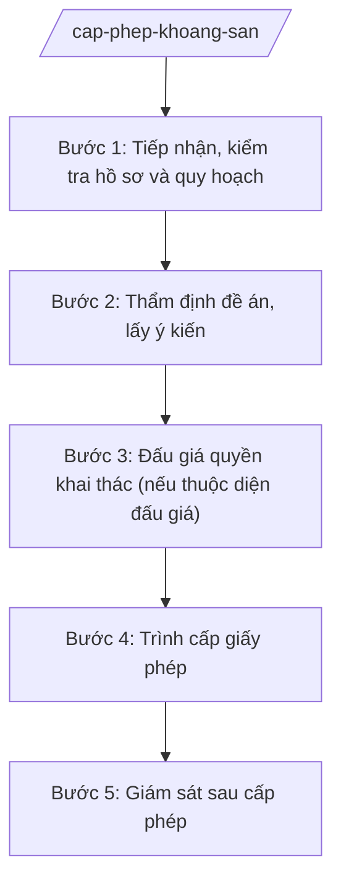

# Skill: Cấp phép khai thác khoáng sản

## 2. Khi nào dùng

- Khi tổ chức đề nghị cấp giấy phép thăm dò, khai thác khoáng sản thuộc thẩm quyền UBND tỉnh.
- Khi tổ chức đấu giá quyền khai thác khoáng sản.
- Khi kiểm tra hoạt động khai thác: nghĩa vụ tài chính, bảo vệ môi trường, an toàn lao động.
- Khi thu hồi, gia hạn giấy phép khai thác.

## 3. Đầu vào (Input)

| Trường | Mô tả | Bắt buộc |
|--------|-------|----------|
| `to_chuc` | Tên tổ chức đề nghị | Có |
| `loai_khoang_san` | Tên khoáng sản (đá xây dựng, cát, đất san lấp...) | Có |
| `dia_diem` | Vị trí mỏ (xã/phường, diện tích) | Có |
| `loai_giay_phep` | thăm dò / khai thác / gia hạn / thu hồi | Có |
| `tru_luong` | Trữ lượng dự kiến (nếu có) | Không |

## 4. Quy trình

**Bước 1. Tiếp nhận, kiểm tra hồ sơ và quy hoạch**
- Làm gì: Tiếp nhận hồ sơ; đối chiếu quy hoạch thăm dò, khai thác, sử dụng khoáng sản của tỉnh; kiểm tra khu vực cấm, tạm cấm hoạt động khoáng sản.
- Dùng input: `to_chuc`, `loai_khoang_san`, `dia_diem`.
- Vai trò: Chuyên viên Phòng Tài nguyên (Sở NN&MT); AI hỗ trợ đối chiếu bản đồ quy hoạch — ⏱ 5 ngày.
- Lưu ý nghiệp vụ: Khu vực cấm (di tích, rừng đặc dụng, hành lang đê...) tuyệt đối không cấp phép; hồ sơ phải có đề án thăm dò/khai thác.
- → Kết quả bước: Phiếu kiểm tra hồ sơ + bảng đối chiếu quy hoạch.

**Bước 2. Thẩm định đề án, lấy ý kiến**
- Làm gì: Thẩm định đề án thăm dò/khai thác: phương pháp, công nghệ, bảo vệ môi trường, an toàn; lấy ý kiến UBND cấp xã, cộng đồng dân cư.
- Dùng input: `loai_khoang_san`, `dia_diem`.
- Vai trò: Trưởng phòng chủ trì; AI hỗ trợ tổng hợp ý kiến — ⏱ 10 ngày.
- Lưu ý nghiệp vụ: Khai thác phải có đánh giá tác động môi trường/phương án BVMT; lấy ý kiến dân cư vùng bị ảnh hưởng.
- → Kết quả bước: Báo cáo thẩm định + ý kiến địa phương, cộng đồng.

**Bước 3. Đấu giá quyền khai thác (nếu thuộc diện đấu giá)**
- Làm gì: Tổ chức đấu giá quyền khai thác khoáng sản theo quy định; xác định tổ chức trúng đấu giá, mức tiền trúng đấu giá.
- Dùng input: `to_chuc`, `dia_diem`.
- Vai trò: Hội đồng đấu giá; AI hỗ trợ lập hồ sơ đấu giá — ⏱ 30–45 ngày.
- Lưu ý nghiệp vụ: Công khai, minh bạch; chống thông đồng, "quân xanh quân đỏ".
- → Kết quả bước: Biên bản đấu giá + quyết định công nhận kết quả trúng đấu giá.

**Bước 4. Trình cấp giấy phép**
- Làm gì: Hoàn thiện tờ trình + dự thảo giấy phép thăm dò/khai thác trình UBND tỉnh cấp.
- Dùng input: Toàn bộ kết quả các bước trên.
- Vai trò: Giám đốc Sở ký tờ trình; AI hỗ trợ soạn thảo — ⏱ 5 ngày.
- Lưu ý nghiệp vụ: Giấy phép ghi rõ: diện tích, trữ lượng, công suất, thời hạn, nghĩa vụ tài chính, BVMT, ký quỹ cải tạo môi trường.
- → Kết quả bước: Giấy phép thăm dò/khai thác khoáng sản của UBND tỉnh.

**Bước 5. Giám sát sau cấp phép**
- Làm gì: Kiểm tra việc thực hiện: nộp tiền cấp quyền, thuế tài nguyên, phí BVMT; ký quỹ cải tạo môi trường; khai thác đúng diện tích, công suất; hoàn thổ sau khai thác.
- Dùng input: `to_chuc`, `dia_diem`.
- Vai trò: Đoàn kiểm tra (Sở NN&MT, Thuế, UBND cấp xã); AI hỗ trợ lập kế hoạch — ⏱ định kỳ + đột xuất.
- Lưu ý nghiệp vụ: Khai thác trái phép ("cát tặc", khai thác lậu) xử lý nghiêm, tịch thu phương tiện; nợ nghĩa vụ tài chính thì đình chỉ, thu hồi phép.
- → Kết quả bước: Biên bản kiểm tra + quyết định xử phạt/thu hồi (nếu có).

## Luồng quy trình (Workflow)

## 5. Đầu ra (Output)

- Báo cáo thẩm định đề án thăm dò/khai thác.
- Biên bản đấu giá quyền khai thác (nếu có).
- Tờ trình + giấy phép thăm dò/khai thác khoáng sản.
- Biên bản kiểm tra sau cấp phép; quyết định xử phạt/thu hồi.

**Cấu trúc output chuẩn (Giấy phép khai thác khoáng sản):**
- Thể thức: tuân thủ Nghị định 30/2020/NĐ-CP về công tác văn thư.

1. Quốc hiệu "CỘNG HÒA XÃ HỘI CHỦ NGHĨA VIỆT NAM", Tiêu ngữ "Độc lập – Tự do – Hạnh phúc"; tên cơ quan cấp (UBND tỉnh A); số, ký hiệu.
2. Tên loại: **GIẤY PHÉP** — khai thác khoáng sản.
3. Tên tổ chức được phép; địa chỉ.
4. Loại khoáng sản; vị trí, diện tích, tọa độ khép góc; trữ lượng được phép khai thác; công suất; thời hạn.
5. Nghĩa vụ: tiền cấp quyền khai thác, thuế tài nguyên, phí BVMT; ký quỹ cải tạo, phục hồi môi trường; báo cáo định kỳ.
6. Điều khoản thu hồi; hiệu lực.
7. Nơi nhận; chữ ký Chủ tịch UBND tỉnh.

> **Chuẩn tài liệu đầu ra** (thứ tự ưu tiên):
> 1. Chuẩn riêng của ngành/cơ quan chủ quản — mẫu, biểu mẫu, quy chuẩn tại văn bản quy phạm chuyên ngành (xem mục "Căn cứ & lưu ý").
> 2. Tài liệu không có quy chuẩn riêng — thể thức NĐ 30/2020/NĐ-CP: Quốc hiệu và Tiêu ngữ; tên cơ quan ban hành; số, ký hiệu; địa danh và thời gian; tên loại và trích yếu; nội dung; chức vụ, họ tên, chữ ký người có thẩm quyền; dấu, chữ ký số; nơi nhận (kèm Phụ lục nếu có).

## 6. Checklist nghiệm thu

- [ ] Khu vực mỏ trong quy hoạch, không thuộc khu vực cấm.
- [ ] Đề án có phương án BVMT, ký quỹ cải tạo môi trường.
- [ ] Đấu giá (nếu thuộc diện) công khai, minh bạch.
- [ ] Giấy phép ghi đầy đủ nghĩa vụ tài chính, thời hạn.
- [ ] Kiểm tra sau cấp phép định kỳ; xử lý nghiêm khai thác trái phép, nợ nghĩa vụ tài chính.
- [ ] Văn bản đúng thể thức NĐ 30/2020/NĐ-CP.

## 7. Ví dụ mô phỏng

*Dữ liệu dưới đây là giả lập 100% phục vụ minh họa.*

**Input mẫu:** to_chuc = "Công ty TNHH Khai thác AB"; loai_khoang_san = "Đá xây dựng"; dia_diem = "Xã A, 10 ha"; loai_giay_phep = "khai thác".

**Output mẫu (trích Giấy phép):**

> **ỦY BAN NHÂN DÂN TỈNH A**
> Số: 1234/GP-UBND
>
> **GIẤY PHÉP**
> Khai thác khoáng sản
>
> Cấp cho: Công ty TNHH Khai thác AB, địa chỉ: xã A, tỉnh A.
> Được phép khai thác đá xây dựng tại xã A, diện tích 10 ha (tọa độ khép góc kèm theo); trữ lượng 500.000 m³; công suất 50.000 m³/năm; thời hạn 10 năm.
> Nghĩa vụ: nộp tiền cấp quyền khai thác, thuế tài nguyên, phí BVMT đầy đủ; ký quỹ cải tạo môi trường 500 triệu đồng; báo cáo định kỳ 6 tháng/lần./.
>
> *Nơi nhận:* ... — **CHỦ TỊCH** *(ký, đóng dấu)* — Phạm Văn P

## 8. Human gate

- Chuyên viên thẩm định → Trưởng phòng kiểm tra → Phó Giám đốc Sở duyệt → Giám đốc Sở ký tờ trình → **UBND tỉnh cấp** giấy phép.
- Kiểm tra sau cấp phép: Trưởng đoàn báo cáo, Giám đốc Sở quyết định xử lý.

## 9. Giới hạn

- AI không tự quyết định cấp/thu hồi giấy phép, không tự xác định trúng đấu giá.
- Không bịa số liệu trữ lượng, kết quả đấu giá.
- Không dùng văn bản hết hiệu lực làm căn cứ.

## 10. Căn cứ & lưu ý

- Thông tư 19/2025/TT-BNNMT của Bộ Nông nghiệp và Môi trường hướng dẫn chức năng, nhiệm vụ của cơ quan chuyên môn về nông nghiệp và môi trường.
- Luật Khoáng sản và các văn bản hướng dẫn (dẫn tên, áp dụng bản hiện hành).
- Nghị định 150/2025/NĐ-CP về tổ chức cơ quan chuyên môn thuộc UBND cấp tỉnh.
- Nghị định 30/2020/NĐ-CP về công tác văn thư (thể thức văn bản).
- Lưu ý: khoáng sản là tài nguyên quốc gia — chống thất thu, chống khai thác trái phép là nhiệm vụ trọng tâm; phối hợp Công an, Thuế.
