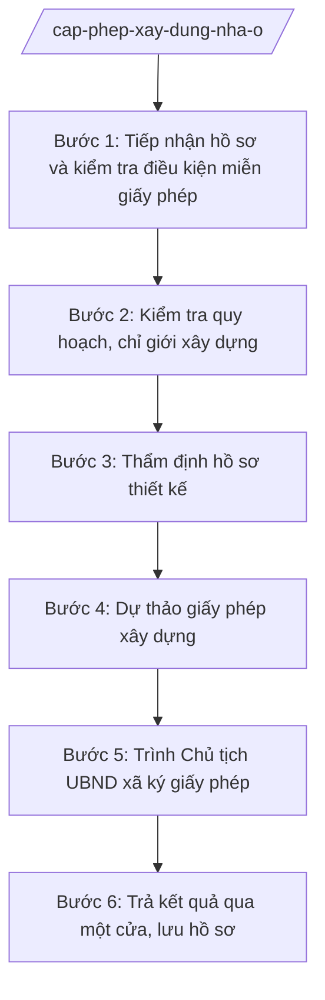

# Skill: Cấp phép xây dựng nhà ở riêng lẻ

## 2. Khi nào dùng

- Hộ gia đình, cá nhân nộp hồ sơ đề nghị cấp giấy phép xây dựng nhà ở riêng lẻ.
- Kiểm tra trường hợp được miễn giấy phép xây dựng (nhà ở riêng lẻ ở nông thôn thuộc khu vực chưa có quy hoạch theo quy định) để ra văn bản hướng dẫn thay vì cấp phép.
- Đề nghị điều chỉnh, gia hạn, cấp lại giấy phép xây dựng nhà ở riêng lẻ đã cấp.
- Trả lời, hướng dẫn người dân về điều kiện, thủ tục xây dựng nhà ở riêng lẻ.
- Trả kết quả qua bộ phận một cửa và lưu hồ sơ cấp phép xây dựng.

## 3. Đầu vào (Input)

| Trường | Mô tả | Bắt buộc |
|--------|-------|----------|
| `ho_ten_chu_dau_tu` | Họ tên hộ gia đình, cá nhân đề nghị cấp phép | Có |
| `dia_diem_xay_dung` | Địa điểm xây dựng (số nhà, thôn, xã) | Có |
| `loai_cong_trinh` | Nhà ở riêng lẻ (nông thôn / đô thị) | Có |
| `dien_tich_xay_dung` | Diện tích xây dựng dự kiến (m²) | Có |
| `so_tang` | Số tầng dự kiến | Có |
| `giay_to_quyen_sd_dat` | Giấy tờ về quyền sử dụng đất của địa điểm xây dựng | Có |
| `ho_so_thiet_ke` | Hồ sơ thiết kế xây dựng kèm theo | Có |
| `thong_tin_quy_hoach` | Khu vực xây dựng đã có / chưa có quy hoạch được duyệt | Có |
| `ngay_nop_hs` | Ngày nộp hồ sơ tại Trung tâm PVHCC | Có |

## 4. Quy trình

**Bước 1. Tiếp nhận hồ sơ và kiểm tra điều kiện miễn giấy phép**

- Làm gì: Công chức Trung tâm PVHCC xã A tiếp nhận hồ sơ, kiểm tra tính đầy đủ; công chức xây dựng (Phòng Kinh tế) kiểm tra ngay điều kiện miễn giấy phép: nếu là nhà ở riêng lẻ ở nông thôn thuộc khu vực chưa có quy hoạch theo quy định → thuộc diện miễn giấy phép → chuyển sang soạn văn bản trả lời, hướng dẫn người dân (không cấp phép); nếu không thuộc diện miễn → tiếp tục các bước thẩm định cấp phép.
- Dùng input: `ho_ten_chu_dau_tu`, `loai_cong_trinh`, `thong_tin_quy_hoach`, `dia_diem_xay_dung`, giay_to_kem_theo (`giay_to_quyen_sd_dat`, `ho_so_thiet_ke`), `ngay_nop_hs`.
- Vai trò: Công chức Trung tâm PVHCC tiếp nhận; công chức xây dựng – Phòng Kinh tế xã A kiểm tra điều kiện miễn phép; AI hỗ trợ checklist hồ sơ, đối chiếu điều kiện miễn phép theo quy định, soạn văn bản hướng dẫn trường hợp miễn ⏱ ~0,5 ngày (ước tính).
- Lưu ý nghiệp vụ: Kiểm tra miễn phép là bước bắt buộc đầu tiên, không được bỏ qua; xác định đúng "khu vực chưa có quy hoạch theo quy định" dựa trên hồ sơ quy hoạch của xã, không suy đoán. Trường hợp miễn phép vẫn phải hướng dẫn người dân tuân thủ quy định về an toàn, vệ sinh môi trường, không lấn chiếm.
- → Kết quả bước: Phân nhánh rõ: (a) văn bản trả lời, hướng dẫn trường hợp miễn giấy phép; hoặc (b) hồ sơ đủ điều kiện chuyển sang thẩm định cấp phép.

**Bước 2. Kiểm tra quy hoạch, chỉ giới xây dựng**

- Làm gì: Đối chiếu địa điểm xây dựng với quy hoạch được duyệt, chỉ giới xây dựng, chỉ giới đường đỏ, hành lang bảo vệ công trình hạ tầng kỹ thuật; xác định mật độ xây dựng, chiều cao tối đa cho phép tại vị trí đề nghị.
- Dùng input: `dia_diem_xay_dung`, `dien_tich_xay_dung`, `so_tang`, `thong_tin_quy_hoach`.
- Vai trò: Công chức xây dựng – Phòng Kinh tế xã A kiểm tra, đối chiếu; AI hỗ trợ tra cứu hồ sơ quy hoạch, lập bảng đối chiếu chỉ tiêu đề nghị với chỉ tiêu cho phép ⏱ ~0,5–1 ngày (ước tính).
- Lưu ý nghiệp vụ: Nếu vị trí xây dựng vi phạm chỉ giới, hành lang bảo vệ hoặc vượt chỉ tiêu quy hoạch → dự thảo văn bản từ chối cấp phép, nêu rõ lý do; không "linh động" cho qua.
- → Kết quả bước: Kết quả đối chiếu quy hoạch, chỉ giới (đạt/không đạt từng chỉ tiêu).

**Bước 3. Thẩm định hồ sơ thiết kế**

- Làm gì: Thẩm định hồ sơ thiết kế xây dựng: sự phù hợp với quy chuẩn, tiêu chuẩn xây dựng; kết cấu, an toàn chịu lực; phòng cháy chữa cháy; vệ sinh môi trường; đối chiếu giấy tờ về quyền sử dụng đất với địa điểm xây dựng.
- Dùng input: `ho_so_thiet_ke`, `giay_to_quyen_sd_dat`, `dien_tich_xay_dung`, `so_tang`.
- Vai trò: Công chức xây dựng – Phòng Kinh tế xã A thẩm định (phối hợp đơn vị chuyên môn khi cần); AI hỗ trợ checklist thẩm định, soạn biên bản thẩm định ⏱ ~1–2 ngày (ước tính).
- Lưu ý nghiệp vụ: Hồ sơ thiết kế không đạt → yêu cầu bổ sung, chỉnh sửa 01 lần bằng văn bản, ghi rõ nội dung cần hoàn thiện; giấy tờ về quyền sử dụng đất phải hợp lệ, đúng địa điểm xây dựng.
- → Kết quả bước: Biên bản thẩm định hồ sơ thiết kế (đạt / cần bổ sung).

**Bước 4. Dự thảo giấy phép xây dựng**

- Làm gì: Khi hồ sơ đạt yêu cầu, công chức xây dựng dự thảo giấy phép xây dựng: ghi đầy đủ thông tin chủ đầu tư, địa điểm, nội dung được phép (diện tích, số tầng, chiều cao, mật độ), thời hạn khởi công, các điều kiện và yêu cầu phải tuân thủ.
- Dùng input: `ho_ten_chu_dau_tu`, `dia_diem_xay_dung`, `dien_tich_xay_dung`, `so_tang` + kết quả Bước 2, 3.
- Vai trò: Công chức xây dựng soạn dự thảo (AI hỗ trợ soạn, kiểm tra tính đầy đủ các nội dung bắt buộc của giấy phép); Trưởng phòng Kinh tế – Bà Hoàng Thị D kiểm tra, ký nháy ⏱ ~0,5 ngày (ước tính).
- Lưu ý nghiệp vụ: Nội dung được phép phải khớp với hồ sơ thiết kế đã thẩm định đạt; ghi rõ thời hạn khởi công và nghĩa vụ thông báo khởi công, tuân thủ an toàn, vệ sinh môi trường trong quá trình xây dựng.
- → Kết quả bước: Dự thảo giấy phép xây dựng đã được Trưởng phòng Kinh tế kiểm tra.

**Bước 5. Trình Chủ tịch UBND xã ký giấy phép**

- Làm gì: Trình hồ sơ, biên bản thẩm định và dự thảo giấy phép lên Chủ tịch UBND xã A xem xét, ký ban hành theo phân cấp; văn thư đánh số, đóng dấu.
- Dùng input: dự thảo giấy phép (từ Bước 4).
- Vai trò: Văn phòng HĐND&UBND trình hồ sơ; Chủ tịch UBND xã – Ông Nguyễn Văn A xem xét, ký giấy phép; văn thư hoàn thiện; AI hỗ trợ: kiểm tra thể thức, số giấy phép trước khi trình ký ⏱ ~0,5 ngày (chưa tính thời gian chờ lãnh đạo) (ước tính).
- Lưu ý nghiệp vụ: Chỉ Chủ tịch UBND xã ký giấy phép xây dựng theo phân cấp; số giấy phép lấy theo sổ đăng ký; không cấp phép khi hồ sơ chưa thẩm định đạt.
- → Kết quả bước: Giấy phép xây dựng đã ký, đóng dấu.

**Bước 6. Trả kết quả qua một cửa, lưu hồ sơ**

- Làm gì: Trả giấy phép xây dựng (hoặc văn bản trả lời trường hợp miễn phép/từ chối) cho người đề nghị qua Trung tâm PVHCC; thu phí, lệ phí theo quy định (nếu có); lưu hồ sơ cấp phép; cập nhật sổ theo dõi để phục vụ quản lý trật tự xây dựng sau cấp phép.
- Dùng input: giấy phép đã ký (hoặc văn bản trả lời), `ho_ten_chu_dau_tu`, `ngay_nop_hs`.
- Vai trò: Công chức Trung tâm PVHCC xã A trả kết quả; công chức xây dựng lưu hồ sơ, cập nhật sổ theo dõi; AI hỗ trợ lập sổ theo dõi cấp phép ⏱ ~0,5 ngày (ước tính).
- Lưu ý nghiệp vụ: Trả kết quả đúng hẹn trên phiếu tiếp nhận; hồ sơ lưu phải đầy đủ: đơn đề nghị, giấy tờ về quyền sử dụng đất, hồ sơ thiết kế, biên bản thẩm định, giấy phép bản lưu.
- → Kết quả bước: Người dân nhận được giấy phép/văn bản trả lời; hồ sơ lưu đầy đủ; sổ theo dõi được cập nhật.

## Luồng quy trình (Workflow)

## 5. Đầu ra (Output)

- Giấy phép xây dựng nhà ở riêng lẻ (Chủ tịch UBND xã ký theo phân cấp).
- Văn bản trả lời, hướng dẫn trường hợp miễn giấy phép xây dựng.
- Biên bản thẩm định hồ sơ thiết kế.
- Sổ theo dõi cấp giấy phép xây dựng.

### Cấu trúc output chuẩn

Khung cố định của Giấy phép xây dựng, các phần bắt buộc theo đúng thứ tự, đúng thể thức NĐ 30/2020/NĐ-CP:

1. **Quốc hiệu – tiêu ngữ** (canh giữa, phía trên cùng): CỘNG HÒA XÃ HỘI CHỦ NGHĨA VIỆT NAM / Độc lập – Tự do – Hạnh phúc
2. **Tên cơ quan ban hành** (canh trái): ỦY BAN NHÂN DÂN XÃ A
3. **Số giấy phép** (dưới tên cơ quan, canh trái): Số: .../GPXD
4. **Địa danh, ngày tháng năm ban hành** (canh phải): Xã A, ngày ... tháng ... năm ...
5. **Tên loại** (canh giữa): GIẤY PHÉP XÂY DỰNG
6. **Nội dung**: Cấp cho ông (bà) ... (địa chỉ); được phép xây dựng công trình: nhà ở riêng lẻ tại ... (địa điểm); nội dung được phép: diện tích xây dựng ... m², số tầng ..., chiều cao ..., mật độ xây dựng ...%, chỉ giới xây dựng ...; thời hạn khởi công: 12 tháng kể từ ngày cấp phép; các yêu cầu, điều kiện: thông báo thời điểm khởi công cho UBND xã; bảo đảm an toàn, vệ sinh môi trường; không lấn chiếm đất đai, hành lang an toàn; tuân thủ đúng nội dung được cấp phép.
7. **Nơi nhận** (cuối văn bản, canh trái): người được cấp phép; Phòng Kinh tế xã A; Trung tâm PVHCC xã A; Lưu: VT, XD.
8. **Chữ ký, chức vụ người ký** (canh phải): "TM. ỦY BAN NHÂN DÂN" / CHỦ TỊCH / họ tên người ký; đóng dấu UBND xã.

## 6. Checklist nghiệm thu

1. Giấy phép có đủ 8 thành phần thể thức theo đúng thứ tự mục 5, không thiếu mục nào.
2. Bước 1 đã kiểm tra điều kiện miễn giấy phép trước khi xem xét cấp phép; trường hợp miễn phép có văn bản trả lời, hướng dẫn thay vì giấy phép.
3. Địa điểm xây dựng phù hợp quy hoạch, không vi phạm chỉ giới xây dựng, hành lang bảo vệ.
4. Hồ sơ thiết kế đã thẩm định đạt; nội dung được phép trong giấy phép khớp với hồ sơ thiết kế.
5. Giấy tờ về quyền sử dụng đất hợp lệ, đúng địa điểm xây dựng.
6. Người ký là Chủ tịch UBND xã; có đóng dấu UBND xã; số giấy phép đúng định dạng ".../GPXD", không trùng số.
7. Ghi rõ thời hạn khởi công và các điều kiện, yêu cầu phải tuân thủ.
8. Trả kết quả đúng hẹn; hồ sơ lưu đầy đủ (đơn, giấy tờ đất đai, hồ sơ thiết kế, biên bản thẩm định, giấy phép bản lưu).
9. Không bịa số liệu, căn cứ pháp lý; mọi chỉ tiêu đều có căn cứ từ hồ sơ thẩm định.
10. Đã qua human gate: công chức xây dựng thẩm định → Trưởng phòng Kinh tế kiểm tra → Chủ tịch UBND xã ký.

## 7. Ví dụ mô phỏng

*Dữ liệu dưới đây là giả lập 100% phục vụ minh họa.*

### Input mẫu

| Trường | Giá trị |
|--------|---------|
| ho_ten_chu_dau_tu | Ông Nguyễn Văn Dân |
| dia_diem_xay_dung | Thôn 1, xã A |
| loai_cong_trinh | Nhà ở riêng lẻ nông thôn |
| dien_tich_xay_dung | 100 m² |
| so_tang | 02 tầng |
| giay_to_quyen_sd_dat | Giấy tờ về quyền sử dụng đất tại thôn 1, xã A |
| ho_so_thiet_ke | Bản vẽ mặt bằng, mặt đứng, mặt cắt công trình |
| thong_tin_quy_hoach | Khu vực đã có quy hoạch được duyệt → thuộc diện phải cấp phép |
| ngay_nop_hs | 05/10/2026 |

### Output mẫu

CỘNG HÒA XÃ HỘI CHỦ NGHĨA VIỆT NAM
Độc lập – Tự do – Hạnh phúc

ỦY BAN NHÂN DÂN XÃ A			Số: 45/GPXD

						Xã A, ngày 09 tháng 10 năm 2026

GIẤY PHÉP XÂY DỰNG

Cấp cho ông Nguyễn Văn Dân, địa chỉ: thôn 1, xã A.

Được phép xây dựng công trình: nhà ở riêng lẻ tại thôn 1, xã A.

Nội dung được phép xây dựng:
- Diện tích xây dựng: 100 m²;
- Số tầng: 02 tầng; chiều cao công trình: 8 m;
- Mật độ xây dựng: 50%;
- Chỉ giới xây dựng: trùng chỉ giới đường đỏ theo quy hoạch được duyệt.

Thời hạn khởi công: 12 tháng kể từ ngày cấp giấy phép.

Các yêu cầu, điều kiện:
- Thông báo thời điểm khởi công cho UBND xã A trước khi thi công;
- Bảo đảm an toàn lao động, vệ sinh môi trường trong quá trình xây dựng;
- Không lấn chiếm đất đai, hành lang an toàn công trình hạ tầng;
- Xây dựng đúng nội dung được cấp phép; mọi thay đổi phải được chấp thuận bằng văn bản.

Nơi nhận:
- Ông Nguyễn Văn Dân;
- Phòng Kinh tế xã A;
- Trung tâm PVHCC xã A;
- Lưu: VT, XD (2b).

TM. ỦY BAN NHÂN DÂN
CHỦ TỊCH

Nguyễn Văn A

## 8. Human gate

- **Công chức xây dựng – Phòng Kinh tế xã A** → kiểm tra điều kiện miễn phép, thẩm định hồ sơ thiết kế, soạn dự thảo giấy phép; chịu trách nhiệm về tính chính xác của nội dung thẩm định.
- **Trưởng phòng Kinh tế xã A (Bà Hoàng Thị D)** → kiểm tra hồ sơ và dự thảo giấy phép; ký nháy trước khi trình.
- **Chủ tịch UBND xã A (Ông Nguyễn Văn A)** → xem xét, ký ban hành giấy phép xây dựng theo phân cấp.
- Không cấp phép khi chưa có chữ ký của Chủ tịch UBND xã; không bỏ qua bước kiểm tra miễn phép.

## 9. Giới hạn

- AI KHÔNG tự kết luận hồ sơ đạt hay không đạt thay người có thẩm quyền thẩm định; chỉ hỗ trợ đối chiếu, lập checklist.
- AI KHÔNG tự cấp, tự ký giấy phép xây dựng dưới bất kỳ hình thức nào.
- AI KHÔNG bỏ qua bước kiểm tra điều kiện miễn giấy phép; không cấp phép cho trường hợp thuộc diện miễn.
- AI KHÔNG bịa số liệu diện tích, số tầng, thông tin quy hoạch, căn cứ pháp lý; mọi chỉ tiêu phải từ hồ sơ thẩm định.
- AI KHÔNG viện dẫn văn bản đã hết hiệu lực.

## 10. Căn cứ & lưu ý

- TT 10/2025/TT-BXD: hướng dẫn chức năng, nhiệm vụ, quyền hạn của Sở Xây dựng và lĩnh vực xây dựng của phòng chuyên môn thuộc UBND cấp xã — căn cứ xác định nhiệm vụ cấp phép xây dựng của Phòng Kinh tế xã A.
- Luật Xây dựng: quy định về giấy phép xây dựng, các trường hợp được miễn giấy phép xây dựng (chỉ nêu tên luật, không kèm số hiệu).
- NĐ 118/2025/NĐ-CP: tiếp nhận, trả kết quả qua Trung tâm PVHCC theo cơ chế một cửa.
- NĐ 30/2020/NĐ-CP: thể thức, kỹ thuật trình bày giấy phép xây dựng.
- Lưu ý: thẩm quyền cấp giấy phép xây dựng nhà ở riêng lẻ của Chủ tịch UBND xã thực hiện theo phân cấp hiện hành; khi xã tổ chức khác khung chuẩn (NĐ 370/2025/NĐ-CP), đối chiếu bảng mapping lĩnh vực → đầu mối trong khung-phong-ban-cap-xa.md.
