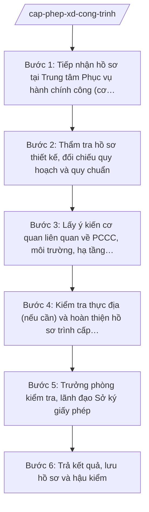

# Skill: Cấp phép xây dựng công trình (theo phân cấp)

## 2. Khi nào dùng

- Tổ chức, chủ đầu tư nộp hồ sơ đề nghị cấp giấy phép xây dựng công trình thuộc thẩm quyền của Sở Xây dựng tỉnh A theo phân định thẩm quyền và phân quyền, phân cấp lĩnh vực xây dựng (mô hình chính quyền địa phương 2 cấp);
- Cần thẩm tra hồ sơ thiết kế xây dựng về sự phù hợp với quy hoạch, quy chuẩn, tiêu chuẩn xây dựng;
- Cần lấy ý kiến các cơ quan liên quan (PCCC, môi trường, hạ tầng kỹ thuật) trước khi cấp phép;
- Cần soạn quyết định cấp giấy phép xây dựng, trình ký, trả kết quả cho chủ đầu tư và lưu hồ sơ theo quy định.

## 3. Đầu vào (Input)

| Trường | Mô tả | Bắt buộc |
|--------|-------|----------|
| `ten_chu_dau_tu` | Tên tổ chức/chủ đầu tư đề nghị cấp phép | Có |
| `ten_cong_trinh` | Tên công trình xây dựng | Có |
| `dia_diem_xay_dung` | Địa điểm xây dựng (xã/phường, vị trí) | Có |
| `loai_cap_cong_trinh` | Loại, cấp công trình | Có |
| `ho_so_thiet_ke` | Hồ sơ thiết kế xây dựng triển khai sau thiết kế cơ sở | Có |
| `giay_to_ve_dat` | Giấy tờ chứng minh quyền sử dụng đất/quyền sử dụng địa điểm xây dựng | Có |
| `van_ban_chap_thuan` | Văn bản chấp thuận chủ trương đầu tư/quyết định phê duyệt dự án (nếu thuộc trường hợp) | Có (khi thuộc trường hợp) |
| `ket_qua_tham_dinh_tk` | Kết quả thẩm định thiết kế của cơ quan chuyên môn (nếu có) | Không |

## 4. Quy trình

**Bước 1. Tiếp nhận hồ sơ tại Trung tâm Phục vụ hành chính công (cơ chế một cửa)**
- Làm gì: Tiếp nhận hồ sơ đề nghị cấp giấy phép xây dựng; kiểm tra tính đầy đủ, hợp lệ của thành phần hồ sơ; viết giấy hẹn trả kết quả; chuyển hồ sơ về Phòng Quản lý xây dựng thụ lý.
- Dùng input: `ten_chu_dau_tu`, `ten_cong_trinh`, `dia_diem_xay_dung`, `loai_cap_cong_trinh`, `ho_so_thiet_ke`, `giay_to_ve_dat`, `van_ban_chap_thuan`.
- Vai trò: Công chức Trung tâm PVHCC tiếp nhận, AI hỗ trợ đối chiếu danh mục hồ sơ theo checklist, in giấy hẹn; ⏱ ~0 (ước tính),5 ngày làm việc.
- Lưu ý nghiệp vụ: Thực hiện theo cơ chế một cửa, một cửa liên thông; hồ sơ thiếu hướng dẫn bổ sung một lần bằng văn bản; thời hạn giải quyết tính từ ngày nhận đủ hồ sơ hợp lệ.
- → Kết quả bước: Hồ sơ đã tiếp nhận + giấy hẹn trả kết quả + phiếu chuyển hồ sơ về Phòng Quản lý xây dựng.

**Bước 2. Thẩm tra hồ sơ thiết kế, đối chiếu quy hoạch và quy chuẩn**
- Làm gì: Kiểm tra sự phù hợp của hồ sơ thiết kế với quy hoạch xây dựng được duyệt, quy chuẩn kỹ thuật quốc gia, tiêu chuẩn áp dụng; kiểm tra tính pháp lý của giấy tờ về đất đai, văn bản chấp thuận đầu tư; lập phiếu thẩm tra ghi rõ nội dung đạt/chưa đạt.
- Dùng input: `ho_so_thiet_ke`, `giay_to_ve_dat`, `van_ban_chap_thuan`, `ket_qua_tham_dinh_tk`, `dia_diem_xay_dung`.
- Vai trò: Chuyên viên Phòng Quản lý xây dựng thẩm tra, AI hỗ trợ lập phiếu thẩm tra, đối chiếu chỉ tiêu quy hoạch — kiến trúc (mật độ, tầng cao, chỉ giới) với quy hoạch được duyệt, liệt kê điểm chưa phù hợp; ⏱ ~5–7 ngày làm việc (ước tính).
- Lưu ý nghiệp vụ: Công trình không phù hợp quy hoạch hoặc vi phạm quy chuẩn thì không đủ điều kiện cấp phép; mọi nhận xét phải viện dẫn căn cứ cụ thể.
- → Kết quả bước: Phiếu thẩm tra hồ sơ thiết kế (đạt / cần bổ sung, chỉnh sửa).

**Bước 3. Lấy ý kiến cơ quan liên quan về PCCC, môi trường, hạ tầng kỹ thuật**
- Làm gì: Soạn công văn lấy ý kiến cơ quan PCCC, cơ quan quản lý môi trường, đơn vị quản lý hạ tầng kỹ thuật (điện, cấp thoát nước, giao thông) đối với công trình thuộc trường hợp phải lấy ý kiến; tổng hợp ý kiến, yêu cầu chủ đầu tư giải trình, bổ sung.
- Dùng input: Kết quả Bước 2, hồ sơ thiết kế.
- Vai trò: Chuyên viên Phòng Quản lý xây dựng soạn công văn, AI hỗ trợ tổng hợp ý kiến thành bảng, soạn văn bản yêu cầu chủ đầu tư bổ sung/giải trình; ⏱ ~7–10 ngày làm việc (ước tính).
- Lưu ý nghiệp vụ: Chỉ lấy ý kiến đối với trường hợp pháp luật quy định; đặt thời hạn trả lời rõ ràng cho cơ quan được lấy ý kiến.
- → Kết quả bước: Bảng tổng hợp ý kiến cơ quan liên quan + hồ sơ thiết kế đã được chủ đầu tư bổ sung, hoàn thiện.

**Bước 4. Kiểm tra thực địa (nếu cần) và hoàn thiện hồ sơ trình cấp phép**
- Làm gì: Tổ chức kiểm tra thực địa địa điểm xây dựng khi cần xác minh hiện trạng (ranh giới, hiện trạng sử dụng đất, công trình lân cận); lập biên bản kiểm tra; tập hợp đầy đủ hồ sơ, soạn dự thảo giấy phép xây dựng.
- Dùng input: `dia_diem_xay_dung`, kết quả Bước 2–3.
- Vai trò: Chuyên viên Phòng Quản lý xây dựng kiểm tra thực địa, AI hỗ trợ soạn biên bản kiểm tra, soạn dự thảo giấy phép xây dựng đúng mẫu, kiểm tra tính thống nhất thông tin (tên công trình, địa điểm, quy mô) trong toàn bộ hồ sơ; ⏱ ~2–3 ngày làm việc (ước tính).
- Lưu ý nghiệp vụ: Biên bản kiểm tra thực địa phải có chữ ký của các bên tham gia; nội dung giấy phép phải khớp với hồ sơ thiết kế đã thẩm tra.
- → Kết quả bước: Biên bản kiểm tra thực địa (nếu có) + dự thảo giấy phép xây dựng + bộ hồ sơ trình ký.

**Bước 5. Trưởng phòng kiểm tra, lãnh đạo Sở ký giấy phép**
- Làm gì: Trưởng phòng Quản lý xây dựng kiểm tra lần cuối tính hợp pháp, đầy đủ của hồ sơ; lãnh đạo Sở xem xét, ký giấy phép xây dựng; đóng dấu, vào sổ cấp phép.
- Dùng input: Toàn bộ hồ sơ trình cấp phép ở Bước 4.
- Vai trò: Trưởng phòng Quản lý xây dựng kiểm tra, Phó Giám đốc/Giám đốc Sở ký giấy phép; AI hỗ trợ rà soát lỗi thể thức trên dự thảo giấy phép; ⏱ ~2–3 ngày làm việc (ước tính).
- Lưu ý nghiệp vụ: Thẩm quyền ký giấy phép thuộc lãnh đạo Sở theo phân cấp; AI tuyệt đối không thay người ký. Trường hợp không đủ điều kiện cấp phép phải có văn bản trả lời nêu rõ lý do.
- → Kết quả bước: Giấy phép xây dựng đã ký, đóng dấu + vào sổ cấp phép.

**Bước 6. Trả kết quả, lưu hồ sơ và hậu kiểm**
- Làm gì: Trả giấy phép xây dựng cho chủ đầu tư tại Trung tâm PVHCC theo giấy hẹn; lưu toàn bộ hồ sơ cấp phép; chuyển thông tin cho bộ phận thanh tra xây dựng để hậu kiểm việc tuân thủ giấy phép trong quá trình thi công.
- Dùng input: Giấy phép xây dựng đã ký, giấy hẹn trả kết quả.
- Vai trò: Công chức Trung tâm PVHCC trả kết quả, chuyên viên Phòng Quản lý xây dựng lưu hồ sơ; AI hỗ trợ cập nhật sổ theo dõi cấp phép, lập danh sách công trình đã cấp phép gửi bộ phận thanh tra; ⏱ ~0 (ước tính),5–1 ngày làm việc.
- Lưu ý nghiệp vụ: Chủ đầu tư ký nhận vào sổ giao nhận; hồ sơ bản lưu đầy đủ phục vụ thanh tra, kiểm tra và giải quyết khiếu nại về sau.
- → Kết quả bước: Giấy phép đã trao cho chủ đầu tư; hồ sơ cấp phép lưu trữ đầy đủ; danh sách hậu kiểm đã chuyển.

## Luồng quy trình (Workflow)

## 5. Đầu ra (Output)

- Giấy hẹn trả kết quả (cơ chế một cửa);
- Phiếu thẩm tra hồ sơ thiết kế;
- Công văn lấy ý kiến cơ quan liên quan + bảng tổng hợp ý kiến;
- Biên bản kiểm tra thực địa (nếu có);
- Giấy phép xây dựng (lãnh đạo Sở ký, đóng dấu);
- Văn bản từ chối cấp phép nêu rõ lý do (nếu không đủ điều kiện);
- Sổ cấp giấy phép xây dựng (bản cập nhật);
- Bộ hồ sơ cấp phép bản lưu.

**Cấu trúc output chuẩn (Giấy phép xây dựng):**
- Thể thức: tuân thủ Nghị định 30/2020/NĐ-CP về công tác văn thư.

1. Quốc hiệu "CỘNG HÒA XÃ HỘI CHỦ NGHĨA VIỆT NAM", Tiêu ngữ "Độc lập – Tự do – Hạnh phúc";
2. Tên cơ quan cấp phép: SỞ XÂY DỰNG TỈNH A; số giấy phép, ký hiệu; địa danh và ngày, tháng, năm cấp;
3. Tên loại: GIẤY PHÉP XÂY DỰNG;
4. Nội dung: tên chủ đầu tư; tên công trình; địa điểm xây dựng; loại, cấp công trình; quy mô (diện tích, tầng cao, tổng diện tích sàn...); thời hạn khởi công; các điều kiện, yêu cầu phải tuân thủ trong quá trình thi công;
5. Căn cứ (Luật Xây dựng; văn bản về phân định thẩm quyền, phân quyền, phân cấp lĩnh vực xây dựng; hồ sơ thiết kế đã thẩm tra...);
6. Thẩm quyền, chức vụ, họ tên người ký: GIÁM ĐỐC (hoặc PHÓ GIÁM ĐỐC được ủy quyền) — (chữ ký, họ tên), dấu của cơ quan.
- Nơi nhận: liệt kê các cơ quan, đơn vị nhận để biết/thực hiện; kết thúc bằng "- Lưu: VT, [mã đơn vị]".

> **Checklist thể thức văn bản theo NĐ 30/2020/NĐ-CP** — đối chiếu trước khi trình ký:
> 1. Quốc hiệu và Tiêu ngữ.
> 2. Tên cơ quan, tổ chức ban hành văn bản.
> 3. Số, ký hiệu của văn bản.
> 4. Địa danh và thời gian ban hành văn bản.
> 5. Tên loại và trích yếu nội dung văn bản.
> 6. Nội dung văn bản.
> 7. Chức vụ, họ tên và chữ ký của người có thẩm quyền.
> 8. Dấu, chữ ký số của cơ quan, tổ chức.
> 9. Nơi nhận (kèm Phụ lục nếu có).

## 6. Checklist nghiệm thu

- [ ] Hồ sơ tiếp nhận đầy đủ thành phần, có giấy hẹn trả kết quả theo cơ chế một cửa;
- [ ] Công trình thuộc thẩm quyền cấp phép của Sở Xây dựng tỉnh A theo phân cấp;
- [ ] Hồ sơ thiết kế phù hợp quy hoạch được duyệt, quy chuẩn kỹ thuật quốc gia;
- [ ] Giấy tờ về đất đai, văn bản chấp thuận đầu tư hợp lệ (nếu thuộc trường hợp);
- [ ] Đã lấy ý kiến đầy đủ cơ quan liên quan đối với trường hợp bắt buộc;
- [ ] Nội dung giấy phép thống nhất với hồ sơ thiết kế đã thẩm tra;
- [ ] Giấy phép do lãnh đạo Sở ký, đóng dấu, vào sổ cấp phép;
- [ ] Trường hợp từ chối: có văn bản trả lời nêu rõ lý do;
- [ ] Đã trả kết quả đúng hẹn, có ký nhận; hồ sơ bản lưu đầy đủ;
- [ ] Đã chuyển danh sách công trình cấp phép cho bộ phận thanh tra để hậu kiểm.

## 7. Ví dụ mô phỏng

*Dữ liệu dưới đây là giả lập 100% phục vụ minh họa.*

### Input mẫu

| Trường | Giá trị giả lập |
|--------|-----------------|
| ten_chu_dau_tu | Công ty Cổ phần Đầu tư Xây dựng A |
| ten_cong_trinh | Nhà xưởng sản xuất linh kiện điện tử |
| dia_diem_xay_dung | Cụm công nghiệp phía Bắc, xã A, tỉnh A |
| loai_cap_cong_trinh | Công trình công nghiệp, cấp II |
| ho_so_thiet_ke | Hồ sơ thiết kế bản vẽ thi công: 30 bản vẽ + thuyết minh |
| giay_to_ve_dat | Hợp đồng thuê đất 50 năm trong cụm công nghiệp (bản sao công chứng) |
| van_ban_chap_thuan | Quyết định chấp thuận chủ trương đầu tư số 1234/QĐ-UBND |

### Output mẫu (Giấy phép xây dựng — trích)

> **CỘNG HÒA XÃ HỘI CHỦ NGHĨA VIỆT NAM**
> **Độc lập – Tự do – Hạnh phúc**
>
> Số: 1234/GPXD
> *Tỉnh A, ngày 20 tháng 3 năm 2027*
>
> **GIẤY PHÉP XÂY DỰNG**
>
> Căn cứ Luật Xây dựng; văn bản quy định về phân định thẩm quyền chính quyền địa phương 2 cấp, phân quyền, phân cấp trong lĩnh vực quản lý nhà nước của Bộ Xây dựng; Thông tư 10/2025/TT-BXD ngày 14/6/2025 của Bộ Xây dựng; ...
>
> SỞ XÂY DỰNG TỈNH A CẤP GIẤY PHÉP XÂY DỰNG:
>
> 1. Chủ đầu tư: Công ty Cổ phần Đầu tư Xây dựng A.
> 2. Công trình: Nhà xưởng sản xuất linh kiện điện tử; công trình công nghiệp cấp II.
> 3. Địa điểm xây dựng: Cụm công nghiệp phía Bắc, xã A, tỉnh A.
> 4. Quy mô: diện tích xây dựng 5.000 m²; 01 tầng, chiều cao 12 m; tổng diện tích sàn 5.000 m².
> 5. Thời hạn khởi công: trong vòng 12 tháng kể từ ngày cấp giấy phép.
> 6. Chủ đầu tư phải tuân thủ hồ sơ thiết kế đã được thẩm tra, quy chuẩn, tiêu chuẩn xây dựng và các quy định về an toàn lao động, vệ sinh môi trường trong quá trình thi công...
>
> **GIÁM ĐỐC**
> *(Chữ ký, dấu)*
> **Hoàng Văn S**

## 8. Human gate

- Công chức Trung tâm PVHCC tiếp nhận hồ sơ (cơ chế một cửa);
- Chuyên viên Phòng Quản lý xây dựng thẩm tra hồ sơ thiết kế;
- Trưởng phòng Quản lý xây dựng kiểm tra lần cuối;
- Phó Giám đốc/Giám đốc Sở Xây dựng tỉnh A ký giấy phép xây dựng (AI không thay người ký).

## 9. Giới hạn

- AI KHÔNG cấp phép, không ký giấy phép thay lãnh đạo Sở; không tự phát hành văn bản hành chính;
- Không bịa số liệu thiết kế, căn cứ pháp lý; chỉ viện dẫn văn bản còn hiệu lực, có thật trong `tai-lieu-moi-nhat.md`;
- Không cấp phép cho công trình không thuộc thẩm quyền của Sở hoặc không đủ điều kiện pháp lý;
- Không dùng văn bản đã hết hiệu lực (vd: NĐ 45/2025/NĐ-CP đã bị NĐ 150/2025/NĐ-CP thay thế).

## 10. Căn cứ & lưu ý

- NĐ 140/2025/NĐ-CP ngày 12/6/2025 — phân định thẩm quyền CQĐP 2 cấp trong lĩnh vực quản lý nhà nước của Bộ Xây dựng;
- NĐ 144/2025/NĐ-CP ngày 12/6/2025 — phân quyền, phân cấp trong lĩnh vực quản lý nhà nước của Bộ Xây dựng;
- TT 10/2025/TT-BXD ngày 14/6/2025 — hướng dẫn chức năng, nhiệm vụ, quyền hạn của Sở Xây dựng, Sở Quy hoạch – Kiến trúc và lĩnh vực xây dựng cấp xã;
- NĐ 118/2025/NĐ-CP ngày 09/6/2025 — cơ chế một cửa, một cửa liên thông trong giải quyết thủ tục hành chính;
- NĐ 150/2025/NĐ-CP (hiệu lực 16/6/2025); NĐ 370/2025/NĐ-CP sửa đổi, bổ sung;
- NĐ 30/2020/NĐ-CP — thể thức, kỹ thuật trình bày văn bản hành chính;
- Luật Xây dựng: chỉ nêu tên, không bịa số hiệu.
