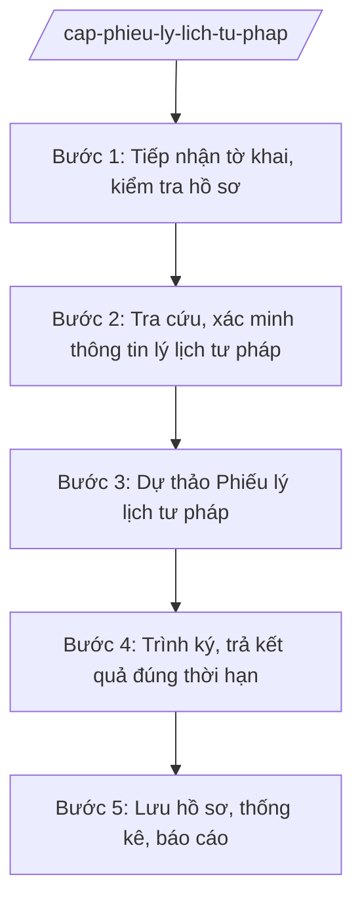

# Skill: Cấp phiếu lý lịch tư pháp

## 2. Khi nào dùng
- Công dân Việt Nam, người nước ngoài cư trú tại tỉnh yêu cầu cấp Phiếu lý lịch tư pháp số 1 (cá nhân, cơ quan, tổ chức yêu cầu) hoặc số 2 (cơ quan tố tụng yêu cầu).
- Cơ quan nhà nước, tổ chức chính trị, tổ chức chính trị – xã hội yêu cầu cấp Phiếu để phục vụ công tác cán bộ.
- Cần tra cứu, xác minh thông tin về án tích, tình trạng cấm đảm nhiệm chức vụ, thành lập, quản lý doanh nghiệp, hợp tác xã của đương sự.
- Cần trình ký Phiếu lý lịch tư pháp, trả kết quả đúng thời hạn và lưu hồ sơ, thống kê.

## 3. Đầu vào (Input)

| Trường | Mô tả | Bắt buộc |
|--------|-------|----------|
| `to_khai_yeu_cau` | Tờ khai yêu cầu cấp Phiếu lý lịch tư pháp theo mẫu | Có |
| `giay_to_tuy_than` | CCCD/hộ chiếu của người yêu cầu (bản sao, xuất trình bản chính để đối chiếu) | Có |
| `loai_phieu` | Phiếu số 1 hoặc Phiếu số 2 | Có |
| `doi_tuong_yeu_cau` | Cá nhân / cơ quan, tổ chức yêu cầu cấp Phiếu | Có |
| `van_ban_uy_quyen` | Văn bản ủy quyền (nếu ủy quyền yêu cầu cấp Phiếu số 1) | Không |
| `thoi_han_giai_quyet` | Thời hạn cấp Phiếu theo quy định | Có |

## 4. Quy trình

**Bước 1. Tiếp nhận tờ khai, kiểm tra hồ sơ**
- Làm gì: Tiếp nhận tờ khai yêu cầu cấp Phiếu tại Trung tâm Phục vụ hành chính công tỉnh (trực tiếp, trực tuyến hoặc qua bưu chính); kiểm tra tính đầy đủ của tờ khai, giấy tờ tùy thân, văn bản ủy quyền (nếu có); kiểm tra thẩm quyền cấp Phiếu của Sở Tư pháp tỉnh A (nơi thường trú/tạm trú của đương sự); viết giấy hẹn.
- Dùng input: `to_khai_yeu_cau`, `giay_to_tuy_than`, `loai_phieu`, `doi_tuong_yeu_cau`, `van_ban_uy_quyen`.
- Vai trò: Chuyên viên Phòng Lý lịch tư pháp (Sở Tư pháp tỉnh A) tiếp nhận, kiểm tra. AI hỗ trợ kiểm tra tính đầy đủ hồ sơ theo checklist từng loại Phiếu, soạn giấy hẹn trả kết quả ⏱ ~0,5 ngày làm việc (ước tính).
- Lưu ý nghiệp vụ: Phiếu số 2 chỉ cấp theo yêu cầu của cơ quan tố tụng; trường hợp ủy quyền phải có văn bản ủy quyền hợp lệ; hồ sơ thiếu hướng dẫn bổ sung một lần bằng văn bản.
- → Kết quả bước: Hồ sơ hợp lệ được tiếp nhận + giấy hẹn trả kết quả; hồ sơ thiếu được hướng dẫn bổ sung.

**Bước 2. Tra cứu, xác minh thông tin lý lịch tư pháp**
- Làm gì: Tra cứu thông tin của đương sự trên Cơ sở dữ liệu lý lịch tư pháp; gửi văn bản xác minh đến cơ quan công an, tòa án nơi đương sự cư trú (khi cần); tổng hợp kết quả tra cứu, xác minh về án tích và tình trạng pháp lý khác.
- Dùng input: thông tin nhân thân trong tờ khai.
- Vai trò: Chuyên viên Phòng Lý lịch tư pháp thực hiện tra cứu, gửi xác minh. AI hỗ trợ soạn văn bản đề nghị xác minh, theo dõi thời hạn trả lời của cơ quan được đề nghị ⏱ ~theo thời hạn xác minh quy định (ước tính).
- Lưu ý nghiệp vụ: Thông tin tra cứu phải chính xác đến từng cá nhân (họ tên, ngày sinh, nơi cư trú); không nhầm lẫn giữa các trường hợp trùng tên; kết quả xác minh lưu đầy đủ vào hồ sơ.
- → Kết quả bước: Kết quả tra cứu, xác minh thông tin lý lịch tư pháp của đương sự.

**Bước 3. Dự thảo Phiếu lý lịch tư pháp**
- Làm gì: Dự thảo Phiếu lý lịch tư pháp số 1 hoặc số 2 theo đúng mẫu: thông tin nhân thân, tình trạng án tích (không có án tích / có án tích đã được xóa / chưa được xóa án tích), thông tin về cấm đảm nhiệm chức vụ, thành lập, quản lý doanh nghiệp, hợp tác xã (đối với Phiếu số 1 theo yêu cầu).
- Dùng input: kết quả tra cứu Bước 2, `loai_phieu`.
- Vai trò: Chuyên viên Phòng Lý lịch tư pháp dự thảo Phiếu. AI hỗ trợ điền mẫu Phiếu từ dữ liệu hồ sơ và kết quả tra cứu, kiểm tra tính thống nhất thông tin trước khi trình ký ⏱ ~0,5 ngày làm việc (ước tính).
- Lưu ý nghiệp vụ: Nội dung Phiếu phải phản ánh trung thực kết quả tra cứu, xác minh; phân biệt rõ nội dung Phiếu số 1 và Phiếu số 2; không ghi thêm thông tin ngoài mẫu quy định.
- → Kết quả bước: Dự thảo Phiếu lý lịch tư pháp đúng mẫu, thông tin chính xác, kèm hồ sơ trình ký.

**Bước 4. Trình ký, trả kết quả đúng thời hạn**
- Làm gì: Trình Giám đốc Sở Tư pháp (hoặc người được ủy quyền) ký Phiếu; đóng dấu; trả kết quả cho người yêu cầu theo giấy hẹn; thu phí theo quy định.
- Dùng input: dự thảo Phiếu, `thoi_han_giai_quyet`.
- Vai trò: Trưởng phòng Lý lịch tư pháp kiểm tra lần cuối; Giám đốc Sở ký Phiếu. AI hỗ trợ theo dõi thời hạn cấp Phiếu, cảnh báo hồ sơ sắp quá hạn ⏱ ~01 ngày làm việc (ước tính).
- Lưu ý nghiệp vụ: Trả kết quả đúng thời hạn; thông tin trên Phiếu là thông tin nhạy cảm, chỉ trả cho đúng người yêu cầu hoặc người được ủy quyền hợp lệ.
- → Kết quả bước: Phiếu lý lịch tư pháp đã ký, đóng dấu, trả cho người yêu cầu đúng hạn.

**Bước 5. Lưu hồ sơ, thống kê, báo cáo**
- Làm gì: Lưu trữ hồ sơ cấp Phiếu theo quy định (tờ khai, kết quả tra cứu, xác minh, bản lưu Phiếu); thống kê số lượng Phiếu đã cấp theo loại Phiếu, đối tượng; báo cáo định kỳ.
- Dùng input: hồ sơ cấp Phiếu, sổ theo dõi.
- Vai trò: Chuyên viên Phòng Lý lịch tư pháp lưu hồ sơ, thống kê. AI hỗ trợ tổng hợp thống kê theo loại Phiếu, đối tượng và soạn báo cáo định kỳ ⏱ ~01 ngày làm việc (ước tính).
- Lưu ý nghiệp vụ: Hồ sơ cấp Phiếu chứa thông tin cá nhân nhạy cảm, phải bảo mật, lưu trữ an toàn; chỉ cung cấp thông tin theo đúng quy định pháp luật.
- → Kết quả bước: Hồ sơ lưu trữ đầy đủ, bảo mật; báo cáo thống kê cấp Phiếu định kỳ.

## Luồng quy trình (Workflow)

## 5. Đầu ra (Output)

Sản phẩm:
- Phiếu lý lịch tư pháp số 1 / số 2 (đã ký, đóng dấu) — trả người yêu cầu
- Giấy hẹn trả kết quả; văn bản hướng dẫn bổ sung hồ sơ (nếu có)
- Hồ sơ cấp Phiếu lưu trữ (tờ khai, kết quả tra cứu, xác minh, bản lưu Phiếu)
- Báo cáo thống kê cấp Phiếu lý lịch tư pháp định kỳ — lưu hồ sơ, gửi cấp trên

**Cấu trúc output chuẩn:**

Khung Phiếu lý lịch tư pháp số 1 gồm các phần theo đúng mẫu quy định và thể thức NĐ 30/2020/NĐ-CP:
1. Quốc hiệu "CỘNG HÒA XÃ HỘI CHỦ NGHĨA VIỆT NAM" — Tiêu ngữ "Độc lập – Tự do – Hạnh phúc"
2. Tên cơ quan cấp: "SỞ TƯ PHÁP TỈNH A"; số Phiếu, ngày cấp
3. Tên giấy tờ: "PHIẾU LÝ LỊCH TƯ PHÁP SỐ 1"
4. Nội dung: I. Thông tin nhân thân (họ tên, ngày sinh, nơi sinh, quốc tịch, nơi thường trú/tạm trú, số CCCD/hộ chiếu); II. Tình trạng án tích; III. Thông tin về cấm đảm nhiệm chức vụ, thành lập, quản lý doanh nghiệp, hợp tác xã
5. Địa danh, ngày, tháng, năm cấp
6. Chữ ký: người có thẩm quyền ký + họ tên, đóng dấu Sở Tư pháp tỉnh A
- Nơi nhận: liệt kê các cơ quan, đơn vị nhận để biết/thực hiện; kết thúc bằng "- Lưu: VT, [mã đơn vị]".

> **Checklist thể thức văn bản theo NĐ 30/2020/NĐ-CP** — đối chiếu trước khi trình ký:
> 1. Quốc hiệu và Tiêu ngữ.
> 2. Tên cơ quan, tổ chức ban hành văn bản.
> 3. Số, ký hiệu của văn bản.
> 4. Địa danh và thời gian ban hành văn bản.
> 5. Tên loại và trích yếu nội dung văn bản.
> 6. Nội dung văn bản.
> 7. Chức vụ, họ tên và chữ ký của người có thẩm quyền.
> 8. Dấu, chữ ký số của cơ quan, tổ chức.
> 9. Nơi nhận (kèm Phụ lục nếu có).

## 6. Checklist nghiệm thu
- [ ] Hồ sơ được kiểm tra đầy đủ; đúng đối tượng được cấp Phiếu số 1 / số 2
- [ ] Đã tra cứu Cơ sở dữ liệu lý lịch tư pháp và xác minh khi cần thiết; không nhầm lẫn trùng tên
- [ ] Nội dung Phiếu phản ánh trung thực kết quả tra cứu, xác minh; đúng mẫu Phiếu số 1 / số 2
- [ ] Trình ký đúng thẩm quyền; trả kết quả đúng thời hạn, đúng người yêu cầu
- [ ] Thông tin cá nhân trên Phiếu được bảo mật trong toàn bộ quy trình
- [ ] Hồ sơ lưu trữ đầy đủ: tờ khai, kết quả tra cứu, xác minh, bản lưu Phiếu
- [ ] Thể thức văn bản đúng NĐ 30/2020/NĐ-CP
- [ ] Không có thông tin, căn cứ pháp lý nào do AI bịa ra
- [ ] Đã qua human gate: chuyên viên tiếp nhận, tra cứu → Trưởng phòng kiểm tra → Giám đốc Sở (hoặc người được ủy quyền) ký Phiếu

## 7. Ví dụ mô phỏng

*Dữ liệu dưới đây là giả lập 100% phục vụ minh họa.*

### Input mẫu
- to_khai_yeu_cau: Tờ khai yêu cầu cấp Phiếu lý lịch tư pháp số 1 của ông Nguyễn Văn Dân (giả lập)
- giay_to_tuy_than: CCCD của ông Nguyễn Văn Dân, thường trú tại xã A, tỉnh A (giả lập)
- loai_phieu: Phiếu số 1
- doi_tuong_yeu_cau: Cá nhân (ông Nguyễn Văn Dân) yêu cầu để bổ sung hồ sơ xin việc
- thoi_han_giai_quyet: Theo thời hạn quy định hiện hành

### Output mẫu

**PHIẾU LÝ LỊCH TƯ PHÁP SỐ 1**

CỘNG HÒA XÃ HỘI CHỦ NGHĨA VIỆT NAM
Độc lập – Tự do – Hạnh phúc

SỞ TƯ PHÁP TỈNH A

Số: 1234/LLTP — Ngày cấp: 20/08/2026

**PHIẾU LÝ LỊCH TƯ PHÁP SỐ 1**

I. Thông tin nhân thân
Họ tên: Nguyễn Văn Dân — Ngày sinh: 01/01/1990 — Nơi sinh: xã A, tỉnh A — Quốc tịch: Việt Nam — Nơi thường trú: xã A, tỉnh A — Số CCCD: (giả lập)

II. Tình trạng án tích: Không có án tích.

III. Thông tin về cấm đảm nhiệm chức vụ, thành lập, quản lý doanh nghiệp, hợp tác xã: Không.

Tỉnh A, ngày 20 tháng 08 năm 2026

NGƯỜI CÓ THẨM QUYỀN
(ký, đóng dấu)
Hoàng Văn S

## 8. Human gate
Chuyên viên Phòng Lý lịch tư pháp tiếp nhận, tra cứu, dự thảo Phiếu → Trưởng phòng kiểm tra → Giám đốc Sở Tư pháp (hoặc người được ủy quyền) ký Phiếu. AI chỉ hỗ trợ kiểm tra hồ sơ, điền mẫu, theo dõi thời hạn; việc xác định nội dung Phiếu và ký Phiếu do con người thực hiện.

## 9. Giới hạn
AI tuyệt đối KHÔNG: kết luận tình trạng án tích thay người có thẩm quyền; tự ký Phiếu lý lịch tư pháp; bịa kết quả tra cứu, xác minh; tiết lộ thông tin lý lịch tư pháp cho người không có quyền tiếp cận; cấp Phiếu vượt thẩm quyền.

## 10. Căn cứ & lưu ý
- TT 09/2025/TT-BTP (Sở Tư pháp tham mưu quản lý nhà nước về hành chính tư pháp, trong đó có lý lịch tư pháp; hiệu lực 01/7/2025)
- NĐ 120/2025/NĐ-CP (phân định thẩm quyền CQĐP 2 cấp trong lĩnh vực quản lý nhà nước của Bộ Tư pháp)
- NĐ 118/2025/NĐ-CP (cơ chế một cửa trong giải quyết thủ tục hành chính)
- NĐ 150/2025/NĐ-CP; NĐ 370/2025/NĐ-CP (tổ chức cơ quan chuyên môn thuộc UBND cấp tỉnh)
- NĐ 30/2020/NĐ-CP (thể thức văn bản hành chính)
- Lưu ý: nội dung Phiếu thực hiện theo quy định pháp luật chuyên ngành hiện hành về lý lịch tư pháp; thông tin lý lịch tư pháp là thông tin nhạy cảm, phải bảo mật tuyệt đối trong toàn bộ quy trình.
