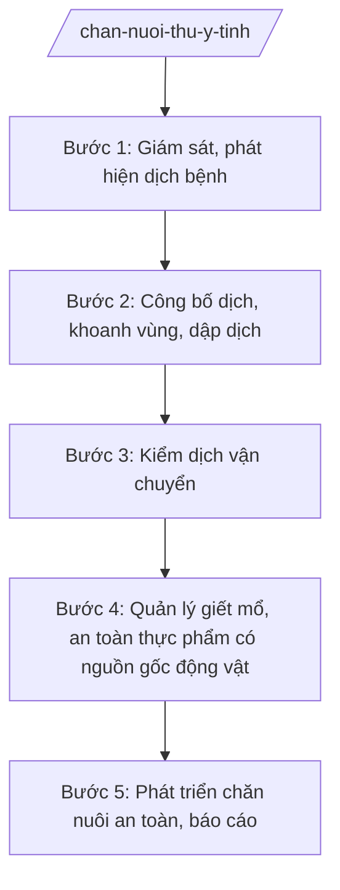

# Skill: Chăn nuôi, thú y

## 2. Khi nào dùng

- Khi phòng chống dịch bệnh động vật (dịch tả lợn châu Phi, cúm gia cầm, lở mồm long móng...).
- Khi kiểm dịch động vật, sản phẩm động vật vận chuyển, xuất nhập tỉnh.
- Khi quản lý cơ sở giết mổ, sơ chế; kiểm soát giết mổ.
- Khi phát triển chăn nuôi an toàn sinh học, chăn nuôi tập trung.

## 3. Đầu vào (Input)

| Trường | Mô tả | Bắt buộc |
|--------|-------|----------|
| `loai_viec` | phòng chống dịch / kiểm dịch / quản lý giết mổ / phát triển chăn nuôi / báo cáo | Có |
| `dich_benh` | Tên dịch bệnh (nếu có) | Không |
| `dia_ban` | Ổ dịch / vùng kiểm dịch / cơ sở | Không |
| `doi_tuong` | Hộ chăn nuôi, cơ sở giết mổ, thương lái | Không |

## 4. Quy trình

**Bước 1. Giám sát, phát hiện dịch bệnh**
- Làm gì: Giám sát chủ động tại chợ, lò mổ, hộ chăn nuôi; tiếp nhận tin báo; lấy mẫu xét nghiệm khi nghi ngờ.
- Dùng input: `loai_viec`, `dia_ban`.
- Vai trò: Chi cục Chăn nuôi và Thú y/trạm thú y; AI hỗ trợ tổng hợp tin báo, bản đồ ổ dịch — ⏱ hằng ngày.
- Lưu ý nghiệp vụ: Không giấu dịch — hộ chăn nuôi, thú y viên cơ sở phải báo ngay khi có dấu hiệu; lấy mẫu đúng quy trình bảo quản.
- → Kết quả bước: Phiếu lấy mẫu + kết quả xét nghiệm.

**Bước 2. Công bố dịch, khoanh vùng, dập dịch**
- Làm gì: Tham mưu công bố dịch; khoanh vùng ổ dịch, vùng đệm; tiêu hủy động vật mắc bệnh; tiêm phòng bao vây; khử trùng tiêu độc.
- Dùng input: `dich_benh`, `dia_ban`.
- Vai trò: Chi cục trưởng tham mưu; AI hỗ trợ dự thảo quyết định công bố dịch, kế hoạch dập dịch — ⏱ ngay khi có kết quả dương tính.
- Lưu ý nghiệp vụ: Tiêu hủy phải có hội đồng, biên bản, hỗ trợ thiệt hại cho hộ dân theo chính sách; chốt kiểm dịch 24/24 tại cửa ngõ vùng dịch.
- → Kết quả bước: Quyết định công bố dịch + kế hoạch dập dịch + biên bản tiêu hủy.

**Bước 3. Kiểm dịch vận chuyển**
- Làm gì: Kiểm dịch động vật, sản phẩm động vật vận chuyển ra/vào tỉnh tại các chốt kiểm dịch; xử lý vận chuyển không có giấy kiểm dịch.
- Dùng input: `doi_tuong`.
- Vai trò: Trạm kiểm dịch; AI hỗ trợ lập sổ theo dõi — ⏱ thường xuyên.
- Lưu ý nghiệp vụ: Khi có dịch, kiểm soát chặt 100% phương tiện qua chốt; không để lọt động vật từ vùng dịch.
- → Kết quả bước: Giấy chứng nhận kiểm dịch / biên bản xử lý vi phạm.

**Bước 4. Quản lý giết mổ, an toàn thực phẩm có nguồn gốc động vật**
- Làm gì: Kiểm tra điều kiện vệ sinh thú y cơ sở giết mổ; kiểm soát giết mổ (đóng dấu kiểm soát); xử lý giết mổ lậu.
- Dùng input: `doi_tuong`, `dia_ban`.
- Vai trò: Đoàn kiểm tra liên ngành; AI hỗ trợ lập biên bản — ⏱ định kỳ + đột xuất.
- Lưu ý nghiệp vụ: Thịt không có dấu kiểm soát không được lưu thông; xử lý nghiêm giết mổ lậu, bơm nước vào thịt.
- → Kết quả bước: Biên bản kiểm tra + quyết định xử phạt (nếu có).

**Bước 5. Phát triển chăn nuôi an toàn, báo cáo**
- Làm gì: Tham mưu chính sách phát triển chăn nuôi tập trung, an toàn sinh học; tiêm phòng định kỳ; báo cáo tình hình chăn nuôi, dịch bệnh.
- Dùng input: `loai_viec`.
- Vai trò: Chuyên viên; AI hỗ trợ lập kế hoạch tiêm phòng, báo cáo — ⏱ theo kế hoạch.
- Lưu ý nghiệp vụ: Tỷ lệ tiêm phòng đạt chỉ tiêu; xây dựng vùng, cơ sở an toàn dịch bệnh.
- → Kết quả bước: Kế hoạch tiêm phòng + báo cáo chăn nuôi, thú y định kỳ.

## Luồng quy trình (Workflow)

## 5. Đầu ra (Output)

- Quyết định công bố dịch động vật + kế hoạch dập dịch.
- Giấy chứng nhận kiểm dịch động vật, sản phẩm động vật.
- Biên bản kiểm tra cơ sở giết mổ; quyết định xử phạt VPHC.
- Kế hoạch tiêm phòng; báo cáo chăn nuôi, thú y định kỳ.

**Cấu trúc output chuẩn (Quyết định công bố dịch):**
- Thể thức: tuân thủ Nghị định 30/2020/NĐ-CP về công tác văn thư.

1. Quốc hiệu "CỘNG HÒA XÃ HỘI CHỦ NGHĨA VIỆT NAM", Tiêu ngữ "Độc lập – Tự do – Hạnh phúc"; tên cơ quan (UBND tỉnh A); số, ký hiệu.
2. Tên loại: **QUYẾT ĐỊNH** — về việc công bố dịch [tên dịch bệnh] trên địa bàn [phạm vi].
3. Căn cứ pháp lý; kết quả xét nghiệm (số, ngày, đơn vị).
4. **Điều 1.** Công bố dịch; phạm vi vùng dịch, vùng đệm, vùng bị uy hiếp.
5. **Điều 2.** Các biện pháp áp dụng (khoanh vùng, tiêu hủy, tiêm phòng, chốt kiểm dịch, cấm vận chuyển...).
6. **Điều 3.** Kinh phí thực hiện; chính sách hỗ trợ.
7. **Điều 4.** Hiệu lực; trách nhiệm thi hành.
8. Nơi nhận; chữ ký Chủ tịch UBND tỉnh.

## 6. Checklist nghiệm thu

- [ ] Dịch bệnh được phát hiện sớm, không giấu dịch.
- [ ] Công bố dịch kịp thời, khoanh vùng đúng quy định.
- [ ] Tiêu hủy có hội đồng, biên bản; hỗ trợ hộ dân theo chính sách.
- [ ] Chốt kiểm dịch hoạt động 24/24 trong thời gian có dịch.
- [ ] Cơ sở giết mổ được kiểm soát; xử lý nghiêm giết mổ lậu.
- [ ] Văn bản đúng thể thức NĐ 30/2020/NĐ-CP.

## 7. Ví dụ mô phỏng

*Dữ liệu dưới đây là giả lập 100% phục vụ minh họa.*

**Input mẫu:** loai_viec = "phòng chống dịch"; dich_benh = "Dịch tả lợn châu Phi"; dia_ban = "Xã A".

**Output mẫu (trích Quyết định):**

> **ỦY BAN NHÂN DÂN TỈNH A**
> Số: 1234/QĐ-UBND
>
> **QUYẾT ĐỊNH**
> Về việc công bố dịch tả lợn châu Phi tại xã A
>
> *Căn cứ* kết quả xét nghiệm số 12/XN-TY ngày 05/9/2026 của Chi cục Chăn nuôi và Thú y tỉnh A (dương tính)...
>
> **Điều 1.** Công bố dịch tả lợn châu Phi tại xã A, tỉnh A.
> **Điều 2.** Áp dụng các biện pháp: khoanh vùng ổ dịch thôn 1, xã A; tiêu hủy toàn bộ lợn mắc bệnh, nghi mắc bệnh; tiêm phòng bao vây; lập 02 chốt kiểm dịch 24/24; cấm vận chuyển lợn ra/vào xã A trong 21 ngày.
> **Điều 3.** Kinh phí từ nguồn dự phòng ngân sách tỉnh; hỗ trợ hộ dân theo chính sách hiện hành./.
>
> *Nơi nhận:* ... — **CHỦ TỊCH** *(ký, đóng dấu)* — Phạm Văn P

## 8. Human gate

- Chuyên viên/Chi cục soạn → Chi cục trưởng kiểm tra → Phó Giám đốc Sở duyệt → Giám đốc Sở ký tờ trình → **Chủ tịch UBND tỉnh quyết định** (công bố dịch).
- Xử phạt: theo thẩm quyền VPHC.

## 9. Giới hạn

- AI không tự công bố dịch, không tự quyết định tiêu hủy động vật.
- Không bịa kết quả xét nghiệm, số liệu dịch bệnh.
- Không dùng văn bản hết hiệu lực làm căn cứ.

## 10. Căn cứ & lưu ý

- Thông tư 19/2025/TT-BNNMT của Bộ Nông nghiệp và Môi trường hướng dẫn chức năng, nhiệm vụ của cơ quan chuyên môn về nông nghiệp và môi trường.
- Luật Thú y và các văn bản hướng dẫn (dẫn tên, áp dụng bản hiện hành).
- Nghị định 150/2025/NĐ-CP về tổ chức cơ quan chuyên môn thuộc UBND cấp tỉnh.
- Nghị định 30/2020/NĐ-CP về công tác văn thư (thể thức văn bản).
- Lưu ý: phòng chống dịch bệnh động vật gắn với ATTP và sức khỏe cộng đồng — phối hợp Sở Y tế khi dịch lây sang người.
