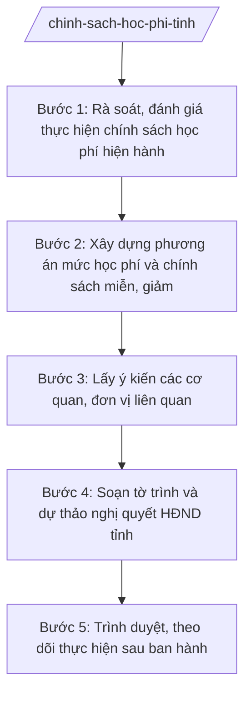

# Skill: Chính sách học phí, miễn giảm

## 2. Khi nào dùng

- Hằng năm hoặc khi có thay đổi chính sách: rà soát, đánh giá thực hiện chính sách học phí, miễn, giảm học phí trên địa bàn tỉnh.
- Tham mưu mức học phí làm căn cứ thực hiện miễn học phí đối với giáo dục mầm non, giáo dục phổ thông theo TT 45/2026/TT-BGDĐT.
- Xây dựng phương án miễn, giảm, hỗ trợ học phí, chi phí học tập cho học sinh thuộc đối tượng chính sách, hộ nghèo, vùng khó khăn.
- Soạn tờ trình và dự thảo nghị quyết của HĐND tỉnh về mức học phí, chính sách hỗ trợ học phí; theo dõi, tổng hợp kết quả thực hiện sau khi nghị quyết được thông qua.

## 3. Đầu vào (Input)

| Trường | Mô tả | Bắt buộc |
|--------|-------|----------|
| `nam_hoc` | Năm học áp dụng chính sách | Có |
| `muc_hoc_phi_hien_hanh` | Mức học phí đang áp dụng theo từng cấp học, vùng | Có |
| `khung_hoc_phi` | Khung học phí, mức trần theo quy định của cấp có thẩm quyền | Có |
| `doi_tuong_chinh_sach` | Số lượng học sinh thuộc diện miễn, giảm, hỗ trợ (chính sách, hộ nghèo, vùng khó khăn...) | Có |
| `du_toan_ngan_sach_bu` | Dự toán ngân sách tỉnh phải bố trí để thực hiện miễn, giảm học phí | Có |
| `de_xuat_muc_moi` | Phương án mức học phí mới Sở đề xuất (nếu điều chỉnh) | Không |
| `y_kien_don_vi` | Ý kiến của Sở Tài chính, UBND xã, cơ sở giáo dục về phương án | Không |

## 4. Quy trình

**Bước 1. Rà soát, đánh giá thực hiện chính sách học phí hiện hành**

- Làm gì: Thu thập số liệu thực hiện chính sách học phí, miễn, giảm học phí năm học trước: số học sinh được miễn/giảm, kinh phí ngân sách đã bố trí, khó khăn vướng mắc của cơ sở giáo dục và địa phương.
- Dùng input: `nam_hoc`, `muc_hoc_phi_hien_hanh`, `doi_tuong_chinh_sach`.
- Vai trò: Chuyên viên Phòng Kế hoạch – Tài chính tổng hợp. AI hỗ trợ: tổng hợp số liệu từ báo cáo của các trường, các xã; lập bảng so sánh thực hiện – kế hoạch; phát hiện đơn vị thực hiện sai đối tượng, sai mức. ⏱ ~5–7 ngày làm việc (ước tính).
- Lưu ý nghiệp vụ: Số liệu phải tách rõ từng nhóm đối tượng miễn, giảm, hỗ trợ; đối chiếu với danh sách hộ nghèo, đối tượng chính sách do cơ quan có thẩm quyền xác nhận.
- → Kết quả bước: Báo cáo đánh giá thực hiện chính sách học phí năm học trước + bảng số liệu chi tiết.

**Bước 2. Xây dựng phương án mức học phí và chính sách miễn, giảm**

- Làm gì: Xây dựng phương án mức học phí làm căn cứ thực hiện miễn học phí mầm non, phổ thông; xác định đối tượng, mức miễn, giảm, hỗ trợ học phí, chi phí học tập; tính toán nhu cầu ngân sách tỉnh phải bố trí.
- Dùng input: Kết quả bước 1; `khung_hoc_phi`, `du_toan_ngan_sach_bu`, `de_xuat_muc_moi`.
- Vai trò: Trưởng phòng Kế hoạch – Tài chính (bà Đặng Thị Y) chủ trì xây dựng phương án. AI hỗ trợ: lập bảng tính mức học phí theo cấp học/vùng trong khung cho phép; tính toán kinh phí miễn, giảm theo từng nhóm đối tượng; soạn dự thảo phương án kèm thuyết minh. ⏱ ~7–10 ngày làm việc (ước tính).
- Lưu ý nghiệp vụ: Mức học phí đề xuất không vượt khung, mức trần quy định; nội dung về mức học phí làm căn cứ miễn học phí mầm non, phổ thông phải bám đúng TT 45/2026/TT-BGDĐT; tính toán ngân sách phải khả thi, có nguồn bố trí rõ ràng.
- → Kết quả bước: Dự thảo phương án mức học phí, chính sách miễn, giảm, hỗ trợ + bảng tính kinh phí.

**Bước 3. Lấy ý kiến các cơ quan, đơn vị liên quan**

- Làm gì: Gửi dự thảo phương án lấy ý kiến Sở Tài chính (về khả năng cân đối ngân sách), UBND các xã, các cơ sở giáo dục; tổng hợp ý kiến, điều chỉnh phương án.
- Dùng input: Kết quả bước 2; `y_kien_don_vi`.
- Vai trò: Văn phòng Sở (bà Ngô Thị V — Chánh Văn phòng) điều phối lấy ý kiến; chuyên viên Phòng Kế hoạch – Tài chính tổng hợp. AI hỗ trợ: tổng hợp ý kiến theo nhóm nội dung, lập bảng đối chiếu tiếp thu/giải trình, cập nhật bảng tính kinh phí sau điều chỉnh. ⏱ ~10–15 ngày làm việc (ước tính).
- Lưu ý nghiệp vụ: Ý kiến của Sở Tài chính về khả năng cân đối ngân sách là bắt buộc và có tính quyết định đối với tính khả thi của phương án; mọi ý kiến không tiếp thu phải giải trình rõ lý do.
- → Kết quả bước: Phương án đã hoàn thiện sau lấy ý kiến + bảng tổng hợp tiếp thu, giải trình ý kiến.

**Bước 4. Soạn tờ trình và dự thảo nghị quyết HĐND tỉnh**

- Làm gì: Soạn Tờ trình của UBND tỉnh trình HĐND tỉnh kèm dự thảo Nghị quyết quy định mức học phí, chính sách miễn, giảm, hỗ trợ học phí trên địa bàn tỉnh; dự thảo phải đúng thể thức, viện dẫn đầy đủ căn cứ pháp lý.
- Dùng input: Kết quả bước 3.
- Vai trò: Chuyên viên Phòng Kế hoạch – Tài chính soạn dự thảo; Trưởng phòng (bà Đặng Thị Y) kiểm tra. AI hỗ trợ: soạn dự thảo tờ trình và nghị quyết đúng thể thức văn bản QPPL địa phương; kiểm tra căn cứ pháp lý (Luật Giáo dục; TT 45/2026/TT-BGDĐT; văn bản của cấp có thẩm quyền về khung học phí); rà soát lỗi chính tả, số liệu. ⏱ ~5–7 ngày làm việc (ước tính).
- Lưu ý nghiệp vụ: Dự thảo nghị quyết phải quy định rõ: mức học phí theo cấp học, đối tượng miễn/giảm/hỗ trợ và mức tương ứng, nguồn kinh phí, thời điểm áp dụng, trách nhiệm tổ chức thực hiện; không quy định nội dung vượt thẩm quyền của HĐND tỉnh.
- → Kết quả bước: Tờ trình + dự thảo Nghị quyết của HĐND tỉnh về mức học phí, chính sách miễn, giảm, hỗ trợ học phí.

**Bước 5. Trình duyệt, theo dõi thực hiện sau ban hành**

- Làm gì: Trình hồ sơ qua nấc kiểm duyệt của Sở; báo cáo UBND tỉnh xem xét, trình HĐND tỉnh thông qua tại kỳ họp; sau khi nghị quyết được ban hành, hướng dẫn các cơ sở giáo dục, UBND xã tổ chức thực hiện; tổng hợp, báo cáo kết quả thực hiện.
- Dùng input: Tờ trình và dự thảo nghị quyết ở bước 4.
- Vai trò: Trưởng phòng Kế hoạch – Tài chính (bà Đặng Thị Y) kiểm tra; Phó Giám đốc Sở (ông Đỗ Văn U) xem xét; Giám đốc Sở (ông Hoàng Văn S) ký tờ trình của Sở báo cáo UBND tỉnh; Phó Chủ tịch UBND tỉnh (bà Lê Thị Q) phụ trách khối văn hóa – xã hội xem xét; Chủ tịch UBND tỉnh (ông Phạm Văn P) ký tờ trình trình HĐND tỉnh. AI hỗ trợ: lập phiếu trình ký, soạn văn bản hướng dẫn thực hiện nghị quyết, biểu mẫu báo cáo kết quả thực hiện của các đơn vị. ⏱ ~10–15 ngày làm việc (trình duyệt) + theo dõi suốt năm học (ước tính).
- Lưu ý nghiệp vụ: Chỉ tổ chức thực hiện sau khi HĐND tỉnh thông qua nghị quyết; mọi khoản miễn, giảm phải đúng đối tượng, đúng mức quy định; công khai chính sách để phụ huynh, học sinh biết.
- → Kết quả bước: Nghị quyết được HĐND tỉnh thông qua; văn bản hướng dẫn thực hiện; báo cáo kết quả thực hiện chính sách.

## Luồng quy trình (Workflow)

## 5. Đầu ra (Output)

### Sản phẩm

1. **Tờ trình + dự thảo Nghị quyết của HĐND tỉnh về mức học phí, chính sách miễn, giảm, hỗ trợ học phí** (sản phẩm chính) — UBND tỉnh trình, HĐND tỉnh ban hành.
2. Phương án mức học phí, chính sách miễn, giảm kèm bảng tính kinh phí (tài liệu trình kèm).
3. Văn bản hướng dẫn thực hiện nghị quyết (Sở GD&ĐT ban hành sau khi nghị quyết được thông qua).
4. Báo cáo đánh giá thực hiện chính sách học phí hằng năm.

**Cấu trúc output chuẩn (Tờ trình trình HĐND tỉnh):**
- Thể thức: tuân thủ Nghị định 30/2020/NĐ-CP về công tác văn thư.

1. Quốc hiệu "CỘNG HÒA XÃ HỘI CHỦ NGHĨA VIỆT NAM", Tiêu ngữ "Độc lập – Tự do – Hạnh phúc": CỘNG HÒA XÃ HỘI CHỦ NGHĨA VIỆT NAM / Độc lập – Tự do – Hạnh phúc.
2. Tên cơ quan trình: ỦY BAN NHÂN DÂN TỈNH A.
3. Số, ký hiệu văn bản: số/TTr-UBND.
4. Địa danh, ngày tháng năm: Tỉnh A, ngày … tháng … năm ….
5. Tên loại và trích yếu nội dung: TỜ TRÌNH / Về việc đề nghị ban hành Nghị quyết quy định mức học phí, chính sách miễn, giảm, hỗ trợ học phí trên địa bàn tỉnh A.
6. Kính gửi: Hội đồng nhân dân tỉnh A.
7. Nội dung chính:
   - I. Sự cần thiết ban hành (căn cứ Luật Giáo dục, TT 45/2026/TT-BGDĐT về mức học phí làm căn cứ miễn học phí mầm non, phổ thông; thực trạng thực hiện);
   - II. Nội dung chủ yếu của dự thảo nghị quyết (mức học phí theo cấp học; đối tượng, mức miễn, giảm, hỗ trợ; nguồn kinh phí; thời điểm áp dụng);
   - III. Dự kiến tác động (số học sinh được hưởng; kinh phí ngân sách tỉnh bố trí; ý kiến của Sở Tài chính về khả năng cân đối);
   - IV. Kiến nghị HĐND tỉnh xem xét, thông qua.
8. Hồ sơ kèm theo (dự thảo nghị quyết; bảng tính kinh phí; bảng tổng hợp ý kiến; văn bản của Sở Tài chính).
9. Nơi nhận; chữ ký, họ tên người ký: TM. ỦY BAN NHÂN DÂN / CHỦ TỊCH / (ký, đóng dấu, ghi rõ họ tên).

## 6. Checklist nghiệm thu

- [ ] Đủ 9 phần theo Cấu trúc output chuẩn mục 5, đúng thứ tự thể thức văn bản hành chính.
- [ ] Báo cáo đánh giá thực hiện năm trước có số liệu tách rõ từng nhóm đối tượng miễn, giảm, hỗ trợ.
- [ ] Mức học phí đề xuất trong khung, mức trần quy định; nội dung về mức học phí làm căn cứ miễn học phí mầm non, phổ thông bám đúng TT 45/2026/TT-BGDĐT.
- [ ] Bảng tính kinh phí ngân sách phải bố trí chi tiết, khả thi; có ý kiến thống nhất của Sở Tài chính về khả năng cân đối.
- [ ] Đã lấy ý kiến Sở Tài chính, UBND xã, cơ sở giáo dục; bảng tiếp thu/giải trình ý kiến đầy đủ.
- [ ] Dự thảo nghị quyết quy định rõ mức học phí, đối tượng, nguồn kinh phí, thời điểm áp dụng, trách nhiệm thực hiện; không vượt thẩm quyền HĐND tỉnh.
- [ ] Số/ký hiệu, ngày tháng, nơi nhận, chữ ký đầy đủ; số liệu khớp giữa tờ trình, dự thảo nghị quyết và bảng tính kinh phí.
- [ ] Đã qua đủ nấc human gate: chuyên viên → Trưởng phòng KH-TC → Phó Giám đốc Sở → Giám đốc Sở → Phó Chủ tịch UBND tỉnh → Chủ tịch UBND tỉnh ký tờ trình trình HĐND.

## 7. Ví dụ mô phỏng

*Dữ liệu dưới đây là giả lập 100% phục vụ minh họa.*

**Input mẫu:**

| Trường | Giá trị mẫu |
|--------|-------------|
| nam_hoc | 2026–2027 |
| muc_hoc_phi_hien_hanh | MN: 100.000 đ/tháng; TH: 80.000 đ/tháng; THCS: 90.000 đ/tháng; THPT: 120.000 đ/tháng |
| khung_hoc_phi | Trong khung quy định của cấp có thẩm quyền |
| doi_tuong_chinh_sach | 2.000 học sinh diện miễn; 5.000 học sinh diện giảm 50–70%; 3.000 học sinh hộ nghèo được hỗ trợ chi phí học tập |
| du_toan_ngan_sach_bu | 50 tỷ đồng/năm |
| y_kien_don_vi | Sở Tài chính thống nhất khả năng cân đối ngân sách |

**Output mẫu:**

CỘNG HÒA XÃ HỘI CHỦ NGHĨA VIỆT NAM
Độc lập – Tự do – Hạnh phúc
---------------

ỦY BAN NHÂN DÂN TỈNH A

Số: 123/TTr-UBND

Tỉnh A, ngày 10 tháng 10 năm 2026

**TỜ TRÌNH**
**Về việc đề nghị ban hành Nghị quyết quy định mức học phí, chính sách miễn, giảm, hỗ trợ học phí trên địa bàn tỉnh A**

*Kính gửi:* Hội đồng nhân dân tỉnh A.

**I. SỰ CẦN THIẾT BAN HÀNH**

Thực hiện Luật Giáo dục và Thông tư số 45/2026/TT-BGDĐT ngày 10/6/2026 của Bộ Giáo dục và Đào tạo (quy định mức học phí làm căn cứ thực hiện miễn học phí đối với giáo dục mầm non, giáo dục phổ thông), UBND tỉnh trình HĐND tỉnh xem xét ban hành nghị quyết quy định mức học phí và chính sách miễn, giảm, hỗ trợ học phí trên địa bàn tỉnh, áp dụng từ năm học 2026–2027.

**II. NỘI DUNG CHỦ YẾU CỦA DỰ THẢO NGHỊ QUYẾT**

1. Mức học phí theo cấp học (trong khung quy định): mầm non 100.000 đồng/học sinh/tháng; tiểu học 80.000 đồng; trung học cơ sở 90.000 đồng; trung học phổ thông 120.000 đồng.
2. Đối tượng, mức miễn, giảm học phí và hỗ trợ chi phí học tập: 2.000 học sinh được miễn 100%; 5.000 học sinh được giảm 50–70%; 3.000 học sinh hộ nghèo được hỗ trợ chi phí học tập.
3. Nguồn kinh phí: ngân sách tỉnh bố trí 50 tỷ đồng/năm; Sở Tài chính đã thống nhất khả năng cân đối.

**III. KIẾN NGHỊ**

UBND tỉnh kính trình HĐND tỉnh xem xét, thông qua dự thảo nghị quyết kèm theo./.

***Hồ sơ kèm theo:*** dự thảo nghị quyết; bảng tính kinh phí; bảng tổng hợp ý kiến; văn bản của Sở Tài chính.

***Nơi nhận:***
- Như trên;
- Thường trực Tỉnh ủy;
- Chủ tịch, các Phó Chủ tịch UBND tỉnh;
- Sở GD&ĐT; Sở Tài chính;
- Lưu: VT, VX.

**TM. ỦY BAN NHÂN DÂN**
**CHỦ TỊCH**

*(Ký, đóng dấu)*

**Phạm Văn P**

## 8. Human gate (người kiểm duyệt)

- Chuyên viên Phòng Kế hoạch – Tài chính soạn số liệu, dự thảo phương án, tờ trình; chịu trách nhiệm về tính chính xác của số liệu học phí, đối tượng, kinh phí.
- Trưởng phòng Kế hoạch – Tài chính (bà Đặng Thị Y) kiểm tra toàn bộ hồ sơ ở các bước 1–4; trả lại sửa nếu chưa đạt.
- Phó Giám đốc Sở (ông Đỗ Văn U) xem xét, cho ý kiến trước khi trình Giám đốc Sở.
- Giám đốc Sở (ông Hoàng Văn S) ký tờ trình của Sở báo cáo UBND tỉnh.
- Phó Chủ tịch UBND tỉnh phụ trách khối văn hóa – xã hội (bà Lê Thị Q) xem xét trước khi trình Chủ tịch UBND tỉnh.
- Chủ tịch UBND tỉnh (ông Phạm Văn P) ký tờ trình trình HĐND tỉnh; HĐND tỉnh xem xét, thông qua nghị quyết tại kỳ họp.

## 9. Giới hạn (guardrails)

- AI KHÔNG ra quyết định hành chính thay người có thẩm quyền (không quyết định mức học phí, đối tượng miễn giảm, không thay HĐND tỉnh thông qua nghị quyết).
- AI không tự ký, đóng dấu, phát hành văn bản dưới danh nghĩa UBND tỉnh, Sở GD&ĐT, HĐND tỉnh hay bất kỳ cá nhân nào.
- AI không bịa số liệu học phí, đối tượng chính sách, kinh phí ngân sách; mọi con số phải có nguồn từ báo cáo của trường, xã và ý kiến của Sở Tài chính.
- AI không bịa căn cứ pháp lý, số hiệu văn bản; nội dung về mức học phí làm căn cứ miễn học phí phải bám đúng TT 45/2026/TT-BGDĐT, không suy diễn thêm.
- AI không đề xuất mức học phí vượt khung, mức trần quy định hoặc phương án ngân sách không có nguồn bố trí.

## 10. Căn cứ & lưu ý

- Thông tư 45/2026/TT-BGDĐT ngày 10/6/2026 của Bộ GD&ĐT (hiệu lực 10/6/2026) — sửa đổi, bổ sung TT 15/2025/TT-BGDĐT; trong đó có nội dung về mức học phí làm căn cứ thực hiện miễn học phí đối với giáo dục mầm non, giáo dục phổ thông.
- Thông tư 15/2025/TT-BGDĐT ngày 24/7/2025 của Bộ GD&ĐT (hiệu lực 24/7/2025) — chức năng, nhiệm vụ, quyền hạn của Sở GD&ĐT (thay thế TT 12/2020/TT-BGDĐT).
- Nghị định 150/2025/NĐ-CP ngày 12/6/2025 (hiệu lực 16/6/2025) — tổ chức cơ quan chuyên môn thuộc UBND cấp tỉnh.
- Nghị định 30/2020/NĐ-CP — thể thức văn bản hành chính.
- Lưu ý: khung học phí, mức trần học phí và thẩm quyền quy định mức học phí thực hiện theo quy định pháp luật chuyên ngành; số hiệu văn bản chuyên ngành không có trong danh mục được phép trích dẫn thì ghi "theo quy định pháp luật chuyên ngành", tuyệt đối không bịa số hiệu.
