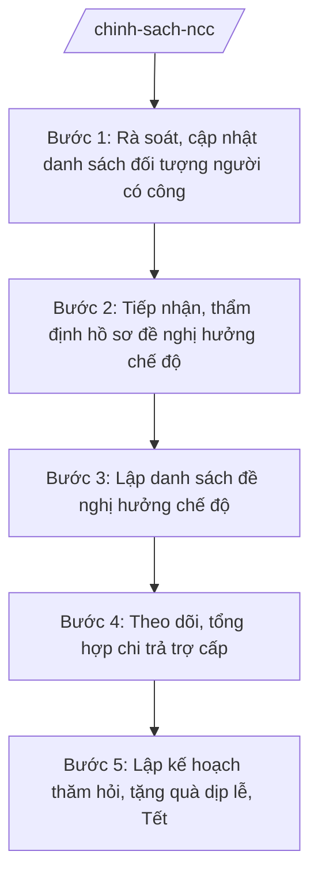

# Skill: Thực hiện chính sách người có công

## 2. Khi nào dùng

- Rà soát, cập nhật danh sách đối tượng người có công với cách mạng (thương binh, bệnh binh, thân nhân liệt sĩ, người có công giúp đỡ cách mạng...) đang quản lý trên địa bàn xã.
- Tiếp nhận hồ sơ đề nghị hưởng chế độ ưu đãi người có công; thẩm định tính đầy đủ, hợp lệ của hồ sơ trước khi trình cấp có thẩm quyền.
- Lập danh sách đề nghị hưởng chế độ ưu đãi người có công trình Chủ tịch UBND xã ký.
- Theo dõi, tổng hợp tình hình chi trả trợ cấp hằng tháng, trợ cấp một lần trong kỳ báo cáo.
- Lập kế hoạch thăm hỏi, tặng quà đối tượng chính sách nhân dịp lễ, Tết.

## 3. Đầu vào (Input)

| Trường | Mô tả | Bắt buộc |
|--------|-------|----------|
| `ky_bao_cao` | Kỳ rà soát/báo cáo (tháng, quý, năm hoặc đợt lễ, Tết cụ thể) | Có |
| `danh_sach_doi_tuong` | Danh sách đối tượng người có công hiện quản lý (họ tên, loại đối tượng, thôn, mức trợ cấp đang hưởng) | Có |
| `ho_so_de_nghi_moi` | Hồ sơ đề nghị hưởng chế độ mới phát sinh trong kỳ (thành phần giấy tờ kèm theo) | Không |
| `so_lieu_chi_tra` | Số liệu chi trả trợ cấp kỳ trước (đã chi, chưa chi, lý do tồn đọng) | Có |
| `muc_tro_cap_hien_hanh` | Mức trợ cấp đang áp dụng theo quy định hiện hành của kỳ báo cáo | Có |
| `ke_hoach_tham_hoi` | Nhu cầu thăm hỏi, tặng quà dịp lễ, Tết (số suất, mức quà dự kiến) | Không |

## 4. Quy trình

**Bước 1. Rà soát, cập nhật danh sách đối tượng người có công**

- Làm gì: Tổng hợp danh sách đối tượng người có công đang quản lý; đối chiếu biến động tăng/giảm trong kỳ (chuyển đi, qua đời, phát sinh mới); phân loại theo loại đối tượng và thôn.
- Dùng input: `danh_sach_doi_tuong`, `ky_bao_cao`.
- Vai trò: Công chức văn hóa – xã hội phụ trách lĩnh vực người có công thực hiện; AI hỗ trợ đối chiếu số liệu, phát hiện chênh lệch, lập bảng tổng hợp ⏱ ~1–2 giờ (ước tính). Trưởng phòng Văn hóa – Xã hội kiểm tra số liệu tổng hợp.
- Lưu ý nghiệp vụ: Không tự ý đưa đối tượng ra khỏi danh sách khi chưa có quyết định của cấp có thẩm quyền; mọi biến động phải có giấy tờ chứng minh kèm theo.
- → Kết quả bước: Bảng danh sách đối tượng người có công đã rà soát, cập nhật theo thôn và loại đối tượng.

**Bước 2. Tiếp nhận, thẩm định hồ sơ đề nghị hưởng chế độ**

- Làm gì: Tiếp nhận hồ sơ đề nghị hưởng chế độ ưu đãi (trợ cấp hằng tháng hoặc một lần); kiểm tra thành phần hồ sơ, tính hợp lệ của từng giấy tờ; lập phiếu tiếp nhận và hẹn trả kết quả.
- Dùng input: `ho_so_de_nghi_moi`.
- Vai trò: Công chức văn hóa – xã hội tiếp nhận tại UBND xã/bộ phận một cửa; AI hỗ trợ đối chiếu checklist thành phần hồ sơ, soạn phiếu tiếp nhận ⏱ ~30–45 phút/hồ sơ (ước tính).
- Lưu ý nghiệp vụ: Hồ sơ thiếu thì hướng dẫn bổ sung một lần, đầy đủ, không để người dân đi lại nhiều lần; không để hồ sơ tồn đọng quá thời hạn xử lý.
- → Kết quả bước: Hồ sơ đã thẩm định đạt/không đạt + phiếu tiếp nhận, hẹn trả kết quả.

**Bước 3. Lập danh sách đề nghị hưởng chế độ**

- Làm gì: Tổng hợp các trường hợp đủ điều kiện từ Bước 2; lập danh sách đề nghị hưởng chế độ theo mẫu; soạn tờ trình trình Chủ tịch UBND xã ký trước khi chuyển cấp có thẩm quyền.
- Dùng input: `ho_so_de_nghi_moi` (đã thẩm định), `danh_sach_doi_tuong`.
- Vai trò: Công chức văn hóa – xã hội soạn thảo; AI hỗ trợ lập danh sách, soạn tờ trình đúng thể thức văn bản hành chính theo NĐ 30/2020/NĐ-CP ⏱ ~1–2 giờ (ước tính). Trưởng phòng Văn hóa – Xã hội kiểm tra trước khi trình ký.
- Lưu ý nghiệp vụ: Chỉ đưa vào danh sách các trường hợp đã thẩm định đủ điều kiện; số liệu trong danh sách phải khớp 100% với hồ sơ gốc.
- → Kết quả bước: Dự thảo danh sách đề nghị hưởng chế độ + tờ trình trình ký.

**Bước 4. Theo dõi, tổng hợp chi trả trợ cấp**

- Làm gì: Tổng hợp số liệu chi trả trợ cấp hằng tháng/một lần trong kỳ: số đối tượng được chi, tổng số tiền, số đối tượng chưa chi và lý do; đối chiếu với danh sách quản lý tại Bước 1.
- Dùng input: `danh_sach_doi_tuong`, `so_lieu_chi_tra`, `muc_tro_cap_hien_hanh`.
- Vai trò: Công chức văn hóa – xã hội tổng hợp; AI hỗ trợ tính toán, đối chiếu, lập bảng tổng hợp chi trả ⏱ ~1–2 giờ (ước tính).
- Lưu ý nghiệp vụ: Số tiền chi trả phải đúng mức quy định hiện hành của kỳ báo cáo; trường hợp chưa chi phải nêu rõ lý do và hướng xử lý, không để tồn đọng kéo dài.
- → Kết quả bước: Bảng tổng hợp chi trả trợ cấp người có công trong kỳ.

**Bước 5. Lập kế hoạch thăm hỏi, tặng quà dịp lễ, Tết**

- Làm gì: Lập danh sách đối tượng được thăm hỏi, tặng quà; dự trù kinh phí; phân công đoàn thăm hỏi theo thôn; dự thảo kế hoạch trình duyệt.
- Dùng input: `danh_sach_doi_tuong` (đã rà soát), `ke_hoach_tham_hoi`, `ky_bao_cao`.
- Vai trò: Công chức văn hóa – xã hội lập kế hoạch; AI hỗ trợ lập danh sách, dự trù kinh phí ⏱ ~1 giờ (ước tính). Trưởng phòng Văn hóa – Xã hội kiểm tra; Phó Chủ tịch UBND xã phụ trách lĩnh vực cho ý kiến trước khi trình Chủ tịch UBND xã.
- Lưu ý nghiệp vụ: Bảo đảm không bỏ sót đối tượng thuộc diện thăm hỏi; mức quà đúng quy định, công khai, minh bạch.
- → Kết quả bước: Kế hoạch thăm hỏi, tặng quà đối tượng chính sách dịp lễ, Tết.

## Luồng quy trình (Workflow)

## 5. Đầu ra (Output)

**Danh sách sản phẩm:**
1. Danh sách đề nghị hưởng chế độ ưu đãi người có công với cách mạng (kèm tờ trình).
2. Báo cáo tình hình chi trả trợ cấp người có công kỳ báo cáo.
3. Kế hoạch thăm hỏi, tặng quà đối tượng chính sách dịp lễ, Tết (khi có nhu cầu).

**Cấu trúc output chuẩn** (Danh sách đề nghị hưởng chế độ — thể thức văn bản hành chính theo NĐ 30/2020/NĐ-CP):
1. Quốc hiệu – Tiêu ngữ: "CỘNG HÒA XÃ HỘI CHỦ NGHĨA VIỆT NAM / Độc lập – Tự do – Hạnh phúc".
2. Tên cơ quan ban hành: ỦY BAN NHÂN DÂN XÃ A.
3. Số, ký hiệu văn bản.
4. Địa danh và ngày, tháng, năm ban hành.
5. Tên loại và trích yếu nội dung: "DANH SÁCH đề nghị hưởng chế độ ưu đãi người có công với cách mạng đợt ...".
6. Căn cứ ban hành (văn bản pháp lý liên quan).
7. Nội dung: bảng danh sách gồm các cột STT, họ tên, năm sinh, loại đối tượng, thôn, loại chế độ đề nghị, ghi chú.
8. Nơi nhận.
9. Chữ ký: chức danh, họ tên người ký (Chủ tịch UBND xã).

**Cấu trúc báo cáo chi trả** (theo NĐ 30/2020/NĐ-CP): quốc hiệu – tiêu ngữ; tên cơ quan; số, ký hiệu; địa danh, ngày tháng năm; tên loại và trích yếu ("BÁO CÁO tình hình chi trả trợ cấp người có công ..."); căn cứ; nội dung (tình hình chung; kết quả chi trả theo bảng tổng hợp; tồn tại, nguyên nhân; kiến nghị); nơi nhận; chữ ký.

## 6. Checklist nghiệm thu

- [ ] Danh sách đúng đối tượng người có công, phân loại đúng loại đối tượng và thôn
- [ ] Số liệu trong danh sách khớp 100% với hồ sơ đã thẩm định, không bịa thêm/bớt trường hợp
- [ ] Báo cáo chi trả có bảng tổng hợp đầy đủ: số đối tượng, số tiền đã chi/chưa chi, lý do tồn đọng
- [ ] Mức trợ cấp áp dụng đúng quy định hiện hành của kỳ báo cáo
- [ ] Đủ các thành phần thể thức văn bản hành chính theo NĐ 30/2020/NĐ-CP
- [ ] Căn cứ pháp lý đúng, còn hiệu lực, không bịa số hiệu văn bản
- [ ] Đã qua human gate: Trưởng phòng kiểm tra, Chủ tịch UBND xã ký duyệt
- [ ] Dữ liệu ví dụ (nếu có) 100% hư cấu theo quy ước, không dùng tên người/địa phương có thật

## 7. Ví dụ mô phỏng

*Dữ liệu dưới đây là giả lập 100% phục vụ minh họa.*

**Input mẫu:**
- `ky_bao_cao`: "Quý I năm 2026"
- `danh_sach_doi_tuong`: 120 đối tượng (thương binh 40, bệnh binh 25, thân nhân liệt sĩ 35, người có công giúp đỡ cách mạng 20), phân bổ 5 thôn
- `ho_so_de_nghi_moi`: 03 hồ sơ (02 thân nhân liệt sĩ đề nghị trợ cấp hằng tháng, 01 thương binh đề nghị trợ cấp một lần)
- `so_lieu_chi_tra`: đã chi 118/120 đối tượng; 02 chưa chi do vắng mặt tại địa phương
- `muc_tro_cap_hien_hanh`: áp dụng theo quy định hiện hành của kỳ báo cáo

**Output mẫu:**

CỘNG HÒA XÃ HỘI CHỦ NGHĨA VIỆT NAM
Độc lập – Tự do – Hạnh phúc

ỦY BAN NHÂN DÂN XÃ A

Số: 12/DS-UBND

Xã A, ngày 10 tháng 01 năm 2026

**DANH SÁCH**
**Đề nghị hưởng chế độ ưu đãi người có công với cách mạng đợt 1 năm 2026**

*Căn cứ* Thông tư 10/2025/TT-BNV ngày 19/6/2025 của Bộ Nội vụ hướng dẫn chức năng, nhiệm vụ của lĩnh vực nội vụ cấp xã;
*Căn cứ* kết quả thẩm định hồ sơ đề nghị hưởng chế độ của Phòng Văn hóa – Xã hội xã A,

Ủy ban nhân dân xã A lập danh sách đề nghị hưởng chế độ ưu đãi người có công với cách mạng đợt 1 năm 2026 như sau:

| STT | Họ và tên | Năm sinh | Loại đối tượng | Thôn | Loại chế độ đề nghị | Ghi chú |
|-----|-----------|----------|----------------|------|---------------------|---------|
| 1 | Ông Nguyễn Văn Dân | 1960 | Thân nhân liệt sĩ | Thôn 1 | Trợ cấp hằng tháng | Hồ sơ đủ điều kiện |
| 2 | Bà Trần Thị Dân | 1965 | Thân nhân liệt sĩ | Thôn 3 | Trợ cấp hằng tháng | Hồ sơ đủ điều kiện |
| 3 | Ông Nguyễn Văn G | 1958 | Thương binh | Thôn 2 | Trợ cấp một lần | Hồ sơ đủ điều kiện |

**Nơi nhận:**
- Sở Nội vụ tỉnh A (để tổng hợp);
- Lưu: VT, VHXH.

**TM. ỦY BAN NHÂN DÂN**
**CHỦ TỊCH**
Nguyễn Văn A

## 8. Human gate (người kiểm duyệt)

- Công chức văn hóa – xã hội soạn thảo → Trưởng phòng Văn hóa – Xã hội (ông Vũ Văn E) kiểm tra số liệu, thể thức → Chủ tịch UBND xã (ông Nguyễn Văn A) ký duyệt trước khi gửi cấp có thẩm quyền hoặc phát hành.
- Danh sách đề nghị hưởng chế độ: Chủ tịch UBND xã ký tờ trình/danh sách trước khi chuyển cơ quan có thẩm quyền xem xét, quyết định.
- Báo cáo chi trả trợ cấp: Trưởng phòng Văn hóa – Xã hội kiểm tra, Phó Chủ tịch UBND xã phụ trách lĩnh vực (bà Trần Thị B) cho ý kiến trước khi ban hành.

## 9. Giới hạn (guardrails)

- AI KHÔNG ra quyết định công nhận đối tượng người có công, không quyết định mức hưởng chế độ thay người/cơ quan có thẩm quyền.
- AI KHÔNG tự ký, đóng dấu, phát hành văn bản hành chính.
- KHÔNG bịa số liệu đối tượng, mức trợ cấp, số hiệu văn bản, căn cứ pháp lý.
- KHÔNG dùng văn bản đã hết hiệu lực hoặc đã bị sửa đổi, bổ sung ở nội dung liên quan (đối chiếu TT 10/2025/TT-BNV với TT 06/2026/TT-BNV).
- KHÔNG tư vấn vượt thẩm quyền của cấp xã; việc công nhận và quyết định chế độ thuộc cấp có thẩm quyền theo quy định.

## 10. Căn cứ & lưu ý

- Thông tư 10/2025/TT-BNV ngày 19/6/2025 của Bộ Nội vụ: hướng dẫn chức năng, nhiệm vụ, quyền hạn của Sở Nội vụ và lĩnh vực nội vụ của phòng chuyên môn thuộc UBND cấp xã.
- Thông tư 06/2026/TT-BNV ngày 29/4/2026 (hiệu lực 15/6/2026): sửa đổi, bổ sung TT 10/2025/TT-BNV; khi trích dẫn nội dung đã sửa đổi phải dùng bản mới nhất.
- Nghị định 150/2025/NĐ-CP: Phòng Văn hóa – Xã hội cấp xã tham mưu lĩnh vực nội vụ.
- Nghị định 370/2025/NĐ-CP: khung tổ chức phòng chuyên môn cấp xã; xã tự quyết định thành lập phòng.
- Nghị định 30/2020/NĐ-CP: thể thức văn bản hành chính (áp dụng cho mọi sản phẩm văn bản của skill).
- Lưu ý: cấp xã thực hiện rà soát, tiếp nhận, thẩm định hồ sơ và lập danh sách đề nghị; việc công nhận đối tượng và quyết định chế độ thuộc thẩm quyền của cấp có thẩm quyền theo quy định pháp luật về ưu đãi người có công.
