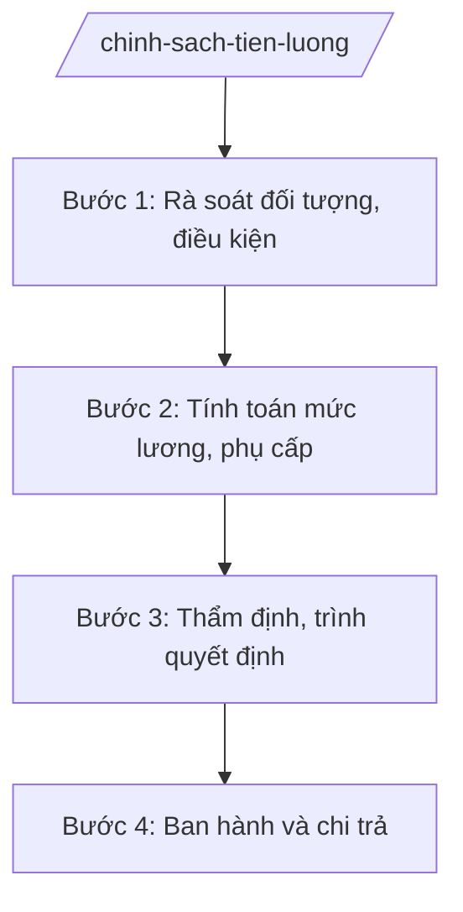

# Skill: Thực hiện chính sách tiền lương, phụ cấp

## 2. Khi nào dùng
- Xếp lương khi tuyển dụng, tiếp nhận công chức, viên chức mới.
- Xét nâng bậc lương thường xuyên hằng năm và nâng bậc trước thời hạn.
- Chuyển xếp lương khi thay đổi ngạch, chức danh.
- Giải quyết chế độ phụ cấp (chức vụ, khu vực, thu hút, thâm niên...).

## 3. Đầu vào (Input)
| Trường | Mô tả | Bắt buộc |
|--------|-------|----------|
| `doi_tuong` | Danh sách CBCCVC cần giải quyết chế độ | Có |
| `loai_che_do` | Loại chế độ (xếp lương mới / nâng bậc / chuyển xếp / phụ cấp) | Có |
| `ho_so_ca_nhan` | Hồ sơ cá nhân (quyết định tuyển dụng, quá trình công tác, đánh giá) | Có |
| `bang_luong_hien_huong` | Mức lương, phụ cấp đang hưởng | Có |
| `quy_dinh_ap_dung` | Quy định tiền lương, phụ cấp hiện hành | Có |

## 4. Quy trình

**Bước 1. Rà soát đối tượng, điều kiện**
- Làm gì: Rà soát danh sách đến kỳ nâng bậc / đủ điều kiện hưởng chế độ; đối chiếu tiêu chuẩn (thời gian giữ bậc, kết quả đánh giá, kỷ luật).
- Dùng input: `doi_tuong`, `loai_che_do`, `ho_so_ca_nhan`
- Vai trò: Chuyên viên Phòng Tiền lương (Sở Nội vụ tỉnh A) rà soát; AI hỗ trợ lập danh sách đến hạn, đối chiếu điều kiện ⏱ ~3 ngày làm việc (ước tính)
- Lưu ý nghiệp vụ: Nâng bậc trước thời hạn phải có thành tích xuất sắc được công nhận; không xét khi đang bị kỷ luật.
- → Kết quả bước: Danh sách đủ/không đủ điều kiện kèm lý do.

**Bước 2. Tính toán mức lương, phụ cấp**
- Làm gì: Tính bậc lương, hệ số, mức phụ cấp mới theo quy định; lập bảng tổng hợp.
- Dùng input: `bang_luong_hien_huong`, `quy_dinh_ap_dung`
- Vai trò: Chuyên viên tính toán; AI hỗ trợ tính toán, kiểm tra chéo ⏱ ~2 ngày làm việc (ước tính)
- Lưu ý nghiệp vụ: Áp dụng đúng bảng lương, hệ số hiện hành; thời điểm hưởng từ ngày đủ điều kiện.
- → Kết quả bước: Bảng tính lương, phụ cấp.

**Bước 3. Thẩm định, trình quyết định**
- Làm gì: Thẩm định hồ sơ từng trường hợp; hoàn thiện tờ trình, dự thảo quyết định nâng bậc/chuyển xếp lương.
- Dùng input: Danh sách Bước 1, bảng tính Bước 2
- Vai trò: Trưởng phòng Tiền lương kiểm tra; Giám đốc Sở Nội vụ ký tờ trình; AI hỗ trợ soạn văn bản ⏱ ~3 ngày làm việc (ước tính)
- Lưu ý nghiệp vụ: Đúng thẩm quyền quyết định theo phân cấp (Sở Nội vụ / UBND tỉnh / cơ quan chủ quản).
- → Kết quả bước: Tờ trình + dự thảo quyết định.

**Bước 4. Ban hành và chi trả**
- Làm gì: Ban hành quyết định; chuyển cơ quan tài chính, kho bạc để chi trả; cập nhật hồ sơ cán bộ.
- Dùng input: Quyết định đã ký
- Vai trò: Văn thư phát hành; AI hỗ trợ lập danh sách chi trả ⏱ ~2 ngày làm việc (ước tính)
- Lưu ý nghiệp vụ: Chi trả đúng, đủ, kịp thời từ thời điểm được hưởng; lưu hồ sơ đầy đủ.
- → Kết quả bước: Quyết định đã ban hành; bảng chi trả.

## Luồng quy trình (Workflow)

## 5. Đầu ra (Output)
- Quyết định nâng bậc lương / chuyển xếp lương / hưởng phụ cấp.
- Bảng tổng hợp lương, phụ cấp.
- Báo cáo quỹ lương (nếu cần).

**Cấu trúc output chuẩn:**
- Thể thức: tuân thủ Nghị định 30/2020/NĐ-CP về công tác văn thư.
Khung quyết định nâng bậc lương:
1. Quốc hiệu "CỘNG HÒA XÃ HỘI CHỦ NGHĨA VIỆT NAM", Tiêu ngữ "Độc lập – Tự do – Hạnh phúc"; số, ký hiệu; địa danh, ngày tháng năm.
2. Tên: "QUYẾT ĐỊNH về việc nâng bậc lương đối với ông/bà ...".
3. Căn cứ pháp lý.
4. Điều 1: Nâng bậc lương từ bậc ... hệ số ... lên bậc ... hệ số ..., thời điểm hưởng từ ngày ...
5. Điều 2: Trách nhiệm thi hành.
6. Chữ ký người có thẩm quyền; đóng dấu.
- Nơi nhận: liệt kê các cơ quan, đơn vị nhận để biết/thực hiện; kết thúc bằng "- Lưu: VT, [mã đơn vị]".
## 6. Checklist nghiệm thu
- [ ] Đối tượng đúng điều kiện, tiêu chuẩn theo quy định.
- [ ] Tính toán đúng bảng lương, hệ số, thời điểm hưởng.
- [ ] Đúng thẩm quyền quyết định theo phân cấp.
- [ ] Quyết định đúng thể thức NĐ 30/2020/NĐ-CP.
- [ ] Chi trả đúng, đủ, kịp thời.
- [ ] Hồ sơ cán bộ đã cập nhật.

## 7. Ví dụ mô phỏng
*Dữ liệu dưới đây là giả lập 100% phục vụ minh họa.*

**Input mẫu:**
- doi_tuong: 200 công chức đến kỳ nâng bậc quý I/2026 (giả lập)
- loai_che_do: Nâng bậc lương thường xuyên

**Output mẫu (trích quyết định):**
> **QUYẾT ĐỊNH**
> **Về việc nâng bậc lương đối với ông Đặng Thị Y**
>
> Điều 1. Nâng bậc lương đối với bà Đặng Thị Y, chuyên viên Phòng Tổ chức cán bộ, từ bậc 4/9 hệ số 2,34 lên bậc 5/9 hệ số 2,67, thời điểm hưởng từ ngày 01/01/2026...
> (Dữ liệu giả lập 100% phục vụ minh họa)

## 8. Human gate
- Trưởng phòng Tiền lương: kiểm tra danh sách và bảng tính (Bước 1–2).
- Giám đốc Sở Nội vụ: ký tờ trình (Bước 3).
- Cấp có thẩm quyền theo phân cấp: quyết định.

## 9. Giới hạn
- AI không tự quyết định nâng bậc hay mức lương cho cá nhân cụ thể.
- Không bịa hồ sơ, quá trình công tác để "đủ điều kiện".
- Mọi tính toán phải theo đúng quy định hiện hành, không áp dụng văn bản hết hiệu lực.

## 10. Căn cứ & lưu ý
- TT 10/2025/TT-BNV (Sở Nội vụ: chính sách tiền lương).
- NĐ 25/2025/NĐ-CP (chức năng, nhiệm vụ của Bộ Nội vụ).
- Quy định về chế độ tiền lương đối với CBCCVC và lực lượng vũ trang — dẫn tên, tra cứu bản hiện hành khi áp dụng.
