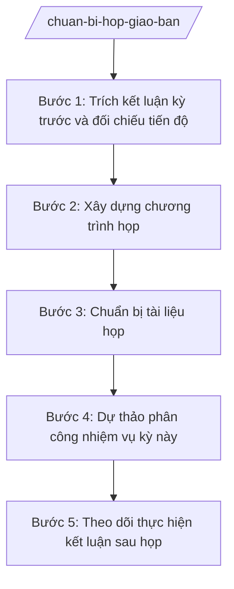

# Skill: Chuẩn bị họp & theo dõi việc

## Khi nào dùng

- Chuẩn bị họp giao ban định kỳ hằng tuần/tháng (người đứng đầu cơ quan hoặc cấp phó chủ trì).
- Chuẩn bị họp giao ban chuyên đề của từng phòng, đơn vị chuyên môn.
- Trích kết luận cuộc họp kỳ trước để kiểm điểm tiến độ thực hiện.
- Lập dự thảo phân công nhiệm vụ mới phát sinh từ cuộc họp.
- Theo dõi, đôn đốc thực hiện kết luận giao ban giữa các kỳ họp.

## Đầu vào (Input)

| Trường | Mô tả | Bắt buộc |
|--------|-------|----------|
| `ky_hop` | Kỳ họp giao ban (vd: "giao ban tháng 10/2026") | Có |
| `thoi_gian_dia_diem` | Thời gian, địa điểm dự kiến tổ chức | Có |
| `chu_tri_du_kien` | Người chủ trì dự kiến | Có |
| `ket_luan_ky_truoc` | Kết luận, phân công nhiệm vụ của kỳ họp trước (đầu mối, thời hạn) | Có |
| `bao_cao_tien_do` | Báo cáo tiến độ thực hiện kết luận kỳ trước của các đơn vị | Có |
| `noi_dung_du_kien` | Các nội dung dự kiến đưa ra họp kỳ này | Không |
| `thanh_phan_moi` | Thành phần mời họp (ngoài thành phần thường trực) | Không |
| `bien_ban_hop` | Biên bản họp đã ký (kết luận chính thức), dùng ở Bước 5 | Không |

## Quy trình

**Bước 1. Trích kết luận kỳ trước và đối chiếu tiến độ**

- Làm gì: Trích toàn bộ kết luận, phân công nhiệm vụ của kỳ họp trước thành bảng: nội dung – đầu mối – thời hạn; đối chiếu với báo cáo tiến độ của các đơn vị để xác định việc đã hoàn thành, đang thực hiện, chậm tiến độ.
- Dùng input: `ket_luan_ky_truoc`, `bao_cao_tien_do`.
- Vai trò: Công chức Văn phòng trích và đối chiếu, AI hỗ trợ lập bảng đối chiếu, tự động đánh dấu trạng thái (hoàn thành / đang thực hiện / chậm tiến độ / chưa báo cáo) (⏱ 20 phút).
- Lưu ý nghiệp vụ: Đơn vị chưa gửi báo cáo tiến độ phải được đôn đốc trước họp ít nhất 01 ngày; việc chậm tiến độ phải ghi rõ lý do đơn vị báo cáo.
- → Kết quả bước: Bảng kiểm điểm thực hiện kết luận kỳ trước, phân loại theo trạng thái.

**Bước 2. Xây dựng chương trình họp**

- Làm gì: Xây dựng chương trình họp theo thứ tự: (1) kiểm điểm thực hiện kết luận kỳ trước; (2) báo cáo tình hình chung; (3) thảo luận các nội dung mới; (4) kết luận, phân công nhiệm vụ; phân bổ thời gian cho từng nội dung; soạn giấy mời họp gửi thành phần được mời.
- Dùng input: `ky_hop`, `thoi_gian_dia_diem`, `chu_tri_du_kien`, `noi_dung_du_kien`, `thanh_phan_moi`.
- Vai trò: Công chức Văn phòng dự thảo chương trình, AI hỗ trợ sắp xếp nội dung theo thứ tự ưu tiên và phân bổ thời gian hợp lý (⏱ 15 phút).
- Lưu ý nghiệp vụ: Ưu tiên nội dung có thời hạn gấp, vụ việc tồn đọng; tổng thời gian họp không quá 1/2 ngày làm việc; thành phần mời phải liên quan trực tiếp đến nội dung thảo luận.
- → Kết quả bước: Dự thảo chương trình họp (nội dung – thời gian – người trình bày).

**Bước 3. Chuẩn bị tài liệu họp**

- Làm gì: Tập hợp tài liệu cho từng nội dung: báo cáo của các phòng, bảng kiểm điểm kết luận kỳ trước, dự thảo văn bản cần xin ý kiến; đóng thành bộ tài liệu họp, gửi trước cho thành phần dự họp.
- Dùng input: Chương trình họp từ Bước 2, `bao_cao_tien_do`.
- Vai trò: Công chức Văn phòng tập hợp và đóng bộ tài liệu, AI hỗ trợ kiểm tra mỗi nội dung trong chương trình đều có tài liệu kèm theo (không để nội dung "chay") (⏱ 20 phút).
- Lưu ý nghiệp vụ: Tài liệu họp gửi trước ít nhất 01 ngày làm việc để thành phần dự họp nghiên cứu; tài liệu mật gửi theo quy định bảo vệ bí mật nhà nước.
- → Kết quả bước: Bộ tài liệu họp đầy đủ, đã gửi đến thành phần dự họp.

**Bước 4. Dự thảo phân công nhiệm vụ kỳ này**

- Làm gì: Trên cơ sở nội dung dự kiến thảo luận, dự thảo trước bảng phân công: nội dung việc – đơn vị/cá nhân đầu mối – đơn vị phối hợp – thời hạn hoàn thành, để người chủ trì tham khảo khi kết luận.
- Dùng input: `noi_dung_du_kien`, bảng kiểm điểm từ Bước 1 (các việc chậm tiến độ cần gia hạn/giao lại).
- Vai trò: Công chức Văn phòng dự thảo, AI hỗ trợ đề xuất đầu mối và thời hạn hợp lý dựa trên phân công kỳ trước và năng lực đơn vị (⏱ 15 phút).
- Lưu ý nghiệp vụ: Đây là dự thảo tham khảo — phân công chính thức do người chủ trì kết luận tại cuộc họp; không đưa dự thảo phân công vào tài liệu gửi trước nếu nội dung còn đang xin ý kiến.
- → Kết quả bước: Dự thảo bảng phân công nhiệm vụ kỳ này (để chủ trì tham khảo khi kết luận).

**Bước 5. Theo dõi thực hiện kết luận sau họp**

- Làm gì: Sau họp, cập nhật kết luận chính thức vào bảng theo dõi chung: nội dung – đầu mối – thời hạn – trạng thái; định kỳ đôn đốc các đơn vị báo cáo tiến độ; tổng hợp phục vụ kỳ họp sau.
- Dùng input: `bien_ban_hop` (kết luận chính thức), `bao_cao_tien_do` (cập nhật giữa kỳ).
- Vai trò: Công chức Văn phòng duy trì bảng theo dõi, AI hỗ trợ nhắc việc sắp đến hạn, tổng hợp báo cáo đôn đốc hằng tuần (⏱ 10 phút/tuần).
- Lưu ý nghiệp vụ: Việc quá hạn chưa hoàn thành phải báo cáo người đứng đầu cơ quan để chỉ đạo; bảng theo dõi là tài liệu bắt buộc của kỳ họp giao ban tiếp theo.
- → Kết quả bước: Bảng theo dõi thực hiện kết luận được cập nhật liên tục, có báo cáo đôn đốc định kỳ.

## Luồng quy trình (Workflow)

## 5. Đầu ra (Output)

- Chương trình họp giao ban (file .docx).
- Bộ tài liệu họp (báo cáo các phòng, bảng kiểm điểm kết luận kỳ trước).
- Giấy mời họp (nếu có thành phần mời ngoài thường trực).
- Dự thảo bảng phân công nhiệm vụ (chủ trì tham khảo khi kết luận).
- Bảng theo dõi thực hiện kết luận (cập nhật liên tục giữa các kỳ họp).

### Cấu trúc output chuẩn

**A. Chương trình họp** — các phần bắt buộc theo đúng thứ tự, đúng thể thức NĐ 30/2020/NĐ-CP:

1. Quốc hiệu "CỘNG HÒA XÃ HỘI CHỦ NGHĨA VIỆT NAM" – Tiêu ngữ "Độc lập – Tự do – Hạnh phúc".
2. Tên cơ quan: "ỦY BAN NHÂN DÂN / XÃ A".
3. Tên loại: "CHƯƠNG TRÌNH" + tên kỳ họp (vd: "Họp giao ban UBND xã A tháng 10/2026").
4. Thời gian, địa điểm, người chủ trì.
5. Thành phần tham dự.
6. Nội dung chương trình (bảng): STT | Thời gian | Nội dung | Người trình bày/báo cáo.
7. Nơi nhận; chữ ký người phê duyệt chương trình (Chánh Văn phòng hoặc Phó Chủ tịch).

**B. Bảng kiểm điểm thực hiện kết luận kỳ trước** — các cột bắt buộc:

| STT | Nội dung kết luận kỳ trước | Đơn vị đầu mối | Thời hạn | Tình trạng | Ghi chú (lý do chậm/nội dung đã làm) |
|-----|----------------------------|----------------|----------|------------|--------------------------------------|

Tình trạng: Hoàn thành / Đang thực hiện / Chậm tiến độ / Chưa báo cáo.

**C. Bảng theo dõi thực hiện kết luận** (dùng liên tục giữa các kỳ): gồm các cột như bảng B, thêm cột "Kỳ họp giao việc" và "Ngày cập nhật".

> **Checklist thể thức văn bản theo NĐ 30/2020/NĐ-CP** — đối chiếu trước khi trình ký:
> 1. Quốc hiệu và Tiêu ngữ.
> 2. Tên cơ quan, tổ chức ban hành văn bản.
> 3. Số, ký hiệu của văn bản.
> 4. Địa danh và thời gian ban hành văn bản.
> 5. Tên loại và trích yếu nội dung văn bản.
> 6. Nội dung văn bản.
> 7. Chức vụ, họ tên và chữ ký của người có thẩm quyền.
> 8. Dấu, chữ ký số của cơ quan, tổ chức.
> 9. Nơi nhận (kèm Phụ lục nếu có).

## 6. Checklist nghiệm thu

1. Chương trình họp đủ 7 phần theo Cấu trúc output chuẩn, nội dung sắp xếp đúng thứ tự ưu tiên.
2. Bảng kiểm điểm trích đủ 100% kết luận, phân công của kỳ họp trước, không bỏ sót việc.
3. Mỗi nội dung trong chương trình đều có tài liệu kèm theo; tài liệu gửi trước ít nhất 01 ngày làm việc.
4. Bảng phân công dự thảo: mỗi việc có đầu mối và thời hạn cụ thể, phù hợp năng lực đơn vị.
5. Bảng theo dõi có đầy đủ các cột bắt buộc, trạng thái được cập nhật (không để việc quá hạn mà không ghi chú).
6. Thành phần mời họp liên quan trực tiếp đến nội dung thảo luận.
7. Tổng thời gian họp dự kiến không quá 1/2 ngày làm việc.
8. Chương trình đã được người có thẩm quyền phê duyệt trước khi phát hành.
9. Sau họp: kết luận chính thức được cập nhật vào bảng theo dõi trong 02 ngày làm việc.

## 7. Ví dụ mô phỏng

*Dữ liệu dưới đây là giả lập 100% phục vụ minh họa.*

**Input mẫu:**

- ky_hop: Họp giao ban UBND xã A tháng 10/2026
- thoi_gian_dia_diem: 08 giờ 00, ngày 25/10/2026 — Phòng họp UBND xã A
- chu_tri_du_kien: Ông Nguyễn Văn A – Chủ tịch UBND xã A
- ket_luan_ky_truoc: (1) Phòng Kinh tế hoàn thành giải phóng mặt bằng 02 dự án giao thông nông thôn trước 30/9/2026; (2) Phòng Văn hóa – Xã hội chuẩn bị lễ khai giảng
- bao_cao_tien_do: Phòng Kinh tế: đã giải phóng mặt bằng 08/10 hộ, còn 02 hộ chưa đồng ý; Phòng Văn hóa – Xã hội: lễ khai giảng tổ chức thành công ngày 05/9/2026
- noi_dung_du_kien: Đánh giá thu ngân sách 9 tháng; triển khai tiêm chủng mở rộng đợt 2

**Output mẫu:**

**A. Chương trình họp**

> CỘNG HÒA XÃ HỘI CHỦ NGHĨA VIỆT NAM
> Độc lập – Tự do – Hạnh phúc
>
> ỦY BAN NHÂN DÂN
> XÃ A
>
> **CHƯƠNG TRÌNH**
> **Họp giao ban UBND xã A tháng 10/2026**
>
> Thời gian: 08 giờ 00, ngày 25 tháng 10 năm 2026.
> Địa điểm: Phòng họp UBND xã A.
> Chủ trì: Ông Nguyễn Văn A – Chủ tịch UBND xã A.
>
> Thành phần: Bà Trần Thị B – Phó Chủ tịch UBND xã; ông Phạm Văn C – Chánh Văn phòng HĐND&UBND; bà Hoàng Thị D – Trưởng phòng Kinh tế; ông Vũ Văn E – Trưởng phòng Văn hóa – Xã hội.
>
> | STT | Thời gian | Nội dung | Người trình bày |
> |-----|-----------|----------|-----------------|
> | 1 | 08:00–08:30 | Kiểm điểm thực hiện kết luận giao ban tháng 9/2026 | Văn phòng HĐND&UBND |
> | 2 | 08:30–09:00 | Đánh giá thu ngân sách 9 tháng năm 2026 | Phòng Kinh tế |
> | 3 | 09:00–09:20 | Triển khai tiêm chủng mở rộng đợt 2 | Phòng Văn hóa – Xã hội |
> | 4 | 09:20–10:00 | Thảo luận, kết luận và phân công nhiệm vụ | Chủ trì |
>
> Nơi nhận:
> - Các thành phần dự họp;
> - Lưu: VT.
>
> KT. CHÁNH VĂN PHÒNG
> *(ký, ghi rõ họ tên)*

**B. Bảng kiểm điểm thực hiện kết luận kỳ trước**

| STT | Nội dung kết luận kỳ trước | Đơn vị đầu mối | Thời hạn | Tình trạng | Ghi chú |
|-----|----------------------------|----------------|----------|------------|---------|
| 1 | Hoàn thành giải phóng mặt bằng 02 dự án giao thông nông thôn | Phòng Kinh tế | 30/9/2026 | Chậm tiến độ | Đã giải phóng 08/10 hộ; 02 hộ chưa đồng ý |
| 2 | Chuẩn bị lễ khai giảng năm học mới | Phòng Văn hóa – Xã hội | 05/9/2026 | Hoàn thành | Tổ chức thành công ngày 05/9/2026 |

**C. Dự thảo phân công nhiệm vụ kỳ này** (chủ trì tham khảo khi kết luận)

| STT | Nội dung | Đầu mối | Phối hợp | Thời hạn |
|-----|----------|---------|----------|----------|
| 1 | Vận động 02 hộ còn lại bàn giao mặt bằng | Phòng Kinh tế | Các thôn liên quan | 30/10/2026 |
| 2 | Tổ chức tiêm chủng mở rộng đợt 2 | Phòng Văn hóa – Xã hội | Trạm Y tế xã | 20/10/2026 |

## 8. Human gate

- Công chức Văn phòng chuẩn bị chương trình, tài liệu, bảng kiểm điểm → Chánh Văn phòng kiểm tra, phê duyệt chương trình → cấp phó/người đứng đầu cơ quan cho ý kiến (nếu nội dung quan trọng) → phát hành.
- Dự thảo phân công nhiệm vụ chỉ là tài liệu tham khảo — phân công chính thức do người chủ trì kết luận tại cuộc họp và được ghi vào biên bản.

## 9. Giới hạn

- AI KHÔNG tự quyết định nội dung kết luận, phân công nhiệm vụ thay người chủ trì.
- AI KHÔNG tự ý đánh giá "hoàn thành" khi đơn vị chưa có báo cáo hoặc báo cáo chưa được kiểm chứng.
- AI KHÔNG bịa báo cáo tiến độ của các đơn vị; đơn vị nào chưa báo cáo thì ghi rõ "Chưa báo cáo".
- AI KHÔNG gửi tài liệu mật ra ngoài phạm vi thành phần được phép tiếp cận.
- AI KHÔNG thay thế việc đôn đốc trực tiếp của Văn phòng đối với các việc chậm tiến độ, quá hạn.

## 10. Căn cứ & lưu ý

- NĐ 30/2020/NĐ-CP về công tác văn thư (thể thức chương trình họp, giấy mời là văn bản hành chính).
- NĐ 150/2025/NĐ-CP (hiệu lực 16/6/2025): Văn phòng HĐND và UBND tham mưu lĩnh vực văn phòng — đầu mối chuẩn bị họp giao ban UBND xã.
- NĐ 370/2025/NĐ-CP (hiệu lực 01/01/2026): xã tự quyết định thành lập phòng chuyên môn — thành phần dự họp xác định theo tổ chức thực tế của xã.
- Chế độ họp giao ban của UBND xã: thực hiện theo quy chế làm việc của UBND xã (không tự gắn số hiệu văn bản khi chưa xác thực).
