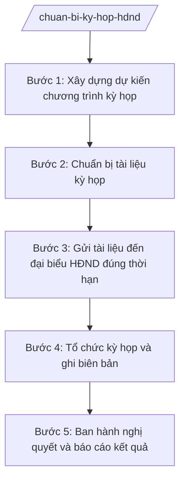

# Skill: Chuẩn bị kỳ họp HĐND xã

## 2. Khi nào dùng
- Chuẩn bị kỳ họp thường lệ giữa năm / cuối năm của HĐND xã.
- Triệu tập kỳ họp bất thường để quyết định vấn đề phát sinh đột xuất thuộc thẩm quyền HĐND.
- Cần ban hành nghị quyết về dự toán ngân sách xã, kế hoạch phát triển kinh tế – xã hội.
- Tổng hợp, báo cáo kết quả sau mỗi kỳ họp gửi cấp trên.

## 3. Đầu vào (Input)
| Trường | Mô tả | Bắt buộc |
|--------|-------|----------|
| `loai_ky_hop` | Thường lệ (giữa năm/cuối năm) hoặc bất thường | Có |
| `thoi_gian_du_kien` | Thời gian dự kiến tổ chức kỳ họp | Có |
| `noi_dung_chuong_trinh` | Các nội dung dự kiến đưa ra kỳ họp (báo cáo, tờ trình, dự thảo nghị quyết) | Có |
| `tai_lieu_kem_theo` | Báo cáo của UBND, tờ trình, dự thảo nghị quyết, báo cáo thẩm tra | Có |
| `danh_sach_dai_bieu` | Danh sách đại biểu HĐND xã | Có |
| `don_vi_chuan_bi` | Đơn vị được giao chuẩn bị từng tài liệu | Không |

## 4. Quy trình

**Bước 1. Xây dựng dự kiến chương trình kỳ họp**
- Làm gì: Dự kiến nội dung, thời gian, địa điểm kỳ họp; phân công đơn vị chuẩn bị từng tài liệu; trình Thường trực HĐND quyết định triệu tập.
- Dùng input: `loai_ky_hop`, `thoi_gian_du_kien`, `noi_dung_chuong_trinh`.
- Vai trò: Chánh Văn phòng HĐND và UBND chủ trì soạn; AI hỗ trợ lập dự thảo chương trình, bảng phân công chuẩn bị tài liệu ⏱ 1 ngày (ước tính) làm việc
- Lưu ý nghiệp vụ: Kỳ họp thường lệ: giữa năm và cuối năm; kỳ họp bất thường khi có vấn đề cấp bách; nội dung phải thuộc thẩm quyền quyết định của HĐND xã (dự toán ngân sách, kế hoạch phát triển KT-XH...).
- → Kết quả bước: Dự kiến chương trình kỳ họp + bảng phân công chuẩn bị tài liệu.

**Bước 2. Chuẩn bị tài liệu kỳ họp**
- Làm gì: Đôn đốc các đơn vị gửi tài liệu: báo cáo của UBND, tờ trình, dự thảo nghị quyết, báo cáo thẩm tra của các Ban HĐND; rà soát thể thức, nội dung trước khi in ấn.
- Dùng input: `tai_lieu_kem_theo`, `don_vi_chuan_bi`.
- Vai trò: Chánh Văn phòng HĐND và UBND đôn đốc, rà soát; AI hỗ trợ kiểm tra thể thức văn bản, tổng hợp danh mục tài liệu ⏱ 5 ngày (ước tính) làm việc
- Lưu ý nghiệp vụ: Dự thảo nghị quyết phải đúng thể thức NĐ 30/2020/NĐ-CP; số liệu giữa báo cáo và tờ trình phải khớp nhau; tài liệu phải hoàn thành trước thời hạn gửi đại biểu.
- → Kết quả bước: Bộ tài liệu kỳ họp hoàn chỉnh, đã rà soát.

**Bước 3. Gửi tài liệu đến đại biểu HĐND đúng thời hạn**
- Làm gì: In ấn/đóng tập tài liệu; gửi đến từng đại biểu HĐND kèm giấy triệu tập; xác nhận đại biểu đã nhận.
- Dùng input: `danh_sach_dai_bieu`, bộ tài liệu kỳ họp.
- Vai trò: Văn phòng HĐND và UBND thực hiện; AI hỗ trợ lập danh sách gửi, theo dõi xác nhận ⏱ 0,5 ngày (ước tính) làm việc
- Lưu ý nghiệp vụ: Gửi đúng thời hạn theo quy định để đại biểu có thời gian nghiên cứu; lưu xác nhận đã gửi/đã nhận làm căn cứ.
- → Kết quả bước: Tài liệu + giấy triệu tập đã đến 100% đại biểu đúng hạn.

**Bước 4. Tổ chức kỳ họp và ghi biên bản**
- Làm gì: Chuẩn bị hội trường, điểm danh đại biểu, phục vụ kỳ họp theo chương trình; ghi biên bản đầy đủ diễn biến, ý kiến thảo luận, kết quả biểu quyết.
- Dùng input: Dự kiến chương trình, `danh_sach_dai_bieu`.
- Vai trò: Chánh Văn phòng HĐND và UBND điều hành công tác phục vụ; thư ký kỳ họp ghi biên bản; AI hỗ trợ soạn biên bản từ ghi chép ⏱ trong ngày họp
- Lưu ý nghiệp vụ: Biên bản phải phản ánh trung thực diễn biến, tỷ lệ biểu quyết từng nghị quyết; bảo đảm số đại biểu dự họp theo quy định.
- → Kết quả bước: Biên bản kỳ họp HĐND xã.

**Bước 5. Ban hành nghị quyết và báo cáo kết quả**
- Làm gì: Hoàn thiện, ban hành các nghị quyết được kỳ họp thông qua; gửi nghị quyết đến cơ quan, tổ chức liên quan; báo cáo kết quả kỳ họp lên cấp trên.
- Dùng input: Biên bản kỳ họp, dự thảo nghị quyết đã thông qua.
- Vai trò: Chánh Văn phòng HĐND và UBND hoàn thiện văn bản; Chủ tịch HĐND ký ban hành nghị quyết; AI hỗ trợ rà soát thể thức trước khi ký ⏱ 2 ngày (ước tính) làm việc
- Lưu ý nghiệp vụ: Nghị quyết HĐND do Chủ tịch HĐND ký; gửi đúng nơi nhận theo quy định; lưu hồ sơ kỳ họp đầy đủ (chương trình, tài liệu, biên bản, nghị quyết).
- → Kết quả bước: Nghị quyết HĐND xã đã ban hành + báo cáo kết quả kỳ họp.

## Luồng quy trình (Workflow)

## 5. Đầu ra (Output)
- Chương trình kỳ họp HĐND xã.
- Giấy triệu tập + bộ tài liệu gửi đại biểu.
- Biên bản kỳ họp HĐND xã.
- Nghị quyết của HĐND xã (được kỳ họp thông qua).
- Báo cáo kết quả kỳ họp.

### Cấu trúc output chuẩn
Khung nghị quyết của HĐND xã (theo NĐ 30/2020/NĐ-CP):
1. Quốc hiệu – tiêu ngữ: "CỘNG HÒA XÃ HỘI CHỦ NGHĨA VIỆT NAM / Độc lập – Tự do – Hạnh phúc".
2. Số, ký hiệu văn bản: số .../NQ-HĐND.
3. Địa danh và ngày, tháng, năm: "Xã A, ngày ... tháng ... năm ...".
4. Tên cơ quan ban hành + tên loại văn bản: "HỘI ĐỒNG NHÂN DÂN XÃ A / NGHỊ QUYẾT / Về việc ...".
5. Căn cứ ban hành: viện dẫn Luật Tổ chức chính quyền địa phương 72/2025/QH15 và văn bản liên quan còn hiệu lực.
6. Nội dung: các điều, khoản quyết định (điều 1: nội dung quyết định; điều cuối: hiệu lực thi hành, trách nhiệm thi hành).
7. Nơi nhận: Thường trực HĐND tỉnh, UBND tỉnh (báo cáo); UBND xã; các Ban HĐND xã; lưu VP.
8. Chữ ký: "TM. HỘI ĐỒNG NHÂN DÂN / CHỦ TỊCH" + họ tên, đóng dấu.

## 6. Checklist nghiệm thu
- [ ] Chương trình kỳ họp bao quát hết nội dung thuộc thẩm quyền HĐND, có phân công chuẩn bị rõ ràng.
- [ ] Bộ tài liệu đầy đủ: báo cáo UBND, tờ trình, dự thảo nghị quyết, báo cáo thẩm tra.
- [ ] Số liệu giữa các tài liệu khớp nhau; dự thảo nghị quyết đúng thể thức NĐ 30/2020/NĐ-CP.
- [ ] Tài liệu gửi đến 100% đại biểu đúng thời hạn, có xác nhận.
- [ ] Biên bản phản ánh trung thực diễn biến, tỷ lệ biểu quyết từng nội dung.
- [ ] Nghị quyết do Chủ tịch HĐND ký, có đủ căn cứ pháp lý còn hiệu lực, gửi đúng nơi nhận.
- [ ] Hồ sơ kỳ họp lưu đầy đủ: chương trình, tài liệu, biên bản, nghị quyết, báo cáo kết quả.
- [ ] Đã qua human gate: Chánh Văn phòng rà soát → Thường trực HĐND quyết định → Chủ tịch HĐND ký nghị quyết.

## 7. Ví dụ mô phỏng
*Dữ liệu dưới đây là giả lập 100% phục vụ minh họa.*

### Input mẫu
- loai_ky_hop: Thường lệ cuối năm
- thoi_gian_du_kien: 20/12/2026
- noi_dung_chuong_trinh: Báo cáo tình hình KT-XH năm 2026; tờ trình dự toán ngân sách xã năm 2027; dự thảo nghị quyết về 2 nội dung trên
- tai_lieu_kem_theo: Báo cáo KT-XH, tờ trình dự toán, 02 dự thảo nghị quyết, báo cáo thẩm tra của Ban Kinh tế – Xã hội
- danh_sach_dai_bieu: 25 đại biểu HĐND xã A
- don_vi_chuan_bi: UBND xã (báo cáo, tờ trình); Ban Kinh tế – Xã hội (thẩm tra)

### Output mẫu
**NGHỊ QUYẾT** số 123/NQ-HĐND
Về việc phê chuẩn dự toán ngân sách xã A năm 2027

CỘNG HÒA XÃ HỘI CHỦ NGHĨA VIỆT NAM
Độc lập – Tự do – Hạnh phúc

HỘI ĐỒNG NHÂN DÂN XÃ A

Xã A, ngày 20 tháng 12 năm 2026

Căn cứ Luật Tổ chức chính quyền địa phương số 72/2025/QH15;
Xét Tờ trình số .../TTr-UBND ngày ... của Ủy ban nhân dân xã A và Báo cáo thẩm tra của Ban Kinh tế – Xã hội,

QUYẾT NGHỊ:

Điều 1. Phê chuẩn dự toán ngân sách xã A năm 2027 với tổng thu 10 tỷ đồng, tổng chi 10 tỷ đồng (chi tiết theo phụ lục kèm theo).

Điều 2. Nghị quyết này được HĐND xã A khóa ... kỳ họp ... thông qua ngày 20 tháng 12 năm 2026 và có hiệu lực thi hành kể từ ngày 01 tháng 01 năm 2027.

Điều 3. Ủy ban nhân dân xã A chịu trách nhiệm tổ chức thực hiện Nghị quyết này.

Nơi nhận:
- Thường trực HĐND tỉnh A, UBND tỉnh A (b/c);
- UBND xã A;
- Các Ban HĐND xã A;
- Lưu: VP.

TM. HỘI ĐỒNG NHÂN DÂN
CHỦ TỊCH
(ký, họ tên)

## 8. Human gate
Chánh Văn phòng HĐND và UBND rà soát chương trình, tài liệu → Thường trực HĐND quyết định triệu tập kỳ họp → Chủ tịch HĐND ký ban hành nghị quyết sau khi kỳ họp biểu quyết thông qua. AI chỉ hỗ trợ soạn thảo, kiểm tra thể thức; nội dung quyết định thuộc về đại biểu HĐND tại kỳ họp.

## 9. Giới hạn
AI tuyệt đối KHÔNG: ra quyết định hành chính thay người có thẩm quyền; tự ký/phát hành văn bản; bịa số liệu, căn cứ pháp lý, trích dẫn; dùng văn bản hết hiệu lực; tư vấn vượt thẩm quyền cấp xã. Đặc biệt: không tự "thông qua" nghị quyết — nghị quyết chỉ có hiệu lực khi được HĐND biểu quyết tại kỳ họp.

## 10. Căn cứ & lưu ý
- Luật Tổ chức chính quyền địa phương 72/2025/QH15.
- NĐ 30/2020/NĐ-CP (thể thức văn bản hành chính).
- Lưu ý: HĐND xã quyết định các vấn đề quan trọng của địa phương như dự toán ngân sách xã, kế hoạch phát triển kinh tế – xã hội; phân biệt rõ văn bản của HĐND (nghị quyết, do Chủ tịch HĐND ký) với văn bản của UBND (quyết định, do Chủ tịch UBND ký).
