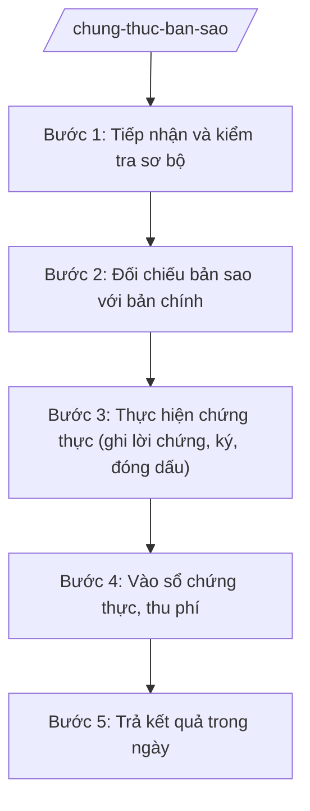

# Skill: Chứng thực bản sao, chữ ký

## 2. Khi nào dùng
- Người dân mang bản chính và bản sao giấy tờ đến yêu cầu chứng thực bản sao từ bản chính.
- Người dân yêu cầu chứng thực chữ ký trên giấy tờ, văn bản.
- Cần kiểm tra bản chính có bị tẩy xóa, sửa chữa không; xác định loại giấy tờ có được phép chứng thực theo quy định.
- Cần đóng dấu chứng thực, ký xác nhận, thu phí và trả kết quả trong ngày làm việc.

## 3. Đầu vào (Input)

| Trường | Mô tả | Bắt buộc |
|--------|-------|----------|
| `ban_chinh` | Bản chính giấy tờ cần chứng thực (người dân xuất trình) | Có |
| `ban_sao` | Bản sao (photocopy/in) cần chứng thực, đã đánh số trang | Có |
| `giay_to_nguoi_yeu_cau` | CCCD/hộ chiếu của người yêu cầu chứng thực | Có |
| `loai_chung_thuc` | Chứng thực bản sao từ bản chính / chứng thực chữ ký | Có |
| `van_ban_ky` | Văn bản cần chứng thực chữ ký (nếu loại là chứng thực chữ ký) | Không |
| `so_luong_ban` | Số lượng bản sao yêu cầu chứng thực | Có |

## 4. Quy trình

**Bước 1. Tiếp nhận và kiểm tra sơ bộ**
- Làm gì: Tiếp nhận bản chính, bản sao và giấy tờ của người yêu cầu; kiểm tra loại giấy tờ có thuộc diện được chứng thực theo quy định không; cấp Giấy tiếp nhận và hẹn trả kết quả trong ngày.
- Dùng input: `ban_chinh`, `ban_sao`, `giay_to_nguoi_yeu_cau`, `loai_chung_thuc`, `so_luong_ban`
- Vai trò: Công chức Tư pháp – Hộ tịch tiếp nhận. AI hỗ trợ kiểm tra danh mục giấy tờ không được chứng thực theo quy định và soạn Giấy tiếp nhận, Giấy hẹn ⏱ ~10 phút/hồ sơ (ước tính).
- Lưu ý nghiệp vụ: Từ chối ngay các loại giấy tờ không được chứng thực (bản chính do cơ quan có thẩm quyền cấp có ghi "không được chứng thực", giấy tờ bị tẩy xóa...). Giải thích rõ lý do từ chối cho người dân.
- → Kết quả bước: Giấy tiếp nhận + Giấy hẹn trả kết quả trong ngày; hồ sơ đủ điều kiện chuyển sang đối chiếu.

**Bước 2. Đối chiếu bản sao với bản chính**
- Làm gì: Đối chiếu từng trang, từng nội dung của bản sao với bản chính; kiểm tra dấu hiệu tẩy xóa, sửa chữa, thêm bớt nội dung trên bản chính và bản sao; kiểm tra tính toàn vẹn, liên tục của các trang.
- Dùng input: `ban_chinh`, `ban_sao`
- Vai trò: Công chức Tư pháp – Hộ tịch trực tiếp đối chiếu. AI hỗ trợ lập biên bản đối chiếu (ghi số trang, dấu hiệu bất thường nếu có) để lưu hồ sơ ⏱ ~15 phút/hồ sơ (ước tính).
- Lưu ý nghiệp vụ: Tuyệt đối không chứng thực bản sao từ bản chính bị tẩy xóa, sửa chữa, hoặc bản sao không khớp nội dung bản chính. Đối với chứng thực chữ ký: người ký phải ký trước mặt công chức chứng thực, kiểm tra giấy tờ tùy thân và năng lực hành vi của người ký.
- → Kết quả bước: Kết luận bản sao khớp/không khớp với bản chính; biên bản đối chiếu đã lập.

**Bước 3. Thực hiện chứng thực (ghi lời chứng, ký, đóng dấu)**
- Làm gì: Ghi lời chứng chứng thực theo mẫu quy định vào từng bản sao (hoặc văn bản chứng thực chữ ký); người có thẩm quyền ký; đóng dấu của UBND xã giáp lai (nếu nhiều trang) và dấu chứng thực.
- Dùng input: `ban_sao` đã đối chiếu đạt, `van_ban_ky` (nếu chứng thực chữ ký)
- Vai trò: Người có thẩm quyền chứng thực của UBND xã (Chủ tịch, Phó Chủ tịch được phân công hoặc công chức được ủy quyền) ký lời chứng. AI hỗ trợ soạn lời chứng đúng mẫu, kiểm tra đầy đủ yếu tố (số, ngày, họ tên người ký chứng thực) ⏱ ~15 phút/hồ sơ (ước tính).
- Lưu ý nghiệp vụ: Lời chứng phải ghi rõ "chứng thực bản sao đúng với bản chính" hoặc nội dung chứng thực chữ ký theo mẫu; đóng dấu giáp lai các trang để chống thay trang. Không ký khống, không đóng dấu trước khi đối chiếu xong.
- → Kết quả bước: Các bản sao đã có lời chứng, chữ ký người có thẩm quyền và dấu UBND xã.

**Bước 4. Vào sổ chứng thực, thu phí**
- Làm gì: Ghi đầy đủ vào Sổ chứng thực theo số thứ tự; tính phí chứng thực theo số lượng bản/trang; thu phí, cấp biên lai.
- Dùng input: `so_luong_ban`, thông tin người yêu cầu, số chứng thực đã cấp
- Vai trò: Công chức Tư pháp – Hộ tịch vào sổ và thu phí. AI hỗ trợ tính phí tự động theo biểu phí, lập biên lai và cập nhật Sổ chứng thực ⏱ ~10 phút/hồ sơ (ước tính).
- Lưu ý nghiệp vụ: Mỗi việc chứng thực phải có số thứ tự riêng trong Sổ chứng thực, ghi đúng ngày thực hiện. Phí thu đúng mức quy định của HĐND tỉnh; cấp biên lai cho từng lượt thu.
- → Kết quả bước: Sổ chứng thực đã ghi; phí đã thu đúng, có biên lai.

**Bước 5. Trả kết quả trong ngày**
- Làm gì: Trả bản sao đã chứng thực (kèm bản chính) cho người yêu cầu theo Giấy hẹn; hướng dẫn kiểm tra lại dấu, chữ ký trước khi nhận.
- Dùng input: bản sao đã chứng thực, `ban_chinh`, Giấy hẹn trả kết quả
- Vai trò: Công chức Tư pháp – Hộ tịch trả kết quả. AI hỗ trợ cập nhật Sổ theo dõi trả kết quả ⏱ ~5 phút/hồ sơ (ước tính).
- Lưu ý nghiệp vụ: Trả đúng người yêu cầu hoặc người được ủy quyền; trả cả bản chính cho người dân (không giữ bản chính). Thời hạn trả kết quả trong ngày làm việc tiếp nhận hồ sơ.
- → Kết quả bước: Người dân đã nhận đầy đủ bản sao chứng thực và bản chính; Sổ theo dõi đã cập nhật.

## Luồng quy trình (Workflow)

## 5. Đầu ra (Output)

Sản phẩm:
- Bản sao đã chứng thực (có lời chứng, chữ ký, dấu UBND xã) — giao người dân
- Văn bản đã chứng thực chữ ký (nếu loại chứng thực chữ ký) — giao người dân
- Sổ chứng thực đã ghi — lưu tại UBND xã
- Biên lai thu phí, Sổ theo dõi trả kết quả — lưu hồ sơ

### Cấu trúc output chuẩn

Khung lời chứng chứng thực bản sao từ bản chính gồm các phần theo đúng thứ tự, đúng thể thức NĐ 30/2020/NĐ-CP:
1. Quốc hiệu "CỘNG HÒA XÃ HỘI CHỦ NGHĨA VIỆT NAM" — Tiêu ngữ "Độc lập – Tự do – Hạnh phúc" (trên văn bản chứng thực chữ ký; lời chứng trên bản sao ghi gọn số, ngày)
2. Số chứng thực / ký hiệu Sổ chứng thực
3. Tên cơ quan: "ỦY BAN NHÂN DÂN XÃ A, TỈNH A"
4. Tên loại: "LỜI CHỨNG CHỨNG THỰC BẢN SAO TỪ BẢN CHÍNH" (hoặc "CHỨNG THỰC CHỮ KÝ")
5. Nội dung lời chứng: xác nhận bản sao đúng với bản chính; số trang; họ tên người yêu cầu chứng thực; ngày thực hiện chứng thực
6. Địa danh, ngày, tháng, năm chứng thực
7. Chữ ký người thực hiện chứng thực (ghi rõ họ tên, chức vụ), đóng dấu UBND xã; dấu giáp lai các trang (nếu nhiều trang)
8. Phân phối: bản chứng thực giao người yêu cầu; lưu sổ chứng thực và hồ sơ tại UBND xã.

> **Chuẩn tài liệu đầu ra** (thứ tự ưu tiên):
> 1. Chuẩn riêng của ngành/cơ quan chủ quản — mẫu, biểu mẫu, quy chuẩn tại văn bản quy phạm chuyên ngành (xem mục "Căn cứ & lưu ý").
> 2. Tài liệu không có quy chuẩn riêng — thể thức NĐ 30/2020/NĐ-CP: Quốc hiệu và Tiêu ngữ; tên cơ quan ban hành; số, ký hiệu; địa danh và thời gian; tên loại và trích yếu; nội dung; chức vụ, họ tên, chữ ký người có thẩm quyền; dấu, chữ ký số; nơi nhận (kèm Phụ lục nếu có).

## 6. Checklist nghiệm thu
- [ ] Bản chính đã được đối chiếu từng trang với bản sao; không có dấu hiệu tẩy xóa, sửa chữa
- [ ] Loại giấy tờ thuộc diện được phép chứng thực theo quy định
- [ ] Đối với chứng thực chữ ký: người ký đã ký trước mặt công chức chứng thực, đã kiểm tra giấy tờ tùy thân
- [ ] Lời chứng ghi đúng mẫu, đủ các yếu tố: số chứng thực, ngày, họ tên người ký chứng thực
- [ ] Đã ký bởi người có thẩm quyền chứng thực; đóng dấu UBND xã và dấu giáp lai (nếu nhiều trang)
- [ ] Đã ghi đầy đủ vào Sổ chứng thực theo số thứ tự, đúng ngày thực hiện
- [ ] Phí chứng thực tính đúng theo số lượng bản/trang, thu đúng mức, có biên lai
- [ ] Trả kết quả trong ngày; trả cả bản chính cho người dân
- [ ] Không có dữ liệu, căn cứ pháp lý nào do AI bịa ra
- [ ] Đã qua human gate: công chức đối chiếu → người có thẩm quyền ký chứng thực

## 7. Ví dụ mô phỏng

*Dữ liệu dưới đây là giả lập 100% phục vụ minh họa.*

### Input mẫu
- ban_chinh: Bằng tốt nghiệp THPT của ông Nguyễn Văn Dân (bản gốc, không tẩy xóa)
- ban_sao: 02 bản photocopy Bằng tốt nghiệp THPT (mỗi bản 01 trang)
- giay_to_nguoi_yeu_cau: CCCD của ông Nguyễn Văn Dân
- loai_chung_thuc: Chứng thực bản sao từ bản chính
- so_luong_ban: 02 bản

### Output mẫu

**LỜI CHỨNG CHỨNG THỰC BẢN SAO TỪ BẢN CHÍNH**

Số chứng thực: 123/SCT-UBND — Sổ chứng thực số: 05

ỦY BAN NHÂN DÂN XÃ A, TỈNH A

Chứng thực bản sao đúng với bản chính.
Bản sao gồm: 01 trang.
Người yêu cầu chứng thực: Nguyễn Văn Dân.

Xã A, ngày 09 tháng 10 năm 2026

Người thực hiện chứng thực
(ký, đóng dấu, ghi rõ họ tên, chức vụ)
Trần Thị B — Phó Chủ tịch UBND xã

## 8. Human gate
Công chức Tư pháp – Hộ tịch tiếp nhận, đối chiếu bản sao với bản chính → người có thẩm quyền chứng thực của UBND xã (Chủ tịch/Phó Chủ tịch được phân công) ký lời chứng, đóng dấu. AI chỉ hỗ trợ soạn lời chứng, tính phí và vào sổ; việc đối chiếu và ký chứng thực do con người thực hiện trực tiếp.

## 9. Giới hạn
AI tuyệt đối KHÔNG: quyết định chứng thực hay từ chối chứng thực thay người có thẩm quyền; tự ký lời chứng, tự đóng dấu; bịa số chứng thực, căn cứ pháp lý; dùng mẫu lời chứng, văn bản đã hết hiệu lực; tư vấn vượt thẩm quyền cấp xã.

## 10. Căn cứ & lưu ý
- TT 09/2025/TT-BTP (hướng dẫn chức năng, nhiệm vụ lĩnh vực tư pháp của Văn phòng HĐND & UBND cấp xã; hiệu lực 01/7/2025)
- NĐ 30/2020/NĐ-CP (thể thức văn bản hành chính)
- NĐ 118/2025/NĐ-CP (cơ chế một cửa)
- Lưu ý: không chứng thực bản sao từ bản chính bị tẩy xóa, sửa chữa; không chứng thực các loại giấy tờ không được phép chứng thực theo quy định; trả kết quả trong ngày làm việc.
