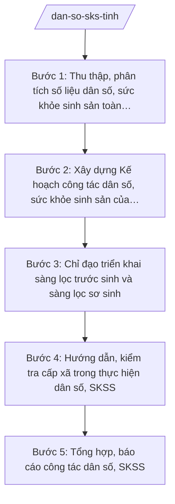

# Skill: Dân số, sức khỏe sinh sản

## 2. Khi nào dùng

- Khi cần thu thập, phân tích số liệu dân số, sức khỏe sinh sản trên địa bàn tỉnh (tỷ suất sinh, tử vong mẹ/trẻ em, tỷ lệ sàng lọc trước sinh/sơ sinh, mất cân bằng giới tính khi sinh).
- Khi cần xây dựng Kế hoạch công tác dân số, sức khỏe sinh sản hằng năm của tỉnh.
- Khi cần chỉ đạo, hướng dẫn triển khai sàng lọc trước sinh và sàng lọc sơ sinh tại các cơ sở y tế trong tỉnh.
- Khi cần tổ chức truyền thông, tư vấn về dân số, sức khỏe sinh sản, kế hoạch hóa gia đình trên địa bàn.
- Khi cần kiểm tra, giám sát việc thực hiện công tác dân số, SKSS ở cấp xã và tổng hợp báo cáo gửi Bộ Y tế, UBND tỉnh.

## 3. Đầu vào (Input)

| Trường | Mô tả | Bắt buộc |
|--------|-------|----------|
| `so_lieu_dan_so` | Số liệu dân số: dân số trung bình, tỷ suất sinh thô, tỷ số giới tính khi sinh, tỷ lệ tăng dân số tự nhiên theo xã | Có |
| `so_lieu_sks` | Số liệu SKSS: tử vong mẹ, tử vong trẻ em, tỷ lệ sàng lọc trước sinh/sơ sinh, tỷ lệ sử dụng biện pháp tránh thai | Có |
| `bao_cao_co_so` | Báo cáo của trung tâm y tế xã, trạm y tế xã về triển khai dân số, SKSS | Có |
| `muc_tieu_ky` | Mục tiêu công tác dân số, SKSS của tỉnh trong năm/kỳ kế hoạch | Có |
| `nang_luc_sang_loc` | Hiện trạng năng lực sàng lọc trước sinh/sơ sinh: cơ sở thực hiện, trang thiết bị, nhân lực | Không |
| `van_ban_chi_dao` | Văn bản chỉ đạo của Bộ Y tế, UBND tỉnh về dân số, SKSS (nếu có) | Không |

## 4. Quy trình

**Bước 1. Thu thập, phân tích số liệu dân số, sức khỏe sinh sản toàn tỉnh**
- Làm gì: Tập hợp số liệu dân số, SKSS từ Chi cục Dân số (hoặc đơn vị phụ trách), trung tâm y tế xã, trạm y tế xã; kiểm tra tính đầy đủ, nhất quán; phân tích xu hướng (tỷ suất sinh, giới tính khi sinh, tử vong mẹ/trẻ em, độ bao phủ sàng lọc); xác định địa bàn có chỉ số xấu cần can thiệp.
- Dùng input: `so_lieu_dan_so`, `so_lieu_sks`, `bao_cao_co_so`.
- Vai trò: Chuyên viên phụ trách dân số thuộc Sở Y tế tổng hợp, phân tích; AI hỗ trợ lập bảng, vẽ biểu đồ xu hướng, so sánh với mục tiêu ⏱ ~2 ngày (ước tính).
- Lưu ý nghiệp vụ: Số liệu từ nguồn chính thống (hệ thống thống kê dân số, báo cáo y tế); phân tích theo địa bàn để xác định trọng điểm; lưu ý các chỉ số nhạy cảm (mất cân bằng giới tính khi sinh) cần đánh giá thận trọng.
- → Kết quả bước: Báo cáo phân tích thực trạng dân số, SKSS tỉnh (kèm bảng số liệu, biểu đồ).

**Bước 2. Xây dựng Kế hoạch công tác dân số, sức khỏe sinh sản của tỉnh**
- Làm gì: Soạn thảo Kế hoạch: mục tiêu cụ thể (giảm tử vong mẹ/trẻ em, nâng độ bao phủ sàng lọc, kiểm soát mất cân bằng giới tính khi sinh); nhiệm vụ, giải pháp (truyền thông, cung cấp dịch vụ, đào tạo); phân công trách nhiệm (Sở Y tế, Chi cục Dân số, trung tâm y tế xã, UBND cấp xã); kinh phí; chế độ báo cáo.
- Dùng input: Phân tích bước 1, `muc_tieu_ky`, `nang_luc_sang_loc`, `van_ban_chi_dao`.
- Vai trò: Chuyên viên phụ trách dân số soạn dự thảo; Trưởng phòng kiểm tra; Phó Giám đốc Sở (ông Đỗ Văn U) chỉ đạo hoàn thiện; Giám đốc Sở (ông Hoàng Văn S) ký ban hành (hoặc trình UBND tỉnh khi vượt thẩm quyền Sở); AI hỗ trợ soạn thảo theo thể thức NĐ 30/2020/NĐ-CP ⏱ ~3 ngày (ước tính).
- Lưu ý nghiệp vụ: Mục tiêu phải lượng hóa được, sát thực tế; phân công rõ việc cấp tỉnh (chỉ đạo, hướng dẫn, kiểm tra) và việc cấp xã (triển khai trực tiếp); kinh phí khả thi, có nguồn rõ ràng.
- → Kết quả bước: Dự thảo Kế hoạch công tác dân số, SKSS tỉnh (năm …).

**Bước 3. Chỉ đạo triển khai sàng lọc trước sinh và sàng lọc sơ sinh**
- Làm gì: Rà soát năng lực sàng lọc của các cơ sở y tế trong tỉnh; tham mưu mở rộng điểm sàng lọc, đào tạo nhân lực, bảo đảm trang thiết bị, sinh phẩm; ban hành văn bản hướng dẫn quy trình sàng lọc, chuyển tuyến ca nghi ngờ; theo dõi tỷ lệ bao phủ.
- Dùng input: `nang_luc_sang_loc`, `so_lieu_sks`, kế hoạch bước 2.
- Vai trò: Chuyên viên phụ trách dân số phối hợp bệnh viện tuyến tỉnh xây dựng hướng dẫn; Trưởng phòng kiểm tra; Giám đốc Sở ký văn bản chỉ đạo; AI hỗ trợ soạn hướng dẫn quy trình, bảng theo dõi ⏱ ~2 ngày (ước tính).
- Lưu ý nghiệp vụ: Sàng lọc phải tự nguyện, bảo đảm quyền riêng tư của người được sàng lọc; ca nghi ngờ phải được tư vấn, chuyển tuyến kịp thời; không ép buộc, không phân biệt đối xử.
- → Kết quả bước: Văn bản chỉ đạo/hướng dẫn sàng lọc trước sinh, sơ sinh + danh sách cơ sở thực hiện.

**Bước 4. Hướng dẫn, kiểm tra cấp xã trong thực hiện dân số, SKSS**
- Làm gì: Soạn văn bản hướng dẫn nghiệp vụ cho Phòng Văn hóa – Xã hội và Trạm Y tế xã: nội dung truyền thông dân số, tư vấn SKSS, quản lý thai nghén, theo dõi bà mẹ/trẻ em; tổ chức kiểm tra, giám sát việc thực hiện tại một số xã trọng điểm; tổng hợp khó khăn, hỗ trợ tháo gỡ.
- Dùng input: Kế hoạch bước 2, `bao_cao_co_so`.
- Vai trò: Chuyên viên phụ trách dân số soạn hướng dẫn, tham gia đoàn kiểm tra; Trưởng phòng kiểm tra nội dung; AI hỗ trợ biên tập tài liệu hướng dẫn dễ áp dụng ⏱ ~2 ngày (ước tính).
- Lưu ý nghiệp vụ: Hướng dẫn phải cụ thể, phù hợp năng lực tuyến xã; kiểm tra có trọng tâm (xã có chỉ số xấu); kết quả kiểm tra là cơ sở hỗ trợ, không phải để xử phạt.
- → Kết quả bước: Văn bản hướng dẫn nghiệp vụ cho cấp xã + báo cáo kết quả kiểm tra, giám sát.

**Bước 5. Tổng hợp, báo cáo công tác dân số, SKSS**
- Làm gì: Tổng hợp kết quả thực hiện kế hoạch toàn tỉnh: các chỉ số đạt được so với mục tiêu, độ bao phủ sàng lọc, hoạt động truyền thông; phân tích tồn tại, nguyên nhân; soạn báo cáo gửi Bộ Y tế (Cục Dân số) và UBND tỉnh; đề xuất, kiến nghị.
- Dùng input: Kết quả các bước 1–4, `muc_tieu_ky`.
- Vai trò: Chuyên viên tổng hợp, soạn báo cáo; Trưởng phòng kiểm tra; Giám đốc Sở (ông Hoàng Văn S) ký báo cáo; AI hỗ trợ tổng hợp số liệu, soạn báo cáo theo thể thức NĐ 30/2020/NĐ-CP ⏱ ~2 ngày (ước tính).
- Lưu ý nghiệp vụ: Đánh giá trung thực mức độ đạt mục tiêu; số liệu khớp giữa các bảng; kiến nghị phải rõ nội dung, đối tượng (đầu tư trang thiết bị, đào tạo nhân lực, kinh phí truyền thông).
- → Kết quả bước: Báo cáo công tác dân số, SKSS tỉnh (kỳ …) gửi Bộ Y tế và UBND tỉnh.

## Luồng quy trình (Workflow)

## 5. Đầu ra (Output)

**Danh sách sản phẩm:**
1. Kế hoạch công tác dân số, sức khỏe sinh sản tỉnh (sản phẩm chính 1).
2. Báo cáo công tác dân số, SKSS tỉnh (sản phẩm chính 2).
3. Văn bản chỉ đạo/hướng dẫn sàng lọc trước sinh, sơ sinh.
4. Văn bản hướng dẫn nghiệp vụ dân số, SKSS cho cấp xã.
5. Báo cáo phân tích thực trạng dân số, SKSS (phụ lục chuyên môn).
6. Bảng tổng hợp chỉ số dân số, SKSS theo xã (phụ lục số liệu).

**Cấu trúc output chuẩn — Kế hoạch công tác dân số, SKSS:**
- Thể thức: tuân thủ Nghị định 30/2020/NĐ-CP về công tác văn thư.

1. Quốc hiệu "CỘNG HÒA XÃ HỘI CHỦ NGHĨA VIỆT NAM", Tiêu ngữ "Độc lập – Tự do – Hạnh phúc".
2. Số, ký hiệu văn bản: số/ký hiệu theo quy định (vd: 1234/KH-SYT).
3. Địa danh, ngày tháng năm ban hành: "Tỉnh A, ngày … tháng … năm …".
4. Tên loại và trích yếu: "KẾ HOẠCH — Công tác dân số và sức khỏe sinh sản tỉnh A (năm …)".
5. Căn cứ: TT 20/2025/TT-BYT; TT 16/2025/TT-BYT; TT 17/2025/TT-BYT; văn bản chỉ đạo của Bộ Y tế, UBND tỉnh (nếu có).
6. Nội dung: I. Mục đích, yêu cầu; II. Thực trạng dân số, SKSS; III. Mục tiêu cụ thể; IV. Nhiệm vụ, giải pháp (truyền thông; sàng lọc trước sinh, sơ sinh; chăm sóc SKSS; đào tạo nhân lực); V. Phân công trách nhiệm (Sở Y tế, Chi cục Dân số, trung tâm y tế xã, UBND cấp xã); VI. Kinh phí; VII. Chế độ báo cáo; VIII. Tổ chức thực hiện.
7. Nơi nhận: Bộ Y tế, UBND tỉnh, các đơn vị y tế, UBND cấp xã, lưu VP Sở.
8. Chữ ký: Giám đốc Sở Y tế ký (hoặc trình Chủ tịch UBND tỉnh ký khi vượt thẩm quyền Sở), đóng dấu.

**Cấu trúc output chuẩn — Báo cáo công tác dân số, SKSS:**

1. Quốc hiệu "CỘNG HÒA XÃ HỘI CHỦ NGHĨA VIỆT NAM", Tiêu ngữ "Độc lập – Tự do – Hạnh phúc".
2. Số, ký hiệu văn bản: số/ký hiệu theo quy định (vd: 1234/BC-SYT).
3. Địa danh, ngày tháng năm ban hành.
4. Tên loại và trích yếu: "BÁO CÁO — Công tác dân số và sức khỏe sinh sản tỉnh A (kỳ …)".
5. Căn cứ: Kế hoạch số …/KH-SYT; TT 20/2025/TT-BYT; TT 16/2025/TT-BYT; TT 17/2025/TT-BYT.
6. Nội dung: I. Kết quả thực hiện (bảng chỉ số so với mục tiêu); II. Sàng lọc trước sinh, sơ sinh; III. Truyền thông, tư vấn; IV. Kiểm tra, giám sát; V. Khó khăn, nguyên nhân; VI. Kiến nghị.
7. Nơi nhận: Bộ Y tế, UBND tỉnh, lưu VP Sở.
8. Chữ ký: Giám đốc Sở Y tế ký, đóng dấu.

## 6. Checklist nghiệm thu

- [ ] Báo cáo phân tích thực trạng có đầy đủ chỉ số (tỷ suất sinh, giới tính khi sinh, tử vong mẹ/trẻ em, độ bao phủ sàng lọc), nguồn số liệu rõ ràng.
- [ ] Kế hoạch có mục tiêu lượng hóa được, nhiệm vụ cụ thể, phân công rõ cấp tỉnh – cấp xã, kinh phí khả thi; đúng thể thức NĐ 30/2020/NĐ-CP.
- [ ] Văn bản hướng dẫn sàng lọc nêu rõ quy trình, cơ sở thực hiện, cơ chế chuyển tuyến ca nghi ngờ; bảo đảm nguyên tắc tự nguyện, riêng tư.
- [ ] Văn bản hướng dẫn cho cấp xã cụ thể, phù hợp năng lực tuyến xã; kiểm tra, giám sát có trọng điểm.
- [ ] Báo cáo đánh giá trung thực mức độ đạt mục tiêu, số liệu khớp giữa các bảng; kiến nghị rõ nội dung, đối tượng.
- [ ] Số liệu, địa danh trong văn bản khớp đúng Input; không bịa số liệu dân số, SKSS, số hiệu văn bản, căn cứ pháp lý.
- [ ] Định vị đúng cấp tỉnh: tham mưu, chỉ đạo, hướng dẫn, kiểm tra, tổng hợp — không viết như nghiệp vụ trực tiếp của trạm y tế xã.
- [ ] Đã qua human gate: Trưởng phòng kiểm tra, Giám đốc Sở ký duyệt theo thẩm quyền.

## 7. Ví dụ mô phỏng

*Dữ liệu dưới đây là giả lập 100% phục vụ minh họa.*

**Input mẫu:**
- so_lieu_dan_so: dân số tỉnh A năm 2026: 1.000.000 người; tỷ suất sinh thô 15‰; tỷ số giới tính khi sinh 112 bé trai/100 bé gái; 3 xã có tỷ số giới tính khi sinh trên 115
- so_lieu_sks: tử vong mẹ 40/100.000 ca sinh sống; tử vong trẻ em dưới 1 tuổi 12‰; tỷ lệ sàng lọc trước sinh 60%, sàng lọc sơ sinh 70%
- bao_cao_co_so: 10 trung tâm y tế xã báo cáo thiếu nhân lực tư vấn SKSS; 5 trạm y tế chưa triển khai sàng lọc sơ sinh
- muc_tieu_ky: năm 2027 — nâng sàng lọc trước sinh lên 75%, sàng lọc sơ sinh lên 85%; giảm tỷ số giới tính khi sinh xuống dưới 110
- nang_luc_sang_loc: Bệnh viện Đa khoa tỉnh A và 3 bệnh viện khu vực có đủ năng lực sàng lọc; 5 trung tâm y tế xã chưa có máy siêu âm 4D

**Output mẫu — Kế hoạch công tác dân số, SKSS (trích):**

> CỘNG HÒA XÃ HỘI CHỦ NGHĨA VIỆT NAM
> Độc lập – Tự do – Hạnh phúc
>
> Số: 1234/KH-SYT
>
> Tỉnh A, ngày 12 tháng 01 năm 2027
>
> **KẾ HOẠCH**
> **Công tác dân số và sức khỏe sinh sản tỉnh A năm 2027**
>
> Căn cứ Thông tư số 20/2025/TT-BYT ngày 23/6/2025 của Bộ Y tế hướng dẫn chức năng, nhiệm vụ, quyền hạn của cơ quan chuyên môn về y tế thuộc UBND cấp tỉnh;
> Căn cứ Thông tư số 17/2025/TT-BYT của Bộ Y tế quy định phân định thẩm quyền trong lĩnh vực dân số;
> Căn cứ Thông tư số 16/2025/TT-BYT của Bộ Y tế quy định phân định thẩm quyền trong lĩnh vực bà mẹ và trẻ em;
>
> **I. MỤC ĐÍCH, YÊU CẦU**
> 1. Nâng cao chất lượng dân số, giảm tử vong mẹ và trẻ em, mở rộng độ bao phủ sàng lọc trước sinh, sơ sinh trên địa bàn tỉnh A.
> 2. Kiểm soát mất cân bằng giới tính khi sinh.
>
> **II. THỰC TRẠNG**
> 1. Dân số 1.000.000 người; tỷ suất sinh thô 15‰; tỷ số giới tính khi sinh 112/100, có 03 xã trên 115.
> 2. Tử vong mẹ 40/100.000 ca sinh sống; tử vong trẻ em dưới 1 tuổi 12‰.
> 3. Tỷ lệ sàng lọc trước sinh 60%, sàng lọc sơ sinh 70%; 05 trung tâm y tế xã chưa có máy siêu âm 4D.
>
> **III. MỤC TIÊU NĂM 2027**
> 1. Sàng lọc trước sinh đạt 75%; sàng lọc sơ sinh đạt 85%.
> 2. Tỷ số giới tính khi sinh dưới 110 bé trai/100 bé gái.
> 3. Giảm tử vong mẹ xuống dưới 35/100.000 ca sinh sống.
>
> **IV. NHIỆM VỤ, GIẢI PHÁP**
> 1. Truyền thông: tổ chức chiến dịch truyền thông về SKSS, bình đẳng giới tại 03 xã có tỷ số giới tính khi sinh cao.
> 2. Sàng lọc: đầu tư 05 máy siêu âm cho 05 trung tâm y tế xã; đào tạo 20 cán bộ về sàng lọc trước sinh, sơ sinh.
> 3. Chăm sóc SKSS: hướng dẫn trạm y tế xã quản lý thai nghén, tư vấn kế hoạch hóa gia đình.
>
> **V. PHÂN CÔNG TRÁCH NHIỆM**
> 1. Sở Y tế: chỉ đạo, điều phối, tổng hợp báo cáo.
> 2. Chi cục Dân số tỉnh: triển khai truyền thông, theo dõi chỉ số.
> 3. Bệnh viện Đa khoa tỉnh A: hỗ trợ chuyên môn sàng lọc, đào tạo.
> 4. UBND cấp xã: tổ chức thực hiện tại địa bàn; báo cáo định kỳ.
>
> **VI. KINH PHÍ:** 500 triệu đồng từ ngân sách sự nghiệp y tế và chương trình mục tiêu.
>
> **VII. CHẾ ĐỘ BÁO CÁO:** báo cáo quý về Sở Y tế; báo cáo năm gửi Bộ Y tế, UBND tỉnh.
>
> **Nơi nhận:** như trên; Bộ Y tế; UBND tỉnh A; lưu VP Sở.
>
> **GIÁM ĐỐC**
> *(Ký, đóng dấu)*
> Hoàng Văn S

## 8. Human gate (người kiểm duyệt)

- Chuyên viên phụ trách dân số thuộc Sở Y tế soạn thảo, tổng hợp số liệu, dự thảo kế hoạch, báo cáo, văn bản hướng dẫn.
- Trưởng phòng phụ trách dân số kiểm tra nội dung chuyên môn, số liệu, thể thức.
- Phó Giám đốc Sở (ông Đỗ Văn U) chỉ đạo hoàn thiện dự thảo kế hoạch, báo cáo.
- Giám đốc Sở (ông Hoàng Văn S) ký ban hành Kế hoạch, văn bản chỉ đạo và báo cáo gửi Bộ Y tế (thuộc thẩm quyền Sở).
- Trường hợp kế hoạch cần nguồn lực lớn hoặc phối hợp nhiều ngành: trình Phó Chủ tịch UBND tỉnh (bà Lê Thị Q) / Chủ tịch UBND tỉnh (ông Phạm Văn P) phê duyệt.

## 9. Giới hạn (guardrails)

- AI KHÔNG ra quyết định hành chính thay người có thẩm quyền; không tự phê duyệt kế hoạch, không tự quyết định phân bổ kinh phí.
- AI KHÔNG tự ký, đóng dấu hoặc phát hành văn bản dưới danh nghĩa Sở Y tế hay lãnh đạo tỉnh.
- AI KHÔNG bịa số liệu dân số, SKSS, kết quả sàng lọc, số hiệu văn bản, căn cứ pháp lý.
- AI KHÔNG đưa ra tư vấn y tế cá nhân (chẩn đoán, chỉ định sàng lọc/điều trị cho cá nhân cụ thể); chỉ hỗ trợ công tác quản lý nhà nước.
- AI KHÔNG dùng văn bản đã hết hiệu lực; chỉ trích dẫn văn bản có trong tai-lieu-moi-nhat.md.

## 10. Căn cứ & lưu ý

- Thông tư số 20/2025/TT-BYT ngày 23/6/2025 của Bộ Y tế: hướng dẫn chức năng, nhiệm vụ, quyền hạn của Sở Y tế thuộc UBND cấp tỉnh (trong đó có nhiệm vụ dân số, sức khỏe sinh sản).
- Thông tư số 17/2025/TT-BYT của Bộ Y tế: quy định phân định thẩm quyền chính quyền địa phương 2 cấp trong lĩnh vực dân số.
- Thông tư số 16/2025/TT-BYT của Bộ Y tế: quy định phân định thẩm quyền chính quyền địa phương 2 cấp trong lĩnh vực bà mẹ và trẻ em.
- Nghị định số 147/2025/NĐ-CP ngày 12/6/2025: phân định thẩm quyền CQĐP 2 cấp trong lĩnh vực quản lý nhà nước của Bộ Y tế.
- Nghị định số 148/2025/NĐ-CP ngày 12/6/2025: phân quyền, phân cấp trong lĩnh vực y tế.
- Nghị định số 150/2025/NĐ-CP ngày 12/6/2025: tổ chức Sở Y tế thuộc UBND cấp tỉnh; sửa đổi bởi NĐ 370/2025/NĐ-CP.
- Nghị định số 30/2020/NĐ-CP của Chính phủ: thể thức văn bản hành chính.
- Lưu ý: cấp tỉnh tham mưu chính sách, chỉ đạo, hướng dẫn, kiểm tra, tổng hợp báo cáo ngành về dân số, SKSS; việc tư vấn, cung cấp dịch vụ trực tiếp cho người dân do trạm y tế xã, cơ sở y tế thực hiện — không trùng với skill cấp xã.
