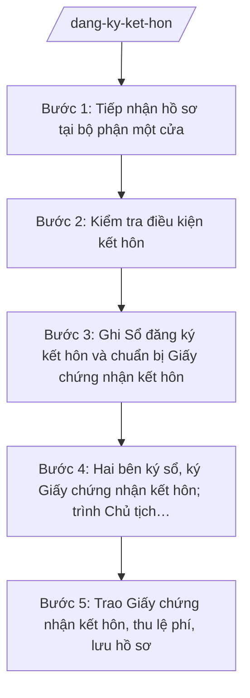

# Skill: Đăng ký kết hôn

## 2. Khi nào dùng
- Hai bên nam, nữ cùng đến bộ phận một cửa nộp Tờ khai đăng ký kết hôn.
- Cần kiểm tra điều kiện kết hôn: độ tuổi (nam đủ 20, nữ đủ 18), sự tự nguyện, không thuộc trường hợp cấm kết hôn.
- Cần kiểm tra giấy xác nhận tình trạng hôn nhân của hai bên, nhất là khi một bên cư trú khác xã.
- Cần tổ chức cho hai bên ký vào Sổ đăng ký kết hôn và Giấy chứng nhận kết hôn, trình Chủ tịch UBND xã ký và trao giấy.

## 3. Đầu vào (Input)

| Trường | Mô tả | Bắt buộc |
|--------|-------|----------|
| `to_khai` | Tờ khai đăng ký kết hôn (hai bên cùng ký) | Có |
| `giay_to_ben_nam` | CCCD/hộ chiếu của bên nam | Có |
| `giay_to_ben_nu` | CCCD/hộ chiếu của bên nữ | Có |
| `xac_nhan_doc_than_nam` | Giấy xác nhận tình trạng hôn nhân của bên nam | Có |
| `xac_nhan_doc_than_nu` | Giấy xác nhận tình trạng hôn nhân của bên nữ | Có |
| `ngay_sinh_nam` | Ngày, tháng, năm sinh của bên nam | Có |
| `ngay_sinh_nu` | Ngày, tháng, năm sinh của bên nữ | Có |
| `noi_cu_tru` | Nơi cư trú của hai bên (xác định thẩm quyền đăng ký) | Có |

## 4. Quy trình

**Bước 1. Tiếp nhận hồ sơ tại bộ phận một cửa**
- Làm gì: Tiếp nhận Tờ khai đăng ký kết hôn và giấy tờ của hai bên; yêu cầu hai bên cùng có mặt; cấp Giấy tiếp nhận hồ sơ và hẹn trả kết quả.
- Dùng input: `to_khai`, `giay_to_ben_nam`, `giay_to_ben_nu`, `xac_nhan_doc_than_nam`, `xac_nhan_doc_than_nu`, `noi_cu_tru`.
- Vai trò: Công chức Tư pháp – Hộ tịch (hoặc công chức bộ phận một cửa) tiếp nhận. AI hỗ trợ kiểm tra danh mục giấy tờ còn thiếu và soạn Giấy tiếp nhận, Giấy hẹn trả kết quả ⏱ ~15 phút/hồ sơ (ước tính).
- Lưu ý nghiệp vụ: Hai bên nam, nữ phải cùng có mặt khi nộp hồ sơ và khi nhận kết quả; không giải quyết khi chỉ một bên đến. Kiểm tra thẩm quyền: đăng ký tại UBND xã nơi cư trú của một trong hai bên.
- → Kết quả bước: Giấy tiếp nhận hồ sơ + Giấy hẹn trả kết quả đã giao; hồ sơ chuyển công chức Tư pháp – Hộ tịch thụ lý.

**Bước 2. Kiểm tra điều kiện kết hôn**
- Làm gì: Kiểm tra độ tuổi (nam từ đủ 20 tuổi, nữ từ đủ 18 tuổi trở lên); xác minh tình trạng hôn nhân (độc thân, đã ly hôn, vợ/chồng đã chết); kiểm tra quan hệ nhân thân, sự tự nguyện; rà soát các trường hợp cấm kết hôn theo quy định.
- Dùng input: `ngay_sinh_nam`, `ngay_sinh_nu`, `xac_nhan_doc_than_nam`, `xac_nhan_doc_than_nu`, `giay_to_ben_nam`, `giay_to_ben_nu`.
- Vai trò: Công chức Tư pháp – Hộ tịch thẩm định điều kiện kết hôn. AI hỗ trợ tính tuổi chính xác từ ngày sinh, đối chiếu giấy xác nhận tình trạng hôn nhân và cảnh báo trường hợp chưa đủ tuổi hoặc còn ràng buộc hôn nhân ⏱ ~30 phút/hồ sơ (ước tính).
- Lưu ý nghiệp vụ: Lỗi thường gặp: giấy xác nhận tình trạng hôn nhân hết thời hạn sử dụng; chưa đủ tuổi tính đến ngày đăng ký; một bên còn vợ/chồng nhưng khai độc thân. Trường hợp nghi ngờ cưỡng ép, tảo hôn phải xác minh kỹ, báo cáo lãnh đạo.
- → Kết quả bước: Kết luận đủ/không đủ điều kiện kết hôn; nếu không đủ điều kiện, lập văn bản từ chối có nêu rõ lý do và hướng dẫn khiếu nại.

**Bước 3. Ghi Sổ đăng ký kết hôn và chuẩn bị Giấy chứng nhận kết hôn**
- Làm gì: Ghi đầy đủ thông tin hai bên vào Sổ đăng ký kết hôn (sổ giấy); nhập liệu lên CSDL hộ tịch điện tử; soạn dự thảo Giấy chứng nhận kết hôn.
- Dùng input: toàn bộ thông tin hai bên đã kiểm tra ở Bước 2 (họ tên, ngày sinh, dân tộc, quốc tịch, nơi cư trú, giấy tờ tùy thân của bên nam và bên nữ).
- Vai trò: Công chức Tư pháp – Hộ tịch ghi sổ và nhập liệu. AI hỗ trợ đối chiếu sổ giấy – CSDL và soạn dự thảo Giấy chứng nhận kết hôn đúng mẫu ⏱ ~30 phút/hồ sơ (ước tính).
- Lưu ý nghiệp vụ: Thông tin hai bên phải khớp tuyệt đối giữa Tờ khai, giấy tờ tùy thân và giấy xác nhận tình trạng hôn nhân. Ghi sổ rõ ràng, không tẩy xóa.
- → Kết quả bước: Sổ đăng ký kết hôn đã ghi; CSDL hộ tịch điện tử đã cập nhật; dự thảo Giấy chứng nhận kết hôn đã soạn.

**Bước 4. Hai bên ký sổ, ký Giấy chứng nhận kết hôn; trình Chủ tịch UBND xã ký**
- Làm gì: Mời hai bên nam, nữ ký, ghi rõ họ tên vào Sổ đăng ký kết hôn và Giấy chứng nhận kết hôn; trình Chánh Văn phòng kiểm tra thể thức, sau đó trình Chủ tịch UBND xã ký, đóng dấu.
- Dùng input: Sổ đăng ký kết hôn, dự thảo Giấy chứng nhận kết hôn.
- Vai trò: Công chức Tư pháp – Hộ tịch tổ chức ký; Chánh Văn phòng HĐND và UBND kiểm tra thể thức (⏱ 15 phút); Chủ tịch UBND xã ký Giấy chứng nhận kết hôn. AI hỗ trợ kiểm tra thể thức theo NĐ 30/2020/NĐ-CP và lập phiếu trình ký ⏱ ~0,5 ngày làm việc chờ ký (ước tính).
- Lưu ý nghiệp vụ: Hai bên phải tự tay ký, không ký thay; kiểm tra chữ ký trên sổ và trên giấy chứng nhận thống nhất. Chỉ Chủ tịch UBND xã (hoặc người được ủy quyền hợp pháp) ký Giấy chứng nhận kết hôn.
- → Kết quả bước: Sổ đăng ký kết hôn có chữ ký hai bên; Giấy chứng nhận kết hôn đã được Chủ tịch UBND xã ký, đóng dấu.

**Bước 5. Trao Giấy chứng nhận kết hôn, thu lệ phí, lưu hồ sơ**
- Làm gì: Trao Giấy chứng nhận kết hôn cho hai bên (hai bên cùng nhận); thu lệ phí đăng ký hộ tịch theo quy định; lưu hồ sơ vào kho lưu trữ.
- Dùng input: Giấy chứng nhận kết hôn đã ký, Giấy hẹn trả kết quả.
- Vai trò: Công chức Tư pháp – Hộ tịch trao giấy và thu phí. AI hỗ trợ lập Sổ theo dõi trả kết quả, biên lai thu lệ phí và danh mục hồ sơ lưu trữ ⏱ ~15 phút/hồ sơ (ước tính).
- Lưu ý nghiệp vụ: Trao giấy trực tiếp cho hai bên vợ chồng, không trao qua người khác khi không có ủy quyền. Lệ phí thu đúng mức quy định, cấp biên lai đầy đủ.
- → Kết quả bước: Hai bên đã nhận Giấy chứng nhận kết hôn; lệ phí đã thu; hồ sơ lưu đầy đủ.

## Luồng quy trình (Workflow)

## 5. Đầu ra (Output)

Sản phẩm:
- Giấy chứng nhận kết hôn (bản chính) — trao hai bên vợ chồng
- Sổ đăng ký kết hôn (sổ giấy) đã ghi, có chữ ký hai bên — lưu tại UBND xã
- Dữ liệu đăng ký kết hôn trên CSDL hộ tịch điện tử — đồng bộ hệ thống
- Biên lai thu lệ phí, Sổ theo dõi trả kết quả — lưu hồ sơ

### Cấu trúc output chuẩn

Khung Giấy chứng nhận kết hôn gồm các phần theo đúng thứ tự, đúng thể thức NĐ 30/2020/NĐ-CP:
1. Quốc hiệu "CỘNG HÒA XÃ HỘI CHỦ NGHĨA VIỆT NAM" — Tiêu ngữ "Độc lập – Tự do – Hạnh phúc"
2. Số Giấy chứng nhận kết hôn / ký hiệu sổ đăng ký
3. Tên cơ quan cấp: "ỦY BAN NHÂN DÂN XÃ A, TỈNH A"
4. Tên loại văn bản: "GIẤY CHỨNG NHẬN KẾT HÔN" (chữ in hoa, cỡ lớn)
5. Nội dung: họ, chữ đệm và tên, ngày tháng năm sinh, dân tộc, quốc tịch, nơi cư trú, giấy tờ tùy thân của bên nam; tương tự của bên nữ; ngày đăng ký kết hôn
6. Địa danh, ngày, tháng, năm cấp Giấy chứng nhận kết hôn
7. Chữ ký của hai bên vợ chồng (ký, ghi rõ họ tên)
8. Chữ ký: "TM. ỦY BAN NHÂN DÂN / CHỦ TỊCH" + chữ ký + họ tên Chủ tịch UBND xã, đóng dấu UBND xã
9. Phân phối: Giấy chứng nhận kết hôn (bản chính) giao vợ chồng; lưu sổ đăng ký kết hôn + cập nhật CSDL hộ tịch điện tử.

> **Chuẩn tài liệu đầu ra** (thứ tự ưu tiên):
> 1. Chuẩn riêng của ngành/cơ quan chủ quản — mẫu, biểu mẫu, quy chuẩn tại văn bản quy phạm chuyên ngành (xem mục "Căn cứ & lưu ý").
> 2. Tài liệu không có quy chuẩn riêng — thể thức NĐ 30/2020/NĐ-CP: Quốc hiệu và Tiêu ngữ; tên cơ quan ban hành; số, ký hiệu; địa danh và thời gian; tên loại và trích yếu; nội dung; chức vụ, họ tên, chữ ký người có thẩm quyền; dấu, chữ ký số; nơi nhận (kèm Phụ lục nếu có).

## 6. Checklist nghiệm thu
- [ ] Hai bên nam, nữ cùng có mặt khi nộp hồ sơ và khi nhận kết quả
- [ ] Hồ sơ đủ: Tờ khai + CCCD hai bên + giấy xác nhận tình trạng hôn nhân của hai bên còn hiệu lực
- [ ] Bên nam đủ 20 tuổi, bên nữ đủ 18 tuổi tính đến ngày đăng ký; hai bên tự nguyện, không thuộc trường hợp cấm kết hôn
- [ ] Thông tin hai bên trên giấy chứng nhận khớp với giấy tờ tùy thân và giấy xác nhận tình trạng hôn nhân
- [ ] Hai bên đã ký, ghi rõ họ tên vào Sổ đăng ký kết hôn và Giấy chứng nhận kết hôn
- [ ] Đã ghi Sổ đăng ký kết hôn (sổ giấy) và cập nhật CSDL hộ tịch điện tử, số liệu khớp nhau
- [ ] Giấy chứng nhận kết hôn do Chủ tịch UBND xã ký, đóng dấu đúng quy định; thể thức đúng NĐ 30/2020/NĐ-CP
- [ ] Đã trao giấy trực tiếp cho hai bên, thu lệ phí đúng mức, có biên lai; hồ sơ lưu đầy đủ
- [ ] Không có dữ liệu, căn cứ pháp lý nào do AI bịa ra
- [ ] Đã qua human gate: công chức soạn → Chánh Văn phòng kiểm tra → Chủ tịch UBND xã ký duyệt

## 7. Ví dụ mô phỏng

*Dữ liệu dưới đây là giả lập 100% phục vụ minh họa.*

### Input mẫu
- to_khai: Tờ khai đăng ký kết hôn của ông Nguyễn Văn Dân và bà Trần Thị Dân (hai bên cùng ký)
- giay_to_ben_nam: CCCD của ông Nguyễn Văn Dân, sinh ngày 01/01/2000
- giay_to_ben_nu: CCCD của bà Trần Thị Dân, sinh ngày 02/02/2002
- xac_nhan_doc_than_nam: Giấy xác nhận tình trạng hôn nhân (độc thân) của UBND xã A cấp cho ông Nguyễn Văn Dân
- xac_nhan_doc_than_nu: Giấy xác nhận tình trạng hôn nhân (độc thân) của UBND xã A cấp cho bà Trần Thị Dân
- ngay_sinh_nam: 01/01/2000
- ngay_sinh_nu: 02/02/2002
- noi_cu_tru: Thôn B, xã A, tỉnh A (cả hai bên)

### Output mẫu

**GIẤY CHỨNG NHẬN KẾT HÔN**

CỘNG HÒA XÃ HỘI CHỦ NGHĨA VIỆT NAM
Độc lập – Tự do – Hạnh phúc

Số: 123/GCNKH-UBND

ỦY BAN NHÂN DÂN XÃ A, TỈNH A

**GIẤY CHỨNG NHẬN KẾT HÔN**

Bên nam: Nguyễn Văn Dân — Sinh ngày: 01/01/2000
Dân tộc: Kinh — Quốc tịch: Việt Nam
Nơi cư trú: Thôn B, xã A, tỉnh A

Bên nữ: Trần Thị Dân — Sinh ngày: 02/02/2002
Dân tộc: Kinh — Quốc tịch: Việt Nam
Nơi cư trú: Thôn B, xã A, tỉnh A

Đã đăng ký kết hôn ngày 05 tháng 10 năm 2026.

Xã A, ngày 05 tháng 10 năm 2026
Bên nam (ký, ghi rõ họ tên): Nguyễn Văn Dân
Bên nữ (ký, ghi rõ họ tên): Trần Thị Dân

TM. ỦY BAN NHÂN DÂN
CHỦ TỊCH
(ký, đóng dấu)
Nguyễn Văn A

## 8. Human gate
Công chức Tư pháp – Hộ tịch tiếp nhận, thẩm định điều kiện kết hôn và soạn dự thảo → Chánh Văn phòng HĐND và UBND kiểm tra tính hợp lệ, thể thức → Chủ tịch UBND xã ký Giấy chứng nhận kết hôn trước khi trao cho hai bên. AI chỉ hỗ trợ kiểm tra tuổi, đối chiếu giấy tờ và soạn thảo, không quyết định thay người có thẩm quyền.

## 9. Giới hạn
AI tuyệt đối KHÔNG: ra quyết định công nhận hay từ chối đăng ký kết hôn thay người có thẩm quyền; tự ký hoặc phát hành Giấy chứng nhận kết hôn; bịa tuổi, tình trạng hôn nhân, căn cứ pháp lý; dùng biểu mẫu, văn bản đã hết hiệu lực; tư vấn các trường hợp kết hôn có yếu tố nước ngoài vượt thẩm quyền cấp xã mà không hướng dẫn chuyển cấp có thẩm quyền.

## 10. Căn cứ & lưu ý
- TT 09/2025/TT-BTP (hướng dẫn chức năng, nhiệm vụ lĩnh vực tư pháp của Văn phòng HĐND & UBND cấp xã; hiệu lực 01/7/2025)
- Luật Hộ tịch
- NĐ 30/2020/NĐ-CP (thể thức văn bản hành chính)
- NĐ 118/2025/NĐ-CP (cơ chế một cửa)
- Lưu ý: nam từ đủ 20 tuổi, nữ từ đủ 18 tuổi trở lên; hai bên phải tự nguyện, cùng có mặt; không thuộc trường hợp cấm kết hôn.
