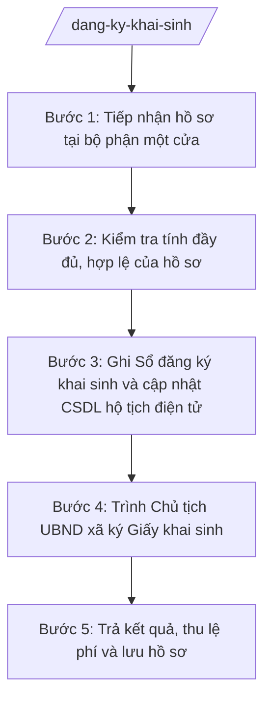

# Skill: Đăng ký khai sinh

## 2. Khi nào dùng
- Người dân đến bộ phận một cửa nộp Tờ khai đăng ký khai sinh kèm Giấy chứng sinh.
- Cần kiểm tra hồ sơ đăng ký đúng hạn hay quá hạn, xử lý trường hợp đặc biệt (trẻ sinh ra tại bệnh viện ngoài địa bàn, trẻ bị bỏ rơi, trẻ có yếu tố nước ngoài thuộc thẩm quyền xã).
- Cần ghi Sổ đăng ký khai sinh, cập nhật cơ sở dữ liệu hộ tịch điện tử và trình Chủ tịch UBND xã ký Giấy khai sinh.
- Cần trả kết quả, thu lệ phí và hướng dẫn người dân nhận trích lục khai sinh khi có nhu cầu.

## 3. Đầu vào (Input)

| Trường | Mô tả | Bắt buộc |
|--------|-------|----------|
| `to_khai` | Tờ khai đăng ký khai sinh (người đi khai ký tên) | Có |
| `giay_chung_sinh` | Giấy chứng sinh do cơ sở y tế cấp | Có |
| `giay_to_nguoi_di_khai` | CCCD/hộ chiếu của người đi đăng ký khai sinh | Có |
| `giay_to_cha_me` | Giấy tờ tùy thân của cha, mẹ trẻ (nếu có) | Không |
| `giay_chung_nhan_ket_hon` | Giấy chứng nhận kết hôn của cha mẹ (nếu có, để xác định họ, tên, quốc tịch) | Không |
| `ngay_sinh` | Ngày, tháng, năm sinh của trẻ | Có |
| `dang_ky_qua_han` | Đúng hạn / quá hạn đăng ký khai sinh | Có |
| `nguoi_yeu_cau` | Họ tên người đi đăng ký khai sinh và quan hệ với trẻ | Có |

## 4. Quy trình

**Bước 1. Tiếp nhận hồ sơ tại bộ phận một cửa**
- Làm gì: Tiếp nhận Tờ khai đăng ký khai sinh và các giấy tờ kèm theo; kiểm tra số lượng, hình thức giấy tờ; cấp Giấy tiếp nhận hồ sơ và hẹn trả kết quả cho người dân.
- Dùng input: `to_khai`, `giay_chung_sinh`, `giay_to_nguoi_di_khai`, `giay_to_cha_me`, `nguoi_yeu_cau`
- Vai trò: Công chức Tư pháp – Hộ tịch (hoặc công chức bộ phận một cửa) tiếp nhận. AI hỗ trợ kiểm tra danh mục giấy tờ còn thiếu và soạn Giấy tiếp nhận hồ sơ, Giấy hẹn trả kết quả ⏱ ~15 phút/hồ sơ (ước tính).
- Lưu ý nghiệp vụ: Không được từ chối đăng ký khai sinh vì bất kỳ lý do gì; trẻ em được đăng ký khai sinh không phụ thuộc vào nơi cư trú của cha, mẹ. Trường hợp không có Giấy chứng sinh, hướng dẫn người dân làm văn bản cam đoan theo quy định.
- → Kết quả bước: Giấy tiếp nhận hồ sơ + Giấy hẹn trả kết quả đã giao cho người dân; hồ sơ chuyển sang công chức Tư pháp – Hộ tịch thụ lý.

**Bước 2. Kiểm tra tính đầy đủ, hợp lệ của hồ sơ**
- Làm gì: Đối chiếu nội dung Tờ khai với Giấy chứng sinh và giấy tờ tùy thân; xác định đăng ký đúng hạn hay quá hạn; kiểm tra họ, tên trẻ (không đặt tên bằng số, ký tự không phải chữ), xác định quốc tịch, quê quán của trẻ.
- Dùng input: `to_khai`, `giay_chung_sinh`, `giay_to_cha_me`, `giay_chung_nhan_ket_hon`, `ngay_sinh`, `dang_ky_qua_han`
- Vai trò: Công chức Tư pháp – Hộ tịch thẩm định hồ sơ. AI hỗ trợ đối chiếu chéo thông tin các giấy tờ, cảnh báo sai lệch (tên cha mẹ, ngày sinh) và soạn Phiếu yêu cầu bổ sung hồ sơ nếu thiếu ⏱ ~30 phút/hồ sơ (ước tính).
- Lưu ý nghiệp vụ: Lỗi thường gặp: ngày sinh trên Tờ khai khác Giấy chứng sinh; họ tên cha mẹ viết tắt; thiếu xác định quốc tịch khi cha hoặc mẹ là người nước ngoài. Trường hợp quá hạn đăng ký phải ghi rõ lý do vào sổ theo dõi.
- → Kết quả bước: Hồ sơ đạt yêu cầu để ghi sổ, hoặc Phiếu yêu cầu bổ sung/bản giải trình đã gửi người dân.

**Bước 3. Ghi Sổ đăng ký khai sinh và cập nhật CSDL hộ tịch điện tử**
- Làm gì: Ghi đầy đủ, chính xác nội dung đăng ký vào Sổ đăng ký khai sinh (sổ giấy); nhập liệu tương ứng lên cơ sở dữ liệu hộ tịch điện tử; cấp số định danh cá nhân cho trẻ theo quy định.
- Dùng input: toàn bộ thông tin đã kiểm tra ở Bước 2 (họ tên trẻ, ngày sinh, giới tính, quốc tịch, quê quán, thông tin cha mẹ, người đi khai)
- Vai trò: Công chức Tư pháp – Hộ tịch thực hiện ghi sổ và nhập liệu. AI hỗ trợ kiểm tra trùng lặp số định danh, đối chiếu sổ giấy – CSDL và soạn dự thảo Giấy khai sinh để trình ký ⏱ ~30 phút/hồ sơ (ước tính).
- Lưu ý nghiệp vụ: Ghi sổ bằng mực bền, chữ rõ ràng, không tẩy xóa; nếu viết sai phải gạch bỏ và ghi lại theo quy định, không dùng bút xóa. Số liệu trên sổ giấy và CSDL điện tử phải khớp nhau 100%.
- → Kết quả bước: Sổ đăng ký khai sinh đã ghi; dữ liệu đã cập nhật trên CSDL hộ tịch điện tử; dự thảo Giấy khai sinh đã soạn xong.

**Bước 4. Trình Chủ tịch UBND xã ký Giấy khai sinh**
- Làm gì: Tổng hợp hồ sơ, dự thảo Giấy khai sinh trình Chánh Văn phòng kiểm tra thể thức, sau đó trình Chủ tịch UBND xã ký, đóng dấu.
- Dùng input: dự thảo Giấy khai sinh, hồ sơ gốc từ các bước trước
- Vai trò: Chánh Văn phòng HĐND và UBND kiểm tra thể thức, tính hợp lệ trước khi trình (15 phút); Chủ tịch UBND xã ký Giấy khai sinh. AI hỗ trợ kiểm tra thể thức văn bản theo NĐ 30/2020/NĐ-CP và lập Tờ trình/phiếu trình ký ⏱ ~0,5 ngày làm việc chờ ký (ước tính).
- Lưu ý nghiệp vụ: Chỉ Chủ tịch UBND xã (hoặc người được ủy quyền hợp pháp) mới có thẩm quyền ký Giấy khai sinh; công chức không được tự ý ký thay. Kiểm tra kỹ số, ký hiệu, ngày tháng trên Giấy khai sinh trước khi đóng dấu.
- → Kết quả bước: Giấy khai sinh đã được Chủ tịch UBND xã ký và đóng dấu UBND xã.

**Bước 5. Trả kết quả, thu lệ phí và lưu hồ sơ**
- Làm gì: Trả Giấy khai sinh (bản chính) cho người đi đăng ký theo Giấy hẹn; cấp trích lục khai sinh nếu người dân yêu cầu; thu lệ phí đăng ký hộ tịch theo quy định; lưu hồ sơ vào kho lưu trữ của Văn phòng.
- Dùng input: Giấy khai sinh đã ký, Giấy hẹn trả kết quả, yêu cầu trích lục (nếu có)
- Vai trò: Công chức Tư pháp – Hộ tịch (hoặc bộ phận một cửa) trả kết quả và thu phí. AI hỗ trợ lập Sổ theo dõi trả kết quả, biên lai thu lệ phí và danh mục hồ sơ lưu trữ ⏱ ~15 phút/hồ sơ (ước tính).
- Lưu ý nghiệp vụ: Trả đúng người có tên trên Giấy hẹn hoặc người được ủy quyền hợp pháp. Lệ phí thu đúng mức quy định của HĐND tỉnh, cấp biên lai đầy đủ. Hồ sơ lưu trữ phải đánh số, sắp xếp theo năm để tra cứu khi cấp trích lục sau này.
- → Kết quả bước: Người dân đã nhận Giấy khai sinh; lệ phí đã thu và nộp ngân sách; hồ sơ lưu trữ đầy đủ.

## Luồng quy trình (Workflow)

## 5. Đầu ra (Output)

Sản phẩm:
- Giấy khai sinh (bản chính) — giao người dân
- Trích lục khai sinh (nếu có yêu cầu) — giao người dân
- Sổ đăng ký khai sinh (sổ giấy) đã ghi — lưu tại UBND xã
- Dữ liệu đăng ký khai sinh trên CSDL hộ tịch điện tử — đồng bộ hệ thống
- Biên lai thu lệ phí, Sổ theo dõi trả kết quả — lưu hồ sơ

### Cấu trúc output chuẩn

Khung Giấy khai sinh (bản chính) gồm các phần theo đúng thứ tự, đúng thể thức NĐ 30/2020/NĐ-CP:
1. Quốc hiệu "CỘNG HÒA XÃ HỘI CHỦ NGHĨA VIỆT NAM" — Tiêu ngữ "Độc lập – Tự do – Hạnh phúc"
2. Số Giấy khai sinh / ký hiệu sổ đăng ký
3. Tên cơ quan cấp: "ỦY BAN NHÂN DÂN XÃ A, TỈNH A"
4. Tên loại văn bản: "GIẤY KHAI SINH" (chữ in hoa, cỡ lớn)
5. Nội dung: họ, chữ đệm và tên người được khai sinh; ngày, tháng, năm sinh; nơi sinh; giới tính; quốc tịch; dân tộc; quê quán; họ tên cha; họ tên mẹ; số định danh cá nhân
6. Địa danh, ngày, tháng, năm cấp Giấy khai sinh
7. Người đi đăng ký khai sinh ký, ghi rõ họ tên
8. Chữ ký: "TM. ỦY BAN NHÂN DÂN / CHỦ TỊCH" + chữ ký + họ tên Chủ tịch UBND xã, đóng dấu UBND xã
9. Phân phối: Giấy khai sinh (bản chính) giao người đi đăng ký; lưu sổ đăng ký khai sinh + cập nhật CSDL hộ tịch điện tử.

> **Chuẩn tài liệu đầu ra** (thứ tự ưu tiên):
> 1. Chuẩn riêng của ngành/cơ quan chủ quản — mẫu, biểu mẫu, quy chuẩn tại văn bản quy phạm chuyên ngành (xem mục "Căn cứ & lưu ý").
> 2. Tài liệu không có quy chuẩn riêng — thể thức NĐ 30/2020/NĐ-CP: Quốc hiệu và Tiêu ngữ; tên cơ quan ban hành; số, ký hiệu; địa danh và thời gian; tên loại và trích yếu; nội dung; chức vụ, họ tên, chữ ký người có thẩm quyền; dấu, chữ ký số; nơi nhận (kèm Phụ lục nếu có).

## 6. Checklist nghiệm thu
- [ ] Hồ sơ có đủ Tờ khai đăng ký khai sinh + Giấy chứng sinh (hoặc văn bản cam đoan thay thế) + giấy tờ tùy thân người đi khai
- [ ] Thông tin trên Giấy khai sinh khớp 100% với Giấy chứng sinh và giấy tờ của cha, mẹ
- [ ] Đã ghi đầy đủ vào Sổ đăng ký khai sinh (sổ giấy), không tẩy xóa sai quy định
- [ ] Dữ liệu trên CSDL hộ tịch điện tử khớp với sổ giấy; số định danh cá nhân đã cấp đúng
- [ ] Giấy khai sinh do Chủ tịch UBND xã ký (không phải công chức ký thay), đóng dấu đúng quy định
- [ ] Thể thức văn bản đúng NĐ 30/2020/NĐ-CP (quốc hiệu, tiêu ngữ, số/ký hiệu, địa danh ngày tháng)
- [ ] Đã trả kết quả đúng hẹn, thu lệ phí đúng mức, có biên lai
- [ ] Hồ sơ lưu trữ đầy đủ, đánh số theo năm, tra cứu được
- [ ] Không có dữ liệu, căn cứ pháp lý nào do AI bịa ra — mọi số liệu đều từ hồ sơ thật
- [ ] Đã qua human gate: công chức soạn → Chánh Văn phòng kiểm tra → Chủ tịch UBND xã ký duyệt

## 7. Ví dụ mô phỏng

*Dữ liệu dưới đây là giả lập 100% phục vụ minh họa.*

### Input mẫu
- to_khai: Tờ khai đăng ký khai sinh của ông Nguyễn Văn Dân (cha đẻ) cho con trai
- giay_chung_sinh: Giấy chứng sinh số 123/GCS do Trạm Y tế xã A cấp ngày 01/10/2026
- giay_to_nguoi_di_khai: CCCD của ông Nguyễn Văn Dân
- giay_to_cha_me: CCCD của ông Nguyễn Văn Dân và bà Trần Thị Dân
- giay_chung_nhan_ket_hon: Giấy chứng nhận kết hôn số 123/GCNKH của UBND xã A
- ngay_sinh: 01/10/2026
- dang_ky_qua_han: Đúng hạn
- nguoi_yeu_cau: Ông Nguyễn Văn Dân — cha đẻ của trẻ

### Output mẫu

**GIẤY KHAI SINH (bản chính)**

CỘNG HÒA XÃ HỘI CHỦ NGHĨA VIỆT NAM
Độc lập – Tự do – Hạnh phúc

Số: 123/ĐKKS-UBND

ỦY BAN NHÂN DÂN XÃ A, TỈNH A

**GIẤY KHAI SINH**

Họ, chữ đệm và tên: Nguyễn Văn Minh
Ngày, tháng, năm sinh: 01/10/2026 — Nơi sinh: Trạm Y tế xã A, tỉnh A
Giới tính: Nam — Dân tộc: Kinh — Quốc tịch: Việt Nam
Quê quán: Xã A, tỉnh A
Họ và tên cha: Nguyễn Văn Dân — Họ và tên mẹ: Trần Thị Dân
Số định danh cá nhân: 001206001234

Xã A, ngày 05 tháng 10 năm 2026
Người đi đăng ký khai sinh: (ký, ghi rõ họ tên) Nguyễn Văn Dân

TM. ỦY BAN NHÂN DÂN
CHỦ TỊCH
(ký, đóng dấu)
Nguyễn Văn A

## 8. Human gate
Công chức Tư pháp – Hộ tịch soạn hồ sơ và dự thảo Giấy khai sinh → Chánh Văn phòng HĐND và UBND kiểm tra tính hợp lệ, thể thức → Chủ tịch UBND xã ký Giấy khai sinh trước khi trả cho người dân. AI chỉ hỗ trợ soạn thảo và kiểm tra chéo, không ký thay, không quyết định thay người có thẩm quyền.

## 9. Giới hạn
AI tuyệt đối KHÔNG: ra quyết định hành chính thay Chủ tịch UBND xã; tự ký hoặc phát hành Giấy khai sinh; bịa số định danh cá nhân, số Giấy chứng sinh, căn cứ pháp lý; dùng biểu mẫu, văn bản đã hết hiệu lực; tư vấn các việc hộ tịch có yếu tố nước ngoài vượt thẩm quyền cấp xã mà không hướng dẫn chuyển cấp có thẩm quyền.

## 10. Căn cứ & lưu ý
- TT 09/2025/TT-BTP (hướng dẫn chức năng, nhiệm vụ lĩnh vực tư pháp của Văn phòng HĐND & UBND cấp xã; hiệu lực 01/7/2025)
- Luật Hộ tịch
- NĐ 30/2020/NĐ-CP (thể thức văn bản hành chính)
- NĐ 118/2025/NĐ-CP (cơ chế một cửa)
- Lưu ý: trẻ em được đăng ký khai sinh không phụ thuộc nơi cư trú của cha, mẹ; không được từ chối đăng ký khai sinh.
