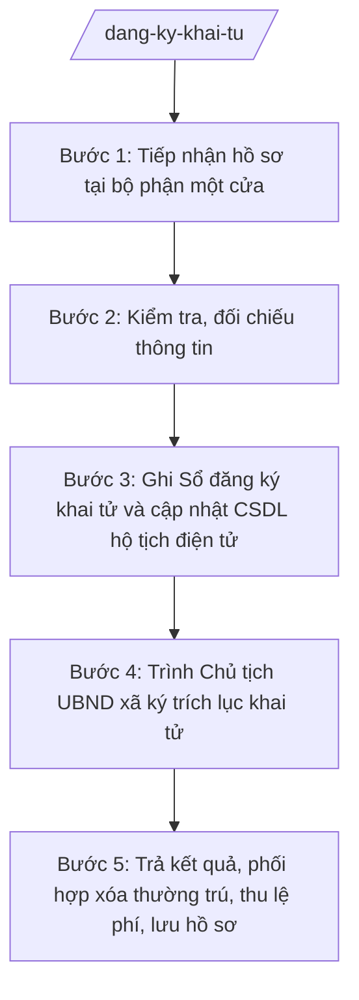

# Skill: Đăng ký khai tử

## 2. Khi nào dùng
- Thân nhân người đã chết đến bộ phận một cửa nộp Tờ khai đăng ký khai tử kèm giấy báo tử hoặc giấy tờ chứng minh việc chết.
- Cần kiểm tra thời hạn đăng ký khai tử, đối chiếu thông tin người chết với sổ hộ khẩu/CSDL cư trú.
- Cần ghi Sổ đăng ký khai tử, cập nhật CSDL hộ tịch điện tử và trình Chủ tịch UBND xã ký trích lục khai tử.
- Cần phối hợp với công an xã để xóa đăng ký thường trú của người đã chết; trả kết quả và thu lệ phí.

## 3. Đầu vào (Input)

| Trường | Mô tả | Bắt buộc |
|--------|-------|----------|
| `to_khai` | Tờ khai đăng ký khai tử (người đi khai ký tên) | Có |
| `giay_bao_tu` | Giấy báo tử của cơ sở y tế hoặc giấy tờ chứng minh việc chết (biên bản, quyết định tuyên bố chết của Tòa án...) | Có |
| `giay_to_nguoi_chet` | Giấy tờ tùy thân của người đã chết (nếu có) | Không |
| `giay_to_nguoi_di_khai` | CCCD/hộ chiếu của người đi đăng ký khai tử | Có |
| `ngay_chet` | Ngày, tháng, năm chết; nguyên nhân chết (theo giấy báo tử) | Có |
| `noi_chet` | Nơi chết (ghi theo giấy báo tử) | Có |
| `dang_ky_qua_han` | Đúng hạn / quá hạn đăng ký khai tử | Có |
| `nguoi_yeu_cau` | Họ tên người đi đăng ký và quan hệ với người đã chết | Có |

## 4. Quy trình

**Bước 1. Tiếp nhận hồ sơ tại bộ phận một cửa**
- Làm gì: Tiếp nhận Tờ khai đăng ký khai tử và giấy tờ kèm theo; kiểm tra hình thức giấy tờ; cấp Giấy tiếp nhận hồ sơ và hẹn trả kết quả.
- Dùng input: `to_khai`, `giay_bao_tu`, `giay_to_nguoi_chet`, `giay_to_nguoi_di_khai`, `nguoi_yeu_cau`
- Vai trò: Công chức Tư pháp – Hộ tịch (hoặc công chức bộ phận một cửa) tiếp nhận. AI hỗ trợ kiểm tra danh mục giấy tờ còn thiếu và soạn Giấy tiếp nhận, Giấy hẹn trả kết quả ⏱ ~15 phút/hồ sơ (ước tính).
- Lưu ý nghiệp vụ: Trường hợp chết do tai nạn, án mạng phải có văn bản của cơ quan công an; trường hợp Tòa án tuyên bố chết phải có bản án/quyết định có hiệu lực. Không tiếp nhận hồ sơ khi chưa rõ nguyên nhân chết theo quy định.
- → Kết quả bước: Giấy tiếp nhận hồ sơ + Giấy hẹn trả kết quả đã giao; hồ sơ chuyển công chức Tư pháp – Hộ tịch thụ lý.

**Bước 2. Kiểm tra, đối chiếu thông tin**
- Làm gì: Đối chiếu Tờ khai với Giấy báo tử và giấy tờ của người đã chết; xác minh người chết có đăng ký thường trú/tạm trú tại xã không; xác định đăng ký đúng hạn hay quá hạn.
- Dùng input: `to_khai`, `giay_bao_tu`, `giay_to_nguoi_chet`, `ngay_chet`, `noi_chet`, `dang_ky_qua_han`
- Vai trò: Công chức Tư pháp – Hộ tịch thẩm định. AI hỗ trợ đối chiếu chéo thông tin, tra cứu CSDL cư trú và cảnh báo sai lệch họ tên, ngày sinh, ngày chết ⏱ ~30 phút/hồ sơ (ước tính).
- Lưu ý nghiệp vụ: Lỗi thường gặp: ngày chết trên Tờ khai khác Giấy báo tử; họ tên người chết không khớp giấy tờ tùy thân. Nếu người chết không cư trú tại xã, hướng dẫn đăng ký tại nơi chết hoặc nơi cư trú cuối cùng theo quy định.
- → Kết quả bước: Hồ sơ đạt yêu cầu, hoặc Phiếu yêu cầu bổ sung đã gửi người dân.

**Bước 3. Ghi Sổ đăng ký khai tử và cập nhật CSDL hộ tịch điện tử**
- Làm gì: Ghi đầy đủ nội dung vào Sổ đăng ký khai tử (sổ giấy); nhập liệu lên CSDL hộ tịch điện tử; ghi chú việc đăng ký khai tử vào các giấy tờ hộ tịch liên quan của người đã chết (nếu có).
- Dùng input: toàn bộ thông tin đã kiểm tra ở Bước 2 (họ tên, ngày sinh, giới tính, dân tộc, quốc tịch, nơi cư trú cuối cùng, ngày chết, nơi chết, nguyên nhân chết, thông tin người đi khai)
- Vai trò: Công chức Tư pháp – Hộ tịch thực hiện ghi sổ và nhập liệu. AI hỗ trợ đối chiếu sổ giấy – CSDL và soạn dự thảo trích lục khai tử ⏱ ~30 phút/hồ sơ (ước tính).
- Lưu ý nghiệp vụ: Ghi sổ rõ ràng, không tẩy xóa; nguyên nhân chết ghi đúng theo Giấy báo tử, không suy diễn. Số liệu sổ giấy và CSDL phải khớp nhau.
- → Kết quả bước: Sổ đăng ký khai tử đã ghi; CSDL hộ tịch điện tử đã cập nhật; dự thảo trích lục khai tử đã soạn.

**Bước 4. Trình Chủ tịch UBND xã ký trích lục khai tử**
- Làm gì: Tổng hợp hồ sơ, dự thảo trích lục khai tử trình Chánh Văn phòng kiểm tra thể thức, sau đó trình Chủ tịch UBND xã ký, đóng dấu.
- Dùng input: dự thảo trích lục khai tử, hồ sơ gốc từ các bước trước
- Vai trò: Chánh Văn phòng HĐND và UBND kiểm tra thể thức, tính hợp lệ (15 phút); Chủ tịch UBND xã ký trích lục khai tử. AI hỗ trợ kiểm tra thể thức theo NĐ 30/2020/NĐ-CP và lập phiếu trình ký ⏱ ~0,5 ngày làm việc chờ ký (ước tính).
- Lưu ý nghiệp vụ: Chỉ Chủ tịch UBND xã (hoặc người được ủy quyền hợp pháp) ký trích lục khai tử. Kiểm tra kỹ số, ký hiệu, ngày tháng trước khi đóng dấu.
- → Kết quả bước: Trích lục khai tử đã được Chủ tịch UBND xã ký và đóng dấu UBND xã.

**Bước 5. Trả kết quả, phối hợp xóa thường trú, thu lệ phí, lưu hồ sơ**
- Làm gì: Trả trích lục khai tử cho người đi đăng ký theo Giấy hẹn; gửi thông báo cho công an xã để xóa đăng ký thường trú của người đã chết; thu lệ phí theo quy định; lưu hồ sơ.
- Dùng input: trích lục khai tử đã ký, Giấy hẹn trả kết quả
- Vai trò: Công chức Tư pháp – Hộ tịch trả kết quả, gửi văn bản phối hợp cho công an xã. AI hỗ trợ soạn văn bản đề nghị xóa đăng ký thường trú, Sổ theo dõi trả kết quả và biên lai thu lệ phí ⏱ ~30 phút/hồ sơ (ước tính).
- Lưu ý nghiệp vụ: Văn bản gửi công an xã phải ghi rõ họ tên, ngày sinh, số định danh cá nhân của người đã chết để xóa thường trú chính xác. Trả đúng người có tên trên Giấy hẹn. Hồ sơ lưu trữ đánh số theo năm.
- → Kết quả bước: Người dân đã nhận trích lục khai tử; công an xã đã nhận văn bản đề nghị xóa thường trú; lệ phí đã thu; hồ sơ lưu đầy đủ.

## Luồng quy trình (Workflow)

## 5. Đầu ra (Output)

Sản phẩm:
- Trích lục khai tử — giao người dân
- Sổ đăng ký khai tử (sổ giấy) đã ghi — lưu tại UBND xã
- Dữ liệu đăng ký khai tử trên CSDL hộ tịch điện tử — đồng bộ hệ thống
- Văn bản đề nghị công an xã xóa đăng ký thường trú — gửi công an xã
- Biên lai thu lệ phí, Sổ theo dõi trả kết quả — lưu hồ sơ

### Cấu trúc output chuẩn

Khung Trích lục khai tử gồm các phần theo đúng thứ tự, đúng thể thức NĐ 30/2020/NĐ-CP:
1. Quốc hiệu "CỘNG HÒA XÃ HỘI CHỦ NGHĨA VIỆT NAM" — Tiêu ngữ "Độc lập – Tự do – Hạnh phúc"
2. Số trích lục / ký hiệu sổ đăng ký
3. Tên cơ quan cấp: "ỦY BAN NHÂN DÂN XÃ A, TỈNH A"
4. Tên loại văn bản: "TRÍCH LỤC KHAI TỬ" (chữ in hoa, cỡ lớn)
5. Nội dung: họ, chữ đệm và tên người đã chết; ngày, tháng, năm sinh; giới tính; dân tộc; quốc tịch; nơi cư trú cuối cùng; số định danh cá nhân; ngày, tháng, năm chết; nơi chết; nguyên nhân chết
6. Địa danh, ngày, tháng, năm cấp trích lục
7. Người đi đăng ký khai tử ký, ghi rõ họ tên
8. Chữ ký: "TM. ỦY BAN NHÂN DÂN / CHỦ TỊCH" + chữ ký + họ tên Chủ tịch UBND xã, đóng dấu UBND xã
9. Phân phối: Trích lục khai tử giao người đi đăng ký; lưu sổ đăng ký khai tử + cập nhật CSDL hộ tịch điện tử.

## 6. Checklist nghiệm thu
- [ ] Hồ sơ có đủ Tờ khai đăng ký khai tử + Giấy báo tử (hoặc giấy tờ chứng minh việc chết hợp lệ) + giấy tờ người đi khai
- [ ] Thông tin người chết trên trích lục khớp với Giấy báo tử và giấy tờ tùy thân
- [ ] Đã ghi đầy đủ vào Sổ đăng ký khai tử (sổ giấy), không tẩy xóa sai quy định
- [ ] Dữ liệu trên CSDL hộ tịch điện tử khớp với sổ giấy
- [ ] Trích lục khai tử do Chủ tịch UBND xã ký, đóng dấu đúng quy định
- [ ] Thể thức văn bản đúng NĐ 30/2020/NĐ-CP
- [ ] Đã gửi văn bản đề nghị công an xã xóa đăng ký thường trú, ghi đúng số định danh cá nhân
- [ ] Đã trả kết quả đúng hẹn, thu lệ phí đúng mức, có biên lai
- [ ] Không có dữ liệu, căn cứ pháp lý nào do AI bịa ra
- [ ] Đã qua human gate: công chức soạn → Chánh Văn phòng kiểm tra → Chủ tịch UBND xã ký duyệt

## 7. Ví dụ mô phỏng

*Dữ liệu dưới đây là giả lập 100% phục vụ minh họa.*

### Input mẫu
- to_khai: Tờ khai đăng ký khai tử của bà Trần Thị Dân (con gái) cho cha là ông Nguyễn Văn Dân
- giay_bao_tu: Giấy báo tử số 123/GBT do Trạm Y tế xã A cấp ngày 02/10/2026 (nguyên nhân: tuổi cao, sức yếu)
- giay_to_nguoi_chet: CCCD của ông Nguyễn Văn Dân
- giay_to_nguoi_di_khai: CCCD của bà Trần Thị Dân
- ngay_chet: 01/10/2026 — nguyên nhân: tuổi cao, sức yếu
- noi_chet: Tại nhà riêng, thôn B, xã A, tỉnh A
- dang_ky_qua_han: Đúng hạn
- nguoi_yeu_cau: Bà Trần Thị Dân — con gái của người đã chết

### Output mẫu

**TRÍCH LỤC KHAI TỬ**

CỘNG HÒA XÃ HỘI CHỦ NGHĨA VIỆT NAM
Độc lập – Tự do – Hạnh phúc

Số: 123/TLKT-UBND

ỦY BAN NHÂN DÂN XÃ A, TỈNH A

**TRÍCH LỤC KHAI TỬ**

Họ, chữ đệm và tên người đã chết: Nguyễn Văn Dân
Ngày, tháng, năm sinh: 01/01/1946 — Giới tính: Nam — Dân tộc: Kinh — Quốc tịch: Việt Nam
Nơi cư trú cuối cùng: Thôn B, xã A, tỉnh A
Số định danh cá nhân: 001046001234
Ngày, tháng, năm chết: 01/10/2026 — Nơi chết: Tại nhà riêng, thôn B, xã A, tỉnh A
Nguyên nhân chết: Tuổi cao, sức yếu

Xã A, ngày 05 tháng 10 năm 2026
Người đi đăng ký khai tử: (ký, ghi rõ họ tên) Trần Thị Dân

TM. ỦY BAN NHÂN DÂN
CHỦ TỊCH
(ký, đóng dấu)
Nguyễn Văn A

## 8. Human gate
Công chức Tư pháp – Hộ tịch soạn hồ sơ và dự thảo trích lục khai tử → Chánh Văn phòng HĐND và UBND kiểm tra tính hợp lệ, thể thức → Chủ tịch UBND xã ký trích lục khai tử trước khi trả cho người dân. AI chỉ hỗ trợ soạn thảo và kiểm tra chéo, không ký thay, không quyết định thay người có thẩm quyền.

## 9. Giới hạn
AI tuyệt đối KHÔNG: ra quyết định hành chính thay Chủ tịch UBND xã; tự ký hoặc phát hành trích lục khai tử; bịa ngày chết, nguyên nhân chết, số giấy báo tử, căn cứ pháp lý; dùng biểu mẫu, văn bản đã hết hiệu lực; tư vấn vượt thẩm quyền cấp xã.

## 10. Căn cứ & lưu ý
- TT 09/2025/TT-BTP (hướng dẫn chức năng, nhiệm vụ lĩnh vực tư pháp của Văn phòng HĐND & UBND cấp xã; hiệu lực 01/7/2025)
- Luật Hộ tịch
- NĐ 30/2020/NĐ-CP (thể thức văn bản hành chính)
- NĐ 118/2025/NĐ-CP (cơ chế một cửa)
- Lưu ý: đăng ký khai tử phải thực hiện trong thời hạn theo quy định; sau khi cấp trích lục phải phối hợp công an xã xóa đăng ký thường trú của người đã chết.
