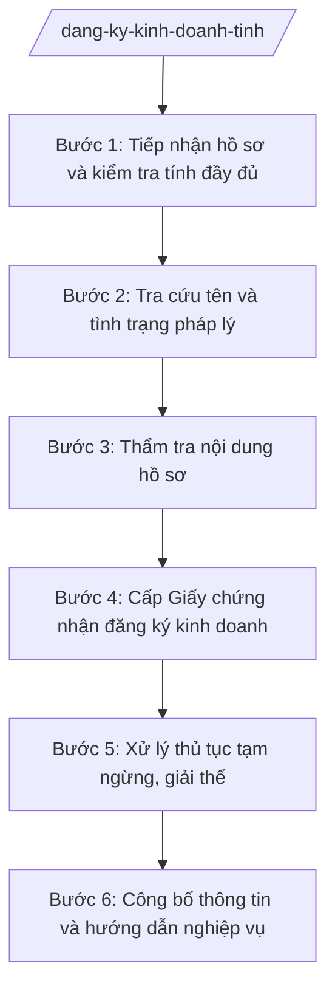

# Skill: Đăng ký kinh doanh

## 2. Khi nào dùng

- Doanh nghiệp, hộ kinh doanh nộp hồ sơ đăng ký thành lập mới;
- Doanh nghiệp nộp hồ sơ thay đổi nội dung đăng ký (tên, địa chỉ, vốn điều lệ, người đại diện theo pháp luật, ngành nghề...);
- Doanh nghiệp làm thủ tục tạm ngừng kinh doanh, giải thể, chấm dứt hoạt động chi nhánh/văn phòng đại diện;
- Cần cấp lại, hiệu đính Giấy chứng nhận đăng ký kinh doanh;
- Cần hướng dẫn, giải đáp vướng mắc về đăng ký kinh doanh cho tổ chức, cá nhân và UBND cấp xã.

## 3. Đầu vào (Input)

| Trường | Mô tả | Bắt buộc |
|--------|-------|----------|
| `loai_thu_tuc` | Loại thủ tục: thành lập mới / thay đổi nội dung / tạm ngừng / giải thể / cấp lại | Có |
| `ho_so_dkkd` | Hồ sơ đăng ký kinh doanh do tổ chức/cá nhân nộp (giấy đề nghị, điều lệ, danh sách thành viên...) | Có |
| `thong_tin_chu_the` | Thông tin chủ thể: tên, địa chỉ trụ sở, người đại diện theo pháp luật, vốn | Có |
| `ket_qua_tra_cuu` | Kết quả tra cứu tên doanh nghiệp, tình trạng pháp lý trên Hệ thống thông tin ĐKDN | Không |
| `phi_le_phi` | Chứng từ nộp phí, lệ phí đăng ký kinh doanh | Có |

## 4. Quy trình

**Bước 1. Tiếp nhận hồ sơ và kiểm tra tính đầy đủ**
- Làm gì: Tiếp nhận hồ sơ đăng ký kinh doanh (trực tiếp tại Trung tâm PVHCC tỉnh hoặc trực tuyến); kiểm tra thành phần hồ sơ theo từng loại thủ tục; cấp giấy biên nhận, hẹn ngày trả kết quả; yêu cầu bổ sung nếu thiếu.
- Dùng input: `loai_thu_tuc`, `ho_so_dkkd`.
- Vai trò: Chuyên viên Phòng Đăng ký kinh doanh tiếp nhận, AI hỗ trợ lập checklist thành phần hồ sơ theo loại thủ tục và phiếu hẹn trả kết quả; ⏱ ~0 (ước tính),5 ngày làm việc.
- Lưu ý nghiệp vụ: Không từ chối tiếp nhận hồ sơ khi chưa kiểm tra kỹ thành phần; mọi yêu cầu bổ sung phải nêu rõ một lần, bằng văn bản.
- → Kết quả bước: Giấy biên nhận hồ sơ + phiếu hẹn trả kết quả (hoặc văn bản yêu cầu bổ sung).

**Bước 2. Tra cứu tên và tình trạng pháp lý**
- Làm gì: Tra cứu tên doanh nghiệp đề xuất trên Hệ thống thông tin đăng ký kinh doanh để kiểm tra trùng, gây nhầm lẫn; tra cứu tình trạng pháp lý của doanh nghiệp (đối với thủ tục thay đổi, tạm ngừng, giải thể).
- Dùng input: `thong_tin_chu_the`, `ket_qua_tra_cuu`.
- Vai trò: Chuyên viên Phòng Đăng ký kinh doanh tra cứu, AI hỗ trợ đối chiếu tên đề xuất với cơ sở dữ liệu, liệt kê các tên tương tự có nguy cơ gây nhầm lẫn; ⏱ ~0 (ước tính),5 ngày làm việc.
- Lưu ý nghiệp vụ: Tên doanh nghiệp không được trùng hoặc gây nhầm lẫn với tên đã đăng ký; doanh nghiệp đang trong tình trạng pháp lý "tạm ngừng", "giải thể" thì không giải quyết thủ tục thay đổi.
- → Kết quả bước: Kết quả tra cứu tên và tình trạng pháp lý, có kết luận đạt/không đạt.

**Bước 3. Thẩm tra nội dung hồ sơ**
- Làm gì: Thẩm tra tính hợp lệ, hợp pháp của từng tài liệu trong hồ sơ: giấy đề nghị, điều lệ, danh sách thành viên/cổ đông, giấy tờ pháp lý của cá nhân, tổ chức; kiểm tra ngành nghề kinh doanh có điều kiện; kiểm tra tính thống nhất thông tin giữa các tài liệu.
- Dùng input: `ho_so_dkkd`, `thong_tin_chu_the`.
- Vai trò: Chuyên viên Phòng Đăng ký kinh doanh thẩm tra, AI hỗ trợ đối chiếu chéo thông tin giữa các tài liệu, cảnh báo điểm chưa thống nhất; ⏱ ~1–2 ngày làm việc (ước tính).
- Lưu ý nghiệp vụ: Ngành nghề kinh doanh có điều kiện phải có tài liệu chứng minh đáp ứng điều kiện theo quy định; thông tin không thống nhất thì yêu cầu giải trình, hiệu đính.
- → Kết quả bước: Phiếu thẩm tra hồ sơ với kết luận hợp lệ/cần bổ sung.

**Bước 4. Cấp Giấy chứng nhận đăng ký kinh doanh**
- Làm gì: Đối với hồ sơ hợp lệ: soạn thảo, trình ký Giấy chứng nhận đăng ký kinh doanh (thành lập mới) hoặc Giấy xác nhận thay đổi nội dung đăng ký; cập nhật thông tin vào Cơ sở dữ liệu quốc gia về đăng ký kinh doanh; trả kết quả cho tổ chức/cá nhân đúng hẹn.
- Dùng input: Kết quả Bước 2, Bước 3; `phi_le_phi`.
- Vai trò: Chuyên viên soạn thảo, Trưởng phòng Đăng ký kinh doanh kiểm tra, Giám đốc Sở (hoặc người được ủy quyền) ký Giấy chứng nhận; AI hỗ trợ soạn thảo mẫu giấy chứng nhận, kiểm tra thông tin in trên giấy; ⏱ ~1 ngày làm việc (ước tính).
- Lưu ý nghiệp vụ: Chỉ cấp Giấy chứng nhận khi hồ sơ hợp lệ và đã nộp đủ phí, lệ phí; thông tin trên Giấy chứng nhận phải khớp tuyệt đối với hồ sơ đã thẩm tra.
- → Kết quả bước: Giấy chứng nhận đăng ký kinh doanh (hoặc Giấy xác nhận thay đổi) đã ký, trả cho người nộp.

**Bước 5. Xử lý thủ tục tạm ngừng, giải thể**
- Làm gì: (Áp dụng khi `loai_thu_tuc` là tạm ngừng/giải thể) Kiểm tra điều kiện tạm ngừng/giải thể (đã hoàn thành nghĩa vụ thuế, không có tranh chấp...); phối hợp cơ quan thuế xác nhận; cập nhật tình trạng pháp lý; công bố thông tin theo quy định.
- Dùng input: `ho_so_dkkd`, `thong_tin_chu_the`.
- Vai trò: Chuyên viên Phòng Đăng ký kinh doanh xử lý, phối hợp cơ quan thuế; AI hỗ trợ lập danh mục kiểm tra điều kiện giải thể; ⏱ ~2–3 ngày làm việc (ước tính).
- Lưu ý nghiệp vụ: Không giải quyết giải thể khi doanh nghiệp chưa hoàn thành nghĩa vụ thuế hoặc đang có tranh chấp tại Tòa án; phải công bố tình trạng pháp lý công khai.
- → Kết quả bước: Thông báo chấp thuận tạm ngừng / Giấy xác nhận giải thể, cập nhật CSDL.

**Bước 6. Công bố thông tin và hướng dẫn nghiệp vụ**
- Làm gì: Công bố nội dung đăng ký kinh doanh theo quy định; hướng dẫn, giải đáp vướng mắc về đăng ký kinh doanh cho tổ chức, cá nhân và UBND cấp xã; tổng hợp, báo cáo tình hình đăng ký kinh doanh trên địa bàn tỉnh theo định kỳ.
- Dùng input: Số liệu đăng ký kinh doanh phát sinh trong kỳ.
- Vai trò: Chuyên viên Phòng Đăng ký kinh doanh thực hiện, AI hỗ trợ tổng hợp số liệu, soạn báo cáo định kỳ; ⏱ ~theo kỳ báo cáo. (ước tính)
- Lưu ý nghiệp vụ: Thông tin công bố phải chính xác, kịp thời; định vị cấp tỉnh là cơ quan đăng ký kinh doanh đối với doanh nghiệp — hộ kinh doanh do cấp xã giải quyết theo phân cấp.
- → Kết quả bước: Thông tin đăng ký đã công bố + báo cáo định kỳ tình hình ĐKKD.

## Luồng quy trình (Workflow)

## 5. Đầu ra (Output)

- Giấy biên nhận hồ sơ và phiếu hẹn trả kết quả;
- Phiếu thẩm tra hồ sơ đăng ký kinh doanh;
- Giấy chứng nhận đăng ký kinh doanh (thành lập mới) hoặc Giấy xác nhận thay đổi nội dung đăng ký (đã ký);
- Thông báo chấp thuận tạm ngừng kinh doanh / Giấy xác nhận giải thể (nếu có);
- Văn bản yêu cầu bổ sung, hiệu đính hồ sơ (nếu hồ sơ chưa hợp lệ);
- Báo cáo định kỳ tình hình đăng ký kinh doanh trên địa bàn tỉnh.

**Cấu trúc output chuẩn (Giấy chứng nhận đăng ký kinh doanh — nội dung chính):**
- Thể thức: tuân thủ Nghị định 30/2020/NĐ-CP về công tác văn thư.

1. Quốc hiệu "CỘNG HÒA XÃ HỘI CHỦ NGHĨA VIỆT NAM", Tiêu ngữ "Độc lập – Tự do – Hạnh phúc";
2. Tên cơ quan cấp: SỞ TÀI CHÍNH TỈNH A — PHÒNG ĐĂNG KÝ KINH DOANH; số Giấy chứng nhận; ngày cấp;
3. Tên doanh nghiệp (tiếng Việt, tiếng nước ngoài, tên viết tắt);
4. Địa chỉ trụ sở chính;
5. Ngành, nghề kinh doanh;
6. Vốn điều lệ; thông tin thành viên/cổ đông sáng lập (loại hình tương ứng);
7. Người đại diện theo pháp luật (họ tên, chức danh);
8. Thẩm quyền, chức vụ, họ tên người ký: TUQ. GIÁM ĐỐC — TRƯỞNG PHÒNG ĐĂNG KÝ KINH DOANH — (chữ ký, họ tên), dấu của cơ quan.
- Nơi nhận: liệt kê các cơ quan, đơn vị nhận để biết/thực hiện; kết thúc bằng "- Lưu: VT, [mã đơn vị]".

> **Checklist thể thức văn bản theo NĐ 30/2020/NĐ-CP** — đối chiếu trước khi trình ký:
> 1. Quốc hiệu và Tiêu ngữ.
> 2. Tên cơ quan, tổ chức ban hành văn bản.
> 3. Số, ký hiệu của văn bản.
> 4. Địa danh và thời gian ban hành văn bản.
> 5. Tên loại và trích yếu nội dung văn bản.
> 6. Nội dung văn bản.
> 7. Chức vụ, họ tên và chữ ký của người có thẩm quyền.
> 8. Dấu, chữ ký số của cơ quan, tổ chức.
> 9. Nơi nhận (kèm Phụ lục nếu có).

## 6. Checklist nghiệm thu

- [ ] Hồ sơ được tiếp nhận có giấy biên nhận, hẹn trả kết quả đúng quy định;
- [ ] Đã tra cứu tên doanh nghiệp, không trùng hoặc gây nhầm lẫn;
- [ ] Hồ sơ được thẩm tra đầy đủ, có phiếu thẩm tra với kết luận rõ ràng;
- [ ] Ngành nghề có điều kiện đã được kiểm tra tài liệu chứng minh;
- [ ] Giấy chứng nhận chỉ cấp khi hồ sơ hợp lệ và đã nộp đủ phí, lệ phí;
- [ ] Thông tin trên Giấy chứng nhận khớp tuyệt đối với hồ sơ đã thẩm tra;
- [ ] Đã cập nhật Cơ sở dữ liệu quốc gia về đăng ký kinh doanh và công bố thông tin;
- [ ] Trả kết quả đúng hẹn; văn bản yêu cầu bổ sung (nếu có) nêu rõ một lần;
- [ ] Căn cứ pháp lý đúng văn bản còn hiệu lực, không bịa số hiệu;
- [ ] Thông tin doanh nghiệp dựa trên hồ sơ thật, AI không tự bịa.

## 7. Ví dụ mô phỏng

*Dữ liệu dưới đây là giả lập 100% phục vụ minh họa.*

### Input mẫu

| Trường | Giá trị giả lập |
|--------|-----------------|
| loai_thu_tuc | Thành lập mới |
| ho_so_dkkd | Giấy đề nghị đăng ký doanh nghiệp + Điều lệ + Danh sách thành viên (giả lập) |
| thong_tin_chu_the | Tên dự kiến: Công ty TNHH ABC (giả lập); địa chỉ: Số 123 đường B, xã A, tỉnh A; vốn điều lệ: 10 tỷ đồng |
| ket_qua_tra_cuu | Tên không trùng, không gây nhầm lẫn (giả lập) |
| phi_le_phi | Biên lai nộp lệ phí đăng ký kinh doanh (giả lập) |

### Output mẫu (Giấy chứng nhận — trích nội dung chính)

> **CỘNG HÒA XÃ HỘI CHỦ NGHĨA VIỆT NAM**
> **Độc lập – Tự do – Hạnh phúc**
>
> **SỞ TÀI CHÍNH TỈNH A — PHÒNG ĐĂNG KÝ KINH DOANH**
> **GIẤY CHỨNG NHẬN ĐĂNG KÝ DOANH NGHIỆP**
> Số: 1234567890 (giả lập) — Đăng ký lần đầu ngày 15 tháng 3 năm 2027
>
> 1. Tên công ty viết bằng tiếng Việt: CÔNG TY TNHH ABC (giả lập)
> 2. Địa chỉ trụ sở chính: Số 123 đường B, xã A, tỉnh A (giả lập)
> 3. Ngành, nghề kinh doanh: ... (theo hồ sơ)
> 4. Vốn điều lệ: 10.000.000.000 đồng
> 5. Người đại diện theo pháp luật: ... (theo hồ sơ)
>
> **TUQ. GIÁM ĐỐC**
> **TRƯỞNG PHÒNG ĐĂNG KÝ KINH DOANH**
> *(ký, đóng dấu)*

## 8. Human gate

1. Chuyên viên Phòng Đăng ký kinh doanh tiếp nhận, tra cứu, thẩm tra hồ sơ (Bước 1–3);
2. Trưởng phòng Đăng ký kinh doanh kiểm tra phiếu thẩm tra và dự thảo Giấy chứng nhận (Bước 4);
3. Giám đốc Sở Tài chính (hoặc người được ủy quyền) ký Giấy chứng nhận đăng ký kinh doanh (Bước 4);
4. Mọi từ chối cấp Giấy chứng nhận phải bằng văn bản nêu rõ lý do — không từ chối miệng.

## 9. Giới hạn

- AI KHÔNG quyết định cấp hay từ chối cấp Giấy chứng nhận thay người có thẩm quyền;
- AI KHÔNG tự ký, tự phát hành Giấy chứng nhận hay bất kỳ văn bản nào;
- AI KHÔNG bịa thông tin doanh nghiệp, kết quả tra cứu tên;
- AI KHÔNG bịa căn cứ pháp lý, không trích dẫn văn bản đã hết hiệu lực;
- AI KHÔNG "làm nhanh", "bỏ qua" bước thẩm tra hồ sơ để cấp Giấy chứng nhận.

## 10. Căn cứ & lưu ý

- Thông tư 57/2025/TT-BTC hướng dẫn chức năng, nhiệm vụ, quyền hạn của Sở Tài chính và lĩnh vực tài chính – kế hoạch của phòng chuyên môn thuộc UBND cấp xã;
- Luật Doanh nghiệp (chỉ nêu tên luật, không kèm số hiệu);
- Nghị định 150/2025/NĐ-CP về tổ chức cơ quan chuyên môn thuộc UBND cấp tỉnh, cấp xã;
- Nghị định 30/2020/NĐ-CP về công tác văn thư (chỉ dùng cho thể thức văn bản);
- Lưu ý: Phòng Đăng ký kinh doanh thuộc Sở Tài chính thực hiện đăng ký kinh doanh đối với doanh nghiệp; hộ kinh doanh do UBND cấp xã giải quyết theo phân cấp; mọi thông tin đăng ký phải được cập nhật vào Cơ sở dữ liệu quốc gia về đăng ký kinh doanh.
