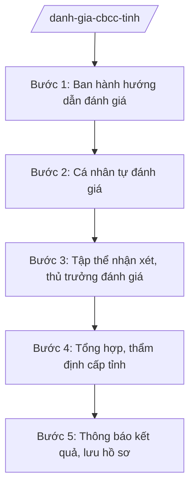

# Skill: Đánh giá, xếp loại CBCCVC

## 2. Khi nào dùng
- Đánh giá, xếp loại CBCCVC hằng năm (cuối năm).
- Đánh giá trước khi quy hoạch, bổ nhiệm, khen thưởng.
- Sở Nội vụ tổng hợp, báo cáo kết quả đánh giá toàn tỉnh.

## 3. Đầu vào (Input)
| Trường | Mô tả | Bắt buộc |
|--------|-------|----------|
| `nam_danh_gia` | Năm đánh giá | Có |
| `tieu_chi_danh_gia` | Tiêu chí đánh giá theo quy định và của tỉnh | Có |
| `ban_tu_danh_gia` | Bản tự đánh giá của cá nhân | Có |
| `nhan_xet_danh_gia` | Nhận xét của tập thể, thủ trưởng đơn vị | Có |
| `ket_qua_thuc_hien_nv` | Kết quả thực hiện nhiệm vụ trong năm | Có |

## 4. Quy trình

**Bước 1. Ban hành hướng dẫn đánh giá**
- Làm gì: Sở Nội vụ ban hành văn bản hướng dẫn đánh giá, xếp loại năm: tiêu chí, thang điểm, mức xếp loại, tiến độ.
- Dùng input: `nam_danh_gia`, `tieu_chi_danh_gia`
- Vai trò: Chuyên viên Phòng Công chức, viên chức soạn; AI hỗ trợ soạn hướng dẫn ⏱ ~2 ngày làm việc (ước tính)
- Lưu ý nghiệp vụ: Tiêu chí phải cụ thể, đo được; phân biệt rõ 4 mức: hoàn thành xuất sắc / tốt / hoàn thành / không hoàn thành nhiệm vụ.
- → Kết quả bước: Văn bản hướng dẫn đánh giá năm.

**Bước 2. Cá nhân tự đánh giá**
- Làm gì: CBCCVC viết bản tự đánh giá theo tiêu chí: kết quả thực hiện nhiệm vụ, phẩm chất, năng lực.
- Dùng input: `ban_tu_danh_gia`, `ket_qua_thuc_hien_nv`
- Vai trò: Cá nhân tự đánh giá; AI hỗ trợ gợi ý cấu trúc bản tự đánh giá (không viết thay nội dung) ⏱ ~2 ngày làm việc (ước tính)
- Lưu ý nghiệp vụ: Tự đánh giá phải trung thực, gắn với kết quả công việc cụ thể, có minh chứng.
- → Kết quả bước: Bản tự đánh giá của cá nhân.

**Bước 3. Tập thể nhận xét, thủ trưởng đánh giá**
- Làm gì: Tổ chức họp tập thể góp ý; thủ trưởng đơn vị nhận xét, xếp loại sơ bộ từng cá nhân.
- Dùng input: `ban_tu_danh_gia`, `nhan_xet_danh_gia`
- Vai trò: Thủ trưởng đơn vị chủ trì; AI hỗ trợ tổng hợp ý kiến ⏱ ~3 ngày làm việc (ước tính)
- Lưu ý nghiệp vụ: Đánh giá dân chủ nhưng phải công bằng; tỷ lệ xuất sắc không vượt khung quy định.
- → Kết quả bước: Kết quả đánh giá, xếp loại của đơn vị.

**Bước 4. Tổng hợp, thẩm định cấp tỉnh**
- Làm gì: Sở Nội vụ tổng hợp kết quả các cơ quan, đơn vị; thẩm định các trường hợp xuất sắc, không hoàn thành; báo cáo UBND tỉnh.
- Dùng input: Kết quả đánh giá các đơn vị
- Vai trò: Chuyên viên Sở Nội vụ tổng hợp; AI hỗ trợ lập bảng tổng hợp toàn tỉnh, phát hiện bất thường ⏱ ~5 ngày làm việc (ước tính)
- Lưu ý nghiệp vụ: Kiểm tra tỷ lệ các mức xếp loại; xác minh các trường hợp khiếu nại về kết quả đánh giá.
- → Kết quả bước: Báo cáo tổng hợp đánh giá CBCCVC toàn tỉnh.

**Bước 5. Thông báo kết quả, lưu hồ sơ**
- Làm gì: Thông báo kết quả đến cá nhân; lưu hồ sơ đánh giá; sử dụng kết quả cho quy hoạch, bổ nhiệm, khen thưởng, tinh giản biên chế.
- Dùng input: Báo cáo tổng hợp Bước 4
- Vai trò: Đơn vị thông báo; AI hỗ trợ lập danh sách theo mức xếp loại ⏱ ~2 ngày làm việc (ước tính)
- Lưu ý nghiệp vụ: Cá nhân có quyền khiếu nại kết quả; hồ sơ đánh giá là tài liệu mật quản lý theo quy định.
- → Kết quả bước: Kết quả đánh giá đã thông báo; hồ sơ lưu trữ.

## Luồng quy trình (Workflow)

## 5. Đầu ra (Output)
- Văn bản hướng dẫn đánh giá năm.
- Báo cáo tổng hợp kết quả đánh giá CBCCVC toàn tỉnh.
- Danh sách xếp loại theo mức.

**Cấu trúc output chuẩn:**
- Thể thức: tuân thủ Nghị định 30/2020/NĐ-CP về công tác văn thư.
Khung báo cáo tổng hợp đánh giá:
1. Quốc hiệu "CỘNG HÒA XÃ HỘI CHỦ NGHĨA VIỆT NAM", Tiêu ngữ "Độc lập – Tự do – Hạnh phúc"; số, ký hiệu; địa danh, ngày tháng năm.
2. Tên: "BÁO CÁO kết quả đánh giá, xếp loại cán bộ, công chức, viên chức năm ... tỉnh A".
3. Kết quả chung toàn tỉnh (bảng theo mức xếp loại, theo khối).
4. Đánh giá: ưu điểm, tồn tại.
5. Kiến nghị.
6. Chữ ký.
- Nơi nhận: liệt kê các cơ quan, đơn vị nhận để biết/thực hiện; kết thúc bằng "- Lưu: VT, [mã đơn vị]".

> **Checklist thể thức văn bản theo NĐ 30/2020/NĐ-CP** — đối chiếu trước khi trình ký:
> 1. Quốc hiệu và Tiêu ngữ.
> 2. Tên cơ quan, tổ chức ban hành văn bản.
> 3. Số, ký hiệu của văn bản.
> 4. Địa danh và thời gian ban hành văn bản.
> 5. Tên loại và trích yếu nội dung văn bản.
> 6. Nội dung văn bản.
> 7. Chức vụ, họ tên và chữ ký của người có thẩm quyền.
> 8. Dấu, chữ ký số của cơ quan, tổ chức.
> 9. Nơi nhận (kèm Phụ lục nếu có).

## 6. Checklist nghiệm thu
- [ ] Hướng dẫn đánh giá ban hành kịp thời, tiêu chí rõ ràng.
- [ ] 100% CBCCVC có bản tự đánh giá.
- [ ] Tỷ lệ các mức xếp loại trong khung quy định.
- [ ] Tổng hợp đầy đủ các cơ quan, đơn vị.
- [ ] Giải quyết khiếu nại về kết quả (nếu có) đúng quy định.
- [ ] Kết quả được lưu hồ sơ, bảo mật theo quy định.
- [ ] Đã báo cáo UBND tỉnh đúng thời hạn.

## 7. Ví dụ mô phỏng
*Dữ liệu dưới đây là giả lập 100% phục vụ minh họa.*

**Input mẫu:**
- nam_danh_gia: 2026
- Tổng số CBCCVC: 5.000 người (giả lập)
- Kết quả: xuất sắc 15%, tốt 65%, hoàn thành 18%, không hoàn thành 2% (giả lập)

**Output mẫu (trích):**
> **BÁO CÁO**
> **Kết quả đánh giá, xếp loại cán bộ, công chức, viên chức năm 2026 tỉnh A**
>
> 1. Kết quả chung: 5.000 người được đánh giá; hoàn thành xuất sắc 750 người (15%)... (giả lập)
> 2. Đánh giá: ...
> (Dữ liệu giả lập 100% phục vụ minh họa)

## 8. Human gate
- Thủ trưởng đơn vị: nhận xét, xếp loại cá nhân (Bước 3).
- Trưởng phòng Công chức, viên chức (Sở Nội vụ): kiểm tra tổng hợp (Bước 4).
- Giám đốc Sở Nội vụ: ký báo cáo trình UBND tỉnh.

## 9. Giới hạn
- AI không thay con người đánh giá, xếp loại cá nhân cụ thể.
- Không bịa kết quả đánh giá; không tự nâng/hạ mức xếp loại.
- Không tiết lộ kết quả đánh giá cá nhân trái quy định bảo mật.
- Mọi số liệu phải từ báo cáo của đơn vị.

## 10. Căn cứ & lưu ý
- TT 10/2025/TT-BNV; TT 06/2026/TT-BNV (quản lý công chức, viên chức).
- Quy định về đánh giá, xếp loại CBCCVC — dẫn tên, tra cứu bản hiện hành khi áp dụng.
